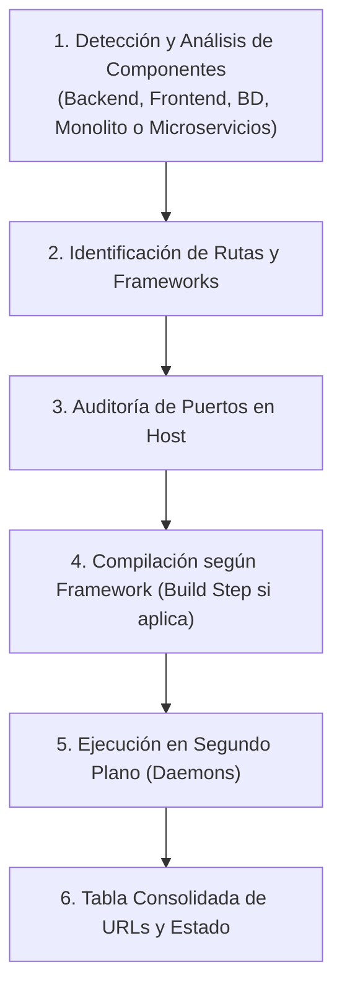

# Orquestador y Compilador Universal de Servidores (/init-servers)

Esta skill actúa como un **compilador y ejecutor agnóstico de servidores**. Su único propósito es **encontrar las rutas de los proyectos, analizar su arquitectura y desplegarlos en tiempo de ejecución**.

> [!IMPORTANT]
> **REGLA DE NO MODIFICACIÓN (READ-ONLY EN CÓDIGO Y CONFIGURACIÓN):**
> Esta skill **NO edita, no altera y no refactoriza ningún archivo de código fuente ni de configuración del proyecto**. Su función es estrictamente de descubrimiento, compilación y lanzamiento de los procesos existentes.

---

## Cuándo Activar Esta Skill
* Invocación explícita del comando `/init-servers`.
* Solicitudes del usuario como: *"arranca los servidores"*, *"compila y levanta el proyecto"*, *"inicia frontend y backend"*, *"despliega los servicios localmente"*.

---

## Flujo de Trabajo

---

### Fase 1: Detección y Clasificación del Proyecto

El agente analiza el repositorio para clasificar qué componentes existen y en qué rutas se ubican:

1. **¿Solo Backend?**: APIs aisladas (Java, Python, PHP, Node/NestJS, Go, .NET, Rust, etc.).
2. **¿Solo Frontend?**: SPAs o sitios web (React, Angular, Vue, Svelte, Vite, Next.js, etc.).
3. **¿Base de Datos / Infraestructura?**: Docker Compose, contenedores de persistencia (PostgreSQL, MySQL, MongoDB, DynamoDB, MinIO, Redis, etc.).
4. **¿Fullstack / Monorepositorio / Microservicios?**: Múltiples carpetas con frontends, backends e infraestructura desacoplada.
5. **¿Variantes o Scripts de Despliegue Existentes?**:
   - Archivos de documentación operativa: `DESPLIEGUE_DEV.md`, `README.md`, `DEPLOY.md`, `Makefile`, `docker-compose.yml`.

---

### Fase 2: Mapeo de Rutas, Frameworks y Comandos de Ejecución

El agente ubica la ruta (`Path`) exacta de cada componente y extrae sus comandos nativos o de contenedor sin modificar nada:

| Componente | Framework / Runtime Detectado | Archivo de Detección | Comando de Compilación | Comando de Ejecución |
| :--- | :--- | :--- | :--- | :--- |
| **Java / Spring Boot** | Maven / Gradle | `pom.xml`, `mvnw.cmd`, `gradlew` | `.\mvnw.cmd compile` | `.\mvnw.cmd spring-boot:run` |
| **NestJS / Express** | Node.js / TypeScript | `package.json`, `tsconfig.json` | `npm run build` (si aplica) | `npm run start:dev` o `npm start` |
| **Angular** | Angular CLI | `angular.json`, `package.json` | `npm run build` | `npm start` (o `npx ng serve`) |
| **React / Vue (Vite)**| Vite / Node.js | `vite.config.*`, `package.json` | `npm run build` | `npm run dev` |
| **Python / FastAPI** | Uvicorn / FastAPI / Django | `main.py`, `requirements.txt`, `pyproject.toml` | - | `python main.py` o `uvicorn main:app --reload` |
| **PHP / Laravel** | Laravel Artisan | `artisan`, `composer.json` | - | `php artisan serve --port XXXX` |
| **Docker / Infra** | Docker Engine | `docker-compose.yml` | `docker-compose build` | `docker-compose up -d` |

---

### Fase 3: Auditoría Rápida de Puertos

Antes de iniciar procesos:
1. Comprobar los puertos en escucha en el sistema (`netstat -ano | findstr LISTENING`).
2. Evitar colisiones si un puerto ya está ocupado por un servicio existente.

---

### Fase 4: Compilación y Lanzamiento de Servicios (Daemons)

1. **Compilación (Build)**:
   - Si un componente requiere build previo antes de su ejecución, ejecutar el comando sincrónicamente verificando código de salida 0.
2. **Ejecución en Segundo Plano**:
   - Para cada servidor backend o frontend, ejecutar mediante `run_command` con:
     * `IsDaemon: true`
     * `WaitMsBeforeAsync: 2000-3000` (capturar logs de arranque)
     * `CommandLine: "cd <ruta-del-componente>; <comando-del-framework>"`
     * `toolSummary: "Start <nombre-componente> daemon"`

---

### Fase 5: Reporte de URLs y Estado de los Servicios

Una vez lanzados los daemons, presentar al usuario una tabla clara con:
* Nombre del componente o microservicio
* Rol (Backend, Frontend, Base de Datos, Infraestructura)
* Ruta del proyecto (`Path`)
* Framework / Ecosistema
* Comando ejecutado
* URL local de acceso (ej. `http://localhost:XXXX`)
* Estado de inicio y salud
