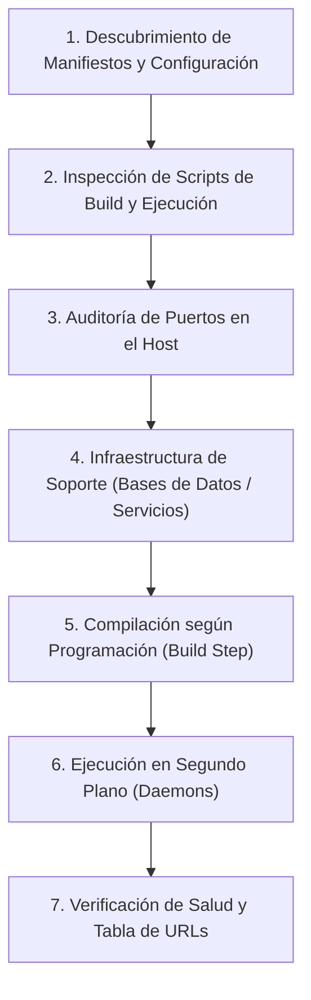

# Orquestador Universal de Compilación y Servidores (/init-servers)

Esta skill es **100% agnóstica y universal**. Puede ejecutarse en **cualquier repositorio o proyecto de software** (monolito, monorepositorio, microservicios políglotas, frontend SPA, APIs backend, workers o infraestructura de datos).

Su principio fundamental es la **fidelidad estricta al código fuente**: inspecciona cómo ha sido programado el proyecto por sus desarrolladores (sus scripts, manifiestos y herramientas de build), compila los componentes de acuerdo con sus especificaciones y levanta los servicios en segundo plano.

---

## Cuándo Activar Esta Skill
* Invocación explícita del comando `/init-servers`.
* Solicitudes del usuario como: *"compila y levanta los proyectos"*, *"inicia todos los servidores"*, *"arranca el proyecto"*, *"inicia frontend y backend"*.

---

## Flujo de Orquestación Universal



---

### Fase 1: Descubrimiento de Manifiestos de Proyecto

El agente debe escanear el árbol de directorios para identificar los manifiestos de build y configuración programados en el proyecto:

| Ecosistema | Archivos Clave | Herramientas de Compilación / Ejecución |
| :--- | :--- | :--- |
| **Node.js / TypeScript** | `package.json`, `pnpm-workspace.yaml`, `lerna.json` | `npm`, `pnpm`, `yarn`, `bun` |
| **Java / JVM** | `pom.xml`, `build.gradle`, `build.gradle.kts` | Maven (`./mvnw`), Gradle (`./gradlew`) |
| **Python** | `pyproject.toml`, `requirements.txt`, `Pipfile`, `setup.py` | `uvicorn`, `gunicorn`, `python manage.py`, `fastapi` |
| **PHP** | `composer.json`, `artisan` | Composer, `php artisan serve`, `symfony` |
| **.NET / C#** | `*.sln`, `*.csproj` | `dotnet build`, `dotnet run` |
| **Go** | `go.mod`, `main.go` | `go build`, `go run` |
| **Rust** | `Cargo.toml` | `cargo build`, `cargo run` |
| **Ruby** | `Gemfile`, `Rakefile` | `bundle exec rails s`, `rackup` |
| **Contenedores** | `docker-compose.yml`, `compose.yaml` | `docker-compose up -d` |
| **Automatización** | `Makefile`, `Taskfile.yml`, `justfile` | `make`, `task`, `just` |

---

### Fase 2: Inspección de Scripts Programados (Fidelidad de Build)

> [!IMPORTANT]
> El agente **NUNCA debe asumir o inventar comandos genéricos** si el proyecto ya tiene programados scripts específicos. Debe leer el manifiesto y utilizar exactamente los comandos definidos por los autores del proyecto:

1. **En Node.js (`package.json`)**:
   - Inspeccionar la sección `"scripts"`:
     * Si existe script de build (`"build"`, `"compile"`), evaluar si el proyecto requiere compilación previa (ej. compilar TypeScript a JavaScript o empaquetar librerías compartidas).
     * Identificar el script de desarrollo o ejecución programado: `"start:dev"`, `"dev"`, `"serve"`, `"start"`.
   - Usar el gestor de paquetes correspondiente al lockfile (`package-lock.json` $\rightarrow$ `npm`, `pnpm-lock.yaml` $\rightarrow$ `pnpm`, `yarn.lock` $\rightarrow$ `yarn`).

2. **En Java (`pom.xml` / `build.gradle`)**:
   - Respetar los wrappers incluidos (`./mvnw` o `mvnw.cmd` en Windows; `./gradlew` o `gradlew.bat`).
   - Identificar plugins programados (Spring Boot plugin, Quarkus, Micronaut).
   - Compilar y ejecutar según la configuración del proyecto (`./mvnw spring-boot:run`, `./mvnw compile`, etc.).

3. **En Python / PHP / Otros**:
   - Verificar archivos `.env` o configuraciones de entorno del proyecto para respetar puertos y variables.
   - Respetar entornos virtuales (`.venv`, `venv`) si están presentes.

---

### Fase 3: Auditoría de Puertos en el Sistema

Antes de iniciar cualquier servicio:
1. Inspeccionar puertos activos en el sistema operativo:
   * Windows: `Get-NetTCPConnection -State Listen | Select-Object -Unique LocalPort`
   * Linux/macOS: `lsof -iTCP -sTCP:LISTEN -P` o `netstat -tuln`
2. Identificar si algún puerto asignado por la configuración del proyecto está en colisión para reportarlo o evitar fallas al arrancar.

---

### Fase 4: Infraestructura y Bases de Datos

1. Si el proyecto depende de bases de datos o servicios auxiliares definidos en `docker-compose.yml`:
   * Verificar si las bases de datos ya están escuchando nativamente en el host.
   * Si no están activas y se dispone de Docker, iniciar únicamente los contenedores de infraestructura necesarios (`docker-compose up -d <servicio-bd>`).
   * Si faltan credenciales o variables indispensables que no estén en los `.env` de ejemplo, consultar al usuario mediante `ask_question`.

---

### Fase 5: Compilación y Ejecución en Segundo Plano (Daemons)

1. **Fase de Compilación (si aplica)**:
   - Para proyectos que requieran compilación previa de librerías, bundles o código tipado, ejecutar el build sincrónicamente:
     ```bash
     npm run build / ./mvnw compile / dotnet build
     ```
   - Verificar que el build termine con código de salida `0` antes de lanzar el servidor.

2. **Fase de Ejecución en Segundo Plano**:
   - Cada servidor de larga duración debe ejecutarse mediante `run_command` configurando:
     * `IsDaemon: true`
     * `WaitMsBeforeAsync: 2000-3000` (para capturar los logs iniciales de arranque).
     * `toolSummary: "Start <nombre> daemon"`

---

### Fase 6: Verificación de Salud y Entrega al Usuario

1. Monitorear los logs iniciales de cada tarea para certificar que el servidor arrancó sin excepciones de inicialización.
2. Comprobar que el puerto esté en estado de escucha (`Listen`).
3. Si el framework expone endpoints de salud (`/health`, `/actuator/health`, `/api/health`, `/`), realizar un ping HTTP de confirmación.
4. Generar y presentar al usuario una **tabla consolidada con el estado de todos los servicios**:

| Componente / Directorio | Lenguaje / Stack | Script Ejecutado | Puerto / URL Local | Estado |
| :--- | :--- | :--- | :--- | :--- |
| `<directorio-o-modulo>` | `<stack-detectado>` | `<comando-del-proyecto>` | `http://localhost:XXXX` | **ACTIVO (200 OK)** |
| `<directorio-o-modulo>` | `<stack-detectado>` | `<comando-del-proyecto>` | `http://localhost:YYYY` | **ACTIVO** |

5. Proveer comandos útiles para detener o reiniciar servicios de forma controlada.
