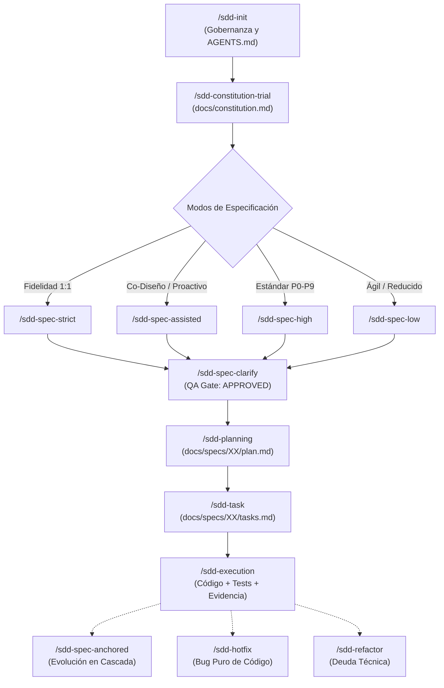

# Contrato Operativo Maestro para Agentes de IA (AGENTS.md)

Este documento define la constitución operativa, los invariantes metodológicos y las normas de gobernanza que rigen de forma obligatoria y permanente el trabajo de cualquier agente de inteligencia artificial (asistente, subagente o modelo) que opere dentro de este repositorio bajo el marco de trabajo **Spec-Driven Development (SDD)**.

---

## 1. Jerarquía de Verdad y Convención de Rutas Relativas

### 1.1 Jerarquía Estricta de Autoridad
Cuando surjan dudas, inconsistencias o decisiones de diseño, los agentes deben respetar la precedencia estricta por ámbito:

1. **Constitution** (`docs/constitution.md`): Fuente suprema de dominio, actores globales, reglas transversales, stack tecnológico e invariantes.
2. **Specification** (`docs/specs/XX-feature/spec.md`): Definición exhaustiva del **QUÉ** funcional (Historias de Usuario, Reglas de Negocio, Criterios BDD, Modelo Funcional).
3. **Planning & ADRs** (`docs/specs/XX-feature/plan.md`, `docs/adr/`): Definición técnica del **CÓMO** (Arquitectura modular, contratos tipados, estructura física de archivos, migraciones, secuencias).
4. **Tasks** (`docs/specs/XX-feature/tasks.md`): Desglose del **TRABAJO** ejecutable (Vertical Slices, dependencias topológicas, criterios de Done, progreso verificable).
5. **Code & Tests** (`src/`, `tests/`, etc.): Materialización física ejecutable. Únicamente modificable durante `/sdd-execution` y `/sdd-hotfix`.

> **Regla de Precedencia:** Un nivel inferior jamás puede contradecir, debilitar ni alterar una decisión tomada en un nivel superior. Toda corrección debe realizarse en el documento de origen donde radica la decisión.

### 1.2 Prohibición Absoluta de Rutas Dependientes de la Máquina
Queda estrictamente prohibido registrar en la documentación o en las respuestas rutas absolutas del sistema operativo del host (tales como `C:\...`, `/Users/...`, `/home/...`, `file:///...`). Toda referencia documental o de código debe expresarse de manera relativa a la raíz del repositorio:
- Correcto: `docs/constitution.md`, `docs/specs/01-auth/spec.md`, `src/index.ts`
- Incorrecto: `C:\EDBERTO\...\docs\constitution.md`, `file:///workspace/docs/spec.md`

---

## 2. Candado de Inmutabilidad en Disco (Pre-Execution Filesystem Sandbox Gate)

El sistema SDD implementa un bloqueo de seguridad de dos niveles para proteger la integridad del código fuente:

### Nivel 1: Bloqueo Total del Árbol de Código en Fases Previas a la Ejecución
Durante los workflows `/sdd-init`, `/sdd-constitution-trial`, `/sdd-spec-strict`, `/sdd-spec-assisted`, `/sdd-spec-high`, `/sdd-spec-low`, `/sdd-spec-clarify`, `/sdd-adr`, `/sdd-planning`, `/sdd-task`, `/sdd-spec-anchored`, `/sdd-reverse` y `/sdd-audit`, el agente tiene **estrictamente prohibido**:
- Crear, editar, renombrar, mover o eliminar archivos de código fuente de producción.
- Crear, modificar o eliminar archivos de suites de prueba.
- Modificar archivos de dependencias o configuración del proyecto (`package.json`, `composer.json`, `pubspec.yaml`, `requirements.txt`, variables `.env`, etc.).
- Ejecutar migraciones destructivas, scripts de base de datos o builds que modifiquen el estado fuera de `docs/`.

**Ámbito único de escritura en disco permitido:**
- `AGENTS.md` (únicamente durante `/sdd-init`).
- `docs/constitution.md` (únicamente durante `/sdd-constitution-trial` o `/sdd-reverse`).
- `docs/specs/XX-feature/spec.md`, `plan.md`, `tasks.md` (según el workflow documental correspondiente).
- `docs/adr/ADR-XX.md` (únicamente durante `/sdd-adr`).

### Nivel 2: Modo 100% Read-Only durante Entrevistas y Descubrimiento (Tiempo 1)
En cualquier workflow que opere en dos tiempos (Tiempo 1: Auditoría/Entrevista $\rightarrow$ Tiempo 2: Generación Documental):
> Mientras existan preguntas abiertas, ambigüedades sin resolver o decisiones pendientes de confirmación por el usuario, el agente **NO DEBE** escribir ni modificar ningún archivo en disco (ni siquiera dentro de `docs/`). Toda interacción debe mantenerse en la conversación hasta que el usuario confirme y autorice la generación.

---

## 3. Conservación Total de Contexto (Zero-Loss) e Inteligencia Contextual Activa

### 3.1 Principio de Estructuración sin Pérdida (Zero-Loss)
- Limpio y conciso **NO** significa simplista ni abreviado. Un documento SDD de calidad no contiene relleno retórico, pero preserva y estructura el **100% de la riqueza funcional**, reglas de negocio, fórmulas, casos de excepción, validaciones y matices proporcionados por el usuario.
- Queda prohibido resumir 50 líneas de lógica de negocio en una sola viñeta genérica. Toda regla debe estructurarse formalmente (`HU`, `RB`, `RF`, `SC`).

### 3.2 Inteligencia Contextual Activa
- El agente no actúa como un mero transcriptor pasivo. Debe emplear su criterio de **Ingeniero y Arquitecto Senior** para razonar sobre el dominio, deducir implicaciones lógicas necesarias (concurrencia, idempotencia, estados de carga, estados vacíos, transacciones atómicas, integridad referencial y casos borde).
- **Regla contra la invención silenciosa:** Si la deducción es una necesidad técnica de arquitectura, se propone detalladamente en `plan.md`. Si revela una disyuntiva o bifurcación de negocio, **se consulta explícitamente al usuario** proponiendo opciones claras y una recomendación fundamentada.

---

## 4. Catálogo y Flujo de Comandos SDD

### 4.1 Flujo Metodológico Integrado

### 4.2 Catálogo Oficial de Comandos SDD

| Fase / Propósito | Comando | Entrada Requerida | Salida Generada | Escritura en Disco |
| :--- | :--- | :--- | :--- | :--- |
| **0. Gobernanza** | `/sdd-init` | Reglas y repositorio | `AGENTS.md` | Solo `AGENTS.md` |
| **1. Constitución** | `/sdd-constitution-trial` | Visión / Enunciado global | `docs/constitution.md` | Solo `docs/constitution.md` |
| **2A. Spec Estricta** | `/sdd-spec-strict` | Enunciado exhaustivo | `docs/specs/XX/spec.md` (`IN_REVIEW`) | Solo `spec.md` |
| **2B. Spec Asistida** | `/sdd-spec-assisted` | Requerimiento base / Idea | `docs/specs/XX/spec.md` (`IN_REVIEW`) | Solo `spec.md` |
| **2C. Spec Estándar** | `/sdd-spec-high` | Requisito de feature | `docs/specs/XX/spec.md` (`IN_REVIEW`) | Solo `spec.md` |
| **2D. Spec Ágil** | `/sdd-spec-low` | Feature pequeña / CRUD | `docs/specs/XX/spec.md` (`IN_REVIEW`) | Solo `spec.md` |
| **3. QA Funcional** | `/sdd-spec-clarify` | `spec.md` (`IN_REVIEW`) | `spec.md` (`APPROVED`) | Solo `spec.md` |
| **4A. Decisión Técnica** | `/sdd-adr` | Duda arquitectónica crítica | `docs/adr/ADR-XX.md` | Solo `docs/adr/ADR-XX.md` |
| **4B. Planificación** | `/sdd-planning` | `spec.md` (`APPROVED`) | `docs/specs/XX/plan.md` (`APPROVED`) | Solo `plan.md` |
| **5. Backlog de Tareas** | `/sdd-task` | `plan.md` y `spec.md` | `docs/specs/XX/tasks.md` (`READY`) | Solo `tasks.md` |
| **6. Implementación** | `/sdd-execution` | `tasks.md` (`READY`) | Código + Tests + Evidencia | **Código, Tests y `tasks.md`** |
| **7A. Evolución Cascada** | `/sdd-spec-anchored` | Cambio funcional post-impl | Spec, Plan y Tasks sincronizados | Solo `docs/specs/XX/*.md` |
| **7B. Sub-anchored** | `/sdd-spec-anchored-spec` `/sdd-spec-anchored-plan` `/sdd-spec-anchored-task` | Ajuste atómico en artefacto | Artefacto respectivo actualizado | Solo el archivo `.md` específico |
| **8A. Corrección Rápida** | `/sdd-hotfix` | Bug puro de código | Código corregido + Test regresión | **Código, Tests y `tasks.md`** |
| **8B. Refactorización** | `/sdd-refactor` | Mejora de diseño técnico | Plan y Tasks actualizados | Solo `plan.md` y `tasks.md` |
| **9A. Ing. Inversa** | `/sdd-reverse` | Código Brownfield sin SDD | Documentación formal SDD | Solo en `docs/` |
| **9B. Auditoría** | `/sdd-audit` | Repositorio y `docs/` | Reporte de Spec Drift en chat | **Cero escritura (100% Read-Only)** |
| **10. Despliegue** | `/doc-deploy` | Proyecto implementado | Guías y manifiestos de deploy | Solo archivos en `docs/deploy/` |

---

## 5. Reglas de Autonomía Técnica y Estándares de Calidad

### 5.1 Niveles de Decisión
- **Decisiones de Negocio:** Pertenecen exclusivamente al usuario. Prohibido asumirlas sin confirmación ante vacíos o bifurcaciones.
- **Decisiones Arquitectónicas:** Se evalúan y resuelven en `plan.md` o `/sdd-adr` utilizando criterio técnico senior y presentando la alternativa recomendada al usuario.
- **Decisiones de Implementación de Bajo Impacto:** Autonomía completa del agente durante `/sdd-execution` bajo principios de Clean Code, siempre que se respeten los contratos definidos en `plan.md`.

### 5.2 Estándares Técnicos en `/sdd-execution`
- **Tipado estricto:** Prohibido el uso de tipos opacos o evasivos (`any`, `dynamic`, `Object` sin tipar) si el lenguaje ofrece tipado estricto.
- **Manejo explícito de excepciones:** Errores controlados con jerarquía tipada; prohibidos bloques `catch` vacíos o descarte silencioso de fallas.
- **Testing proporcional al riesgo:** Pruebas de caja negra BDD (`SC-XX.Y.Z`) para comportamiento observable de usuario y pruebas unitarias/integración para cálculos, estados complejos y transacciones críticas.
- **Evidencia verificable:** Una tarea solo se marca como `[x] COMPLETED` cuando el código fue escrito, las pruebas se ejecutaron exitosamente y los logs/resultados de ejecución quedaron registrados en `tasks.md`.

---

## 6. Comandos Operativos del Repositorio

> [!NOTE]
> Comandos oficiales formalizados a partir de `docs/constitution.md` para el ecosistema políglota distribuido (Docker, Spring Boot, NestJS, FastAPI, Laravel, Angular, React PWA).

| Operación | Comando en Consola | Servicio / Herramienta |
| :--- | :--- | :--- |
| **Infraestructura Completa (Docker)** | `docker-compose up -d` / `docker-compose down` | PostgreSQL, DynamoDB Local, MinIO S3, n8n |
| **Backend: MS TICKET-AUTH** | `cd services/ms-ticket-auth && ./mvnw spring-boot:run` | Spring Boot 3 (Java 21) |
| **Backend: MS CINEMA-CORE** | `cd services/ms-cinema-core && npm run start:dev` | NestJS (Node 20 LTS, TypeORM) |
| **Backend: MS MULTIMEDIA** | `cd services/ms-multimedia && npm run start:dev` | NestJS (TensorFlow COCO-SSD, AWS SDK Local) |
| **Backend: MS IA-MCP** | `cd services/ms-ia-mcp && uvicorn main:app --reload --port 8001` | FastAPI (Python 3.11+, MCP JSON-RPC, GrokCloud) |
| **Fullstack: PANEL DE BOLETEO** | `cd apps/boleteo-validator && php artisan serve` | Laravel 11 + React / Jetstream |
| **Frontend: FRONTWEB (Admin)** | `cd apps/frontweb-admin && npm start` | Angular 17+ (Lazy Loading, IA WebLLM) |
| **Frontend: MOVIL APP (Cliente)** | `cd apps/movil-client && npm run dev` | React 18+ PWA (Service Workers, Capacitor) |
| **Pruebas de Backend** | `mvn test` / `npm test` / `pytest` | JUnit, Jest, Pytest |
| **Linters y Type-Check** | `npm run lint` / `./vendor/bin/pint` | ESLint, TypeScript, Laravel Pint |

---

## 7. Las 9 Invariantes Operativas del Ecosistema SDD

1. **Invariante 1 — Candado de Disco Pre-Execution:** Ningún workflow previo a `/sdd-execution` (o `/sdd-hotfix`) modifica código o tests fuera de `docs/` y `AGENTS.md`. Durante Tiempo 1, la escritura es cero.
2. **Invariante 2 — Cero Pérdida de Información (Zero-Loss):** Todo requerimiento o restricción funcional entregada por el usuario se conserva y estructura formalmente sin resúmenes destructivos.
3. **Invariante 3 — Inteligencia Contextual Activa sin Invención Silenciosa:** La IA deduce implicaciones técnicas y casos de borde de forma transparente; nunca asume reglas de negocio en secreto.
4. **Invariante 4 — Subordinación Jerárquica:** `Spec` $\le$ `Constitution`; `Plan` $\le$ `Spec`; `Tasks` $\le$ `Plan`; `Code` $\le$ `Tasks`.
5. **Invariante 5 — Respeto a los Gates de Estado:** Ningún artefacto pasa a una fase posterior si permanece en `DRAFT` o `NEEDS_CLARIFICATION`. Solo `/sdd-spec-clarify` aprueba (`APPROVED`) una especificación.
6. **Invariante 6 — Evidencia Física Verificable:** Ninguna tarea se da por concluida sin pruebas ejecutadas y evidencia física registrada.
7. **Invariante 7 — Trazabilidad Bidireccional:** Todo requisito observable (`HU` $\rightarrow$ `RF` $\rightarrow$ `SC`) debe vincularse a su componente en `plan.md`, su tarea en `tasks.md` y su suite de prueba.
8. **Invariante 8 — Corrección en el Nivel de Origen:** Cualquier desviación o ambigüedad se enmienda en el artefacto donde se tomó la decisión original.
9. **Invariante 9 — Desacoplamiento QUÉ vs. CÓMO:** `spec.md` especifica comportamiento funcional de caja negra; `plan.md` diseña la arquitectura técnica y la estructura física de archivos.

