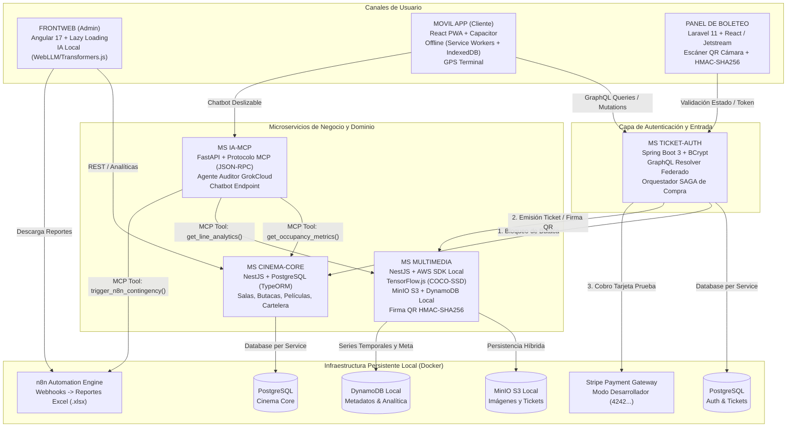

# Constitution: Ecosistema CineV2 - Plataforma Distribuida de Gestión y Experiencia Cinematográfica

> **Estado:** APPROVED  
> **Versión:** 1.2.0  
> **Última actualización:** 2026-11-03  
> **Gobernanza:** Nivel 1 en Jerarquía SDD (Precedencia Absoluta sobre Spec, Plan, Tasks y Code)

---

## 1. Visión, Dominio y Propósito del Sistema

### 1.1 Misión Principal
El ecosistema **CineV2** es una solución universitaria avanzada de ingeniería de software diseñada para modelar de punta a punta las operaciones cinematográficas comerciales modernas mediante una arquitectura desacoplada de microservicios políglotas, inteligencia artificial contextual y canales de usuario especializados.

El sistema resuelve la interoperabilidad en tiempo real entre la administración de complejos (salas, butacas y proyecciones), la experiencia de compra asistida por IA para clientes finales (web y móvil híbrido con soporte offline y geolocalización en sala), la validación física de acceso mediante códigos QR dinámicos criptográficamente firmados, el procesamiento analítico de video mediante visión artificial (conteo de personas en filas de taquilla) y la auditoría comercial autónoma mediante el protocolo MCP (Model Context Protocol) integrado con GrokCloud y orquestaciones reactivas en n8n.

### 1.2 Contexto Operativo
- **Entorno de Despliegue:** Arquitectura contenerizada sobre Docker y Docker Compose con persistencia políglota local (PostgreSQL, DynamoDB Local y MinIO S3 Object Storage).
- **Canales de Interacción:** 
  1. *Panel Administrativo (FRONTWEB):* Aplicación Angular con arquitectura modular (Lazy Loading) e inferencia local de IA (WebLLM / Transformers.js).
  2. *Canal Cliente (MOVIL APP / Web Cliente):* Aplicación híbrida unificada en React PWA + Capacitor, con soporte offline (Service Workers + IndexedDB) y geolocalización GPS interna en terminal.
  3. *Control de Acceso (PANEL DE BOLETEO):* Aplicación monolítica en Laravel 11 con React (Inertia.js/Jetstream) y captura de video/cámara para escaneo de credenciales QR.
- **Población Inicial de Datos:** Entorno precargado con *seeders* y *factories* realistas con un volumen de ~300 registros variables (películas, salas, butacas, funciones y compras históricas) y 3 usuarios predefinidos con roles asignados.

### 1.3 Alcance Global del Sistema (In-Scope Macro)
1. **Gestión de Infraestructura de Cine:** Modelado jerárquico y matricial de salas de exhibición y butacas individuales anidadas, gestión de catálogo de películas en cartelera y programación de funciones horarias.
2. **Autenticación Unificada y Transacciones de Boletos:** Registro e inicio de sesión centralizado con contraseñas encriptadas mediante BCrypt, reservas atómicas de butacas y pasarela de cobro integrada con Stripe (modo desarrollador / tarjetas de prueba 4242424...).
3. **Generación y Verificación Criptográfica de Boletos:** Emisión de tickets en imagen gráfica almacenados en MinIO S3 y generación de códigos QR dinámicos firmados con clave secreta compartida (`clave_secreta_universitaria_mcp`) mediante HMAC-SHA256, verificables de forma autónoma por la cámara del boletero.
4. **Visión Artificial y Analítica de Filas:** Simulación de procesamiento de video mediante TensorFlow.js (COCO-SSD) sobre cuadros de imágenes para conteo de personas en filas de taquilla e impacto de métricas en DynamoDB.
5. **Auditoría Comercial Autónoma y Automatización:** Servidor MCP (FastAPI) con herramientas semánticas JSON-RPC consumidas por un Agente IA con GrokCloud para evaluación comercial continua y disparo de webhooks hacia n8n para generación de informes consolidados en Excel (`.xlsx`).
6. **Asistencia de Compra Conversacional:** Chatbot deslizable interactivo (drawer izquierdo-derecho contraíble) integrado en la experiencia del cliente para selección y compra asistida de boletos.

### 1.4 Exclusiones Globales (Out-of-Scope Macro)
1. **Exclusión Absoluta de Módulo de Confitería / Dulcería:** El sistema **NO** incluye venta de alimentos, inventario de snacks, catálogo de dulcería ni pedidos de cafetería. Toda métrica de afluencia o alerta de contingencia se orienta estrictamente a taquillas y accesos a salas de proyección.
2. **Pagos con Fondos Reales:** Queda estrictamente prohibido el procesamiento de transacciones financieras reales; la pasarela Stripe operará exclusivamente con llaves de prueba y tarjetas de prueba de desarrollador (`4242424242424242`).
3. **Despliegue Productivo en Nube Pública de Pago:** Todos los componentes de AWS (S3 y DynamoDB) se ejecutarán sobre emuladores locales en Docker (`http://localhost:9000` y `http://localhost:8000`), sin interactuar con cuentas en la nube de AWS.

---

## 2. Lenguaje Ubicuo (Glosario Canónico del Dominio)

> Todo documento de especificación (`spec.md`), plan técnico (`plan.md`), tarea (`tasks.md`) y símbolo en código fuente debe utilizar con exactitud la terminología de esta tabla. Quedan expresamente prohibidos los sinónimos listados.

| Término Oficial (ES / Código) | Sinónimos Prohibidos | Definición Exacta en el Dominio e Invariante Conceptual |
| :--- | :--- | :--- |
| **Complejo de Cine** (`CinemaVenue`) | Teatro, Sucursal, Local | Entidad física principal que agrupa salas, taquillas y áreas de acceso público. |
| **Sala** (`CinemaHall`) | Habitación, Auditorio, Room | Espacio físico cerrado acondicionado con pantalla y sistema de audio que contiene un conjunto matricial de butacas. |
| **Butaca** (`Seat`) | Asiento, Silla, Posición | Unidad indivisible de asignación espacial dentro de una sala, identificada por fila (letra) y número (ej. A-12). |
| **Película** (`Movie`) | Film, Cinta, Título | Obra cinematográfica registrada en el catálogo con metadatos (título, sinopsis, duración, portada en MinIO). |
| **Función / Cartelera** (`Showtime`) | Sesión, Horario, Tanda | Asignación temporal y fija de una película proyectada en una sala específica en una fecha y rango de horas determinado. |
| **Boleto / Entrada** (`Ticket`) | Pase, Voucher, TicketVenta | Contrato de derecho de acceso emitido para un cliente, asociado a una función, butaca específica y monto cobrado. Posee un ciclo de vida con estados inmutables. |
| **Código QR Dinámico** (`DynamicQRCode`) | Código de barras, QR estático | Matriz bidimensional generada que contiene un payload JSON firmado criptográficamente con HMAC-SHA256, único por boleto. |
| **Firma Criptográfica** (`CryptoSignature`) | Hash simple, Token | Firma digital calculada con la clave maestra `clave_secreta_universitaria_mcp` que autentica el `ticket_id`, `seat_id` y timestamp del boleto. |
| **Métrica de Afluencia** (`LineOccupancyMetric`) | Conteo de fila, Tráfico | Número entero que representa la cantidad de personas detectadas en fila de espera mediante el modelo COCO-SSD de TensorFlow. |
| **Anomalía Comercial** (`CommercialAnomaly`) | Alerta, Problema, Error | Desviación operativa crítica detectada por el Agente Auditor (ej. taquilla saturada con >40 personas o sala vacía con <5% de ocupación a 15 min de la función). |
| **Reporte Predictivo** (`PredictiveReport`) | Informe, Planilla | Archivo generado en formato Excel binario real (`.xlsx`) consolidado por n8n a partir de datos MCP. |
| **Agente Auditor** (`AuditAgent`) | Bot de control, Cron | Entidad autónoma de IA impulsada por GrokCloud que evalúa periódicamente las herramientas MCP del cine. |
| **Chatbot de Compra** (`SalesChatbot`) | Asistente virtual, Soporte | Componente interactivo deslizable en el frontend del cliente que invoca herramientas para recomendar funciones y asistir en la compra. |

---

## 3. Mapa Global de Actores, Roles y Matriz de Autorización

### 3.1 Actores Humanos
1. **Administrador (`admin`):**
   - Operador central con credenciales maestras predefinidas (`admin@cine.local`).
   - Acceso exclusivo al panel **FRONTWEB (Angular)**.
   - Responsable de la creación y mantenimiento del catálogo de películas, estructuración de salas y matrices de butacas, fijación de carteleras/horarios, inspección de dashboards ejecutivos, visualización de métricas de visión artificial y descarga de reportes predictivos de n8n.
2. **Cliente (`cliente`):**
   - Usuario final registrado o precargado (`cliente@cine.local`).
   - Acceso a la **MOVIL APP (React PWA + Capacitor)** y visualización web de cartelera.
   - Puede consultar funciones, seleccionar butacas disponibles en mapa interactivo, interactuar con el chatbot conversacional deslizable, emitir pagos simulados con Stripe, recibir boletos digitales, almacenarlos offline en IndexedDB y utilizar el GPS interno para guiarse en el cine.
3. **Boletero (`boletero`):**
   - Personal operativo de control de acceso en puertas físicas (`boletero@cine.local`).
   - Acceso exclusivo al **PANEL DE BOLETEO (Laravel 11 + React)**.
   - Utiliza la cámara web/móvil para escanear en tiempo real el código QR del boleto, valida localmente la firma criptográfica HMAC-SHA256 y gatilla el cambio de estado del ticket a `Utilizado`.

### 3.2 Actores de Sistema y Servicios Externos
1. **Agente Auditor GrokCloud:** Modelo LLM autónomo con System Prompt de *Auditor Comercial de Operaciones de Cine* que invoca periódicamente las 3 herramientas JSON-RPC de `MS IA-MCP`.
2. **Orquestador n8n:** Motor de flujos conectado por Webhooks para recepcionar anomalías y compilar reportes consolidados en hojas de cálculo Excel (`.xlsx`).
3. **MinIO S3 Local:** Almacén de objetos compatible con AWS S3 que aloja imágenes binarias (portadas de películas y credenciales gráficas de tickets).
4. **DynamoDB Local:** Almacén NoSQL clave-valor / documentos para metadatos de tickets y series temporales de conteo de personas de TensorFlow.
5. **Stripe API (Modo Desarrollador):** Pasarela de pagos externa simulada para procesamiento de tokens de tarjetas de prueba.

### 3.3 Matriz General de Permisos por Dominio

| Dominio / Operación Macro | Administrador (`admin`) | Cliente (`cliente`) | Boletero (`boletero`) | Agente IA / Sistema |
| :--- | :---: | :---: | :---: | :---: |
| **Login / Registro Centralizado** | ✅ | ✅ | ✅ | ❌ |
| **Crear / Editar Salas y Butacas** | ✅ | ❌ | ❌ | ❌ |
| **Crear / Publicar Cartelera de Películas** | ✅ | ❌ | ❌ | ❌ |
| **Consultar Cartelera y Disponibilidad** | ✅ | ✅ | ❌ | ✅ (vía MCP) |
| **Reservar Butaca y Comprar Boleto** | ❌ | ✅ | ❌ | ✅ (vía Chatbot) |
| **Procesar Cobro con Tarjeta Stripe** | ❌ | ✅ | ❌ | ❌ |
| **Descarga Offline de Tickets (IndexedDB)** | ❌ | ✅ | ❌ | ❌ |
| **Escanear QR y Cambiar Estado de Ticket** | ❌ | ❌ | ✅ | ❌ |
| **Ejecutar Inferencia TensorFlow (Conteo)** | ❌ | ❌ | ❌ | ✅ (MS MULTIMEDIA) |
| **Consumir Herramientas MCP y Disparar Webhook** | ❌ | ❌ | ❌ | ✅ (MS IA-MCP) |
| **Visualizar Dashboards y Descargar Excel n8n** | ✅ | ❌ | ❌ | ❌ |
| **Consultas IA Local en Navegador (WebLLM)** | ✅ | ❌ | ❌ | ❌ |

---

## 4. Invariantes y Reglas de Negocio Universales (`INV-BIZ-XX`)

### `INV-BIZ-01` (Exclusión Total de Confitería y Enfoque en Afluencia)
Queda estrictamente prohibido registrar entidades, tablas o endpoints para venta o inventario de productos de dulcería. Toda mención operativa a métricas de saturación o tiempos de espera se aplica única y exclusivamente a las filas de taquilla física y puntos de control de acceso a salas.

### `INV-BIZ-02` (Inmutabilidad Financiera y Ciclo de Vida de Boletos)
Ningún registro de boleto (`Ticket`) confirmado o cobrado puede ser eliminado físicamente de la base de datos (DELETE SQL terminantemente prohibido).
El ciclo de vida del boleto transiciona rígidamente por los siguientes estados:
- `PENDING_PAYMENT`: Butaca bloqueada temporalmente durante la sesión de checkout en Stripe (tiempo máximo de retención: 5 minutos).
- `CONFIRMED`: Pago en Stripe completado exitosamente; boleto emitido, imagen renderizada en MinIO y QR firmado generado.
- `USED`: Boleto escaneado legítimamente por el boletero en puerta física; no admite reingresos.
- `CANCELLED`: Reserva expirada por inactividad de pago o cancelada por compensación SAGA ante fallo de transacción de Stripe.
- `VOIDED`: Boleto revocado administrativamente por contingencia justificada.

### `INV-BIZ-03` (Integridad Atómica de Butaca y Prevención de Doble Reserva)
Una butaca (`Seat`) para una función determinada (`Showtime`) solo puede asignarse a un único boleto a la vez. El sistema debe garantizar a nivel transaccional que dos clientes concurrentes no puedan seleccionar ni pagar la misma butaca simultáneamente (bloqueo pesimista o verificación atómica de estado en base de datos).

### `INV-BIZ-04` (Firma Criptográfica Obligatoria de Códigos QR)
Queda prohibido el uso de códigos QR con textos planos o URLs desprotegidas. Todo código QR dinámico debe encapsular un JSON con la estructura:
```json
{
  "ticketId": "uuid-v4",
  "seatId": "uuid-v4",
  "showtimeId": "uuid-v4",
  "issuedAt": "iso-timestamp",
  "sig": "hmac_sha256_hex"
}
```
Donde `sig` se calcula concatenando `${ticketId}:${seatId}:${showtimeId}:${issuedAt}` firmado con el secreto `clave_secreta_universitaria_mcp`. Un boleto cuya firma no coincida exactamente debe ser rechazado como fraude visual en color rojo crítico.

### `INV-BIZ-05` (Soporte Offline Asíncrono de Boletos para Clientes)
La aplicación cliente debe asegurar que, una vez confirmado el boleto, el artefacto gráfico del ticket y el payload del código QR se persistan de inmediato en el almacenamiento local del navegador/dispositivo (`IndexedDB` vía Service Worker). El cliente debe poder abrir la aplicación y presentar su código QR al boletero aun cuando no disponga de señal de datos móviles ni Wi-Fi dentro del complejo.

### `INV-BIZ-06` (Seguridad de Credenciales de Usuarios Predefinidos)
El script de inicialización de datos (seeders) debe generar obligatoriamente los 3 usuarios predefinidos (`admin@cine.local`, `cliente@cine.local`, `boletero@cine.local`) protegiendo sus contraseñas mediante el algoritmo **BCrypt** con un factor de costo no menor a 10. Queda terminantemente prohibido almacenar contraseñas en texto claro.

### `INV-BIZ-07` (Aislamiento Estricto de Secretos y Variables de Entorno)
Cada microservicio debe gobernar sus credenciales sensibles mediante su propio archivo `.env` local, debidamente ignorado en el control de versiones (`.gitignore`). Queda prohibida la consolidación de un `.env` global compartido que mezcle credenciales de bases de datos o llaves de servicios de microservicios independientes.

### `INV-BIZ-08` (Ruta Principal Única de Entrada y Redirección Centralizada por Rol)
Debe existir una única ruta de acceso principal al sistema para todos los usuarios. Queda terminantemente prohibido acceder de forma directa o anónima a las rutas internas de los paneles (`FRONTWEB`, `MOVIL APP` o `PANEL DE BOLETEO`).
- **Punto Único de Entrada (`/login`):** Gestionado centralmente desde el canal de autenticación de `MS TICKET-AUTH`.
- **Pre-requisito Obligatorio:** Todo usuario debe autenticarse (o registrarse si es un nuevo cliente) antes de entrar a cualquier vista operativa.
- **Redirección Estricta por Rol:**
  - `admin` $\rightarrow$ Redirecciona automáticamente a la consola de administración **FRONTWEB (Angular)**.
  - `cliente` $\rightarrow$ Redirecciona automáticamente al catálogo y cartelera de la **MOVIL APP (React PWA)**.
  - `boletero` $\rightarrow$ Redirecciona automáticamente a la cámara de escaneo del **PANEL DE BOLETEO (Laravel 11 + React)**.
- **Protección de Rutas (Guards / Middleware):** Todo intento de navegación no autenticado o con rol inadecuado hacia cualquier sub-ruta de los frontends debe ser interceptado y devuelto de forma inmediata a la pantalla única de inicio de sesión.

---

## 5. Arquitectura Macro y Flujos Globales de Integración

### 5.1 Diagrama de Arquitectura del Ecosistema



### 5.2 Secuencia de la Transacción Distribuida de Compra (Patrón SAGA)
1. **Solicitud de Compra:** El cliente en la `MOVIL APP` selecciona función y butaca; la interfaz gatilla la mutación GraphQL `initiateTicketPurchase(...)` hacia `MS TICKET-AUTH`.
2. **Reserva Temporal de Butaca (Compensable):** `MS TICKET-AUTH` solicita síncronamente a `MS CINEMA-CORE` el bloqueo transaccional de la butaca a estado `RESERVADA_TEMPORAL`.
3. **Generación Gráfica y Firma de Boleto:** `MS TICKET-AUTH` solicita a `MS MULTIMEDIA` la construcción de la imagen del ticket, almacenamiento en MinIO S3 y cálculo de la firma HMAC-SHA256 del código QR dinámico.
4. **Previsualización en Cliente:** La `MOVIL APP` recupera la URL de la imagen del ticket desde MinIO S3 y renderiza la vista preliminar en el componente deslizable antes de activar el contenedor `<Elements>` de Stripe.
5. **Procesamiento de Pago en Stripe:** El cliente suministra la tarjeta de prueba de Stripe. Si el pago es exitoso, `MS TICKET-AUTH` confirma la compra, marca el ticket como `CONFIRMED` en su PostgreSQL y notifica a `MS CINEMA-CORE` para marcar la butaca como `OCUPADA_DEFINITIVA`.
6. **Compensación SAGA (Manejo de Fallo):** Si el pago es rechazado, expira o el usuario cancela la pasarela, `MS TICKET-AUTH` ejecuta de inmediato la acción compensatoria: solicita a `MS CINEMA-CORE` liberar la butaca a estado `DISPONIBLE` y marca el ticket local como `CANCELLED`.
7. **Descarga Offline:** Una vez emitido el boleto confirmado, el Service Worker de la `MOVIL APP` descarga el payload JSON y la imagen del código QR en el IndexedDB local del cliente.

### 5.3 Flujo de Validación en Puerta de Acceso (Boleteo)
1. El `boletero` enfoca la cámara del dispositivo en el `PANEL DE BOLETEO` (Laravel 11 + React).
2. El lector decodifica el JSON del código QR dinámico y extrae `{ ticketId, seatId, showtimeId, issuedAt, sig }`.
3. El frontend de React en Laravel verifica de forma autónoma la firma `sig` mediante HMAC-SHA256 utilizando la clave secreta institucional.
4. Si la firma es legítima, Laravel despacha una solicitud autenticada con JWT a `MS TICKET-AUTH` para actualizar el estado del ticket a `USED`.
5. Si la firma es inválida, el ticket ya figura como `USED` o está cancelado, el sistema despliega una alerta visual roja y bloquea el acceso.

### 5.4 Flujo de Auditoría Comercial MCP y Automatización n8n
1. `MS IA-MCP` ejecuta en background su ciclo de auditoría continua asistido por el Agente GrokCloud.
2. El agente consume las herramientas MCP declaradas en el manifiesto JSON-RPC:
   - `get_occupancy_metrics()`: Lee la ocupación y volumen de ventas de `MS CINEMA-CORE`.
   - `get_line_analytics()`: Lee el conteo de personas obtenido por el modelo TensorFlow en `MS MULTIMEDIA`.
3. Si el agente detecta una condición anómala (ej. taquilla con >40 personas en fila o función a 15 min de inicio con ocupación <5%), invoca `trigger_n8n_contingency()`.
4. `MS IA-MCP` emite un Webhook saliente hacia `n8n` con un payload tipado estructurado.
5. `n8n` recibe el evento, procesa las reglas de contingencia y genera el archivo real de hoja de cálculo en formato `.xlsx` para la visualización del Administrador en el FRONTWEB.

---

## 6. Stack Tecnológico Oficial y Restricciones de Plataforma

| Capa / Módulo | Tecnología / Framework Oficial | Versión / Runtime | Responsabilidad e Invariantes |
| :--- | :--- | :--- | :--- |
| **MS TICKET-AUTH (Backend)** | Spring Boot | 3.2+ (Java 21) | Autenticación centralizada (BCrypt), GraphQL federado, orquestador SAGA de compras, SDK Stripe. |
| **MS CINEMA-CORE (Backend)** | NestJS | 10+ (Node.js 20 LTS) | Arquitectura Hexagonal / Modular, TypeORM, gestión de salas, butacas anidadas, películas y cartelera. |
| **MS MULTIMEDIA (Backend)** | NestJS | 10+ (Node.js 20 LTS) | Integración `@aws-sdk/client-s3` (MinIO) y `@aws-sdk/client-dynamodb` local, `@tensorflow/tfjs-node` con COCO-SSD, firma HMAC-SHA256. |
| **MS IA-MCP (Backend)** | FastAPI | 0.110+ (Python 3.11+) | Protocolo Model Context Protocol (MCP JSON-RPC), Agente GrokCloud (`${GROQ_API_KEY}`), webhooks hacia n8n y endpoint de chatbot de compra. |
| **PANEL DE BOLETEO (Fullstack)** | Laravel 11 + React | PHP 8.2+ / Node 20 | Monolito desacoplado con Inertia.js o Jetstream, lector de cámara web HTML5 (ZXing/html5-qrcode), verificación de firma HMAC y llamada JWT a Auth. |
| **FRONTWEB (Admin Frontend)** | Angular | 17+ (TypeScript 5+) | Panel administrativo modular con Lazy Loading, consumo de APIs de salas/cartelera, IA en navegador (WebLLM / Transformers.js para analítica offline). |
| **MOVIL APP (Cliente Frontend)** | React + PWA + Capacitor | React 18+ / Capacitor 5+ | Aplicación híbrida unificada con Service Workers, IndexedDB para tickets offline, geolocalización GPS interna, drawer de Chatbot y Stripe Elements. |
| **Base de Datos Relacional** | PostgreSQL | 16+ | Bases de datos independientes por microservicio (`db_tickets_auth`, `db_cinema_core`). |
| **Base de Datos NoSQL** | Amazon DynamoDB Local | Imagen Docker oficial | Almacenamiento local de metadatos de tickets y series de analítica de video (`http://localhost:8000`). |
| **Almacenamiento de Objetos** | MinIO S3 Object Storage | Imagen Docker oficial | Bucket local para portadas de películas y credenciales gráficas de tickets (`http://localhost:9000`). |
| **Motor de Automatización** | n8n | Imagen Docker oficial | Orquestador de webhooks y generador de reportes en hojas de cálculo Excel (`.xlsx`). |
| **Visión Artificial / Deep Learning** | TensorFlow.js Core / Node | `@tensorflow/tfjs-node` | Modelo preentrenado COCO-SSD para detección y conteo de personas en imágenes de fila de taquilla. |

---

## 7. Arquitectura Macro y Reglas de Diseño Técnico (`INV-ARCH-XX`)

### `INV-ARCH-01` (Aislamiento Database per Service y Persistencia Políglota)
Cada microservicio es dueño absoluto de su capa de persistencia. Queda terminantemente prohibido que un microservicio ejecute consultas SQL directas, joins o escrituras sobre la base de datos de otro microservicio. Toda comunicación inter-servicio debe realizarse mediante interfaces formales tipadas (REST, GraphQL, JSON-RPC o Webhooks).

### `INV-ARCH-02` (Configuración de Endpoints Locales de AWS SDK)
En `MS MULTIMEDIA`, todas las inicializaciones de clientes de AWS SDK (`S3Client` y `DynamoDBClient`) deben fijar explícitamente la propiedad `endpoint` hacia las instancias contenerizadas en Docker:
- S3 / MinIO: `endpoint: "http://localhost:9000"`, `forcePathStyle: true`, credenciales locales simuladas (`accessKeyId: "minioadmin"`, `secretAccessKey: "minioadmin"`).
- DynamoDB: `endpoint: "http://localhost:8000"`, `region: "us-east-1"`, credenciales locales simuladas.
Queda prohibido intentar autenticarse contra la nube pública de AWS o buscar credenciales en variables de entorno del sistema operativo host.

### `INV-ARCH-03` (Persistencia Híbrida: Binarios vs. Metadatos)
Los archivos binarios pesados (imágenes PNG/JPG de portadas y gráficos de boletos) deben persistirse exclusivamente en buckets de MinIO S3. DynamoDB y PostgreSQL almacenarán únicamente el identificador del objeto (`key`), la URL de acceso firmada, los identificadores relacionales y los metadatos numéricos.

### `INV-ARCH-04` (Arquitectura Hexagonal en Servicios de Dominio)
En `MS TICKET-AUTH` y `MS CINEMA-CORE`, el código debe organizarse respetando la separación en tres capas independientes:
1. **Dominio:** Entidades puras y reglas de negocio, libres de anotaciones de ORM o dependencias de frameworks externos.
2. **Aplicación:** Casos de uso, orquestación SAGA, puertos de entrada y salida, DTOs tipados.
3. **Infraestructura:** Adaptadores de base de datos (Spring Data JPA / TypeORM), controladores REST/GraphQL, clientes HTTP y adaptadores de pasarela externa (Stripe).

### `INV-ARCH-05` (Manifiesto MCP y Payload de Webhook n8n)
`MS IA-MCP` debe implementar el protocolo Model Context Protocol (MCP) exponiendo obligatoriamente su manifiesto JSON-RPC con tres herramientas:
1. `get_occupancy_metrics`: Interroga a `MS CINEMA-CORE` para computar aforo por sala.
2. `get_line_analytics`: Interroga a `MS MULTIMEDIA` para leer el conteo de personas de TensorFlow.
3. `trigger_n8n_contingency`: Emite el Webhook saliente hacia `n8n` con la firma:
```json
{
  "anomaly_type": "TAQUILLA_CONGESTIONADA | SALA_SUBOCUPADA",
  "severity_level": "CRITICAL | WARNING",
  "raw_mcp_data": {},
  "timestamp": "2026-11-03T00:00:00Z"
}
```

### `INV-ARCH-06` (Estrategia Dual de Contenerización: Defensa Todo-en-Uno vs. Despliegue Aislado en Cloud)
El sistema debe soportar dos modalidades de empaquetamiento y despliegue para garantizar la excelencia académica y la viabilidad en producción:
1. **Modalidad Cloud Desacoplada (Buena Práctica para AWS / GCP / Azure):**
   - Cada microservicio backend (`ms-ticket-auth`, `ms-cinema-core`, `ms-multimedia`, `ms-ia-mcp`) y cada aplicación frontend (`frontweb-admin`, `movil-client`, `boleteo-validator`) debe disponer de su propio **`Dockerfile` multi-stage autónomo** en su directorio respectivo.
   - Estos archivos compilan imágenes autocontenidas y ligeras (Alpine/Slim) capaces de desplegarse de manera independiente en contenedores serverless o clusters distribuidos (ej. AWS ECS/Fargate, Google Cloud Run, Azure Container Apps o Kubernetes).
2. **Modalidad Raíz Todo-en-Uno para Defensa y Evaluación Local:**
   - La raíz del proyecto provee un artefacto de despliegue consolidado (**`Dockerfile.all-in-one`** y el orquestador maestro **`docker-compose.yml`**) diseñado para que cualquier evaluador docente o jurado pueda compilar, inicializar los *seeders* y levantar el 100% de los servicios, bases de datos y frontends con un solo comando en su máquina local sin configuraciones manuales.

### `INV-ARCH-07` (Nomenclatura Estandarizada de Contenedores Docker)
Todos los contenedores generados u orquestados en el ecosistema (definidos en `docker-compose.yml`, scripts de despliegue o comandos `docker run`) deben llevar obligatoriamente el prefijo institucional **`SW2-P2-CINEv2-`** en su propiedad `container_name`, garantizando trazabilidad y orden absoluto en Docker Desktop o terminal:
- `SW2-P2-CINEv2-ms-ticket-auth` (Backend Spring Boot 8081)
- `SW2-P2-CINEv2-ms-cinema-core` (Backend NestJS 3000)
- `SW2-P2-CINEv2-ms-multimedia` (Backend NestJS + TensorFlow 3001)
- `SW2-P2-CINEv2-ms-ia-mcp` (Backend FastAPI + GrokCloud 8001)
- `SW2-P2-CINEv2-boleteo-validator` (Fullstack Laravel 11 + React 8000)
- `SW2-P2-CINEv2-frontweb-admin` (Frontend Angular 4200)
- `SW2-P2-CINEv2-movil-client` (Frontend React PWA 5173)
- `SW2-P2-CINEv2-postgres-auth` (Base de datos PostgreSQL 5432)
- `SW2-P2-CINEv2-postgres-core` (Base de datos PostgreSQL 5433)
- `SW2-P2-CINEv2-minio-s3` (Almacén de objetos S3 9000 / Consola 9001)
- `SW2-P2-CINEv2-dynamodb-local` (NoSQL DynamoDB 8002)
- `SW2-P2-CINEv2-n8n` (Automatizaciones y Reportes Excel 5678)

---

## 8. Estándares de Calidad, Seguridad, Resiliencia y Manejo de Errores

### 8.1 Tipado Estricto y Prohibición de Tipos Evasivos
Todo el código TypeScript, Java, PHP y Python debe configurarse en modo de tipado estricto. Queda prohibido el uso no justificado de `any` (TypeScript/Angular/Nest), `dynamic` / `Object` sin tipar (Java), o diccionarios no tipados sin esquemas Pydantic (FastAPI).

### 8.2 Taxonomía Estructurada de Excepciones
Toda falla de dominio o validación debe retornar un contrato uniforme estructurado:
```json
{
  "statusCode": 400,
  "errorCode": "SEAT_ALREADY_RESERVED",
  "message": "La butaca seleccionada ya no se encuentra disponible.",
  "timestamp": "2026-11-03T00:00:00Z"
}
```
Queda prohibido descartar excepciones en bloques `catch` vacíos o exponer trazas de depuración de servidor (`stack traces`) al cliente final.

### 8.3 Resiliencia y Timeouts en Invocaciones de Red e IA
- Las solicitudes HTTP inter-servicio deben aplicar un timeout máximo de 5000 ms.
- Las consultas al modelo GrokCloud e inferencias de TensorFlow deben contar con fallback degradado y circuit breaker para evitar bloqueos del hilo de ejecución.

---

## 9. Estrategia Global de Validación y Testing

### 9.1 Pruebas de Caja Negra (BDD / Escenarios Observables)
Todo flujo de negocio crítico debe contar con escenarios Gherkin automatizados que certifiquen el comportamiento de usuario:
- Flujo BDD de compra completa de boleto con Stripe y emisión de QR.
- Flujo BDD de compensación SAGA ante tarjeta rechazada en Stripe.
- Flujo BDD de escaneo y validación HMAC-SHA256 en el Panel de Boleteo.
- Flujo BDD de consulta de boleto offline en IndexedDB.

### 9.2 Pruebas de Caja Blanca (Unit / Integration)
- Pruebas unitarias sobre el cálculo y verificación de la firma criptográfica HMAC-SHA256.
- Pruebas de integración sobre los endpoints federados de GraphQL.
- Pruebas unitarias sobre la lógica de detección de anomalías comerciales en `MS IA-MCP`.
- Pruebas de persistencia con contenedores de prueba (Testcontainers / Docker local).

---

## 10. Comandos Oficiales del Entorno de Desarrollo

```bash
# ===================================================================
# GESTIÓN DE INFRAESTRUCTURA Y CONTENEDORES (DOCKER)
# ===================================================================
# Levantar todo el ecosistema (Bases de datos, MinIO, DynamoDB, n8n)
docker-compose up -d

# Detener los servicios contenerizados
docker-compose down

# ===================================================================
# MICROSERVICIOS BACKEND
# ===================================================================
# MS TICKET-AUTH (Spring Boot)
cd services/ms-ticket-auth && ./mvnw spring-boot:run

# MS CINEMA-CORE (NestJS)
cd services/ms-cinema-core && npm run start:dev

# MS MULTIMEDIA (NestJS + TensorFlow + AWS SDK Local)
cd services/ms-multimedia && npm run start:dev

# MS IA-MCP (FastAPI + GrokCloud + MCP)
cd services/ms-ia-mcp && uvicorn main:app --reload --port 8001

# ===================================================================
# CANALES DE USUARIO Y FRONTENDS
# ===================================================================
# FRONTWEB (Angular Admin)
cd apps/frontweb-admin && npm start

# MOVIL APP (React PWA + Capacitor Cliente)
cd apps/movil-client && npm run dev

# PANEL DE BOLETEO (Laravel 11 + React)
cd apps/boleteo-validator && php artisan serve

# ===================================================================
# SUITES DE PRUEBA Y AUDITORÍA
# ===================================================================
# Ejecutar todas las pruebas de backend
cd services/ms-ticket-auth && ./mvnw test
cd services/ms-cinema-core && npm test
cd services/ms-multimedia && npm test
cd services/ms-ia-mcp && pytest

# Ejecutar linters y verificación de tipos
cd apps/frontweb-admin && npm run lint
cd apps/movil-client && npm run lint
cd apps/boleteo-validator && ./vendor/bin/pint
```

---

## 11. Mapa Maestro de Módulos y Bóveda de Semillas de Especificación (Zero-Loss Backlog)

> Esta sección resguarda el 100% de los detalles específicos y restricciones funcionales proporcionadas por el usuario en el enunciado inicial, preservándolas intactas para alimentar sin pérdida las fases futuras de `/sdd-spec-*`.

### Módulo `01-auth-tickets` (MS TICKET-AUTH)
- **Objetivo:** Autenticación centralizada, gestión de sesiones, resolver GraphQL federado, orquestación SAGA de compra de boletos e integración con pasarela de prueba Stripe.
- **Dependencias:** Ninguna (Núcleo fundacional de usuarios).
- **Semilla Funcional Detallada (Zero-Loss):**
  - Roles soportados: `admin`, `cliente`, `boletero`.
  - Precarga de los 3 usuarios predefinidos en script de base de datos con contraseñas encriptadas obligatoriamente con **BCrypt**.
  - Login y Register obligatorios antes de acceder a las operaciones del sistema.
  - Exposición de API mediante GraphQL con esquema federado donde el tipo `Ticket` unifica la URL del código QR firmado generado por `MS MULTIMEDIA`.
  - Integración de Stripe a nivel de desarrollador utilizando tarjetas de prueba `4242424...`.
  - Por fines demostrativos de defensa académica, cada compra de entrada debe abrir el contenedor dinámico de `<Elements>` de Stripe.
  - Orquestador del flujo SAGA para reservar butaca en `MS CINEMA-CORE` y disparar compensación si el pago falla.

### Módulo `02-cinema-core` (MS CINEMA-CORE)
- **Objetivo:** Administración y persistencia de salas de cine, butacas anidadas, catálogo de películas y cartelera horaria.
- **Dependencias:** `01-auth-tickets` (para autorización de administradores).
- **Semilla Funcional Detallada (Zero-Loss):**
  - CRUD completo de Salas (`CinemaHall`) y CRUD anidado de Butacas (`Seat`) donde una sala contiene la matriz de sus butacas.
  - Panel administrativo para definición de capacidad, disposición de asientos y películas en cartelera / estrenos.
  - Cálculo de KPIs de ocupación y dashboards de rendimiento de salas.
  - Endpoint de bloqueo atómico de butaca (`RESERVAR_TEMPORAL`, `LIBERAR_COMPENSACION`, `CONFIRMAR_OCUPACION`).

### Módulo `03-multimedia-analytics` (MS MULTIMEDIA)
- **Objetivo:** Gestión de binarios en MinIO S3, almacenamiento de metadatos en DynamoDB local, visión artificial con TensorFlow.js para conteo de personas en taquilla y generación/firma de códigos QR.
- **Dependencias:** Ninguna (Servicio de infraestructura y procesamiento).
- **Semilla Funcional Detallada (Zero-Loss):**
  - Estrategia de persistencia híbrida: imágenes físicas (portadas de películas y gráficos de tickets) en MinIO S3 (`http://localhost:9000`); metadatos y series temporales de afluencia en DynamoDB Local (`http://localhost:8000`).
  - Configuración explícita de AWS SDK (`@aws-sdk/client-s3`, `@aws-sdk/client-dynamodb`) con `endpoint: "http://localhost:9000"` y `"http://localhost:8000"`.
  - Script de TensorFlow.js/Core cargando el modelo preentrenado COCO-SSD para procesar imágenes enviadas por HTTP, filtrando cajas clasificadas exclusivamente como `"person"` e impactando el conteo entero en DynamoDB.
  - Generador de códigos QR dinámicos con firma criptográfica HMAC-SHA256 (`clave_secreta_universitaria_mcp`) sobre el payload `{ ticketId, seatId, showtimeId, issuedAt }`.

### Módulo `04-ia-mcp-agent` (MS IA-MCP)
- **Objetivo:** Servidor MCP (Model Context Protocol) en FastAPI, agente auditor autónomo con GrokCloud, orquestación n8n y endpoint de soporte para Chatbot de compra.
- **Dependencias:** `01-auth-tickets`, `02-cinema-core`, `03-multimedia-analytics`.
- **Semilla Funcional Detallada (Zero-Loss):**
  - Implementación en FastAPI bajo el estándar Model Context Protocol (MCP JSON-RPC).
  - Tres herramientas obligatorias:
    1. `get_occupancy_metrics()`: consulta a `MS CINEMA-CORE`.
    2. `get_line_analytics()`: consulta a `MS MULTIMEDIA` (contador TensorFlow).
    3. `trigger_n8n_contingency()`: emite webhook estructurado a n8n.
  - Inyección de la API Key de GrokCloud (`${GROQ_API_KEY}`) en un Agente Autónomo preconfigurado como *Auditor Comercial de Operaciones de Cine*.
  - Disparo de Webhook hacia n8n con payload: `{ anomaly_type, severity_level, raw_mcp_data, timestamp }`.
  - n8n compila y genera hojas de cálculo reales en formato EXCEL (`.xlsx`) sin placeholders.
  - Endpoint de procesamiento conversacional para el Chatbot deslizable de clientes.

### Módulo `05-boleteo-validator` (PANEL DE BOLETEO)
- **Objetivo:** Canal operativo para el personal de taquilla/acceso para escanear y autenticar entradas en tiempo real.
- **Dependencias:** `01-auth-tickets`, `03-multimedia-analytics`.
- **Semilla Funcional Detallada (Zero-Loss):**
  - Fullstack en Laravel 11 (monolito desacoplado) con React integrado mediante Inertia.js / Jetstream.
  - Uso de la cámara del dispositivo para decodificar el JSON del código QR dinámico.
  - Verificación autónoma de la firma HMAC-SHA256 con la clave `clave_secreta_universitaria_mcp` contrastando `ticket_id`, `seat_id` y timestamp.
  - Si la firma es legítima, actualiza el estado del boleto a `Utilizado` mediante llamada autenticada a `MS TICKET-AUTH`.
  - Despliegue visual inmediato: interfaz verde de confirmación exitosa o pantalla de alerta roja crítica en caso de firma fraudulenta o boleto ya utilizado.

### Módulo `06-frontweb-admin` (FRONTWEB ADMINISTRACIÓN)
- **Objetivo:** Interfaz gráfica para la gestión ejecutiva y operativa del cine.
- **Dependencias:** `01-auth-tickets`, `02-cinema-core`, `04-ia-mcp-agent`.
- **Semilla Funcional Detallada (Zero-Loss):**
  - Desarrollada de forma modular e independiente en Angular con Lazy Loading.
  - Módulos aislados: Administración de salas/butacas, gestión de cartelera/películas, visualización de dashboards/KPIs y descarga de reportes predictivos en Excel de n8n.
  - Integración de IA local en el navegador mediante Transformers.js o WebLLM para consultas en lenguaje natural y analíticas rápidas de negocio en modo local/offline sin conexión a internet.

### Módulo `07-mobile-client` (MOVIL APP CLIENTE)
- **Objetivo:** Experiencia integral del cliente para compra de boletos, visualización de tickets y asistencia de navegación.
- **Dependencias:** `01-auth-tickets`, `02-cinema-core`, `03-multimedia-analytics`, `04-ia-mcp-agent`.
- **Semilla Funcional Detallada (Zero-Loss):**
  - Arquitectura híbrida unificada en React configurada como PWA offline y empaquetada con Capacitor para ejecución nativa.
  - Autenticación y registro exclusivo de clientes.
  - Chatbot de IA en panel deslizable (drawer de izquierda a derecha contraíble) para asistir en la compra.
  - Previsualización gráfica de la imagen del ticket consumida desde MinIO S3 antes de desplegar el wrapper dinámico de `<Elements>` de Stripe.
  - Descarga automática mediante Service Workers de los códigos QR dinámicos e imágenes en la base de datos local `IndexedDB`.
  - Modo Offline garantizado: visualización fluida de los boletos adquiridos en "Mis Boletos" sin conexión a red celular.
  - Uso de la API de geolocalización GPS nativa del terminal para guiar al cliente por el complejo de cine hacia su sala correspondiente.

---

## 12. Historial de Enmiendas Constitucionales (Changelog)

| Versión | Fecha | Tipo de Cambio | Descripción de la Decisión / Enmienda | Módulos Impactados |
| :--- | :--- | :--- | :--- | :--- |
| `1.0.0` | 2026-11-03 | Fundación | Creación inicial de la Constitución del proyecto Ecosistema CineV2 tras resolver en Tiempo 1 (/grill-me) las contradicciones de dulcería, distribución de microservicios, soporte offline PWA/Capacitor, orquestación SAGA y validación de boleteo. | Todos (`01` a `07`) |
| `1.1.0` | 2026-11-03 | Enmienda | Incorporación de `INV-BIZ-08` (Ruta única de entrada `/login` con redirección centralizada por rol) y formalización de `INV-ARCH-06` (Estrategia dual de Docker: `Dockerfile.all-in-one` y `docker-compose.yml` para defensa local + `Dockerfile` independiente por servicio para despliegue desacoplado en AWS/GCP/Azure). | Todos (`01` a `07`) |
| `1.2.0` | 2026-11-03 | Enmienda | Incorporación de `INV-ARCH-07` (Nomenclatura estandarizada obligatoria `SW2-P2-CINEv2-*` en todos los `container_name` de Docker del ecosistema). | Todos (`01` a `07`) |

