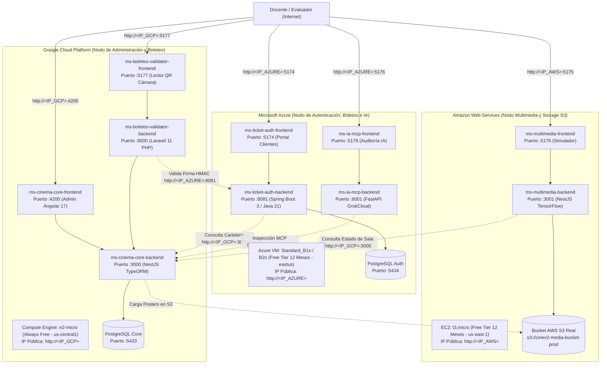

# Arquitectura Multi-Cloud Distribuida — Ecosistema CineV2

Este documento define la arquitectura física, técnica y operativa del ecosistema **CineV2** distribuido entre tres proveedores de nube pública (**Google Cloud Platform**, **Microsoft Azure** y **Amazon Web Services**) para un proyecto de examen universitario de alta especialización.

---

## 1. Distribución Estratégica de Microservicios por Proveedor de Nube

Cada microservicio se aloja en la nube más idónea técnica y financieramente, maximizando el aprovechamiento de las **Capas Gratuitas (Free Tier / Always Free)**:

> [!NOTE]
> El proyecto `movil-client` (puerto :5173) corresponde a la aplicación móvil PWA orientada a ejecución en dispositivos y se excluye de los servidores en la nube.

---

## 2. Matriz de Asignación por Servidor y Costes

| Proveedor de Nube | Microservicios y Frameworks Asignados | Infraestructura Base | Manifiesto de Despliegue | Costo Mensual |
| :--- | :--- | :--- | :--- | :--- |
| **Microsoft Azure** | **Spring Boot 3 (Java 21)** + **FastAPI (Python)** `ms-ticket-auth` (Portal Clientes :5174 + Backend Java :8081 + PostgreSQL :5434) `ms-ia-mcp` (Auditoría :5176 + FastAPI :8001) | Azure VM `Standard_B1s` Disco 64 GB SSD P6 | `docker-compose.azure.yml` | **$0.00 USD** (Free Tier 12 Meses / $200 crédito) |
| **Google Cloud (GCP)** | **NestJS (Node.js)** + **Angular 17** + **Laravel 11 (PHP 8.2)** `ms-cinema-core` (Admin Angular :4200 + Backend NestJS :3000 + PostgreSQL :5433) `ms-boleteo-validator` (Boletero :5177 + Laravel :8000) | Compute Engine `e2-micro` Disco 30 GB pd-standard | `docker-compose.gcp.yml` | **$0.00 USD** (Always Free de por vida) |
| **Amazon Web Services (AWS)** | **NestJS** + **TensorFlow COCO-SSD** `ms-multimedia` (Simulador :5175 + Backend TensorFlow :3001) Almacenamiento: **Bucket real de AWS S3** | EC2 `t3.micro` + S3 Bucket (5 GB Free Tier) | `docker-compose.aws.yml` | **$0.00 USD** (Free Tier 12 Meses) |
| **TOTAL MULTI-CLOUD:** | **Todo el Ecosistema en Producción** | **3 Servidores + 1 S3 Bucket** | — | **$0.00 USD / mes** |

---

## 3. Matriz de Puertos y Reglas de Firewall Cross-Cloud

Para que los servicios se comuniquen entre servidores mediante sus IPs públicas, cada nube abre exclusivamente los puertos que aloja:

| Servidor / Nube | Puertos Requeridos en Firewall | Servicios Escuchando |
| :--- | :--- | :--- |
| **Azure (NSG nsg-cinev2-auth)** | `22, 5174, 8081, 5176, 8001` | SSH, Portal Clientes, Ticket-Auth API, Consola IA, IA-MCP API |
| **GCP (Regla allow-cinev2-core)** | `22, 4200, 3000, 5177, 8000` | SSH, Admin Angular, Cinema-Core API, Validador Boletero, Boleteo API |
| **AWS (Security Group sg-cinev2)** | `22, 5175, 3001` | SSH, Simulador Multimedia, Multimedia API |

---

## 4. Guías Detalladas por Nube

Cada carpeta contiene las instrucciones de despliegue paso a paso con los comandos CLI para su respectivo servidor:

1. [Guía de Despliegue en Microsoft Azure](azure/00_RESUMEN_GENERAL.md)
2. [Guía de Despliegue en Google Cloud Platform (GCP)](gcp/00_RESUMEN_GENERAL.md)
3. [Guía de Despliegue en Amazon Web Services (AWS)](aws/00_RESUMEN_GENERAL.md)
