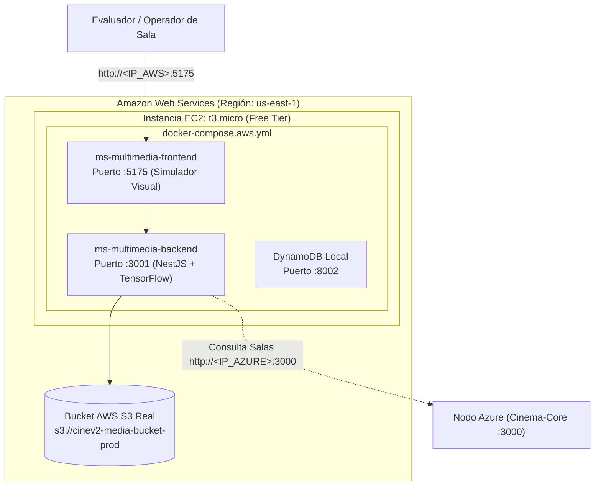

# Despliegue en Amazon Web Services (AWS) — 00. Resumen General (Nodo Multimedia + AWS S3)

## 1. Rol de AWS en la Arquitectura Multi-Cloud

En esta arquitectura distribuida, **Amazon Web Services (AWS)** se encarga del **almacenamiento en la nube mediante un Bucket real de AWS S3** y del **procesamiento multimedia con visión artificial**:

- **Almacenamiento en la Nube (AWS S3 Bucket):**
  - Bucket real `s3://cinev2-media-bucket-prod` ubicado en `us-east-1`.
  - Almacena las imágenes de cartelera, posters de películas y capturas de salas.
  - Consumido por `ms-multimedia` y por `ms-cinema-core` (en Azure) mediante el SDK oficial de AWS (`@aws-sdk/client-s3`).
- **Microservicio Multimedia (`ms-multimedia`):**
  - Backend en **NestJS (Node.js)** en el puerto `3001`, con el modelo de visión artificial **TensorFlow COCO-SSD** para simular la detección de ocupación de butacas en salas.
  - Frontend en **React + Vite** en el puerto `5175` (Simulador de Transmisiones de Sala).
- **Manifiesto de Ejecución:** `docker-compose.aws.yml`.

---

## 2. Diagrama del Nodo AWS

---

## 3. Matriz de Enlaces Públicos del Nodo AWS

| Servicio | URL Pública Directa | Función en el Examen |
| :--- | :--- | :--- |
| **Simulador Multimedia de Salas** | `http://<IP_AWS>:5175` | Visor de cámaras de sala y renderizado de butacas detectadas. |
| **API Multimedia** | `http://<IP_AWS>:3001` | Endpoints de inferencia de ocupación y subida de multimedia a S3. |
| **Almacenamiento S3** | `s3://cinev2-media-bucket-prod` | Bucket de posters accesible mediante AWS CLI o SDK. |

---

## 4. Costo Total en AWS

- **Instancia EC2 t3.micro:** \$0.00 USD (750 horas/mes incluidas en el Free Tier de 12 meses).
- **Almacenamiento S3 (5 GB):** \$0.00 USD (5 GB de almacenamiento estándar incluidos en Free Tier).
- **TOTAL EN AWS:** **$0.00 USD / mes**.
