# Despliegue en Amazon Web Services (AWS) — 00. Resumen General

## 1. Propósito y Arquitectura de Producción

Este documento define la arquitectura física y operativa para desplegar el ecosistema **CineV2** en **Amazon Web Services (AWS)** bajo el nivel de coste más bajo posible, aprovechando la capa gratuita (**AWS Free Tier** de 12 meses o **Amazon Lightsail** a $3.50-$5.00 USD/mes).

### Arquitectura de Producción Contenerizada en AWS

```mermaid
flowchart TB
    Internet([Usuarios en Internet]) --> Route53["DNS / Dominio (Route 53 o DNS Externo)"]
    Route53 -->|"HTTP (80) / HTTPS (443)"| EIP["AWS Elastic IP / Puerta de Entrada"]
    
    subgraph VPC ["VPC de AWS (us-east-1)"]
        subgraph SecurityGroup ["Security Group: cinev2-sg (Puertos 22, 80, 443)"]
            subgraph EC2 ["Instancia EC2 (t4g.small / t3.micro) o Lightsail"]
                NginxProxy["Nginx Reverse Proxy + Certbot SSL Let's Encrypt"]
                Swap["4 GB Swap Space (Memoria Virtual para Java/NestJS)"]
                
                subgraph DockerBridge ["Red Interna: cinev2-network"]
                    FrontAuth["Frontend Auth & Stepper (:5174)"]
                    FrontCore["Frontend Admin Angular (:4200)"]
                    FrontBol["Frontend Boleteo Cámara (:5177)"]
                    FrontMov["Frontend Móvil PWA (:5173)"]
                    FrontIA["Frontend IA Consola (:5176)"]
                    FrontMed["Frontend Multimedia (:5175)"]

                    BackAuth["MS Ticket-Auth (Spring Boot Java 21 :8081)"]
                    BackCore["MS Cinema-Core (NestJS :3000)"]
                    BackBol["MS Boleteo-Validator (Laravel :8000)"]
                    BackIA["MS IA-MCP (FastAPI :8001)"]
                    BackMed["MS Multimedia (NestJS + TF :3001)"]

                    DBAuth[("PostgreSQL 15 (:5434)<br/>db_tickets_auth")]
                    DBCore[("PostgreSQL 15 (:5433)<br/>db_cinema_core")]
                    MinIO[("MinIO S3 Emulado (:9000)<br/>Posters & Tickets")]
                    DynamoLocal[("DynamoDB Local (:8002)<br/>Analítica de Filas")]
                    N8N["n8n Automation (:5678)"]
                end

                NginxProxy --> FrontAuth
                NginxProxy --> FrontCore
                NginxProxy --> FrontBol
                NginxProxy --> FrontMov
                NginxProxy --> FrontIA
            end
        end
    end
```

---

## 2. Prerrequisitos y Costes Estimados

### Prerrequisitos
- Cuenta de AWS activa (con tarjeta de crédito vinculada y verificación completada).
- AWS CLI instalado localmente o acceso a la consola web de AWS.
- Par de llaves SSH generado (`cinev2-key.pem`).
- Un dominio propio o el uso de un DNS comodín gratuito basado en IP (`<TU_IP_PUBLICA>.sslip.io` o `<TU_IP_PUBLICA>.nip.io`).

### Desglose de Costes y Capa Gratuita (Free Tier)

| Recurso | Tipo en AWS | Beneficio Free Tier (12 Meses) | Costo Residual Fuera de Free Tier |
| :--- | :--- | :--- | :--- |
| **Cómputo (VM)** | EC2 `t3.micro` o `t4g.small` (Ubuntu 22.04 LTS) | 750 horas mensuales (100% cubierto) | ~$6.00 a $8.00 USD/mes |
| **Alternativa Lightsail** | Instancia Linux 2GB RAM / 1 vCPU / 60GB SSD | Primeros 3 meses gratis | $5.00 USD/mes tarifa plana fija |
| **Almacenamiento en Disco** | EBS gp3 de 30 GB | 30 GB mensuales cubiertos en Free Tier | ~$2.40 USD/mes |
| **Dirección IP Pública** | Elastic IP asignada a instancia activa | Sin cargo mientras la instancia esté encendida | ~$0.005 / hora si se desasocia |
| **Certificados SSL** | Let's Encrypt mediante Certbot | 100% gratuito siempre | **$0.00 USD** |
| **Total Estimado** | — | **$0.00 USD / mes** | **~$5.00 a $8.50 USD / mes** |

---

## 3. Matriz de Responsabilidades y Asignación de Servidores

- **DevOps / SysAdmin:** Responsable de la creación de la instancia EC2, configuración del Security Group, aprovisionamiento del espacio de Swap, emisión de certificados SSL con Certbot y despliegue del `docker-compose.yml`. Posee el archivo `cinev2-key.pem` y acceso SSH.
- **Administrador de Cine:** Gestiona películas, salas y funciones desde la URL `https://admin.<TU_DOMINIO>` (o subruta). No requiere ni debe tener acceso SSH al servidor host.
- **Boletero:** Accede desde la URL segura con HTTPS `https://boleteo.<TU_DOMINIO>` para poder operar la cámara de lectura QR sin bloqueos de navegador.
- **Auditor Comercial:** Monitorea métricas y reportes desde `https://ia.<TU_DOMINIO>`.

---

## 4. Riesgos Identificados y Mitigaciones Técnicas

| Riesgo Operativo | Causa Raíz | Mitigación Técnica en AWS |
| :--- | :--- | :--- |
| **Agotamiento de Memoria (OOM Kill)** | Java 21 (Spring Boot) + Node.js + TensorFlow en VM de 1-2 GB de RAM. | Configuración obligatoria de **4 GB de archivo Swap** en el disco EBS gp3 y fijación de límites de JVM (`-Xmx384m`). |
| **Bloqueo de Cámara Web en Boletero** | Navegador exige HTTPS para activar `navigator.mediaDevices`. | Nginx configurado con terminación SSL vía Certbot Let's Encrypt en el puerto 443 antes de servir el frontend `:5177`. |
| **Cargos Inesperados por IP Flotante** | Elastic IP reservada sin instancia asociada. | Mantener la Elastic IP siempre enlazada a la instancia EC2 en ejecución. |
| **Pérdida de Datos en Reinicios** | Desmontaje de contenedores sin volúmenes persistentes. | Mapeo persistente de datos en volúmenes Docker de tipo volumen nombrado en `/var/lib/docker/volumes/`. |

