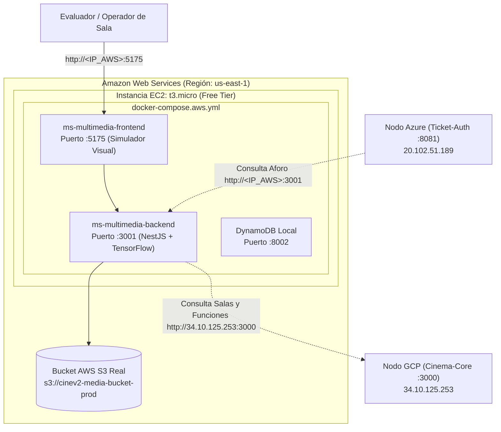

# Despliegue en Amazon Web Services (AWS) — 00. Resumen General (Nodo Multimedia + AWS S3)

## 1. Rol de AWS en la Arquitectura Multi-Cloud

En esta arquitectura distribuida, **Amazon Web Services (AWS)** se encarga del **almacenamiento en la nube mediante un Bucket real de AWS S3** y del **procesamiento multimedia con visión artificial**:

- **Almacenamiento en la Nube (AWS S3 Bucket):**
  - Bucket real `s3://cinev2-media-bucket-prod` ubicado en la región `us-east-1` (Norte de Virginia).
  - Almacena imágenes de cartelera, posters de películas y capturas de salas.
  - Consumido por `ms-multimedia` y por el portal de clientes mediante el SDK oficial de AWS (`@aws-sdk/client-s3`).
- **Microservicio Multimedia (`ms-multimedia`):**
  - Backend en **NestJS (Node.js)** en el puerto `3001`, con el modelo de visión artificial **TensorFlow COCO-SSD** para simular la detección de ocupación de butacas en salas.
  - Frontend en **React + Vite** en el puerto `5175` (Simulador de Transmisiones de Sala).
- **Base de Datos NoSQL DynamoDB Local:**
  - Puerto `8002` (mapeado al contenedor `dynamodb-local:8000`) para registrar eventos de congestión y aforo.
- **Manifiesto de Ejecución:** `docker-compose.aws.yml`.

---

## 2. Diagrama del Nodo AWS en el Ecosistema Multi-Cloud

---

## 3. Matriz de Enlaces Públicos del Nodo AWS

| Servicio | URL Pública Directa | Función en el Proyecto |
| :--- | :--- | :--- |
| **Simulador Multimedia de Salas** | `http://<IP_AWS>:5175` | Visor de cámaras de sala y renderizado de butacas detectadas con TensorFlow. |
| **API Multimedia (NestJS)** | `http://<IP_AWS>:3001` | Endpoints de inferencia de ocupación y subida de multimedia a S3. |
| **Almacenamiento S3** | `s3://cinev2-media-bucket-prod` | Bucket de posters accesible públicamente en la nube. |

---

## 4. Costo Total en AWS

- **Instancia EC2 t3.micro (o t2.micro):** \$0.00 USD (750 horas/mes incluidas en la capa gratuita *Free Tier* de 12 meses).
- **Disco EBS de 30 GB gp3:** \$0.00 USD (Hasta 30 GB de almacenamiento EBS estándar incluidos en *Free Tier*).
- **Almacenamiento S3 (5 GB):** \$0.00 USD (5 GB de almacenamiento estándar incluidos en *Free Tier*).
- **TOTAL EN AWS:** **$0.00 USD / mes**.

---

## 5. Índice de Guías Paso a Paso para AWS

1. [01_CONFIGURAR_PROYECTO.md](file:///docs/deploy/aws/01_CONFIGURAR_PROYECTO.md) — Configuración del archivo `.env` en la raíz.
2. [02_CREAR_INFRAESTRUCTURA.md](file:///docs/deploy/aws/02_CREAR_INFRAESTRUCTURA.md) — Guía visual paso a paso en la consola web para crear S3, credenciales IAM y EC2.
3. [03_INSTALAR_HERRAMIENTAS.md](file:///docs/deploy/aws/03_INSTALAR_HERRAMIENTAS.md) — Swap obligatorio de 4 GB, Docker y Docker Compose V2.
4. [04_DESPLEGAR_Y_VERIFICAR.md](file:///docs/deploy/aws/04_DESPLEGAR_Y_VERIFICAR.md) — Clonar, compilar y verificar en el navegador.
5. [05_ACTUALIZAR_PRODUCCION.md](file:///docs/deploy/aws/05_ACTUALIZAR_PRODUCCION.md) — Comandos para actualizar cambios futuros en AWS.
6. [06_APAGAR_Y_REACTIVAR.md](file:///docs/deploy/aws/06_APAGAR_Y_REACTIVAR.md) — Cómo pausar y reactivar la instancia para ahorrar recursos.
