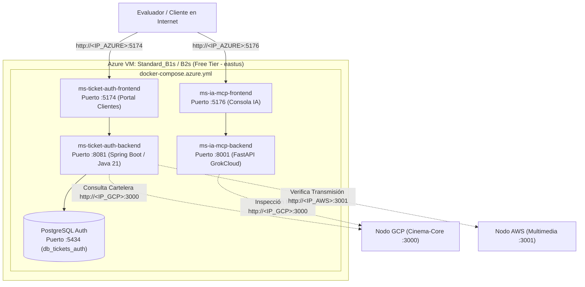

# Despliegue en Microsoft Azure — 00. Resumen General (Nodo Ticket-Auth + IA-MCP)

## 1. Rol de Microsoft Azure en la Arquitectura Multi-Cloud

En esta arquitectura distribuida, **Microsoft Azure** actúa como el **nodo central de autenticación, emisión de boletos, seguridad criptográfica y auditoría con Inteligencia Artificial**:

- **Microservicio Ticket-Auth (`ms-ticket-auth`):**
  - Backend en **Spring Boot 3 (Java 21)** en el puerto `8081` con base de datos **PostgreSQL 15** en el puerto `5434`.
  - Frontend en **React + Vite** en el puerto `5174` (Portal Principal de Compra y Chatbot de Clientes).
  - Emisión de boletos con firmas criptográficas HMAC-SHA256 y autenticación JWT.
- **Microservicio IA-MCP (`ms-ia-mcp`):**
  - Backend en **FastAPI (Python 3.11)** en el puerto `8001`, integrado con xAI / GrokCloud y el protocolo Model Context Protocol (MCP).
  - Frontend en **React + Vite** en el puerto `5176` (Consola de Auditoría Inteligente).
- **Manifiesto de Ejecución:** `docker-compose.azure.yml`.

---

## 2. Diagrama del Nodo Azure

---

## 3. Matriz de Enlaces Públicos del Nodo Azure

| Servicio | URL Pública Directa | Framework / Tecnología | Función en el Examen |
| :--- | :--- | :--- | :--- |
| **Portal Clientes / Login** | `http://<IP_AZURE>:5174` | React + Vite | Catálogo, selección de butacas y checkout. |
| **Consola de Auditoría IA** | `http://<IP_AZURE>:5176` | React + Vite | Chatbot inteligente y auditoría de operaciones. |
| **API Ticket-Auth** | `http://<IP_AZURE>:8081` | Spring Boot 3 (Java 21) | Endpoints REST de boletos y tokens JWT. |
| **API IA-MCP** | `http://<IP_AZURE>:8001` | FastAPI (Python 3.11) | Servidor MCP y consultas a GrokCloud. |
| **Health Check Auth** | `http://<IP_AZURE>:8081/actuator/health` | Spring Boot Actuator | `{"status":"UP"}`. |

---

## 4. Costo Total en Azure

- **VM Standard_B1s:** \$0.00 USD (750 horas/mes incluidas en el Free Tier de 12 meses + $200 USD de crédito de bienvenida).
- **Disco OS 64 GB SSD P6:** \$0.00 USD (Cubierto en cuenta gratuita).
- **TOTAL EN AZURE:** **$0.00 USD / mes**.
