# Despliegue en Microsoft Azure — 00. Resumen General de Arquitectura

## 1. Visión General de la Infraestructura en Azure

El ecosistema **CineV2** está diseñado para ejecutarse en **Microsoft Azure** bajo un modelo de cómputo unificado y optimizado de costo mínimo, utilizando los beneficios de la **Capa Gratuita de Azure (Azure Free Tier)** y el crédito de bienvenida de \$200 USD:

- **Máquina Virtual:** Instancia `Standard_B1s` (1 vCPU, 1 GB RAM) incluida en los **12 meses gratuitos** (750 horas al mes para Linux).
- **Almacenamiento:** Disco administrado de 64 GB SSD estándar (`StandardSSD_LRS` o `Standard_LRS`), de los cuales hasta 64 GB P6 están incluidos en promociones de cuenta gratuita o con coste inferior a \$3.00 USD/mes.
- **Red:** Virtual Network (VNet) con Network Security Group (NSG) filtrando únicamente los puertos 22 (SSH), 80 (HTTP) y 443 (HTTPS).
- **Optimización de Cómputo:** Swapfile de 4 GB configurado en el sistema operativo host para absorber la compilación en paralelo de microservicios y picos de memoria de Java 21 y Node.js.
- **Terminación SSL y W3C Compliance:** Nginx Reverse Proxy gestiona los certificados SSL automáticos con Let's Encrypt, garantizando el protocolo HTTPS estricto indispensable para el funcionamiento de la cámara del boletero en el navegador.

---

## 2. Diagrama de Arquitectura de Red y Contenedores en Azure

```mermaid
flowchart TD
    subgraph Azure_Cloud["Microsoft Azure (Región: eastus)"]
        subgraph VNet["Virtual Network (vnet-cinev2 / 10.0.0.0/16)"]
            subgraph Subnet["Subred Pública (subnet-cinev2 / 10.0.1.0/24)"]
                NSG["Network Security Group<br/>(nsg-cinev2)<br/>Permitidos: 22, 80, 443"]
                
                subgraph VM["Azure Virtual Machine: vm-cinev2-prod<br/>(Standard_B1s: 1 vCPU, 1 GB RAM + 4GB Swap)"]
                    Nginx["Nginx Reverse Proxy & SSL (Let's Encrypt)"]
                    
                    subgraph Docker_Network["Docker Bridge Network (cinev2-net)"]
                        AuthFE["ms-ticket-auth-frontend<br/>:5174 (React)"]
                        CoreFE["ms-cinema-core-frontend<br/>:4200 (Angular)"]
                        BoleteroFE["ms-boleteo-validator-frontend<br/>:5177 (React + Cámara)"]
                        IAFE["ms-ia-mcp-frontend<br/>:5176 (React Console)"]
                        MediaFE["ms-multimedia-frontend<br/>:5175 (React Viewer)"]
                        
                        AuthBE["ms-ticket-auth-backend<br/>:8081 (Spring Boot 3 / Java 21)"]
                        CoreBE["ms-cinema-core-backend<br/>:3000 (NestJS TypeORM)"]
                        MediaBE["ms-multimedia-backend<br/>:3001 (NestJS TensorFlow)"]
                        IABe["ms-ia-mcp-backend<br/>:8001 (FastAPI GrokCloud)"]
                        BoleteroBE["ms-boleteo-validator-backend<br/>:8000 (Laravel 11)"]
                        
                        PGAuth[("PostgreSQL Auth<br/>:5434")]
                        PGCore[("PostgreSQL Core<br/>:5433")]
                        MinIO[("MinIO S3<br/>:9000")]
                        Dynamo[("DynamoDB Local<br/>:8002")]
                    end
                end
            end
        end
    end

    Usuario["Navegador Web / Celular Boletero"] -->|HTTPS :443| NSG
    NSG --> Nginx
    Nginx -->|cine.tudominio.com| AuthFE
    Nginx -->|admin.tudominio.com| CoreFE
    Nginx -->|boletero.tudominio.com| BoleteroFE
    Nginx -->|ia-audit.tudominio.com| IAFE
    Nginx -->|multimedia.tudominio.com| MediaFE
    Nginx -->|api.tudominio.com| AuthBE & CoreBE & MediaBE & IABe & BoleteroBE
```

---

## 3. Estimación y Desglose de Costes (Azure Free Tier vs Producción)

| Concepto de Recurso | Nivel Gratuito de Azure (12 Meses) | Costo Mensual en Free Tier | Costo Estimado sin Free Tier |
| :--- | :--- | :--- | :--- |
| **VM Standard_B1s** (1 vCPU, 1 GB) | 750 horas/mes incluidas durante 12 meses | **$0.00 USD** | ~$7.59 USD/mes |
| **Disco Administrado OS** (64 GB P6 SSD) | Hasta 64 GB SSD incluidos en cuenta gratuita | **$0.00 USD** | ~$3.84 USD/mes |
| **Dirección IP Pública (Standard)** | $0.004 USD/hora o incluida con la NIC | **$0.00 – $2.80 USD** | ~$2.80 USD/mes |
| **Ancho de Banda de Salida (Egress)** | 15 GB/mes incluidos de transferencia saliente | **$0.00 USD** | $0.087 por GB adicional |
| **Certificados SSL Let's Encrypt** | Certbot open-source ilimitado | **$0.00 USD** | $0.00 USD |
| **TOTAL ESTIMADO:** | — | **$0.00 a $2.80 USD/mes** | **~$14.23 USD/mes** |

> [!NOTE]
> Durante los primeros 30 días, Azure otorga un saldo promocional de **$200 USD de crédito**. Puede usar este saldo si prefiere probar una máquina `Standard_B2s` (2 vCPU, 4 GB RAM) para un rendimiento más desahogado durante el montaje inicial sin pagar nada.

---

## 4. Riesgos Operativos y Mitigaciones en Azure

1. **Memoria RAM Limitada en B1s (1 GB):**
   - *Riesgo:* Bloqueo por `Out Of Memory (OOM Killer)` al iniciar Spring Boot o compilar proyectos Node.js.
   - *Mitigación:* Se crea obligatoriamente un archivo Swap de 4 GB (`/swapfile`) y se restringe la JVM a `-Xms128m -Xmx384m`.
2. **Desasignación de la Máquina Virtual (Deallocate vs Stop):**
   - *Riesgo:* Si se detiene la VM desde el sistema operativo (`sudo poweroff`), Azure la marca como *Stopped*, pero sigue cobrando la reserva de hardware.
   - *Mitigación:* Siempre usar `az vm deallocate` para liberar la asignación de hardware y detener la facturación de cómputo.
3. **Restricción de Acceso a la Cámara en Boletero:**
   - *Riesgo:* `getUserMedia` exige origen seguro (HTTPS).
   - *Mitigación:* Nginx gestiona certificados SSL válidos emitidos por Let's Encrypt mediante Certbot sobre el subdominio del boletero.

