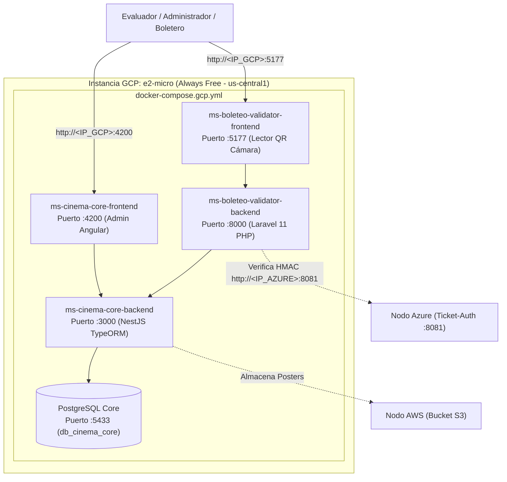

# Despliegue en Google Cloud Platform (GCP) — 00. Resumen General (Nodo Cinema-Core + Boleteo)

## 1. Rol de Google Cloud en la Arquitectura Multi-Cloud

En esta arquitectura distribuida, **Google Cloud Platform (GCP)** aloja el **cerebro de administración del cine, cartelera, salas y el control de acceso en puerta**:

- **Microservicio Cinema-Core (`ms-cinema-core`):**
  - Backend en **NestJS (Node.js / TypeORM)** en el puerto `3000` con base de datos **PostgreSQL 15** en el puerto `5433`.
  - Frontend en **Angular 17** en el puerto `4200` (Panel de Administración de Cartelera, Salas y Butacas).
  - Integrado con **AWS S3** para lectura y almacenamiento de posters de películas.
- **Microservicio Boleteo-Validator (`ms-boleteo-validator`):**
  - Backend en **Laravel 11 (PHP 8.2)** en el puerto `8000`, que valida la firma criptográfica HMAC de los boletos comunicándose con el nodo de Azure.
  - Frontend en **React + Vite** en el puerto `5177` (Lector de Códigos QR con Cámara web y móvil).
- **Manifiesto de Ejecución:** `docker-compose.gcp.yml`.

---

## 2. Diagrama del Nodo GCP

---

## 3. Matriz de Enlaces Públicos del Nodo GCP

| Servicio | URL Pública Directa | Framework / Tecnología | Función en el Examen |
| :--- | :--- | :--- | :--- |
| **Panel Admin Cine** | `http://<IP_GCP>:4200` | Angular 17 | Gestión de salas, butacas, películas y cartelera. |
| **Validador de Boleteo (Cámara)** | `http://<IP_GCP>:5177` | React + Inertia | **Escáner QR en puerta** y validación de boletos en vivo. |
| **API Cinema-Core** | `http://<IP_GCP>:3000` | NestJS + TypeORM | API de salas y funciones consultada por Azure y AWS. |
| **API Boleteo-Validator** | `http://<IP_GCP>:8000` | Laravel 11 (PHP 8.2) | Endpoint de validación criptográfica HMAC. |

---

## 4. Costo Total en GCP

- **Instancia Compute Engine e2-micro:** \$0.00 USD (Always Free de por vida en us-central1).
- **Disco de 30 GB pd-standard:** \$0.00 USD (Always Free).
- **TOTAL EN GCP:** **$0.00 USD / mes**.
