# Despliegue en Google Cloud Platform (GCP) — 00. Resumen General

## 1. Propósito y Arquitectura de Producción

Este documento define la arquitectura física y operativa para desplegar el ecosistema **CineV2** en **Google Cloud Platform (GCP)** bajo el nivel de coste más bajo posible, aprovechando el programa **GCP Always Free Tier** (gratuito de forma vitalicia sin vencimiento a los 12 meses).

### Arquitectura de Producción en GCP Compute Engine

```mermaid
flowchart TB
    Internet([Usuarios en Internet]) --> CloudDNS["Cloud DNS / Dominio Externo"]
    CloudDNS -->|"HTTP (80) / HTTPS (443)"| StaticIP["GCP External Static IP"]
    
    subgraph VPC ["VPC Network (Región: us-central1)"]
        subgraph FirewallRules ["Firewall Rules: cinev2-allow-web (Puertos 22, 80, 443)"]
            subgraph GCE ["Instancia Compute Engine (e2-micro - Always Free)"]
                NginxProxy["Nginx Reverse Proxy + Certbot SSL Let's Encrypt"]
                Swap["4 GB Swap Space (Memoria Virtual sobre Disco Persistente)"]
                
                subgraph DockerBridge ["Red Docker: cinev2-network"]
                    FrontAuth["Frontend Auth & Stepper (:5174)"]
                    FrontCore["Frontend Admin Angular (:4200)"]
                    FrontBol["Frontend Boleteo Cámara (:5177)"]
                    FrontMov["Frontend Móvil PWA (:5173)"]
                    FrontIA["Frontend IA Consola (:5176)"]
                    FrontMed["Frontend Multimedia (:5175)"]

                    BackAuth["MS Ticket-Auth (Spring Boot Java 21 :8081)"]
                    BackCore["MS Cinema-Core (NestJS :3000)"]
                    BackBol["MS Boleteo-Validator (Laravel :8000)"]
                    BackIA["MS IA-MCP (FastAPI :8001)"]
                    BackMed["MS Multimedia (NestJS + TF :3001)"]

                    DBAuth[("PostgreSQL 15 (:5434)<br/>db_tickets_auth")]
                    DBCore[("PostgreSQL 15 (:5433)<br/>db_cinema_core")]
                    MinIO[("MinIO S3 Emulado (:9000)<br/>Posters & Tickets")]
                    DynamoLocal[("DynamoDB Local (:8002)<br/>Analítica de Filas")]
                    N8N["n8n Automation (:5678)"]
                end

                NginxProxy --> FrontAuth
                NginxProxy --> FrontCore
                NginxProxy --> FrontBol
                NginxProxy --> FrontMov
                NginxProxy --> FrontIA
            end
        end
    end
```

---

## 2. Prerrequisitos y Beneficios del Always Free Tier de GCP

### Prerrequisitos
- Proyecto de GCP activo con facturación habilitada (necesaria para activar APIs, aunque no se cobre en el rango Free).
- Google Cloud SDK (`gcloud` CLI) instalado localmente o uso de **Google Cloud Shell** en el navegador.
- Dominio propio o DNS comodín gratuito basado en IP (`<TU_IP_PUBLICA>.sslip.io` o `<TU_IP_PUBLICA>.nip.io`).

### Desglose de Costes y Capa Gratuita (Always Free)

| Recurso | Tipo en GCP | Beneficio Always Free (Sin Vencimiento) | Costo Residual |
| :--- | :--- | :--- | :--- |
| **Cómputo (VM)** | Compute Engine `e2-micro` (2 vCPUs compartidas, 1 GB RAM) en `us-central1`, `us-east1` o `us-west1`. | **1 instancia al 100% gratuita de por vida** (744 horas al mes cubiertas). | **$0.00 USD / mes** |
| **Almacenamiento en Disco** | Disco persistente estándar (pd-standard) de 30 GB. | **30 GB mensuales cubiertos en Always Free** | **$0.00 USD / mes** |
| **Dirección IP Externa** | Dirección IPv4 externa estática asignada a VM activa. | Gratuita mientras la instancia `e2-micro` esté corriendo. | ~$0.01 / hora si se desasocia |
| **Tráfico Saliente** | Tráfico de red hacia Internet | 1 GB mensual gratuito hacia todas las regiones (excepto China/Australia). | ~$0.12 por GB excedente |
| **Certificados SSL** | Let's Encrypt mediante Certbot Nginx | 100% gratuito siempre | **$0.00 USD** |
| **Total Estimado** | — | **$0.00 USD / mes** | **$0.00 USD / mes** |

---

## 3. Matriz de Responsabilidades y Asignación de Servidores en GCP

- **DevOps / SysAdmin:** Administra el proyecto GCP, crea la instancia `e2-micro`, gestiona reglas de firewall en VPC, configura la memoria Swap de 4 GB y renueva certificados SSL. Acceso mediante `gcloud compute ssh`.
- **Administrador del Complejo (Gerente):** Accede a `https://admin.<TU_DOMINIO>` (`:4200`) para registrar salas, butacas y películas. Sin credenciales de GCP ni acceso a la consola de Google Cloud.
- **Boletero:** Accede a `https://boleteo.<TU_DOMINIO>` (`:5177`) para validar entradas con cámara en vivo sin bloqueos de navegador.
- **Auditor Comercial:** Accede a `https://ia.<TU_DOMINIO>` (`:5176`) para trazabilidad de boletos y reportes automáticos.

