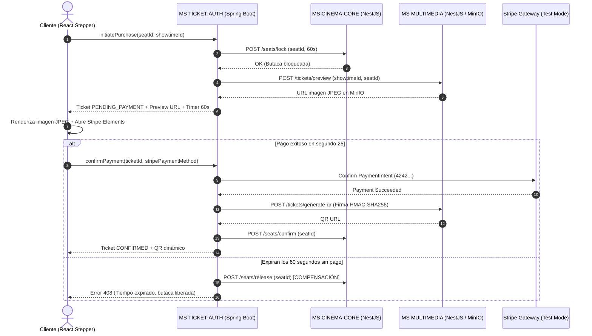

# Plan Técnico: Módulo 01 - Autenticación Centralizada y Gestión de Boletos (MS TICKET-AUTH)

> **Estado:** APPROVED  
> **Versión:** 1.0.0  
> **Módulo:** `docs/specs/01-auth-tickets/`  
> **Especificación Base:** `docs/specs/01-auth-tickets/spec.md`  
> **Constitución Base:** `docs/constitution.md`  
> **Metodología:** SDD-Planning

---

## 1. Resumen Arquitectónico y Decisiones de Diseño

- **Objetivo Técnico:** Implementar el microservicio de autenticación, emisión de tokens JWT, orquestación SAGA de compra de boletos e integración con Stripe, implementando una arquitectura Hexagonal (Puertos y Adaptadores) en Spring Boot 3 (Java 21) para el backend y un frontend desacoplado en React para el portal de acceso único y Stepper de pago.
- **Estilo Arquitectónico:** Arquitectura Hexagonal con separación estricta:
  - *Dominio:* Entidades puras (`User`, `Ticket`), Value Objects y excepciones de dominio libres de frameworks.
  - *Aplicación:* Casos de uso de autenticación, compra de boleto y orquestación SAGA con compensaciones síncronas.
  - *Infraestructura:* Adaptadores Spring Data JPA (PostgreSQL), Spring Security con BCrypt, GraphQL Controller / Schema Federado, cliente HTTP para MS Cinema Core / Multimedia y SDK oficial de Stripe.
  - *Presentación:* Portal de login unificado con botones de acceso Demo 1-Click y Stepper UI de 4 etapas.
- **Decisiones Técnicas Clave:**
  - **Concurrencia y SAGA:** Orquestación centralizada en `PurchaseTicketSagaCoordinator`. Manejo de temporizador de 60 segundos mediante tarea programada (`ScheduledExecutorService` / Redis / DB timestamp check) que gatilla compensación hacia `MS CINEMA-CORE` si el pago expira.
  - **Seguridad:** BCryptPasswordEncoder con factor de costo 10. Emisión de JWT firmado con algoritmo HMAC-SHA256 y tiempo de expiración de 8 horas.
  - **Stripe:** Uso de `PaymentIntent` de Stripe en modo desarrollador con captura síncrona/webhook de prueba.

### 1.1 Matriz de Componentes Técnicos (`PLAN-XX`)

| ID Componente | Nombre / Artefacto Técnico | Capa Arquitectónica | Responsabilidad Técnica | Requisitos que Cubre |
| :--- | :--- | :--- | :--- | :--- |
| **`PLAN-01`** | `V1__init_auth_tickets.sql` / JPA Entities | Infraestructura / Datos | Esquema PostgreSQL, tablas `users` y `tickets`, índices y restricciones. | `RF-01.1`, `RB-AUTH-01`, `RB-AUTH-02` |
| **`PLAN-02`** | `User`, `Ticket`, `TicketState`, Domain Failures | Dominio | Entidades puras, máquina de estados y excepciones tipadas. | `RB-AUTH-02`, `RB-AUTH-03`, `RB-AUTH-05` |
| **`PLAN-03`** | `AuthenticateUserUseCase`, `PurchaseTicketSagaUseCase` | Aplicación | Orquestación de login, bloqueo temporal de butacas y transacciones SAGA. | `HU-01`, `HU-02`, `RF-02.1`, `RF-02.5` |
| **`PLAN-04`** | `CinemaCoreClient`, `MultimediaClient`, `StripeAdapter` | Infraestructura | Clientes HTTP inter-servicio y pasarela externa Stripe. | `RF-02.1`, `RF-02.2`, `RF-02.3` |
| **`PLAN-05`** | `AuthGraphQLController`, `LoginDemoView`, `StepperPaymentUI` | Presentación | Resolvers GraphQL, pantalla de login único con botones Demo y Stepper de 4 pasos. | `HU-01`, `HU-02`, `HU-03`, `RF-01.2` |

---

## 2. Estructura Física de Archivos del Módulo

```text
services/ms-ticket-auth/
├── backend/
│   ├── pom.xml                                                                       # Dependencias Maven (Spring Boot, GraphQL, Security, Stripe)
│   ├── src/main/resources/
│   │   ├── application.yml                                                           # Configuración de puerto 8081, PostgreSQL, JWT secret y Stripe
│   │   ├── graphql/schema.graphqls                                                   # Esquema GraphQL federado con Ticket, Showtime, User
│   │   └── db/migration/V1__init_auth_tickets.sql                                    # [CREATE] (PLAN-01) Migración Flyway/PostgreSQL
│   └── src/main/java/com/cine/auth/
│       ├── domain/
│       │   ├── model/
│       │   │   ├── User.java                                                         # [CREATE] (PLAN-02) Entidad de usuario y rol
│       │   │   ├── Ticket.java                                                       # [CREATE] (PLAN-02) Entidad de boleto y ciclo de vida
│       │   │   └── TicketStatus.java                                                 # [CREATE] (PLAN-02) Enum (PENDING_PAYMENT, CONFIRMED, USED, CANCELLED)
│       │   ├── exception/
│       │   │   ├── DomainException.java                                              # [CREATE] (PLAN-02) Excepción base tipada
│       │   │   ├── SeatAlreadyReservedException.java                                 # [CREATE] (PLAN-02) Conflicto de asiento
│       │   │   └── PaymentExpiredException.java                                      # [CREATE] (PLAN-02) Expiración de 60 segundos
│       │   └── repository/
│       │       ├── UserRepositoryPort.java                                           # [CREATE] (PLAN-02) Puerto de usuarios
│       │       └── TicketRepositoryPort.java                                         # [CREATE] (PLAN-02) Puerto de boletos
│       ├── application/
│       │   ├── dto/
│       │   │   ├── LoginRequestDto.java                                              # [CREATE] (PLAN-03) Payload de login
│       │   │   ├── AuthResponseDto.java                                              # [CREATE] (PLAN-03) Token JWT y perfil de usuario
│       │   │   ├── InitiatePurchaseDto.java                                          # [CREATE] (PLAN-03) Datos de butaca y función
│       │   │   └── ConfirmPaymentDto.java                                            # [CREATE] (PLAN-03) Confirmación con Stripe PaymentIntent
│       │   ├── usecase/
│       │   │   ├── AuthenticateUserUseCase.java                                      # [CREATE] (PLAN-03) Verificación BCrypt y JWT
│       │   │   ├── RegisterUserUseCase.java                                          # [CREATE] (PLAN-03) Registro con BCrypt
│       │   │   └── PurchaseTicketSagaCoordinator.java                                # [CREATE] (PLAN-03) Orquestador SAGA de 60s
│       ├── infrastructure/
│       │   ├── adapter/
│       │   │   ├── JpaUserRepositoryAdapter.java                                     # [CREATE] (PLAN-04) Implementación JPA de UserRepositoryPort
│       │   │   ├── JpaTicketRepositoryAdapter.java                                   # [CREATE] (PLAN-04) Implementación JPA de TicketRepositoryPort
│       │   │   ├── CinemaCoreRestClient.java                                         # [CREATE] (PLAN-04) Cliente HTTP hacia MS CINEMA-CORE
│       │   │   ├── MultimediaRestClient.java                                         # [CREATE] (PLAN-04) Cliente HTTP hacia MS MULTIMEDIA
│       │   │   └── StripePaymentGatewayAdapter.java                                  # [CREATE] (PLAN-04) Adaptador de API Stripe (test cards)
│       │   ├── config/
│       │   │   ├── SecurityConfig.java                                               # [CREATE] (PLAN-04) Spring Security + JWT Filter
│       │   │   └── DatabaseSeeder.java                                               # [CREATE] (PLAN-01) Carga de 3 usuarios demo y datos iniciales
│       │   └── presentation/
│       │       ├── AuthGraphQLResolver.java                                          # [CREATE] (PLAN-05) Query y Mutation GraphQL
│       │       └── TicketGraphQLResolver.java                                        # [CREATE] (PLAN-05) Resolver federado para Tickets
│       └── src/test/java/com/cine/auth/
│           ├── domain/TicketDomainTest.java                                          # [CREATE] Test unitario de reglas de boleto
│           ├── application/PurchaseSagaTest.java                                     # [CREATE] Test de compensación SAGA de 60s
│           └── presentation/AuthGraphQLIntegrationTest.java                          # [CREATE] Test BDD de endpoints GraphQL
│
└── frontend/
    ├── package.json                                                                  # React 18, Vite, Apollo Client, TailwindCSS, Stripe Elements
    ├── src/
    │   ├── components/
    │   │   ├── LoginView.tsx                                                         # [CREATE] (PLAN-05) Portal único de login con botones Demo 1-Click
    │   │   ├── StepperPayment.tsx                                                    # [CREATE] (PLAN-05) Stepper UI de 4 etapas con cronómetro de 60s
    │   │   ├── TicketPreview.tsx                                                     # [CREATE] (PLAN-05) Renderizado de JPEG desde MinIO S3
    │   │   └── StripePaymentWrapper.tsx                                              # [CREATE] (PLAN-05) Contenedor de Stripe Elements de prueba
    │   └── tests/
    │       └── LoginAndPurchase.spec.tsx                                             # [CREATE] Test BDD visual de login demo y compra
```

---

## 3. Modelo Físico de Persistencia (PostgreSQL `db_tickets_auth`)

### 3.1 Tablas Físicas

#### Tabla: `users`
| Columna | Tipo Físico | Nulabilidad | Restricciones / Índices | Propósito |
| :--- | :--- | :--- | :--- | :--- |
| `id` | `UUID` | `NOT NULL` | `PRIMARY KEY` | Identificador único |
| `full_name` | `VARCHAR(100)` | `NOT NULL` | | Nombre del usuario |
| `email` | `VARCHAR(120)` | `NOT NULL` | `UNIQUE`, `INDEX idx_users_email` | Correo de login |
| `password_hash`| `VARCHAR(255)` | `NOT NULL` | | Clave encriptada con BCrypt |
| `role` | `VARCHAR(20)` | `NOT NULL` | `CHECK (role IN ('ADMIN','CLIENTE','BOLETERO'))` | Perfil de acceso |
| `created_at` | `TIMESTAMP UTC` | `NOT NULL` | `DEFAULT CURRENT_TIMESTAMP` | Auditoría |

#### Tabla: `tickets`
| Columna | Tipo Físico | Nulabilidad | Restricciones / Índices | Propósito |
| :--- | :--- | :--- | :--- | :--- |
| `id` | `UUID` | `NOT NULL` | `PRIMARY KEY` | Identificador del boleto |
| `user_id` | `UUID` | `NOT NULL` | `FOREIGN KEY REFERENCES users(id) ON DELETE RESTRICT` | Cliente comprador |
| `showtime_id` | `UUID` | `NOT NULL` | `INDEX idx_tickets_showtime` | Función de la película |
| `seat_id` | `UUID` | `NOT NULL` | | Butaca reservada |
| `amount_paid` | `DECIMAL(10,2)` | `NOT NULL` | `CHECK (amount_paid >= 0)` | Monto de la transacción |
| `status` | `VARCHAR(25)` | `NOT NULL` | `CHECK (status IN ('PENDING_PAYMENT','CONFIRMED','USED','CANCELLED'))` | Estado de ciclo de vida |
| `qr_code_url` | `VARCHAR(500)` | `NULL` | | Enlace al QR firmado de MinIO |
| `ticket_image_url`| `VARCHAR(500)` | `NULL` | | Enlace a la imagen JPEG de MinIO |
| `lock_expires_at`| `TIMESTAMP UTC` | `NOT NULL` | `INDEX idx_tickets_expires` | Límite de los 60 segundos |
| `stripe_payment_id`| `VARCHAR(100)`| `NULL` | | Identificador del PaymentIntent |
| `created_at` | `TIMESTAMP UTC` | `NOT NULL` | `DEFAULT CURRENT_TIMESTAMP` | Fecha de creación |

---

## 4. Contratos de Código e Interfaces Tipadas

### 4.1 Entidad de Dominio (`Ticket.java`)
```java
public class Ticket {
    private final UUID id;
    private final UUID userId;
    private final UUID showtimeId;
    private final UUID seatId;
    private final BigDecimal amountPaid;
    private TicketStatus status;
    private String qrCodeUrl;
    private String ticketImageUrl;
    private final Instant lockExpiresAt;

    public boolean isExpired(Instant now) {
        return this.status == TicketStatus.PENDING_PAYMENT && now.isAfter(lockExpiresAt);
    }

    public void confirmPayment(String qrUrl, String imageUrl) {
        if (this.status != TicketStatus.PENDING_PAYMENT) {
            throw new IllegalStateException("Solo boletos pendientes pueden confirmarse.");
        }
        this.status = TicketStatus.CONFIRMED;
        this.qrCodeUrl = qrUrl;
        this.ticketImageUrl = imageUrl;
    }

    public void cancel() {
        this.status = TicketStatus.CANCELLED;
    }
}
```

### 4.2 Orquestador SAGA de 60 Segundos (`PurchaseTicketSagaCoordinator.java`)
```java
@Service
public class PurchaseTicketSagaCoordinator {
    // 1. Solicita bloqueo a MS CINEMA-CORE
    // 2. Persiste Ticket en estado PENDING_PAYMENT con lock_expires_at = now + 60s
    // 3. Solicita generación de imagen preliminar a MS MULTIMEDIA
    // 4. Si el pago en Stripe falla o vence el temporizador -> Llama a CINEMA-CORE para liberar butaca
}
```

---

## 5. Diagrama de Secuencia de la Compra SAGA



---

## 6. Arquitectura de Vertical Slices para `/sdd-task`

* **Slice 0 (Setup):** `PLAN-01` Migraciones Flyway, configuración Spring Security, JWT y seeder de los 3 usuarios demo con BCrypt.
* **Slice 1 (Portal de Login Único):** `PLAN-03`, `PLAN-05` Endpoint GraphQL de autenticación y vista React con botones de acceso Demo 1-Click (`[Admin]`, `[Cliente]`, `[Boletero]`).
* **Slice 2 (Flujo de Compra SAGA y Stripe):** `PLAN-02`, `PLAN-03`, `PLAN-04`, `PLAN-05` Stepper UI, bloqueo de 60 segundos, previsualización en MinIO, pasarela Stripe y compensación de butaca.
* **Slice 3 (Verificación y Cierre):** Pruebas de integración GraphQL, suites unitarias de SAGA y build consolidado.

