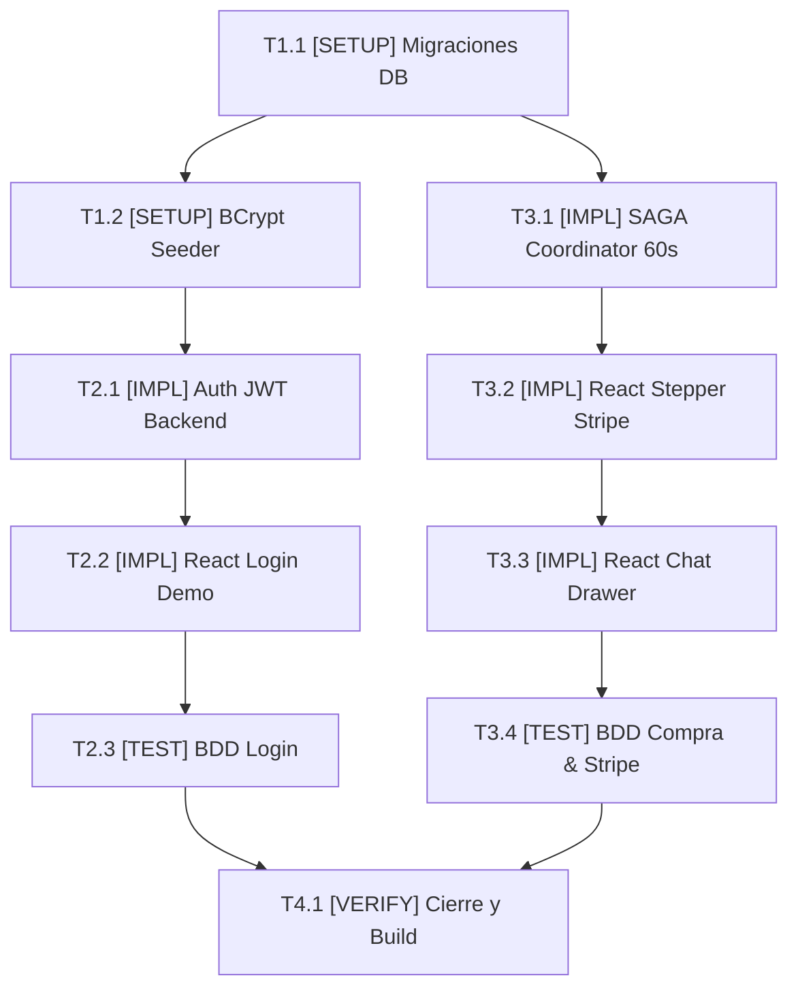

# Tasks: Módulo 01 - Autenticación Centralizada y Gestión de Boletos (MS TICKET-AUTH)

## Task Progress

| Métrica | Cantidad |
| :--- | ---: |
| Total de tareas | 10 |
| Tareas realizadas | 0 |
| Tareas por realizar | 10 |
| Tareas bloqueadas | 0 |
| Tareas en progreso | 0 |
| Progreso | 0% |

**Estado:** READY

---

## Checklist Rápido de Tareas por Vertical Slice

### Fase 0: Setup y Fundación Base
- [ ] `T1.1` `[SETUP]` Configuración de proyecto Spring Boot 3, Flyway y migración de tablas `users` y `tickets` (`PLAN-01`).
- [ ] `T1.2` `[SETUP]` Implementación de BCryptPasswordEncoder y Seeder con los 3 usuarios predefinidos (`admin`, `cliente`, `boletero`) (`PLAN-01`).

### Slice 1: Portal de Login Único y Redirección por Rol
- [ ] `T2.1` `[IMPL]` Implementar caso de uso `AuthenticateUserUseCase` y generación de tokens JWT con claims de rol (`PLAN-02`, `PLAN-03`).
- [ ] `T2.2` `[IMPL]` Construir la vista de Login en React con los 3 botones de acceso rápido "Demo 1-Click" y redirección por rol (`PLAN-05`).
- [ ] `T2.3` `[TEST]` Suite BDD de autenticación: verificar login exitoso, login demo y bloqueo de acceso anónimo (`SC-01.1.1`, `SC-01.1.2`).

### Slice 2: Flujo de Compra SAGA, Previsualización y Pasarela Stripe
- [ ] `T3.1` `[IMPL]` Implementar orquestador `PurchaseTicketSagaCoordinator` con temporizador de 60 segundos y compensación hacia Cinema Core (`PLAN-03`, `PLAN-04`).
- [ ] `T3.2` `[IMPL]` Construir componente Stepper UI en React de 4 etapas: selección, previsualización JPEG de MinIO, Stripe Elements y QR (`PLAN-05`).
- [ ] `T3.3` `[IMPL]` Implementar componente `ChatDrawer` deslizable (drawer retráctil) con compra conversacional integrada (`PLAN-05`).
- [ ] `T3.4` `[TEST]` Suite BDD de compra: verificar flujo feliz con tarjeta `4242...`, expiración de 60s y compra desde el chat (`SC-01.2.1`, `SC-01.2.2`, `SC-01.3.1`).

### Fase Final: Verificación Consolidada y Cierre
- [ ] `T4.1` `[VERIFY]` Ejecución integral de pruebas de integración GraphQL, linter de React y build Maven de `ms-ticket-auth`.

---

## 1. Resumen de Trazabilidad (`Spec` → `Plan` → `Tasks`)

| Requisito / Regla / Escenario (`spec.md`) | Componente Técnico (`plan.md`) | Tareas Asociadas (`tasks.md`) |
| :--- | :--- | :--- |
| `HU-01`, `RF-01.1`, `RB-AUTH-01` | `PLAN-01`, `PLAN-02`, `PLAN-03` | `T1.1`, `T1.2`, `T2.1` |
| `RF-01.2`, `SC-01.1.1`, `SC-01.1.2` | `PLAN-05` | `T2.2`, `T2.3` |
| `HU-02`, `RF-02.1`, `RF-02.5`, `RB-AUTH-02`, `RB-AUTH-03` | `PLAN-02`, `PLAN-03`, `PLAN-04` | `T3.1` |
| `RF-02.2`, `RF-02.3`, `RF-02.4`, `SC-01.2.1`, `SC-01.2.2` | `PLAN-04`, `PLAN-05` | `T3.2`, `T3.4` |
| `HU-03`, `RF-03.1`, `RF-03.2`, `RF-03.3`, `SC-01.3.1` | `PLAN-05` | `T3.3`, `T3.4` |
| Cierre y verificación de calidad | Todos los componentes `PLAN` | `T4.1` |

---

## 2. Grafo de Dependencias de Tareas

---

## 3. Desglose Detallado de Tareas Ejecutables

### Fase 0: Setup y Fundación Base

#### [ ] T1.1 [SETUP] Configuración de Spring Boot 3 y migraciones Flyway de tablas users y tickets
* **Status:** PENDING
* **Traceability:** `PLAN-01`
* **Depends on:** —
* **Files:**
  * `[CREATE]` `services/ms-ticket-auth/backend/src/main/resources/db/migration/V1__init_auth_tickets.sql`
  * `[CREATE]` `services/ms-ticket-auth/backend/src/main/resources/application.yml`
* **Objective:** Crear la base de datos `db_tickets_auth` con las tablas `users` y `tickets` con sus restricciones de integridad.
* **Work:** Escribir el DDL de tablas `users` y `tickets` con llaves foráneas y tipos físicos exactos.
* **Done when:** El script de Flyway se ejecuta limpiamente y las tablas quedan creadas en PostgreSQL.
* **Evidence:** `./mvnw flyway:migrate`

#### [ ] T1.2 [SETUP] Implementación de BCryptPasswordEncoder y Seeder con los 3 usuarios predefinidos
* **Status:** PENDING
* **Traceability:** `PLAN-01`, `RB-AUTH-01`
* **Depends on:** `T1.1`
* **Files:**
  * `[CREATE]` `services/ms-ticket-auth/backend/src/main/java/com/cine/auth/infrastructure/config/DatabaseSeeder.java`
* **Objective:** Precargar las cuentas `admin@cine.local`, `cliente@cine.local` y `boletero@cine.local` con BCrypt.
* **Work:** Implementar el `CommandLineRunner` que verifica la existencia de los 3 usuarios e inyecta los registros si la base está vacía.
* **Done when:** Los 3 usuarios existen en la tabla `users` con contraseñas en hash BCrypt.
* **Evidence:** `./mvnw test -Dtest=DatabaseSeederTest`

---

### Slice 1: Portal de Login Único y Redirección por Rol

#### [ ] T2.1 [IMPL] Implementar caso de uso AuthenticateUserUseCase y generación de tokens JWT
* **Status:** PENDING
* **Traceability:** `PLAN-02`, `PLAN-03` | `RF-01.1`
* **Depends on:** `T1.2`
* **Files:**
  * `[CREATE]` `services/ms-ticket-auth/backend/src/main/java/com/cine/auth/application/usecase/AuthenticateUserUseCase.java`
  * `[CREATE]` `services/ms-ticket-auth/backend/src/main/java/com/cine/auth/infrastructure/presentation/AuthGraphQLResolver.java`
* **Objective:** Validar credenciales contra BCrypt y emitir token JWT con claims de rol.
* **Work:** Implementar la lógica del caso de uso y el resolver GraphQL para la mutación `login(email, password)`.
* **Done when:** La mutación retorna el JWT y el rol del usuario autenticado.
* **Evidence:** `./mvnw test -Dtest=AuthenticateUserUseCaseTest`

#### [ ] T2.2 [IMPL] Construir la vista de Login en React con los 3 botones de acceso rápido "Demo 1-Click"
* **Status:** PENDING
* **Traceability:** `PLAN-05` | `RF-01.2`, `RF-01.5`
* **Depends on:** `T2.1`
* **Files:**
  * `[CREATE]` `services/ms-ticket-auth/frontend/src/components/LoginView.tsx`
* **Objective:** Interfaz gráfica de login unificado con botones directos para Administrador, Cliente y Boletero y redirección por rol.
* **Work:** Crear el formulario con campos de correo/contraseña y agregar los 3 botones visuales que ejecutan el login instantáneo con las credenciales demo.
* **Done when:** Al hacer clic en un botón demo se autentica y redirecciona al panel correspondiente.
* **Evidence:** `npm test LoginView.spec.tsx`

#### [ ] T2.3 [TEST] Suite BDD de autenticación y redirección
* **Status:** PENDING
* **Traceability:** `SC-01.1.1`, `SC-01.1.2`
* **Depends on:** `T2.2`
* **Files:**
  * `[CREATE]` `services/ms-ticket-auth/backend/src/test/java/com/cine/auth/presentation/AuthGraphQLIntegrationTest.java`
* **Objective:** Demostrar con pruebas automatizadas el login exitoso, login demo y rechazo de credenciales falsas.
* **Work:** Codificar los escenarios Gherkin en pruebas de integración GraphQL.
* **Done when:** 100% de los tests de autenticación pasan en verde.
* **Evidence:** `./mvnw test -Dtest=AuthGraphQLIntegrationTest`

---

### Slice 2: Flujo de Compra SAGA, Previsualización y Pasarela Stripe

#### [ ] T3.1 [IMPL] Implementar orquestador PurchaseTicketSagaCoordinator con temporizador de 60 segundos
* **Status:** PENDING
* **Traceability:** `PLAN-03`, `PLAN-04` | `RB-AUTH-02`, `RB-AUTH-03`
* **Depends on:** `T1.1`
* **Files:**
  * `[CREATE]` `services/ms-ticket-auth/backend/src/main/java/com/cine/auth/application/usecase/PurchaseTicketSagaCoordinator.java`
  * `[CREATE]` `services/ms-ticket-auth/backend/src/main/java/com/cine/auth/infrastructure/adapter/CinemaCoreRestClient.java`
  * `[CREATE]` `services/ms-ticket-auth/backend/src/main/java/com/cine/auth/infrastructure/adapter/StripePaymentGatewayAdapter.java`
* **Objective:** Coordinar el bloqueo de la butaca en Cinema Core, el temporizador de 60 segundos y la compensación ante fallo.
* **Work:** Implementar el flujo SAGA: llamada de bloqueo $\rightarrow$ creación de boleto `PENDING_PAYMENT` $\rightarrow$ cobro Stripe $\rightarrow$ emisión o compensación de butaca.
* **Done when:** Si no se confirma el pago en 60s, la butaca se libera automáticamente a `DISPONIBLE`.
* **Evidence:** `./mvnw test -Dtest=PurchaseSagaTest`

#### [ ] T3.2 [IMPL] Construir el componente Stepper UI en React de 4 etapas
* **Status:** PENDING
* **Traceability:** `PLAN-05` | `RF-02.1`, `RF-02.2`, `RF-02.3`, `RF-02.4`
* **Depends on:** `T3.1`
* **Files:**
  * `[CREATE]` `services/ms-ticket-auth/frontend/src/components/StepperPayment.tsx`
  * `[CREATE]` `services/ms-ticket-auth/frontend/src/components/TicketPreview.tsx`
  * `[CREATE]` `services/ms-ticket-auth/frontend/src/components/StripePaymentWrapper.tsx`
* **Objective:** Componente visual interactivo que guía al cliente por selección, previsualización en MinIO, pago con tarjeta de prueba y QR final.
* **Work:** Programar el Stepper con temporizador visual regresivo de 60 segundos, contenedor de Stripe Elements e integración de imagen JPEG.
* **Done when:** El usuario visualiza la imagen previa del boleto antes de ingresar los datos de la tarjeta de prueba.
* **Evidence:** `npm test StepperPayment.spec.tsx`

#### [ ] T3.3 [IMPL] Implementar componente ChatDrawer deslizable con compra conversacional integrada
* **Status:** PENDING
* **Traceability:** `PLAN-05` | `HU-03`, `RF-03.1`, `RF-03.2`, `RF-03.3`
* **Depends on:** `T3.2`
* **Files:**
  * `[CREATE]` `services/ms-ticket-auth/frontend/src/components/ChatDrawer.tsx`
* **Objective:** Drawer lateral retráctil contraíble de izquierda a derecha con selección asistida de butaca y compra directa.
* **Work:** Programar el panel retráctil con animación suave que se conecta al servicio conversacional y despliega tarjetas de butacas seleccionables con activación del Stepper de pago.
* **Done when:** El usuario puede seleccionar una butaca y pagar con tarjeta de prueba directamente dentro del drawer sin salir del chat.
* **Evidence:** `npm test ChatDrawer.spec.tsx`

#### [ ] T3.4 [TEST] Suite BDD de flujo de compra, compensación SAGA y Chatbot
* **Status:** PENDING
* **Traceability:** `SC-01.2.1`, `SC-01.2.2`, `SC-01.3.1`
* **Depends on:** `T3.3`
* **Files:**
  * `[CREATE]` `services/ms-ticket-auth/backend/src/test/java/com/cine/auth/application/PurchaseSagaTest.java`
* **Objective:** Validar la compra completa con tarjeta `4242...`, la liberación por expiración de 60 segundos y la compra asistida en el chat.
* **Work:** Ejecutar el flujo simulando respuesta exitosa de Stripe, simular el caso de expiración del temporizador y simular compra en drawer.
* **Done when:** Las pruebas de compensación SAGA y compra asistida pasan en verde.
* **Evidence:** `./mvnw test -Dtest=PurchaseSagaTest`

---

### Fase Final: Verificación Consolidada y Cierre

#### [ ] T4.1 [VERIFY] Verificación completa del microservicio ms-ticket-auth
* **Status:** PENDING
* **Traceability:** Cross-cutting (Cierre de Módulo 01)
* **Depends on:** `T2.3`, `T3.4`
* **Objective:** Ejecutar todas las pruebas unitarias e integración de backend y frontend.
* **Work:** Correr suite completa Maven y linter de React.
* **Done when:** 100% de tests en verde y 0 errores de compilación.
* **Evidence:** `./mvnw verify && npm run lint`

---

## 4. Bitácora de Evidencia de Ejecución (`/sdd-execution`)
* *(Pendiente de inicio de `/sdd-execution`)*
