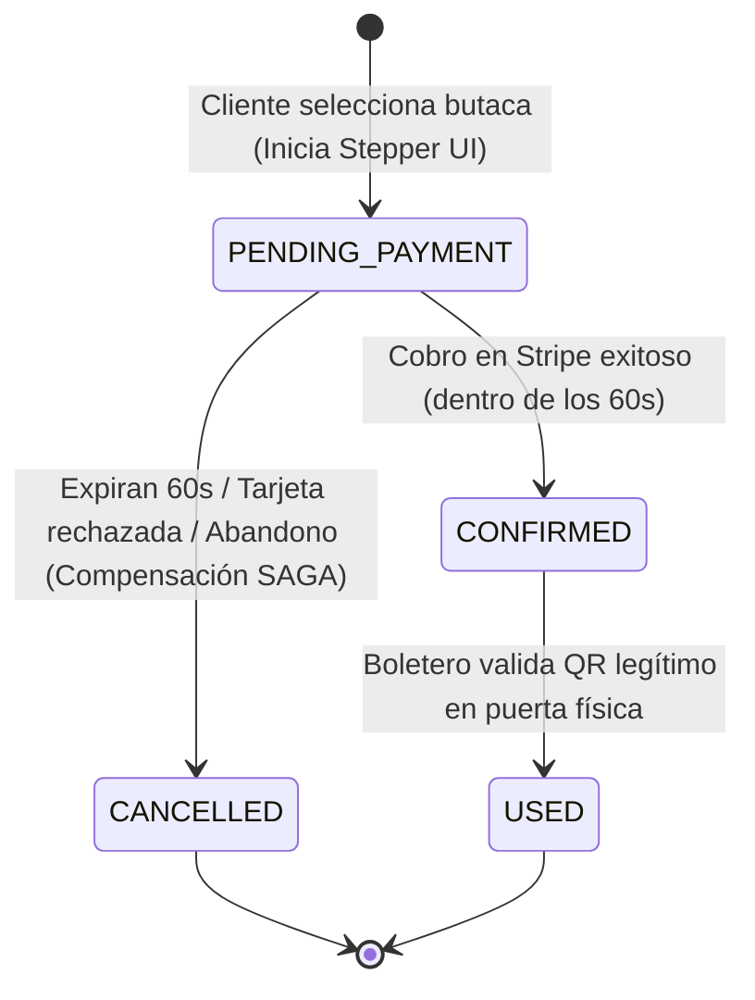

# Specification: Módulo 01 - Autenticación Centralizada y Gestión de Boletos (MS TICKET-AUTH)
Status: APPROVED
Version: 1

Revisión 2026-11-12: se conserva la aprobación previa. La reserva y confirmación requieren respuestas efectivas de Cinema-Core; un fallo de la dependencia no constituye una reserva exitosa. La corrección deriva del bloqueo y la compensación de la SAGA ya especificados.

> **Estado:** APPROVED  
> **Módulo:** `docs/specs/01-ms-ticket-auth/`  
> **Ubicación en Código:** `ms/ms-ticket-auth/backend/` y `ms/ms-ticket-auth/frontend/`  
> **Metodología:** SDD-Spec-Strict (Zero-Loss)  
> **Subordinación:** Sujeto estrictamente a `docs/constitution.md` (v1.3.0)

---

## 1. Objetivo y Alcance

### 1.1 Objetivo de Negocio
Proveer el punto único y centralizado de acceso, identidad y autorización para todos los actores del ecosistema cinematográfico, orquestando de manera segura el ciclo de compra de boletos mediante un flujo interactivo con previsualización gráfica de entradas, cobro de prueba asistido por pasarela externa (Stripe) y emisión de credenciales digitales verificables, coordinando la consistencia de las reservas entre salas y servicios de apoyo.

### 1.2 Alcance Funcional (In-Scope)
- **Portal Único de Entrada (`/login`):** Pantalla unificada de autenticación y registro en `ms/ms-ticket-auth/frontend/` para todos los usuarios con mecanismo de acceso rápido para demostración académica ("Acceso Demo 1-Click").
- **Redirección Automatizada por Rol:** Redirección inmediata pos-autenticación según el perfil verificado (`admin` $\rightarrow$ Panel Administrativo Angular en `ms/ms-cinema-core/frontend/`, `cliente` $\rightarrow$ Aplicación Móvil PWA en `ms/movil-client/`, `boletero` $\rightarrow$ Validador de Boleteo en `ms/ms-boleteo-validator/`).
- **Flujo Guiado de Compra de Boletos (Stepper UI):** Proceso de compra en 4 etapas observables:
  1. Selección de butaca y función.
  2. Previsualización de la credencial gráfica del ticket (renderizado desde MinIO S3).
  3. Procesamiento de pago simulado con tarjeta de prueba en Stripe con temporizador regresivo de 60 segundos.
  4. Confirmación de compra y emisión de credencial con código QR dinámico firmado.
- **Transacción Distribuida de Compra (SAGA):** Bloqueo transaccional temporal de la butaca en la sala, coordinación con el generador multimedia para la firma criptográfica y ejecución de compensación automática (liberación de butaca a disponible) si el cliente no completa el pago en 60 segundos o si el cobro es rechazado.
- **Asistencia Conversacional de Compra (Chatbot Deslizable):** Panel lateral retráctil (drawer de izquierda a derecha) que permite al cliente consultar la cartelera y ejecutar el mismo flujo de compra asistido por lenguaje natural.
- **Unificación de Esquema de Datos (GraphQL Federado):** Exposición de consultas y mutaciones de boletos donde la entidad `Ticket` unifica transparentemente la información de la función, la butaca y la URL del código QR firmado.

### 1.3 Exclusiones Explícitas (Out-of-Scope)
- **Venta de Confitería / Alimentos:** Prohibido cualquier catálogo, carrito o cobro de dulcería (acorde a `INV-BIZ-01`).
- **Anulación o Cancelación por el Cliente:** Una vez pagado el boleto y emitido el estado `CONFIRMED`, el cliente no puede revertir la compra de forma voluntaria; los boletos son finales hasta su uso o vencimiento.
- **Transacciones Monetarias Reales:** La pasarela opera exclusivamente con la tarjeta de pruebas de desarrollador `4242424242424242`.

---

## 2. Actores y Permisos en el Módulo

| Actor | Permisos en este Módulo | Restricciones de Acceso |
| :--- | :--- | :--- |
| **Administrador (`admin`)** | Iniciar sesión mediante credenciales o botón de acceso demo; consultar métricas globales de venta de boletos. | No puede comprar boletos a su nombre ni reservar butacas directamente en la cartelera de clientes. |
| **Cliente (`cliente`)** | Registrar nueva cuenta; iniciar sesión; consultar cartelera; reservar butaca temporal; pagar vía Stripe; consultar "Mis Boletos" confirmados; interactuar con el Chatbot deslizable. | No puede modificar estados de salas, forzar confirmaciones sin pago ni validar accesos en puerta. |
| **Boletero (`boletero`)** | Iniciar sesión para obtener su credencial de sesión autorizada. | No puede emitir compras de boletos ni gestionar el catálogo de películas. |
| **Visitante / No Autenticado** | Visualizar la pantalla de login/registro; utilizar los botones demo de acceso rápido; registrarse como nuevo cliente. | Bloqueado terminantemente de acceder a cualquier vista interna de compra, cartelera o administración. |

---

## 3. Modelo Funcional de Datos y Reglas de Negocio Específicas

### 3.1 Entidades Funcionales y Atributos de Dominio

#### Entidad: Usuario (`User`)
- `id`: Identificador único (UUID).
- `nombreCompleto`: Texto obligatorio (mínimo 3, máximo 100 caracteres).
- `email`: Correo electrónico válido, único en el sistema.
- `passwordHash`: Clave encriptada con algoritmo seguro (BCrypt, factor de costo $\ge 10$).
- `rol`: Enumerador estricto (`ADMIN`, `CLIENTE`, `BOLETERO`).
- `fechaRegistro`: Marca de tiempo de alta del usuario.

#### Entidad: Boleto / Entrada (`Ticket`)
- `id`: Identificador único (UUID).
- `clienteId`: Referencia obligatoria al cliente comprador.
- `showtimeId`: Referencia a la función cinematográfica programada.
- `seatId`: Referencia a la butaca asignada (fila y número).
- `montoCobrado`: Valor numérico decimal positivo (moneda estándar del sistema).
- `estado`: Estado del ciclo de vida (`PENDING_PAYMENT`, `CONFIRMED`, `USED`, `CANCELLED`).
- `qrCodeUrl`: URL pública/firmada de la imagen del código QR con firma criptográfica HMAC-SHA256.
- `ticketImageUrl`: URL pública de la credencial gráfica completa del boleto almacenada en MinIO S3.
- `expiracionBloqueo`: Marca temporal límite para completar el pago (tiempo de creación + 60 segundos).
- `stripePaymentIntentId`: Identificador de la transacción de prueba en la pasarela Stripe.

### 3.2 Reglas de Negocio del Módulo (`RB-AUTH-XX`)

- **`RB-AUTH-01` (Credenciales Predefinidas Inmutables):** El sistema debe proveer obligatoriamente tres cuentas maestras pre-sembradas:
  - Administrador: `admin@cine.local`
  - Cliente: `cliente@cine.local`
  - Boletero: `boletero@cine.local`
  Todas protegidas con hash BCrypt. La pantalla de login debe incluir 3 botones visuales de "Acceso Demo 1-Click" que completen las credenciales y autentiquen de inmediato al perfil seleccionado.
- **`RB-AUTH-02` (Retención Temporal de Butaca con Ventana Estricta de 60 Segundos):** Al iniciar la compra (etapa 1 del Stepper), la butaca pasa a estado `RESERVADA_TEMPORAL` y el boleto a `PENDING_PAYMENT`. El cliente dispone de exactamente 60 segundos cronometrados en pantalla para autorizar el cobro en Stripe.
- **`RB-AUTH-03` (Compensación Automática por Vencimiento o Rechazo):** Si el cronómetro de 60 segundos llega a cero sin recibir la confirmación de pago de Stripe, o si la tarjeta es rechazada, el sistema cancela el boleto (`CANCELLED`), solicita la liberación inmediata de la butaca a estado `DISPONIBLE` y presenta una advertencia visual al cliente impidiendo cobros posteriores.
- **`RB-AUTH-04` (Previsualización Previa al Cobro):** Antes de desplegar el formulario de tarjeta de Stripe, la interfaz debe cargar y exhibir al usuario la imagen previa de su ticket (diseño gráfico con datos de la película, sala y butaca obtenido desde el repositorio de objetos MinIO S3).
- **`RB-AUTH-05` (Inmutabilidad de Boletos Pagados):** Un boleto con estado `CONFIRMED` no puede ser cancelado, reembolsado ni modificado por el cliente. Solo puede evolucionar a `USED` cuando el boletero escanee físicamente el código QR legítimo.
- **`RB-AUTH-06` (Asistencia Conversacional Simétrica):** Toda acción de compra efectuada mediante el Chatbot deslizable debe ejecutar exactamente las mismas validaciones, bloqueo temporal de 60 segundos, previsualización de ticket y pasarela Stripe que el flujo manual de cartelera.

---

## 4. Máquina de Estados del Boleto (`TicketStateMachine`)



### Transiciones Prohibidas:
- `PENDING_PAYMENT` $\rightarrow$ `USED` (Prohibido validar un boleto sin cobro confirmado).
- `CANCELLED` $\rightarrow$ `CONFIRMED` (Prohibido pagar una reserva cuya ventana de 60 segundos expiró).
- `USED` $\rightarrow$ `CONFIRMED` o `PENDING_PAYMENT` (Prohibido reutilizar un boleto ya validado).
- Eliminación física (`DELETE SQL`) de cualquier registro en cualquier estado (Violación de `INV-BIZ-02`).

---

## 5. Requerimientos Funcionales Estructurados (Patrón EARS)

### Historia de Usuario `HU-01`: Portal Único de Acceso y Redirección por Rol
*Como cualquier usuario del cine, quiero disponer de una única pantalla de acceso con opciones de inicio tradicional y botones de prueba rápida, para ingresar al sistema y ser dirigido a mi espacio de trabajo correspondiente según mi perfil.*

- **`RF-01.1` (Acceso Tradicional):** Cuando un usuario registrado ingrese su correo y contraseña válidos en la pantalla única de login, el sistema deberá verificar la coincidencia contra el hash BCrypt, iniciar la sesión segura y redirigirlo inmediatamente según su rol (`admin` $\rightarrow$ FrontWeb Angular; `cliente` $\rightarrow$ Movil App PWA; `boletero` $\rightarrow$ Validador Laravel).
- **`RF-01.2` (Acceso Rápido Demo 1-Click):** Cuando el evaluador presione cualquiera de los tres botones demo (`[Ingresar como Administrador]`, `[Ingresar como Cliente]`, `[Ingresar como Boletero]`), el sistema deberá autenticar de forma instantánea al usuario predefinido correspondiente sin requerir digitación manual y redirigirlo a su interfaz respectiva.
- **`RF-01.3` (Manejo de Credenciales Inválidas):** Si un usuario ingresa un correo no registrado o una contraseña incorrecta, el sistema deberá impedir el acceso, mantener al usuario en la pantalla de login y desplegar el mensaje de error observable: *"Credenciales de acceso incorrectas. Por favor verifique sus datos."*
- **`RF-01.4` (Registro de Nuevos Clientes):** Cuando un visitante complete el formulario de registro con nombre, correo único y contraseña (mínimo 6 caracteres), el sistema deberá registrar la nueva cuenta con rol `CLIENTE`, encriptar la clave con BCrypt y autenticarlo automáticamente redirigiéndolo a la cartelera.
- **`RF-01.5` (Protección contra Accesos Anónimos):** Si un usuario no autenticado intenta ingresar por URL a cualquier ruta interna protegida de administración, cliente o boleteo, el sistema deberá interceptar la navegación y redirigirlo obligatoriamente a la pantalla de `/login`.

---

### Historia de Usuario `HU-02`: Compra Guiada de Entradas con Stepper UI y Pasarela Stripe
*Como cliente autenticado, quiero seguir un proceso visual paso a paso con previsualización de mi boleto y cobro seguro con tarjeta de prueba cronometrado, para asegurar mi butaca y obtener mi código QR de acceso.*

- **`RF-02.1` (Inicio de Compra y Bloqueo de Butaca):** Cuando el cliente seleccione una butaca disponible en una función programada y pulse "Continuar Compra", el sistema deberá avanzar a la Etapa 1 del Stepper UI, generar un boleto en estado `PENDING_PAYMENT`, solicitar el bloqueo transaccional de la butaca en la sala e iniciar un cronómetro regresivo visible de 60 segundos.
- **`RF-02.2` (Previsualización de Ticket Gráfico):** Mientras el cronómetro esté activo, el sistema deberá consultar la imagen gráfica del boleto emitida en MinIO S3 y renderizarla dentro de la Etapa 2 del Stepper antes de desplegar el formulario de pago.
- **`RF-02.3` (Despliegue Dinámico de Pasarela Stripe):** Cuando se verifique la carga de la imagen previa, el sistema deberá habilitar la Etapa 3 del Stepper desplegando el contenedor dinámico de pasarela de pago (Stripe Elements) con la tarjeta de prueba de desarrollador (`4242 4242 4242 4242`) sugerida para el usuario.
- **`RF-02.4` (Confirmación Exitosa y Emisión de QR):** Cuando el cliente presione "Pagar Entrada" y la pasarela Stripe apruebe la transacción antes de concluir los 60 segundos, el sistema deberá cambiar el estado del boleto a `CONFIRMED`, consolidar la butaca como ocupada, avanzar a la Etapa 4 del Stepper mostrando el código QR dinámico firmado y gatillar la sincronización de almacenamiento offline local.
- **`RF-02.5` (Expiración del Temporizador y Compensación SAGA):** Si el cronómetro de 60 segundos llega a 00:00 sin que el pago se haya procesado, el sistema deberá cancelar la operación, marcar el boleto como `CANCELLED`, disparar la liberación automática de la butaca a estado `DISPONIBLE` y mostrar en pantalla el mensaje: *"El tiempo de reserva ha expirado. La butaca ha sido liberada para otros usuarios."*
- **`RF-02.6` (Rechazo de Tarjeta de Pago):** Si la pasarela de prueba rechaza la tarjeta por fondos o error de transacción, el sistema deberá mantener el cronómetro corriendo, notificar visualmente el rechazo al cliente y permitirle reintentar el pago dentro del tiempo restante antes de liberar la butaca.

---

### Historia de Usuario `HU-03`: Compra Asistida mediante Chatbot Deslizable
*Como cliente, quiero interactuar con un asistente conversacional en un panel lateral retráctil, para consultar funciones y comprar boletos mediante diálogo natural manteniendo la misma seguridad transaccional.*

- **`RF-03.1` (Contracción y Despliegue del Drawer):** El sistema deberá ofrecer un botón flotante accesible en la interfaz del cliente que permita abrir y contraer suavemente de izquierda a derecha el panel lateral del Chatbot sin perder el contexto visual de la cartelera.
- **`RF-03.2` (Recomendación y Selección Asistida):** Cuando el cliente consulte al Chatbot sobre horarios, películas o recomendaciones, el asistente deberá responder con las opciones disponibles e insertar tarjetas interactivas de butacas seleccionables dentro del chat.
- **`RF-03.3` (Gatillado de Compra en el Chatbot):** Cuando el cliente confirme una butaca dentro del chat, el componente lateral deberá presentar la imagen previa del ticket, activar el cronómetro de 60 segundos y desplegar el contenedor de Stripe Elements, aplicando exactamente las reglas de negocio `RB-AUTH-02` y `RB-AUTH-03`.

---

## 6. Comportamiento Observable y Criterios de Aceptación (Escenarios BDD Gherkin)

### Escenario 1: Login Rápido de Demostración para Administrador (`SC-01.1.1`)
```gherkin
Given que un evaluador se encuentra en la pantalla principal de login "/login"
When presiona el botón de acceso rápido "[Ingresar como Administrador]"
Then el sistema completa automáticamente las credenciales de "admin@cine.local"
And autentica la sesión de forma inmediata emitiendo el token JWT
And redirige al evaluador a la consola administrativa FrontWeb en Angular ("http://localhost:4200")
And no muestra ningún mensaje de error
```

### Escenario 2: Intento de Acceso Anónimo a Ruta Protegida (`SC-01.1.2`)
```gherkin
Given que un visitante no autenticado intenta navegar directamente a la URL "/admin/salas"
When el navegador procesa la petición de ruta
Then el guardián de autenticación intercepta la navegación
And redirige forzosamente al visitante a la URL "/login"
And despliega la advertencia visual "Debe iniciar sesión para acceder a este recurso"
```

### Escenario 3: Flujo Completo de Compra Exitosa con Stepper y Stripe (`SC-01.2.1`)
```gherkin
Given que el cliente "cliente@cine.local" está autenticado y visualiza la función de la película "Avatar 2"
When selecciona la butaca disponible "Fila C, Asiento 8" y presiona "Continuar Compra"
Then el sistema abre el Stepper UI en la Etapa 1
And bloquea la butaca temporalmente en MS CINEMA-CORE e inicia la cuenta regresiva de 60 segundos
And avanza a la Etapa 2 mostrando la imagen gráfica del boleto recuperada de MinIO S3
And avanza a la Etapa 3 renderizando el contenedor dinámico de Stripe Elements con tarjeta de prueba
When el cliente presiona "Pagar Entrada" en el segundo 25
Then Stripe aprueba la transacción de prueba
And el sistema marca el boleto como "CONFIRMED"
And avanza a la Etapa 4 del Stepper desplegando el código QR dinámico firmado con HMAC-SHA256
And el boleto queda visible en la sección "Mis Boletos"
```

### Escenario 4: Expiración de Reserva por Agotamiento del Temporizador (`SC-01.2.2`)
```gherkin
Given que un cliente tiene bloqueada la butaca "D-4" en el Stepper de compra con el boleto en estado "PENDING_PAYMENT"
When el cronómetro regresivo de 60 segundos llega a 00:00 sin confirmación de pago
Then el sistema cancela la pasarela de Stripe de inmediato
And cambia el estado del boleto local a "CANCELLED"
And ejecuta la compensación SAGA solicitando a MS CINEMA-CORE liberar la butaca "D-4" a "DISPONIBLE"
And muestra el mensaje en pantalla "El tiempo de reserva ha expirado. La butaca ha sido liberada para otros usuarios."
And deshabilita el botón de pago impidiendo cobros tardíos
```

### Escenario 5: Compra Asistida desde el Chatbot Deslizable (`SC-01.3.1`)
```gherkin
Given que el cliente autenticado pulsa el icono del asistente virtual
When el drawer lateral se desliza de izquierda a derecha en la pantalla
And el cliente escribe "Quiero comprar una entrada para Interestelar hoy"
Then el asistente responde con las funciones disponibles y una tarjeta con la butaca "B-2"
When el cliente presiona el botón "Comprar B-2" dentro del diálogo del chat
Then dentro del mismo panel deslizable se carga la imagen previa del ticket desde MinIO S3
And se activa el cronómetro de 60 segundos con el contenedor de Stripe Elements
When se completa el pago con la tarjeta de prueba
Then el chat confirma la compra exhibiendo el código QR firmado listo para acceso
```

### Escenario 6: Estado Vacío en "Mis Boletos" (`SC-01.4.1`)
```gherkin
Given que un nuevo cliente acaba de registrarse en el sistema y no ha realizado compras
When navega a la pestaña "Mis Boletos"
Then la pantalla no muestra listas vacías ni errores
And despliega la ilustración de estado vacío con el mensaje "Aún no tienes entradas compradas"
And muestra un botón destacado "Explorar Cartelera" que lo lleva a la selección de películas
```

---

## 7. Efectos Secundarios e Integraciones

### 7.1 Dependencias con otros Microservicios del Ecosistema
* **Con `MS CINEMA-CORE`:**
  - Envío de comando síncrono para bloqueo temporal de butaca (`RESERVAR_TEMPORAL`).
  - Envío de comando síncrono compensatorio ante expiración (`LIBERAR_BUTACA`).
  - Envío de comando de confirmación definitiva (`CONFIRMAR_OCUPACION`).
* **Con `MS MULTIMEDIA`:**
  - Solicitud de generación de imagen gráfica de entrada y almacenamiento en MinIO S3.
  - Solicitud de generación del código QR dinámico con la firma HMAC-SHA256 (`clave_secreta_universitaria_mcp`).
* **Con `MS IA-MCP`:**
  - Conexión vía HTTP para el procesamiento de mensajes de lenguaje natural del Chatbot deslizable.
* **Con Pasarela Stripe:**
  - Creación de `PaymentIntent` y confirmación de pago de prueba en modo desarrollador con tarjeta `4242424...`.

### 7.2 Efectos Secundarios en el Canal Cliente
* Una vez emitido el boleto en estado `CONFIRMED`:
  - Se despacha una señal al Service Worker de la aplicación móvil PWA para descargar de inmediato la imagen del ticket y el payload JSON del código QR a la base de datos local `IndexedDB`, garantizando disponibilidad offline total en la sala.

---

## 8. Contratos de Interconexión y Comunicación Inter-Servicios (`IC-CONTRACT-01`)

### `IC-01.1` (SAGA Bloqueo / Liberación de Butacas hacia `MS CINEMA-CORE`)
- **Protocolo:** REST sobre HTTP/1.1
- **Cliente:** `PurchaseTicketSagaCoordinator` en `ms/ms-ticket-auth/backend/`
- **Servidor:** `ShowtimesController` en `ms/ms-cinema-core/backend/` (Puerto 3000)
- **Operaciones:**
  1. *Bloqueo Temporal:*
     - **Ruta:** `POST /api/v1/showtimes/{showtimeId}/seats/{seatId}/lock`
     - **Headers:** `Content-Type: application/json`, `X-Internal-Service: ms-ticket-auth`
     - **Request Payload:**
       ```json
       {
         "ticketId": "3fa85f64-5717-4562-b3fc-2c963f66afa6",
         "timeoutSeconds": 60
       }
       ```
     - **Success Response (200 OK):**
       ```json
       {
         "status": "LOCKED",
         "showtimeId": "3fa85f64-5717-4562-b3fc-2c963f66afa6",
         "seatId": "e1f14798-2936-4d08-8123-cb84524458d1",
         "expiresAt": "2026-11-03T02:00:00Z"
       }
       ```
     - **Failure Response (409 Conflict):**
       ```json
       {
         "statusCode": 409,
         "errorCode": "SEAT_ALREADY_RESERVED",
         "message": "La butaca solicitada ya está reservada por otro usuario."
       }
       ```
  2. *Liberación Compensatoria SAGA:*
     - **Ruta:** `POST /api/v1/showtimes/{showtimeId}/seats/{seatId}/release`
     - **Headers:** `Content-Type: application/json`, `X-Internal-Service: ms-ticket-auth`
     - **Request Payload:**
       ```json
       {
         "ticketId": "3fa85f64-5717-4562-b3fc-2c963f66afa6",
         "reason": "PAYMENT_TIMEOUT_OR_FAILED"
       }
       ```
     - **Success Response (200 OK):**
       ```json
       {
         "status": "RELEASED",
         "seatId": "e1f14798-2936-4d08-8123-cb84524458d1"
       }
       ```
  3. *Confirmación Definitiva:*
     - **Ruta:** `POST /api/v1/showtimes/{showtimeId}/seats/{seatId}/confirm`
     - **Success Response (200 OK):**
       ```json
       {
         "status": "OCCUPIED_DEFINITIVE",
         "seatId": "e1f14798-2936-4d08-8123-cb84524458d1"
       }
       ```

### `IC-01.2` (Generación de Credencial y Firma QR hacia `MS MULTIMEDIA`)
- **Protocolo:** REST sobre HTTP/1.1
- **Cliente:** `MultimediaRestClient` en `ms/ms-ticket-auth/backend/`
- **Servidor:** `TicketsMediaController` en `ms/ms-multimedia/backend/` (Puerto 3001)
- **Ruta:** `POST /api/v1/multimedia/tickets/generate`
- **Headers:** `Content-Type: application/json`
- **Request Payload:**
  ```json
  {
    "ticketId": "3fa85f64-5717-4562-b3fc-2c963f66afa6",
    "seatId": "e1f14798-2936-4d08-8123-cb84524458d1",
    "showtimeId": "a9a85f64-5717-4562-b3fc-2c963f66af11",
    "movieTitle": "Avatar 2: El Sentido del Agua",
    "hallName": "Sala IMAX 1",
    "seatLabel": "C-8",
    "price": 35.00
  }
  ```
- **Success Response (201 Created):**
  ```json
  {
    "ticketId": "3fa85f64-5717-4562-b3fc-2c963f66afa6",
    "ticketImageUrl": "http://localhost:9000/cine-tickets/tickets/3fa85f64.jpg",
    "qrCodePayload": {
      "ticketId": "3fa85f64-5717-4562-b3fc-2c963f66afa6",
      "seatId": "e1f14798-2936-4d08-8123-cb84524458d1",
      "showtimeId": "a9a85f64-5717-4562-b3fc-2c963f66af11",
      "issuedAt": "2026-11-03T01:50:00Z",
      "sig": "b5a932c0f21448d38..."
    }
  }
  ```

### `IC-01.3` (Consumo de Validación de Acceso desde `MS BOLETEO-VALIDATOR`)
- **Protocolo:** REST sobre HTTP/1.1
- **Cliente:** `TicketAuthClient` en `ms/ms-boleteo-validator/backend/`
- **Servidor:** `TicketRestController` en `ms/ms-ticket-auth/backend/` (Puerto 8081)
- **Ruta:** `POST /api/v1/tickets/{ticketId}/use`
- **Headers:** 
  - `Authorization: Bearer <JWT_DEL_BOLETERO>`
  - `Content-Type: application/json`
- **Request Payload:**
  ```json
  {
    "ticketId": "3fa85f64-5717-4562-b3fc-2c963f66afa6",
    "qrSignature": "b5a932c0f21448d38...",
    "scannedAt": "2026-11-03T02:15:00Z"
  }
  ```
- **Success Response (200 OK):**
  ```json
  {
    "valid": true,
    "status": "USED",
    "ticketId": "3fa85f64-5717-4562-b3fc-2c963f66afa6",
    "movieTitle": "Avatar 2: El Sentido del Agua",
    "hallName": "Sala IMAX 1",
    "seatLabel": "C-8",
    "scannedTimestamp": "2026-11-03T02:15:00Z"
  }
  ```
- **Error Response (400 Bad Request / 409 Conflict):**
  ```json
  {
    "valid": false,
    "statusCode": 409,
    "errorCode": "TICKET_ALREADY_USED",
    "message": "El boleto ya fue utilizado a las 2026-11-03T02:00:15Z."
  }
  ```

### `IC-01.4` (Esquema GraphQL Federado expuesto hacia Canales Clientes)
- **Protocolo:** GraphQL sobre HTTP (Endpoint `/graphql`)
- **Queries:**
  - `myTickets(userId: ID!): [Ticket!]!`
  - `getTicketById(id: ID!): Ticket`
- **Mutations:**
  - `login(input: LoginInput!): AuthPayload!`
  - `register(input: RegisterInput!): AuthPayload!`
  - `initiatePurchase(input: InitiatePurchaseInput!): PendingTicketPayload!`
  - `confirmPurchase(ticketId: ID!, stripePaymentIntentId: String!): Ticket!`

