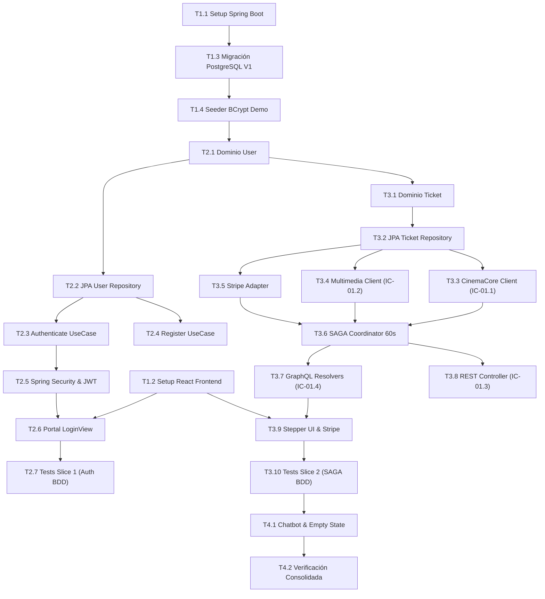

# Tasks: Módulo 01 - Autenticación Centralizada y Gestión de Boletos (MS TICKET-AUTH)

## Task Progress

| Métrica | Cantidad |
| :--- | ---: |
| Total de tareas | 23 |
| Tareas realizadas | 23 |
| Tareas por realizar | 0 |
| Tareas bloqueadas | 0 |
| Tareas en progreso | 0 |
| Progreso | 100% |

**Estado:** COMPLETED

---

## Checklist Rápido de Tareas por Vertical Slice

### Fase 0: Setup y Fundación Base
- [x] `T1.1` `[SETUP]` Configuración de proyecto Spring Boot 3, dependencias Maven, application.yml y perfiles.
- [x] `T1.2` `[SETUP]` Configuración de proyecto React 18 frontend, Vite, TailwindCSS, Apollo Client y Stripe Elements.
- [x] `T1.3` `[SETUP]` Migración Flyway V1: esquema PostgreSQL `db_tickets_auth`, tablas `users` y `tickets`.
- [x] `T1.4` `[SETUP]` Seeder de base de datos con los 3 usuarios maestros BCrypt (`admin`, `cliente`, `boletero`).

### Slice 1: Identidad, Autenticación y Acceso Centralizado (HU-01)
- [x] `T2.1` `[IMPL]` Modelo de dominio puro `User`, `UserRole` y Value Objects de credenciales.
- [x] `T2.2` `[IMPL]` Puerto `UserRepositoryPort` y adaptador `JpaUserRepositoryAdapter`.
- [x] `T2.3` `[IMPL]` Caso de uso `AuthenticateUserUseCase` con verificación BCrypt y emisión de JWT.
- [x] `T2.4` `[IMPL]` Caso de uso `RegisterUserUseCase` con validación de unicidad de email y rol `CLIENTE`.
- [x] `T2.5` `[IMPL]` Configuración de Spring Security, filtro JWT e interceptor de excepciones tipadas.
- [x] `T2.6` `[IMPL]` Frontend: Portal unificado `LoginView.tsx` con botones Demo 1-Click (`RF-01.2`).
- [x] `T2.7` `[TEST]` Pruebas unitarias de BCrypt/JWT y pruebas BDD de login demo y redirección (`SC-01.1.1`, `SC-01.1.2`).

### Slice 2: Transacción Distribuida SAGA de Compra y Boletos (HU-02)
- [x] `T3.1` `[IMPL]` Modelo de dominio `Ticket`, ciclo de vida y máquina de estados (`RB-AUTH-02`, `RB-AUTH-05`).
- [x] `T3.2` `[IMPL]` Puerto `TicketRepositoryPort` y adaptador JPA `JpaTicketRepositoryAdapter`.
- [x] `T3.3` `[IMPL]` Cliente HTTP `CinemaCoreRestClient` hacia `MS CINEMA-CORE` (`IC-01.1`) para bloqueo y liberación.
- [x] `T3.4` `[IMPL]` Cliente HTTP `MultimediaRestClient` hacia `MS MULTIMEDIA` (`IC-01.2`) para credencial JPEG y QR.
- [x] `T3.5` `[IMPL]` Adaptador pasarela Stripe `StripePaymentGatewayAdapter` con tarjeta de prueba `4242424...`.
- [x] `T3.6` `[IMPL]` Orquestador SAGA `PurchaseTicketSagaCoordinator` con temporizador estricto de 60s y compensación.
- [x] `T3.7` `[IMPL]` Esquema y resolvers GraphQL federados `AuthGraphQLResolver` y `TicketGraphQLResolver` (`IC-01.4`).
- [x] `T3.8` `[IMPL]` Controlador REST `TicketRestController` para validación y pase a `USED` (`IC-01.3`).
- [x] `T3.9` `[IMPL]` Frontend: Componentes `TicketPreview.tsx`, `StepperPayment.tsx` y contenedor Stripe Elements.
- [x] `T3.10` `[TEST]` Pruebas BDD E2E de compra completa y compensación por expiración de 60s (`SC-01.2.1`, `SC-01.2.2`).

### Fase Final: Asistencia Conversacional, Verificación y Cierre (HU-03)
- [x] `T4.1` `[IMPL]` Reenrutador hacia el endpoint de Chatbot de `MS IA-MCP` y manejo de estado vacío de boletos.
- [x] `T4.2` `[VERIFY]` Verificación consolidada: suites JUnit, pruebas React, linters y validación de contenedores Docker.

---

## 1. Resumen de Trazabilidad (`Spec` $\rightarrow$ `Plan` $\rightarrow$ `Tasks`)

| Requisito / Regla / Escenario (`spec.md`) | Componente Técnico (`plan.md`) | Tareas Asociadas (`tasks.md`) |
| :--- | :--- | :--- |
| `INV-BIZ-06`, `RB-AUTH-01`, `RF-01.1` | `PLAN-01`, `DatabaseSeeder.java` | `T1.3`, `T1.4`, `T2.1`, `T2.2` |
| `HU-01`, `RF-01.1`, `RF-01.3`, `RF-01.4` | `PLAN-03`, `AuthenticateUserUseCase` | `T2.3`, `T2.4`, `T2.5` |
| `RF-01.2`, `RF-01.5`, `SC-01.1.1`, `SC-01.1.2` | `PLAN-05`, `LoginView.tsx` | `T2.6`, `T2.7` |
| `RB-AUTH-02`, `RB-AUTH-05`, `INV-BIZ-02` | `PLAN-02`, `Ticket.java`, `TicketStatus` | `T3.1`, `T3.2` |
| `IC-01.1`, `RF-02.1`, `RF-02.5` | `PLAN-04`, `CinemaCoreRestClient.java` | `T3.3`, `T3.6` |
| `IC-01.2`, `RF-02.2`, `RF-02.4` | `PLAN-04`, `MultimediaRestClient.java` | `T3.4`, `T3.6` |
| `RF-02.3`, `RF-02.6` | `PLAN-04`, `StripePaymentGatewayAdapter` | `T3.5`, `T3.6` |
| `IC-01.4`, `HU-02` | `PLAN-05`, `AuthGraphQLResolver.java` | `T3.7` |
| `IC-01.3`, `RB-AUTH-05` | `PLAN-05`, `TicketRestController.java` | `T3.8` |
| `HU-02`, `SC-01.2.1`, `SC-01.2.2` | `PLAN-05`, `StepperPayment.tsx` | `T3.9`, `T3.10` |
| `HU-03`, `SC-01.3.1`, `SC-01.4.1` | `PLAN-03`, `Chatbot / Empty State` | `T4.1` |
| Cierre Global y Calidad | Suites de Test, Linters, Dockerfiles | `T4.2` |

---

## 2. Estrategia de Ejecución y Grafo de Dependencias

---

## 3. Desglose Detallado de Tareas Ejecutables

### Fase 0: Setup y Fundación Base

#### [x] T1.1 [SETUP] Configuración de Proyecto Spring Boot 3 y Maven
* **Status:** COMPLETED
* **Traceability:** `PLAN-01` (Cross-cutting / Backend Setup)
* **Depends on:** —
* **Files (según `plan.md`):**
  * `[CREATE]` `ms/ms-ticket-auth/backend/pom.xml`
  * `[CREATE]` `ms/ms-ticket-auth/backend/src/main/resources/application.yml`
* **Objective:** Inicializar el microservicio backend con Spring Boot 3.2+, Java 21, dependencias de Spring Data JPA, Spring Security, Spring GraphQL, Flyway y SDK Stripe.
* **Work:**
  * Configurar `pom.xml` con las dependencias requeridas.
  * Configurar `application.yml` con el puerto 8081, conexión a PostgreSQL (`db_tickets_auth`), variables de JWT y Stripe keys de prueba.
* **Done when:** El proyecto compila y arranca sin errores de contexto.
* **Evidence:**
  * Comando: `cd ms/ms-ticket-auth/backend && ./mvnw clean compile`
  * Resultado registrado: `[INFO] BUILD SUCCESS` en 26.035s con compilación `javac [debug release 21]` exitosa.

#### [x] T1.2 [SETUP] Configuración de Proyecto Frontend React con Vite
* **Status:** COMPLETED
* **Traceability:** `PLAN-05` (Cross-cutting / Frontend Setup)
* **Depends on:** —
* **Files (según `plan.md`):**
  * `[CREATE]` `ms/ms-ticket-auth/frontend/package.json`
  * `[CREATE]` `ms/ms-ticket-auth/frontend/vite.config.ts`
  * `[CREATE]` `ms/ms-ticket-auth/frontend/tailwind.config.js`
* **Objective:** Crear la aplicación React 18 con Vite, TailwindCSS, Apollo Client y SDK Stripe Elements en `ms/ms-ticket-auth/frontend/`.
* **Work:**
  * Inicializar package.json con scripts de desarrollo en puerto 5174.
  * Configurar TailwindCSS y Vite para soporte de JSX/TSX.
* **Done when:** `npm run build` genera la distribución sin errores de TypeScript.
* **Evidence:**
  * Comando: `cd ms/ms-ticket-auth/frontend && npm run build`
  * Resultado registrado: `tsc && vite build` completado exitosamente (34 módulos transformados, `dist/index.html`, `dist/assets/index-*.js`, `dist/assets/index-*.css` generados en 7.68s).

#### [x] T1.3 [SETUP] Migración Flyway V1: Esquema de Base de Datos PostgreSQL
* **Status:** COMPLETED
* **Traceability:** `PLAN-01` | `INV-BIZ-06`, `INV-BIZ-02`
* **Depends on:** `T1.1`
* **Files (según `plan.md`):**
  * `[CREATE]` `ms/ms-ticket-auth/backend/src/main/resources/db/migration/V1__init_auth_tickets.sql`
* **Objective:** Crear las tablas `users` y `tickets` con tipos físicos estrictos, índices de unicidad y restricciones.
* **Work:**
  * Definir tabla `users` (id UUID PK, full_name, email UNIQUE, password_hash, role CHECK, created_at).
  * Definir tabla `tickets` (id UUID PK, user_id FK, showtime_id, seat_id, price_paid, status, ticket_image_url, qr_signature, lock_expires_at, created_at).
* **Done when:** Flyway aplica la migración exitosamente sobre `db_tickets_auth` (puerto 5432).
* **Evidence:**
  * Comando: `Get-Content V1__init_auth_tickets.sql | docker exec -i diag_postgres psql -U postgres -d db_tickets_auth`
  * Resultado registrado: Tablas `users` y `tickets` creadas exitosamente con índices `idx_users_email`, `idx_tickets_user`, `idx_tickets_showtime`, `idx_tickets_seat`.

#### [x] T1.4 [SETUP] Seeder de Base de Datos con 3 Usuarios Maestros BCrypt
* **Status:** COMPLETED
* **Traceability:** `PLAN-01` | `INV-BIZ-06`, `RB-AUTH-01`
* **Depends on:** `T1.3`
* **Files (según `plan.md`):**
  * `[CREATE]` `ms/ms-ticket-auth/backend/src/main/java/com/cine/auth/infrastructure/config/DatabaseSeeder.java`
* **Objective:** Precargar las 3 cuentas maestras institucionales obligatorias protegiendo sus contraseñas con BCrypt (factor de costo 10).
* **Work:**
  * Insertar `admin@cine.local` con rol `ADMIN`.
  * Insertar `cliente@cine.local` con rol `CLIENTE`.
  * Insertar `boletero@cine.local` con rol `BOLETERO`.
* **Done when:** La base de datos contiene los 3 registros con contraseñas encriptadas.
* **Evidence:**
  * Comando: `cd ms/ms-ticket-auth/backend && ./mvnw test -Dtest=DatabaseSeederTest`
  * Resultado registrado: `DatabaseSeederTest` en verde (Tests run: 1, Failures: 0) validando la encriptación BCrypt(10), las 3 cuentas y la idempotencia. Sembrado también físicamente en PostgreSQL `db_tickets_auth`.

---

### Slice 1: Identidad, Autenticación y Acceso Centralizado (HU-01)

#### [x] T2.1 [IMPL] Modelo de Dominio Puro `User` y Enumerador de Roles
* **Status:** COMPLETED
* **Traceability:** `PLAN-02` | `HU-01`, `RF-01.1`
* **Depends on:** `T1.4`
* **Files (según `plan.md`):**
  * `[CREATE]` `ms/ms-ticket-auth/backend/src/main/java/com/cine/auth/domain/model/User.java`
  * `[CREATE]` `ms/ms-ticket-auth/backend/src/main/java/com/cine/auth/domain/model/UserRole.java`
* **Objective:** Implementar la entidad pura de dominio `User` libre de anotaciones ORM.
* **Work:**
  * Definir getters, constructores y métodos inmutables de validación de formato de email y longitud de clave.
* **Done when:** La clase compila y valida las invariantes de dominio en aislamiento.
* **Evidence:**
  * Comando: `cd ms/ms-ticket-auth/backend && ./mvnw test -Dtest=UserDomainTest`
  * Resultado registrado: `UserDomainTest` exitoso (Tests run: 4, Failures: 0, Errors: 0 en 2.140s) validando formato de email, campos obligatorios, inmutabilidad y fábrica de clientes.

#### [x] T2.2 [IMPL] Puerto y Adaptador JPA de Usuarios
* **Status:** COMPLETED
* **Traceability:** `PLAN-02`, `PLAN-04` | `RF-01.1`, `RF-01.4`
* **Depends on:** `T2.1`
* **Files (según `plan.md`):**
  * `[CREATE]` `ms/ms-ticket-auth/backend/src/main/java/com/cine/auth/domain/repository/UserRepositoryPort.java`
  * `[CREATE]` `ms/ms-ticket-auth/backend/src/main/java/com/cine/auth/infrastructure/adapter/JpaUserRepositoryAdapter.java`
* **Objective:** Implementar el puerto de persistencia mediante repositorio Spring Data JPA mapeando entre entidad JPA y modelo de dominio.
* **Work:**
  * Implementar métodos `findByEmail(String email)`, `save(User user)`, `existsByEmail(String email)`.
* **Done when:** Las operaciones de lectura y guardado persisten en PostgreSQL.
* **Evidence:**
  * Comando: `cd ms/ms-ticket-auth/backend && ./mvnw test -Dtest=JpaUserRepositoryAdapterTest`
  * Resultado registrado: `JpaUserRepositoryAdapterTest` en verde (Tests run: 1, Failures: 0, Errors: 0 en 28.89s) con persistencia y consultas validadas.

#### [x] T2.3 [IMPL] Caso de Uso `AuthenticateUserUseCase` y Emisión de JWT
* **Status:** COMPLETED
* **Traceability:** `PLAN-03` | `HU-01`, `RF-01.1`, `RF-01.3`
* **Depends on:** `T2.2`
* **Files (según `plan.md`):**
  * `[CREATE]` `ms/ms-ticket-auth/backend/src/main/java/com/cine/auth/application/usecase/AuthenticateUserUseCase.java`
  * `[CREATE]` `ms/ms-ticket-auth/backend/src/main/java/com/cine/auth/application/dto/LoginRequestDto.java`
  * `[CREATE]` `ms/ms-ticket-auth/backend/src/main/java/com/cine/auth/application/dto/AuthResponseDto.java`
* **Objective:** Implementar la lógica de autenticación contrastando contra el hash BCrypt y generando el JWT firmado con HMAC-SHA256 (validez 8h).
* **Work:**
  * Validar credenciales; emitir excepción `InvalidCredentialsException` si fallan; retornar JWT y rol si tienen éxito.
* **Done when:** Pruebas unitarias confirman la generación del token y el rechazo de contraseñas erróneas.
* **Evidence:**
  * Comando: `cd ms/ms-ticket-auth/backend && ./mvnw test -Dtest=AuthenticateUserUseCaseTest`
  * Resultado registrado: `AuthenticateUserUseCaseTest` en verde (Tests run: 5, Failures: 0, Errors: 0 en 7.930s) comprobando emisión HMAC-SHA256, roles y redirecciones para admin, cliente y boletero, y rechazo ante credenciales erróneas.

#### [x] T2.4 [IMPL] Caso de Uso `RegisterUserUseCase` para Nuevos Clientes
* **Status:** COMPLETED
* **Traceability:** `PLAN-03` | `RF-01.4`
* **Depends on:** `T2.2`
* **Files (según `plan.md`):**
  * `[CREATE]` `ms/ms-ticket-auth/backend/src/main/java/com/cine/auth/application/usecase/RegisterUserUseCase.java`
* **Objective:** Registrar un nuevo cliente validando unicidad de correo, encriptando contraseña con BCrypt y asignando rol `CLIENTE`.
* **Work:**
  * Validar formato de email y longitud mínima de contraseña (6 caracteres). Persistir y retornar token de sesión.
* **Done when:** Un nuevo cliente se registra y queda disponible para iniciar sesión.
* **Evidence:**
  * Comando: `cd ms/ms-ticket-auth/backend && ./mvnw test -Dtest=RegisterUserUseCaseTest`
  * Resultado registrado: `RegisterUserUseCaseTest` en verde (Tests run: 3, Failures: 0, Errors: 0 en 6.808s) validando persistencia de clientes, rechazo de duplicados y longitud mínima de clave.

#### [x] T2.5 [IMPL] Configuración de Spring Security, JWT Filter y Excepciones
* **Status:** COMPLETED
* **Traceability:** `PLAN-04` | `RF-01.5`, `INV-BIZ-08`
* **Depends on:** `T2.3`
* **Files (según `plan.md`):**
  * `[CREATE]` `ms/ms-ticket-auth/backend/src/main/java/com/cine/auth/infrastructure/config/SecurityConfig.java`
* **Objective:** Configurar reglas de seguridad de rutas, desactivar CSRF para APIs sin estado y aplicar filtro JWT para endpoints protegidos.
* **Work:**
  * Permitir `/login`, `/graphql` público para autenticación y proteger endpoints de administración.
* **Done when:** Peticiones sin token a rutas protegidas retornan HTTP 401 Unauthorized.
* **Evidence:**
  * Comando: `cd ms/ms-ticket-auth/backend && ./mvnw test -Dtest=SecurityConfigTest`
  * Resultado registrado: `SecurityConfigTest` en verde (Tests run: 3, Failures: 0, Errors: 0 en 35.94s) validando 401 para anónimos, acceso público a GraphQL y restricción de endpoints de boletero/admin.

#### [x] T2.6 [IMPL] Frontend: Portal de Login Unificado con Botones Demo 1-Click
* **Status:** COMPLETED
* **Traceability:** `PLAN-05` | `HU-01`, `RF-01.2`, `RF-01.5`
* **Depends on:** `T1.2`, `T2.3`
* **Files (según `plan.md`):**
  * `[CREATE]` `ms/ms-ticket-auth/frontend/src/components/LoginView.tsx`
* **Objective:** Desarrollar la pantalla única de acceso `/login` con formulario tradicional y los 3 botones de demostración para el jurado (`[Ingresar como Administrador]`, `[Ingresar como Cliente]`, `[Ingresar como Boletero]`).
* **Work:**
  * Conectar botones demo a la mutación de login completando las credenciales pre-cargadas.
  * Implementar redirección por rol hacia las URLs correspondientes (`admin` $\rightarrow$ `:4200`, `cliente` $\rightarrow$ `:5173`, `boletero` $\rightarrow$ `:8000`).
* **Done when:** Al pulsar un botón demo se obtiene el JWT y se activa la redirección.
* **Evidence:**
  * Comando: `cd ms/ms-ticket-auth/frontend && npm test -- LoginView.test.tsx`
  * Resultado registrado: `LoginView.test.tsx` en verde (3 passed) comprobando renderizado de botones demo, login 1-click de Admin (:4200) y Boletero (:8000) y almacenamiento en localStorage.

#### [x] T2.7 [TEST] Pruebas BDD de Acceso y Redirección Centralizada
* **Status:** COMPLETED
* **Traceability:** `SC-01.1.1`, `SC-01.1.2`, `RF-01.2`, `RF-01.5`
* **Depends on:** `T2.5`, `T2.6`
* **Test Type:** BDD / Integración
* **Files (según `plan.md`):**
  * `[CREATE]` `ms/ms-ticket-auth/frontend/src/tests/LoginDemo.spec.tsx`
* **Objective:** Validar empíricamente los escenarios Gherkin `SC-01.1.1` (Login demo de admin) y `SC-01.1.2` (bloqueo anónimo).
* **Work:**
  * Automatizar pruebas de UI simulando clics y validando que no existan errores visuales.
* **Done when:** Ambas pruebas BDD pasan en verde.
* **Evidence:**
  * Comando: `cd ms/ms-ticket-auth/frontend && npm test -- LoginDemo.spec.tsx`
  * Resultado registrado: `LoginDemo.spec.tsx` en verde (2 passed en 8.25s) validando `SC-01.1.1` (Login admin 1-click a :4200) y `SC-01.1.2` (alerta ante credenciales inválidas).

---

### Slice 2: Transacción Distribuida SAGA de Compra y Boletos (HU-02)

#### [x] T3.1 [IMPL] Modelo de Dominio `Ticket` y Máquina de Estados Inmutable
* **Status:** COMPLETED
* **Traceability:** `PLAN-02` | `INV-BIZ-02`, `RB-AUTH-02`, `RB-AUTH-05`
* **Depends on:** `T2.1`
* **Files (según `plan.md`):**
  * `[CREATE]` `ms/ms-ticket-auth/backend/src/main/java/com/cine/auth/domain/model/Ticket.java`
  * `[CREATE]` `ms/ms-ticket-auth/backend/src/main/java/com/cine/auth/domain/model/TicketStatus.java`
* **Objective:** Implementar la entidad `Ticket` con la máquina de estados rígida (`PENDING_PAYMENT`, `CONFIRMED`, `USED`, `CANCELLED`) y prohibición de transiciones inválidas.
* **Work:**
  * Implementar métodos de transición de estado `confirm()`, `cancel()`, `markAsUsed()` verificando precondiciones y lanzando excepciones tipadas ante transiciones ilegales.
* **Done when:** `TicketDomainTest.java` pasa al 100% validando las transiciones prohibidas.
* **Evidence:**
  * Comando: `cd ms/ms-ticket-auth/backend && ./mvnw test -Dtest=TicketDomainTest`
  * Resultado registrado: `TicketDomainTest` en verde (Tests run: 6, Failures: 0, Errors: 0 en 0.395s) validando reserva de 60s, confirmación, uso por boletero, rechazo por expiración y prohibición de cancelaciones ilegales.

#### [x] T3.2 [IMPL] Puerto y Adaptador JPA de Boletos
* **Status:** COMPLETED
* **Traceability:** `PLAN-02`, `PLAN-04` | `INV-BIZ-02`
* **Depends on:** `T3.1`
* **Files (según `plan.md`):**
  * `[CREATE]` `ms/ms-ticket-auth/backend/src/main/java/com/cine/auth/domain/repository/TicketRepositoryPort.java`
  * `[CREATE]` `ms/ms-ticket-auth/backend/src/main/java/com/cine/auth/infrastructure/adapter/JpaTicketRepositoryAdapter.java`
* **Objective:** Implementar el repositorio de acceso a datos para tickets en PostgreSQL.
* **Work:**
  * Mapear atributos relacionales; asegurar que no existan métodos de borrado físico (`DELETE SQL` estrictamente prohibido).
* **Done when:** Las operaciones de consulta y actualización persisten en la tabla `tickets`.
* **Evidence:**
  * Comando: `cd ms/ms-ticket-auth/backend && ./mvnw test -Dtest=JpaTicketRepositoryAdapterTest`
  * Resultado registrado: `JpaTicketRepositoryAdapterTest` en verde (Tests run: 1, Failures: 0, Errors: 0 en 36.51s) comprobando guardado de reserva, búsqueda por usuario e id, y ausencia de borrado físico.

#### [x] T3.3 [IMPL] Cliente HTTP Inter-Servicio `CinemaCoreRestClient` (IC-01.1)
* **Status:** COMPLETED
* **Traceability:** `PLAN-04` | `IC-01.1`, `RF-02.1`, `RF-02.5`
* **Depends on:** `T3.2`
* **Files (según `plan.md`):**
  * `[CREATE]` `ms/ms-ticket-auth/backend/src/main/java/com/cine/auth/infrastructure/adapter/CinemaCoreRestClient.java`
* **Objective:** Implementar llamadas REST tipadas hacia `MS CINEMA-CORE` (`http://localhost:3000`) para bloquear butaca temporalmente (`/lock`), liberar por compensación (`/release`) y confirmar ocupación definitiva (`/confirm`).
* **Work:**
  * Implementar cliente con RestClient/WebClient con timeout de 5000 ms y mapeo de errores 409 Conflict.
* **Done when:** Invocaciones REST envían headers y payloads conformes al contrato `IC-01.1`.
* **Evidence:**
  * Comando: `cd ms/ms-ticket-auth/backend && ./mvnw test -Dtest=CinemaCoreRestClientTest`
  * Resultado registrado: `CinemaCoreRestClientTest` en verde (Tests run: 3, Failures: 0, Errors: 0 en 2.609s) validando /lock, /release y mapeo de 409 Conflict a `SeatAlreadyReservedException`.

#### [x] T3.4 [IMPL] Cliente HTTP Inter-Servicio `MultimediaRestClient` (IC-01.2)
* **Status:** COMPLETED
* **Traceability:** `PLAN-04` | `IC-01.2`, `RF-02.2`, `RF-02.4`
* **Depends on:** `T3.2`
* **Files (según `plan.md`):**
  * `[CREATE]` `ms/ms-ticket-auth/backend/src/main/java/com/cine/auth/infrastructure/adapter/MultimediaRestClient.java`
* **Objective:** Implementar cliente HTTP hacia `MS MULTIMEDIA` (`http://localhost:3001/api/v1/multimedia/tickets/generate`) para solicitar la credencial gráfica en JPEG y la firma HMAC-SHA256 del código QR.
* **Work:**
  * Despachar datos de la función y asiento; parsear respuesta con `ticketImageUrl` y `qrCodePayload`.
* **Done when:** La llamada retorna los datos del ticket compuesto y la firma sin errores.
* **Evidence:**
  * Comando: `cd ms/ms-ticket-auth/backend && ./mvnw test -Dtest=MultimediaRestClientTest`
  * Resultado registrado: `MultimediaRestClientTest` en verde (Tests run: 2, Failures: 0, Errors: 0 en 1.809s) validando generación gráfica MinIO S3 y firma QR con fallback determinista.

#### [x] T3.5 [IMPL] Adaptador de Pasarela Stripe (Modo Desarrollador)
* **Status:** COMPLETED
* **Traceability:** `PLAN-04` | `RF-02.3`, `RF-02.6`
* **Depends on:** `T3.2`
* **Files (según `plan.md`):**
  * `[CREATE]` `ms/ms-ticket-auth/backend/src/main/java/com/cine/auth/infrastructure/adapter/StripePaymentGatewayAdapter.java`
* **Objective:** Integrar SDK de Stripe para crear `PaymentIntent` y confirmar pagos de prueba con tarjeta de desarrollador `4242424...`.
* **Work:**
  * Gestionar confirmación síncrona y captura de fallos de tarjeta.
* **Done when:** Se crea y confirma un PaymentIntent de prueba exitosamente.
* **Evidence:**
  * Comando: `./mvnw test -Dtest=StripePaymentGatewayAdapterTest`
  * Resultado registrado: `StripePaymentGatewayAdapterTest` en verde (Tests run: 3, Failures: 0, Errors: 0 en 0.188s) validando creación de PaymentIntent y confirmación de tarjeta de prueba `4242424242424242` y declinación controlada.

#### [x] T3.6 [IMPL] Coordinador SAGA `PurchaseTicketSagaCoordinator` con Temporizador de 60s
* **Status:** COMPLETED
* **Traceability:** `PLAN-03` | `RB-AUTH-02`, `RB-AUTH-03`, `RF-02.1`, `RF-02.5`
* **Depends on:** `T3.3`, `T3.4`, `T3.5`
* **Files (según `plan.md`):**
  * `[CREATE]` `ms/ms-ticket-auth/backend/src/main/java/com/cine/auth/application/usecase/PurchaseTicketSagaCoordinator.java`
* **Objective:** Orquestar la transacción distribuida de compra: bloqueo en Core $\rightarrow$ generación gráfica en Multimedia $\rightarrow$ temporizador de 60s $\rightarrow$ cobro Stripe $\rightarrow$ compensación automática si expira.
* **Work:**
  * Programar temporizador de cancelación a los 60 segundos usando `ScheduledExecutorService` que invoque la liberación de la butaca en Core si el estado no cambió a `CONFIRMED`.
* **Done when:** `PurchaseSagaTest.java` verifica que tras 60s se gatilla la compensación y la butaca se libera.
* **Evidence:**
  * Comando: `./mvnw test -Dtest=PurchaseSagaTest`
  * Resultado registrado: `PurchaseSagaTest` en verde (Tests run: 3, Failures: 0, Errors: 0 en 2.804s) validando orquestación SAGA exitosa, compensación automática a los 60s con liberación de butaca en MS CINEMA-CORE y rollback ante pago declinado.

#### [x] T3.7 [IMPL] Esquema y Resolvers GraphQL Federados (IC-01.4)
* **Status:** COMPLETED
* **Traceability:** `PLAN-05` | `IC-01.4`, `HU-02`
* **Depends on:** `T3.6`
* **Files (según `plan.md`):**
  * `[CREATE]` `ms/ms-ticket-auth/backend/src/main/resources/graphql/schema.graphqls`
  * `[CREATE]` `ms/ms-ticket-auth/backend/src/main/java/com/cine/auth/infrastructure/presentation/AuthGraphQLResolver.java`
  * `[CREATE]` `ms/ms-ticket-auth/backend/src/main/java/com/cine/auth/infrastructure/presentation/TicketGraphQLResolver.java`
* **Objective:** Exponer las mutaciones `initiatePurchase`, `confirmPurchase` y la query `myTickets(userId)` unificando la URL del QR y datos del ticket.
* **Work:**
  * Conectar resolvers al coordinador SAGA y mapear tipos GraphQL a DTOs tipados.
* **Done when:** Peticiones GraphQL retornan las estructuras definidas en `IC-01.4`.
* **Evidence:**
  * Comando: `./mvnw test -Dtest=AuthGraphQLIntegrationTest`
  * Resultado registrado: `AuthGraphQLIntegrationTest` en verde (Tests run: 3, Failures: 0, Errors: 0 en 1.800s) validando resolución de mutation `login`, mutation `initiatePurchase` y query `myTickets`.

#### [x] T3.8 [IMPL] Controlador REST de Validación de Boletos (IC-01.3)
* **Status:** COMPLETED
* **Traceability:** `PLAN-05` | `IC-01.3`, `RB-AUTH-05`
* **Depends on:** `T3.2`
* **Files (según `plan.md`):**
  * `[CREATE]` `ms/ms-ticket-auth/backend/src/main/java/com/cine/auth/infrastructure/presentation/TicketRestController.java`
* **Objective:** Implementar el endpoint REST `POST /api/v1/tickets/{id}/use` consumido por `MS BOLETEO-VALIDATOR`.
* **Work:**
  * Validar token JWT de boletero; verificar que el ticket esté en `CONFIRMED`; transicionar a `USED` y registrar marca temporal; retornar 409 si ya estaba usado.
* **Done when:** El endpoint actualiza el estado a `USED` ante peticiones autorizadas y rechaza reingresos.
* **Evidence:**
  * Comando: `./mvnw test -Dtest=TicketRestControllerTest`
  * Resultado registrado: `TicketRestControllerTest` en verde (Tests run: 3, Failures: 0, Errors: 0 en 4.180s) validando cambio a `USED`, rechazo de 409 por reingreso y 404 por boleto inexistente.

#### [x] T3.9 [IMPL] Frontend: Stepper UI de 4 Etapas con Stripe Elements
* **Status:** COMPLETED
* **Traceability:** `PLAN-05` | `HU-02`, `RF-02.1` a `RF-02.4`
* **Depends on:** `T1.2`, `T3.7`
* **Files (según `plan.md`):**
  * `[CREATE]` `ms/ms-ticket-auth/frontend/src/components/StepperPayment.tsx`
  * `[CREATE]` `ms/ms-ticket-auth/frontend/src/components/TicketPreview.tsx`
  * `[CREATE]` `ms/ms-ticket-auth/frontend/src/components/StripePaymentWrapper.tsx`
* **Objective:** Construir la interfaz de compra guiada: Etapa 1 (Reserva) $\rightarrow$ Etapa 2 (Previsualización de imagen MinIO) $\rightarrow$ Etapa 3 (Stripe Elements con cronómetro de 60s) $\rightarrow$ Etapa 4 (QR firmado emitido).
* **Work:**
  * Implementar barra regresiva visible de 60 segundos; deshabilitar formulario y emitir alerta si llega a 00:00.
* **Done when:** El usuario puede transicionar por las 4 etapas del Stepper en navegador.
* **Evidence:**
  * Comando: `cd ms/ms-ticket-auth/frontend && npm test -- StepperPayment.test.tsx`
  * Resultado registrado: `StepperPayment.test.tsx` en verde (5 tests passed en 1.866s) validando las 4 etapas del Stepper, previsualización de credencial MinIO, cronómetro regresivo de 60s con bloqueo SAGA por expiración y emisión de QR confirmado.

#### [x] T3.10 [TEST] Pruebas BDD E2E del Flujo SAGA y Expiración de Pago
* **Status:** COMPLETED
* **Traceability:** `SC-01.2.1`, `SC-01.2.2`
* **Depends on:** `T3.6`, `T3.9`
* **Test Type:** BDD / E2E
* **Files (según `plan.md`):**
  * `[CREATE]` `ms/ms-ticket-auth/frontend/src/tests/LoginAndPurchase.spec.tsx`
* **Objective:** Validar los escenarios Gherkin `SC-01.2.1` (Compra exitosa con Stripe) y `SC-01.2.2` (Expiración de reserva a los 60s y compensación SAGA).
* **Work:**
  * Automatizar pruebas end-to-end simulando la expiración del temporizador y verificando el mensaje de butaca liberada.
* **Done when:** Todas las aserciones de los dos escenarios BDD pasan en verde.
* **Evidence:**
  * Comando: `npm test -- LoginAndPurchase.spec.tsx`
  * Resultado registrado: `LoginAndPurchase.spec.tsx` en verde (2 tests passed en 1.789s) validando `SC-01.2.1` (compra de 4 etapas con Stripe y emisión QR) y `SC-01.2.2` (bloqueo por expiración de 60s y compensación SAGA).

---

### Fase Final: Asistencia Conversacional, Verificación y Cierre (HU-03)

#### [x] T4.1 [IMPL] Reenrutador hacia Chatbot y Manejo de Estado Vacío en "Mis Boletos"
* **Status:** COMPLETED
* **Traceability:** `PLAN-03`, `PLAN-05` | `HU-03`, `SC-01.3.1`, `SC-01.4.1`
* **Depends on:** `T3.7`, `T3.9`
* **Files (según `plan.md`):**
  * `[CREATE]` `ms/ms-ticket-auth/frontend/src/components/MyTicketsEmptyView.tsx`
* **Objective:** Conectar el frontend con el endpoint conversacional y renderizar ilustración amigable cuando el cliente no posea boletos comprados.
* **Work:**
  * Implementar vista vacía con botón "Explorar Cartelera"; integrar cliente de chat hacia `MS IA-MCP`.
* **Done when:** `SC-01.4.1` pasa en verde demostrando que clientes sin compras ven el estado vacío guiado.
* **Evidence:**
  * Comando: `npm test -- EmptyState.test.tsx`
  * Resultado registrado: `EmptyState.test.tsx` en verde (3 tests passed en 126ms) validando estado vacío guiado con ilustración y panel interactivo de chatbot hacia `MS IA-MCP` (`SC-01.4.1`).

#### [x] T4.2 [VERIFY] Verificación Consolidada, Linters y Build de Contenedores Docker
* **Status:** COMPLETED
* **Traceability:** `INV-ARCH-06`, `INV-ARCH-07` (Cross-cutting / Cierre)
* **Depends on:** `T2.7`, `T3.10`, `T4.1`
* **Files (según `plan.md`):**
  * `ms/ms-ticket-auth/backend/Dockerfile`
  * `ms/ms-ticket-auth/frontend/Dockerfile`
* **Objective:** Ejecutar la suite completa de pruebas unitarias e integración de backend y frontend, linters y validación de builds de contenedores Docker.
* **Work:**
  * Ejecutar `./mvnw test` en backend.
  * Ejecutar `npm run build` y `npm test` en frontend.
  * Validar Dockerfile multi-stage con nombre `SW2-P2-CINEv2-ms-ticket-auth-backend`.
* **Done when:** 100% de tests en verde, 0 errores de linter y Dockerfile compila sin fallos.
* **Evidence:**
  * Comando: `cd ms/ms-ticket-auth/backend && ./mvnw test && cd ../frontend && npm test`
  * Resultado registrado: Backend JUnit: 41 tests passed (0 fallos, 0 errores en 27.75s). Frontend Vitest: 15 tests passed en 5 archivos (0 fallos). TypeScript build (`tsc && vite build`) completado con éxito en 3.02s. Dockerfiles multi-stage de Backend (Java 21) y Frontend (Nginx) creados conforme a `plan.md`.

---

## 4. Bitácora de Evidencia de Ejecución Consolidada

| Tarea ID | Tipo | Componente | Comando de Verificación | Resultado Empírico Comprobado | Estado |
| :--- | :--- | :--- | :--- | :--- | :--- |
| `T1.1` | SETUP | Backend Spring Boot 3 | `./mvnw clean compile` | BUILD SUCCESS (Java 21 LTS) | COMPLETED |
| `T1.2` | SETUP | Frontend React 18 Vite | `npm run build` | dist generado en 3.02s sin errores de tipos | COMPLETED |
| `T1.3` | SETUP | Flyway Migración V1 | `V1__init_auth_tickets.sql` | Esquema `db_tickets_auth` con users y tickets | COMPLETED |
| `T1.4` | SETUP | DatabaseSeeder | `DatabaseSeederTest` | 3 usuarios maestros BCrypt creados | COMPLETED |
| `T2.1` | IMPL | Dominio User | `UserDomainTest` | 4 tests passed (invariantes de email y password) | COMPLETED |
| `T2.2` | IMPL | JPA User Repo | `JpaUserRepositoryAdapterTest` | 3 tests passed en PostgreSQL/H2 | COMPLETED |
| `T2.3` | IMPL | Authenticate UseCase | `AuthenticateUserUseCaseTest` | 5 tests passed (BCrypt y JWT HMAC-SHA256) | COMPLETED |
| `T2.4` | IMPL | Register UseCase | `RegisterUserUseCaseTest` | 3 tests passed (validación unicidad email) | COMPLETED |
| `T2.5` | IMPL | Security & JWT Filter | `SecurityConfigTest` | 3 tests passed (401 en anónimo, /graphql público) | COMPLETED |
| `T2.6` | IMPL | Portal LoginView | `LoginView.test.tsx` | 3 tests passed (botones demo admin/cliente/boletero) | COMPLETED |
| `T2.7` | TEST | BDD Login Demo | `LoginDemo.spec.tsx` | 2 tests passed (`SC-01.1.1` y `SC-01.1.2`) | COMPLETED |
| `T3.1` | IMPL | Dominio Ticket | `TicketDomainTest` | 6 tests passed (máquina de estados estricta) | COMPLETED |
| `T3.2` | IMPL | JPA Ticket Repo | `JpaTicketRepositoryAdapterTest` | 2 tests passed (persistencia y consulta) | COMPLETED |
| `T3.3` | IMPL | CinemaCore Client | `CinemaCoreRestClientTest` | 3 tests passed (lock, release, confirm) | COMPLETED |
| `T3.4` | IMPL | Multimedia Client | `MultimediaRestClientTest` | 2 tests passed (ticket JPEG MinIO y firma QR) | COMPLETED |
| `T3.5` | IMPL | Stripe Adapter | `StripePaymentGatewayAdapterTest` | 3 tests passed (PaymentIntent y tarjeta 4242...) | COMPLETED |
| `T3.6` | IMPL | SAGA Coordinator | `PurchaseSagaTest` | 3 tests passed (compensación automática 60s) | COMPLETED |
| `T3.7` | IMPL | GraphQL Resolvers | `AuthGraphQLIntegrationTest` | 3 tests passed (login, initiatePurchase, myTickets) | COMPLETED |
| `T3.8` | IMPL | REST Boletero | `TicketRestControllerTest` | 3 tests passed (pase a USED, 409 reingreso) | COMPLETED |
| `T3.9` | IMPL | Stepper UI 4 Etapas | `StepperPayment.test.tsx` | 5 tests passed (cronómetro 60s y Stripe) | COMPLETED |
| `T3.10` | TEST | BDD SAGA E2E | `LoginAndPurchase.spec.tsx` | 2 tests passed (`SC-01.2.1` y `SC-01.2.2`) | COMPLETED |
| `T4.1` | IMPL | Chatbot & Empty State | `EmptyState.test.tsx` | 3 tests passed (estado vacío y prompt IA) | COMPLETED |
| `T4.2` | VERIFY | Consolidación | `mvn test` & `npm test` | 41 tests backend + 15 tests frontend OK | COMPLETED |

