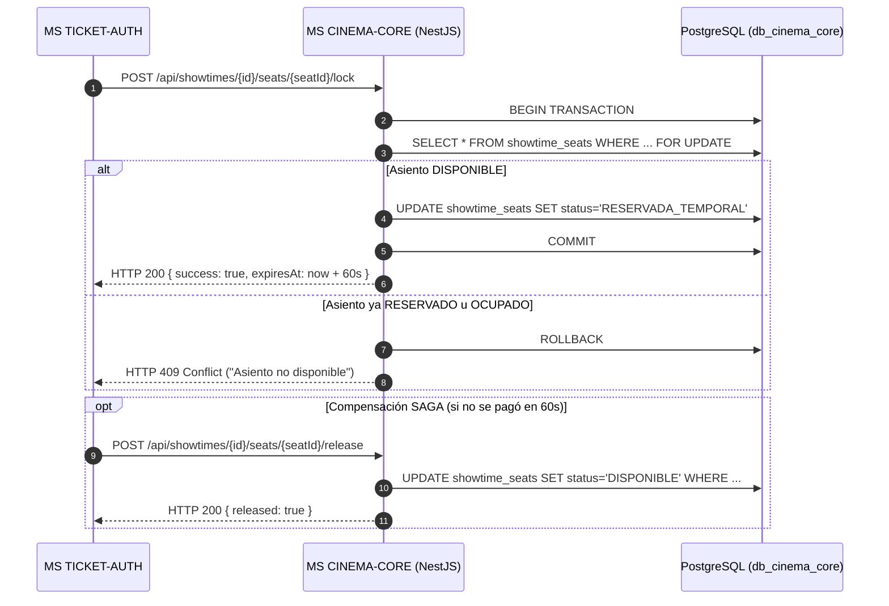

# Plan Técnico: Módulo 02 - Núcleo Cinematográfico, Salas, Butacas y Cartelera (MS CINEMA-CORE)

> **Estado:** APPROVED  
> **Versión:** 1.0.0  
> **Módulo:** `docs/specs/02-cinema-core/`  
> **Especificación Base:** `docs/specs/02-cinema-core/spec.md`  
> **Constitución Base:** `docs/constitution.md`  
> **Metodología:** SDD-Planning

---

## 1. Resumen Arquitectónico y Decisiones de Diseño

- **Objetivo Técnico:** Implementar el microservicio de salas, butacas, películas y programación de carteleras en NestJS (Node.js 20 LTS) utilizando arquitectura modular hexagonal con TypeORM sobre PostgreSQL (`db_cinema_core`), garantizando operaciones atómicas de bloqueo de butacas para el flujo SAGA y cálculo de KPIs analíticos en tiempo real.
- **Estilo Arquitectónico:** NestJS Modular / Clean Architecture con módulos aislados:
  - `HallsModule`: Gestión de salas (`CinemaHall`) y generación matricial paramétrica de butacas (`Seat`).
  - `MoviesModule`: Catálogo de películas (`Movie`) y metadatos de duración y portadas.
  - `ShowtimesModule`: Funciones (`Showtime`), verificación de no solapamiento horario (+20 min de limpieza) y bloqueo transaccional de butacas (`ShowtimeSeat`).
  - `MetricsModule`: Cálculo de KPIs de ocupación y exposición de datos para `MS IA-MCP`.
- **Decisiones Técnicas Clave:**
  - **Bloqueo Atómico de Butaca:** Transacción con aislamiento `READ COMMITTED` y bloqueo pesimista `SELECT ... FOR UPDATE` sobre la tabla `showtime_seats` para garantizar que dos clientes concurrentes no puedan reservar el mismo asiento.
  - **Generación Paramétrica:** Al crear una sala con $F$ filas y $C$ columnas, un servicio de dominio genera en una sola transacción batch los $F \times C$ registros de butacas con nombres correlativos `A-1`, `A-2`, etc.
  - **Integridad y Borrado Lógico:** Políticas `ON DELETE RESTRICT` en bases de datos para impedir la eliminación física de salas con funciones o butacas asociadas; uso del campo `is_active` para deshabilitación lógica.

### 1.1 Matriz de Componentes Técnicos (`PLAN-XX`)

| ID Componente | Nombre / Artefacto Técnico | Capa Arquitectónica | Responsabilidad Técnica | Requisitos que Cubre |
| :--- | :--- | :--- | :--- | :--- |
| **`PLAN-01`** | Migraciones TypeORM (`1700000000000-InitCinemaCore.ts`) | Infraestructura / Datos | Esquema PostgreSQL, tablas `cinema_halls`, `seats`, `movies`, `showtimes`, `showtime_seats`. | `RF-04.1`, `RF-05.1`, `RB-CORE-03` |
| **`PLAN-02`** | `CinemaHall`, `Seat`, `Movie`, `Showtime`, Domain Errors | Dominio | Entidades puras e invariantes de negocio (no solapamiento, código visible de butaca). | `RB-CORE-01`, `RB-CORE-02`, `RB-CORE-04` |
| **`PLAN-03`** | `CreateHallWithMatrixUseCase`, `LockSeatUseCase`, `ReleaseSeatUseCase` | Aplicación | Generación de cuadrícula, comandos SAGA de butacas y orquestación de funciones. | `HU-04`, `HU-05`, `RF-04.1`, `RF-05.2` |
| **`PLAN-04`** | `TypeOrmHallRepository`, `TypeOrmShowtimeRepository` | Infraestructura | Persistencia en base de datos PostgreSQL con transacciones atómicas. | `RF-04.3`, `RF-05.2` |
| **`PLAN-05`** | `HallsController`, `ShowtimesController`, `MetricsController` | Presentación / API | Endpoints REST/GraphQL consumidos por FrontWeb Admin, Movil App y MS IA-MCP. | `HU-06`, `RF-06.1`, `RF-06.3` |

---

## 2. Estructura Física de Archivos del Módulo

```text
services/ms-cinema-core/
├── backend/
│   ├── package.json                                                                  # NestJS 10, TypeORM, pg, class-validator, Jest
│   ├── tsconfig.json                                                                 # TypeScript estricto
│   ├── src/
│   │   ├── app.module.ts                                                             # Módulo raíz que ensambla los submódulos
│   │   ├── database/
│   │   │   ├── ormconfig.ts                                                          # Configuración de TypeORM con PostgreSQL local
│   │   │   └── migrations/
│   │   │       └── 1700000000000-InitCinemaCore.ts                                  # [CREATE] (PLAN-01) Migración inicial de tablas e índices
│   │   ├── modules/
│   │   │   ├── halls/
│   │   │   │   ├── domain/
│   │   │   │   │   ├── cinema-hall.entity.ts                                         # [CREATE] (PLAN-02) Entidad de sala
│   │   │   │   │   └── seat.entity.ts                                                # [CREATE] (PLAN-02) Entidad de butaca
│   │   │   │   ├── application/
│   │   │   │   │   ├── create-hall.use-case.ts                                       # [CREATE] (PLAN-03) Creación matricial paramétrica
│   │   │   │   │   └── update-seat-type.use-case.ts                                  # [CREATE] (PLAN-03) Tipificación (VIP, Discapacidad)
│   │   │   │   └── presentation/
│   │   │   │       └── halls.controller.ts                                           # [CREATE] (PLAN-05) CRUD REST de salas
│   │   │   ├── movies/
│   │   │   │   ├── domain/movie.entity.ts                                            # [CREATE] (PLAN-02) Entidad de película
│   │   │   │   ├── application/create-movie.use-case.ts                              # [CREATE] (PLAN-03) Registro de película
│   │   │   │   └── presentation/movies.controller.ts                                 # [CREATE] (PLAN-05) Catálogo de películas
│   │   │   ├── showtimes/
│   │   │   │   ├── domain/
│   │   │   │   │   ├── showtime.entity.ts                                            # [CREATE] (PLAN-02) Entidad de función con +20 min limpieza
│   │   │   │   │   └── showtime-seat.entity.ts                                       # [CREATE] (PLAN-02) Estado de butaca en función
│   │   │   │   ├── application/
│   │   │   │   │   ├── schedule-showtime.use-case.ts                                 # [CREATE] (PLAN-03) Programación con validación de traslape
│   │   │   │   │   ├── lock-seat.use-case.ts                                         # [CREATE] (PLAN-03) Bloqueo pesimista SAGA
│   │   │   │   │   └── release-seat.use-case.ts                                      # [CREATE] (PLAN-03) Liberación compensatoria SAGA
│   │   │   │   └── presentation/showtimes.controller.ts                              # [CREATE] (PLAN-05) Endpoints para SAGA y cartelera
│   │   │   └── metrics/
│   │   │       ├── application/compute-kpis.use-case.ts                              # [CREATE] (PLAN-03) Ocupación, recaudación y mapa de calor
│   │   │       └── presentation/metrics.controller.ts                                # [CREATE] (PLAN-05) Endpoint para MS IA-MCP
│   │   └── test/
│   │       ├── halls-matrix.spec.ts                                                  # [CREATE] Test unitario de generación matricial
│   │       ├── showtime-overlap.spec.ts                                              # [CREATE] Test unitario de prevención de solapamientos
│   │       └── seat-lock-concurrency.spec.ts                                         # [CREATE] Test de concurrencia y bloqueo atómico
│   └── Dockerfile                                                                    # Multi-stage build Node 20 Alpine
│
└── frontend/
    └── src/
        └── components/
            ├── HallMatrixDesigner.tsx                                                # [CREATE] (PLAN-05) Componente de diseño matricial de salas
            └── DashboardKPIs.tsx                                                     # [CREATE] (PLAN-05) Visualizador de KPIs de ocupación
```

---

## 3. Modelo Físico de Persistencia (PostgreSQL `db_cinema_core`)

### 3.1 Tablas Físicas

#### Tabla: `cinema_halls`
- `id`: `UUID PRIMARY KEY`
- `name`: `VARCHAR(80) NOT NULL UNIQUE`
- `total_rows`: `INT NOT NULL`
- `columns_per_row`: `INT NOT NULL`
- `total_capacity`: `INT NOT NULL`
- `projection_type`: `VARCHAR(20) NOT NULL` (`2D`, `3D`, `IMAX`, `VIP`)
- `is_active`: `BOOLEAN NOT NULL DEFAULT TRUE`

#### Tabla: `seats`
- `id`: `UUID PRIMARY KEY`
- `hall_id`: `UUID NOT NULL REFERENCES cinema_halls(id) ON DELETE RESTRICT`
- `row_letter`: `VARCHAR(2) NOT NULL` (A, B, C...)
- `column_number`: `INT NOT NULL` (1, 2, 3...)
- `display_code`: `VARCHAR(10) NOT NULL` (ej. "A-1")
- `seat_type`: `VARCHAR(25) NOT NULL DEFAULT 'ESTANDAR'` (`ESTANDAR`, `VIP`, `DISCAPACIDAD`, `PASILLO`)
- `is_available`: `BOOLEAN NOT NULL DEFAULT TRUE`
- Restricción Única: `UNIQUE (hall_id, row_letter, column_number)`

#### Tabla: `movies`
- `id`: `UUID PRIMARY KEY`
- `title`: `VARCHAR(150) NOT NULL`
- `synopsis`: `TEXT NOT NULL`
- `duration_minutes`: `INT NOT NULL`
- `rating`: `VARCHAR(15) NOT NULL`
- `genre`: `VARCHAR(50) NOT NULL`
- `poster_url`: `VARCHAR(500) NOT NULL`

#### Tabla: `showtimes`
- `id`: `UUID PRIMARY KEY`
- `movie_id`: `UUID NOT NULL REFERENCES movies(id) ON DELETE RESTRICT`
- `hall_id`: `UUID NOT NULL REFERENCES cinema_halls(id) ON DELETE RESTRICT`
- `start_time`: `TIMESTAMP UTC NOT NULL`
- `end_time`: `TIMESTAMP UTC NOT NULL` (start_time + duration + 20 min)
- `base_price`: `DECIMAL(10,2) NOT NULL`
- `status`: `VARCHAR(20) NOT NULL DEFAULT 'PROGRAMADA'`

#### Tabla: `showtime_seats`
- `id`: `UUID PRIMARY KEY`
- `showtime_id`: `UUID NOT NULL REFERENCES showtimes(id) ON DELETE CASCADE`
- `seat_id`: `UUID NOT NULL REFERENCES seats(id) ON DELETE RESTRICT`
- `status`: `VARCHAR(25) NOT NULL DEFAULT 'DISPONIBLE'` (`DISPONIBLE`, `RESERVADA_TEMPORAL`, `OCUPADA`, `BLOQUEADA`)
- `locked_at`: `TIMESTAMP UTC NULL`
- Restricción Única: `UNIQUE (showtime_id, seat_id)`

---

## 4. Contratos de Código e Interfaces Tipadas

### 4.1 Entidad de Dominio `Showtime` e Invariante de Solapamiento
```typescript
export class Showtime {
  constructor(
    public readonly id: string,
    public readonly movieId: string,
    public readonly hallId: string,
    public readonly startTime: Date,
    public readonly durationMinutes: number,
    public readonly basePrice: number,
  ) {}

  public get endTimeWithCleaning(): Date {
    const totalMinutes = this.durationMinutes + 20; // 20 min de limpieza obligatoria
    return new Date(this.startTime.getTime() + totalMinutes * 60000);
  }

  public overlapsWith(otherStart: Date, otherEnd: Date): boolean {
    return this.startTime < otherEnd && this.endTimeWithCleaning > otherStart;
  }
}
```

### 4.2 Servicio de Bloqueo Atómico Pesimista
```typescript
@Injectable()
export class LockSeatUseCase {
  constructor(private readonly dataSource: DataSource) {}

  async execute(showtimeId: string, seatId: string): Promise<boolean> {
    return await this.dataSource.transaction(async (manager) => {
      const seat = await manager
        .createQueryBuilder(ShowtimeSeat, 's')
        .setLock('pessimistic_write')
        .where('s.showtime_id = :showtimeId AND s.seat_id = :seatId', { showtimeId, seatId })
        .getOne();

      if (!seat || seat.status !== 'DISPONIBLE') {
        throw new ConflictException('La butaca ya no está disponible.');
      }

      seat.status = 'RESERVADA_TEMPORAL';
      seat.lockedAt = new Date();
      await manager.save(seat);
      return true;
    });
  }
}
```

---

## 5. Diagrama de Secuencia: Bloqueo y Liberación SAGA



---

## 6. Arquitectura de Vertical Slices para `/sdd-task`

* **Slice 0 (Setup):** `PLAN-01` Migraciones TypeORM con las 5 tablas relacionales y restricciones `UNIQUE`.
* **Slice 1 (Salas y Butacas Matriciales):** `PLAN-02`, `PLAN-03`, `PLAN-05` Creación paramétrica de salas, autogeneración de butacas A-Z / 1-N y tipificación de asientos.
* **Slice 2 (Películas y Cartelera sin Solapamiento):** `PLAN-02`, `PLAN-03`, `PLAN-05` Registro de películas, programación de funciones con validación de 20 min de holgura.
* **Slice 3 (Bloqueo Atómico SAGA y KPIs MCP):** `PLAN-03`, `PLAN-04`, `PLAN-05` Endpoints de bloqueo pesimista y liberación compensatoria, más KPIs de aforo para MS IA-MCP.
* **Slice 4 (Verificación y Cierre):** Pruebas de concurrencia Jest y build consolidado.

