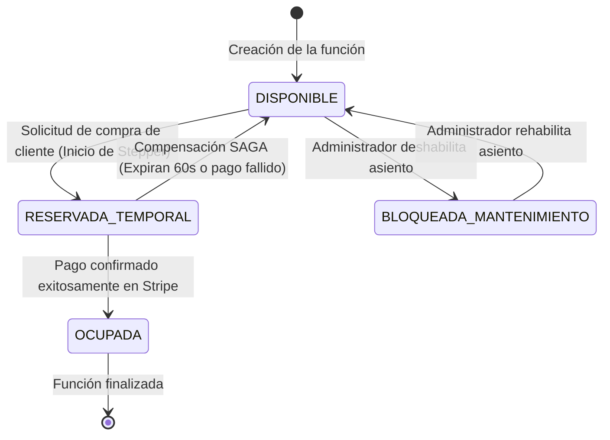

# Specification: Módulo 02 - Núcleo Cinematográfico, Salas, Butacas y Cartelera (MS CINEMA-CORE)

> **Estado:** APPROVED  
> **Módulo:** 02-cinema-core  
> **Metodología:** SDD-Spec-Assisted  
> **Subordinación:** Sujeto estrictamente a `docs/constitution.md` (v1.1.0)

---

## 1. Objetivo y Alcance

### 1.1 Objetivo de Negocio
Gestionar la infraestructura física y operativa del complejo cinematográfico mediante el modelado jerárquico de salas de proyección, generación paramétrica de matrices de butacas, administración del catálogo de películas y programación horaria de funciones, garantizando el bloqueo atómico de asientos y computando indicadores clave de rendimiento (KPIs) para la toma de decisiones y el monitoreo automatizado.

### 1.2 Alcance Funcional (In-Scope)
- **CRUD de Salas (`CinemaHall`) y Butacas Anidadas (`Seat`):** Creación, consulta, modificación y deshabilitación lógica de salas con generación automática de la matriz espacial de asientos por filas alfabéticas y columnas numéricas.
- **Tipificación Especial de Butacas:** Clasificación funcional de butacas individuales dentro de la matriz (Estándar, VIP, Movilidad Reducida / Discapacidad, Pasillo / Inactiva).
- **Catálogo de Películas (`Movie`):** Registro de obras cinematográficas con metadatos descriptivos (título, sinopsis, duración en minutos, género, clasificación etaria y referencia a la portada en almacenamiento de objetos).
- **Programación de Cartelera (`Showtime`):** Asignación temporal de proyecciones vinculando película, sala, fecha, hora de inicio y fin, validando la ausencia de solapamientos horarios en la misma sala.
- **Mecanismo de Bloqueo Atómico de Butaca:** Gestión transaccional del estado de cada asiento en una función (`DISPONIBLE`, `RESERVADA_TEMPORAL`, `OCUPADA`, `BLOQUEADA_MANTENIMIENTO`) para prevenir reservas simultáneas y habilitar la compensación SAGA.
- **Cuarteto de KPIs y Métricas de Rendimiento:** Cálculo consolidado de:
  1. Porcentaje de ocupación por sala y función (% aforo ocupado vs capacidad total).
  2. Recaudación acumulada estimada por película y proyección.
  3. Mapa de calor de demanda de butacas (asientos con mayor frecuencia de selección).
  4. Detección de funciones críticas con sub-ocupación (<15% de aforo próximo a su inicio).
- **Exposición de Métricas para Servidor MCP:** Interfaz semántica para suministrar los datos de ocupación y alertas a las herramientas del `MS IA-MCP`.

### 1.3 Exclusiones Explícitas (Out-of-Scope)
- **Procesamiento de Pagos o Facturación:** Las transacciones económicas y pasarelas pertenecen exclusivamente a `MS TICKET-AUTH`.
- **Almacenamiento Físico de Archivos Binarios:** Las imágenes de las portadas se almacenan en MinIO S3 (`MS MULTIMEDIA`); este módulo solo custodia metadatos y URLs.
- **Eliminación Física Destructiva con Historial:** Queda prohibido el borrado físico de salas o butacas que cuenten con funciones vigentes o boletos emitidos.

---

## 2. Actores y Permisos en el Módulo

| Actor | Permisos en este Módulo | Restricciones de Acceso |
| :--- | :--- | :--- |
| **Administrador (`admin`)** | Crear, editar y deshabilitar salas y butacas; registrar películas; programar funciones en cartelera; visualizar dashboard y KPIs analíticos. | No puede alterar estados de butacas asignadas a boletos pagados sin proceso de auditoría. |
| **Cliente (`cliente`)** | Consultar salas y cartelera pública; visualizar el mapa de distribución de asientos de una función en tiempo real. | No puede crear salas, modificar horarios ni cambiar el aforo o precio. |
| **Microservicio `MS TICKET-AUTH` (Sistema)** | Solicitar bloqueo temporal de butaca (`RESERVAR_TEMPORAL`), liberación compensatoria (`LIBERAR_DISPONIBLE`) o confirmación final (`OCUPAR`). | Opera bajo contratos de máquina a máquina tipados. |
| **Microservicio `MS IA-MCP` (Sistema)** | Consultar métricas de ocupación y recaudación mediante la herramienta `get_occupancy_metrics()`. | Solo lectura de métricas agregadas. |

---

## 3. Modelo Funcional de Datos y Reglas de Negocio Específicas

### 3.1 Entidades Funcionales y Atributos de Dominio

#### Entidad: Sala (`CinemaHall`)
- `id`: Identificador único (UUID).
- `nombre`: Texto descriptivo único (ej. "Sala 1 - MacroXE", "Sala 2 - 3D").
- `totalFilas`: Número entero positivo (ej. 10 filas correspondientes a A–J).
- `columnasPorFila`: Número entero positivo (ej. 15 asientos por fila).
- `capacidadTotal`: Número entero computado automáticamente (`totalFilas * columnasPorFila` menos asientos inactivos/pasillos).
- `tipoProyeccion`: Enumerador (`2D`, `3D`, `IMAX`, `VIP`).
- `estadoOperativo`: Enumerador (`ACTIVA`, `EN_MANTENIMIENTO`).

#### Entidad: Butaca (`Seat`)
- `id`: Identificador único (UUID).
- `salaId`: Referencia obligatoria a la sala contenedora.
- `fila`: Letra identificadora de fila (ej. "A", "B", "C").
- `numero`: Entero identificador en la fila (ej. 1, 2, 3...).
- `codigoVisible`: Etiqueta legible concatenada (ej. "C-8").
- `tipo`: Enumerador (`ESTANDAR`, `VIP`, `DISCAPACIDAD`, `PASILLO_BLOQUEADO`).
- `habilitada`: Booleano (indica si está disponible para venta general).

#### Entidad: Película (`Movie`)
- `id`: Identificador único (UUID).
- `titulo`: Texto obligatorio (ej. "Oppenheimer").
- `sinopsis`: Texto descriptivo detallado.
- `duracionMinutos`: Entero positivo (ej. 180).
- `clasificacion`: Enumerador (`ATP`, `PG-13`, `R-16`, `R-18`).
- `genero`: Texto o categoría (ej. "Ciencia Ficción", "Drama").
- `portadaUrl`: URL de la imagen en MinIO S3.
- `estadoCatalogo`: Enumerador (`EN_CARTELERA`, `PROXIMO_ESTRENO`, `ARCHIVADA`).

#### Entidad: Función / Cartelera (`Showtime`)
- `id`: Identificador único (UUID).
- `peliculaId`: Referencia obligatoria a la película proyectada.
- `salaId`: Referencia obligatoria a la sala de exhibición.
- `fechaHoraInicio`: Marca de tiempo (ISO-8601).
- `fechaHoraFin`: Marca de tiempo calculada automáticamente (`fechaHoraInicio + duracionMinutos + 20 minutos de limpieza`).
- `precioBase`: Valor numérico positivo.
- `estado`: Enumerador (`PROGRAMADA`, `EN_CURSO`, `FINALIZADA`, `CANCELADA`).

### 3.2 Reglas de Negocio del Módulo (`RB-CORE-XX`)

- **`RB-CORE-01` (Generación Matricial Paramétrica):** Al registrar una nueva sala, el usuario ingresa la cantidad de filas y columnas; el sistema autogenera inmediatamente todas las entidades de butacas asociadas con código visible `${Fila}-${Numero}` en tipo `ESTANDAR`, permitiendo la edición individual posterior.
- **`RB-CORE-02` (Prevención de Solapamiento Horario en Sala):** Queda estrictamente prohibido programar dos funciones en la misma sala cuyo rango horario se traslape. El sistema debe validar que entre el fin de una proyección y el inicio de la siguiente existan al menos 20 minutos de holgura operativa para limpieza y desalojo.
- **`RB-CORE-03` (Integridad y Bloqueo de Eliminación por Historial):** Si una sala o butaca está asociada a una función con boletos emitidos (o históricos), el sistema impide terminantemente su eliminación física (`DELETE` rechazado) y ofrece su pase a estado `EN_MANTENIMIENTO`, impidiendo nuevas reservas sin alterar el registro previo.
- **`RB-CORE-04` (Concurrencia y Bloqueo Atómico de Butaca):** En una función activa, una butaca solo puede transicionar a `RESERVADA_TEMPORAL` si su estado previo es estrictamente `DISPONIBLE`. Si dos solicitudes concurrentes intentan bloquear la misma butaca, el sistema procesa la primera y rechaza de inmediato la segunda con error de conflicto.
- **`RB-CORE-05` (Sincronización de Compensación SAGA):** Al recibir la señal de liberación de `MS TICKET-AUTH` (por expiración de 60 segundos o cobro fallido), el sistema debe revertir atómicamente el estado del asiento a `DISPONIBLE` para que vuelva a figurar libre en la cartelera en tiempo real.
- **`RB-CORE-06` (Cálculo Dinámico de Alerta de Sub-ocupación):** Toda función a menos de 30 minutos de iniciar con un porcentaje de aforo menor al 15% debe ser catalogada como anomalía de baja ocupación y exponerse a `MS IA-MCP`.

---

## 4. Máquina de Estados de la Butaca en una Función (`ShowtimeSeatState`)



---

## 5. Requerimientos Funcionales Estructurados (Patrón EARS)

### Historia de Usuario `HU-04`: Gestión Paramétrica de Salas y Matrices de Asientos
*Como administrador del cine, quiero configurar salas indicando dimensiones de filas y columnas, para generar rápidamente la distribución de butacas y personalizar asientos especiales.*

- **`RF-04.1` (Creación Paramétrica de Sala):** Cuando el administrador ingrese el nombre de sala, cantidad de filas (ej. 8) y columnas (ej. 12), el sistema deberá crear la sala y autogenerar las 96 butacas correspondientes con sus códigos visuales correlativos (A-1 a H-12) en estado `ESTANDAR`.
- **`RF-04.2` (Personalización de Butacas Especiales):** Cuando el administrador seleccione una o más butacas en el visor gráfico de la sala, el sistema deberá permitir reclasificar su tipo a `VIP`, `DISCAPACIDAD` o `PASILLO_BLOQUEADO`, recalculando de inmediato la capacidad vendible total.
- **`RF-04.3` (Protección contra Borrado Físico):** Si el administrador intenta eliminar una sala con funciones históricas o vigentes, el sistema deberá rechazar la operación física, mostrar la alerta *"La sala posee funciones asociadas y no puede ser eliminada"* y habilitar la opción de marcarla como `EN_MANTENIMIENTO`.

---

### Historia de Usuario `HU-05`: Catálogo de Películas y Programación de Cartelera
*Como administrador, quiero dar de alta películas y programar horarios en las salas disponibles, para mantener actualizada la cartelera comercial del cine.*

- **`RF-05.1` (Registro de Película):** Cuando el administrador complete los datos obligatorios de una película (título, sinopsis, duración, género y URL de portada), el sistema deberá registrar la película en estado `EN_CARTELERA` y ponerla a disposición para programación.
- **`RF-05.2` (Programación sin Solapamiento):** Cuando el administrador programe una función asignando película, sala y horario de inicio, el sistema deberá computar la hora de finalización sumando la duración más 20 minutos de limpieza y verificar que no exista colisión horaria con otra función en la misma sala.
- **`RF-05.3` (Rechazo de Conflicto Horario):** Si el horario programado colisiona con otra función existente en la misma sala, el sistema deberá bloquear la creación y presentar el mensaje: *"Existe un solapamiento con la función programada de [Título] de [HoraInicio] a [HoraFin]."*

---

### Historia de Usuario `HU-06`: Dashboard Ejecutivo y Suministro de KPIs a la IA
*Como administrador y como sistema de auditoría inteligente, quiero consultar métricas consolidadas de ocupación y recaudación, para evaluar el rendimiento de las salas y detectar anomalías.*

- **`RF-06.1` (Cálculo de Aforo y Recaudación):** El sistema deberá computar en tiempo real el porcentaje de ocupación (`(butacas_ocupadas / capacidad_total) * 100`) y la recaudación total acumulada por cada sala y función programada.
- **`RF-06.2` (Mapa de Calor de Demanda):** El sistema deberá generar un ranking visual de las butacas con mayor frecuencia de ocupación histórica dentro de cada sala para optimizar la asignación tarifaria.
- **`RF-06.3` (Herramienta Semántica de Ocupación para MCP):** Cuando el microservicio `MS IA-MCP` invoque la herramienta `get_occupancy_metrics()`, el sistema deberá retornar un payload estructurado con el aforo actual de todas las salas, el porcentaje de ocupación promedio y el listado de funciones críticas con menos del 15% de ocupación próximas a comenzar.

---

## 6. Comportamiento Observable y Criterios de Aceptación (Escenarios BDD Gherkin)

### Escenario 1: Creación Exitosa de Sala con Matriz Paramétrica (`SC-02.1.1`)
```gherkin
Given que el administrador autenticado ingresa al panel de gestión de salas
When completa el formulario con nombre "Sala 3 - Atmos", filas 5 y columnas 10
And presiona "Crear Sala y Generar Butacas"
Then el sistema crea la sala con capacidad total de 50 asientos
And genera visualmente una cuadrícula de 5 filas (A a E) y 10 columnas (1 a 10)
And todas las butacas quedan inicializadas como "ESTANDAR" y disponibles
```

### Escenario 2: Intento de Solapamiento Horario en Cartelera (`SC-02.2.1`)
```gherkin
Given que la "Sala 1" tiene programada la película "Avatar 2" de 18:00 a 21:20 (incluyendo 20 min de limpieza)
When el administrador intenta programar en la "Sala 1" la película "Titanic" con inicio a las 20:30
Then el sistema detecta la superposición horaria
And impide el guardado de la nueva función
And muestra la alerta observable "Existe un solapamiento con la función programada de Avatar 2 de 18:00 a 21:20"
```

### Escenario 3: Bloqueo Atómico Concurrente de Butaca (`SC-02.3.1`)
```gherkin
Given que la butaca "C-5" de la función 101 se encuentra en estado "DISPONIBLE"
When dos clientes intentan reservar simultáneamente la butaca "C-5"
Then la primera solicitud es aceptada y la butaca transiciona a "RESERVADA_TEMPORAL"
And la segunda solicitud es rechazada inmediatamente con el mensaje "La butaca seleccionada ya no se encuentra disponible"
And la butaca permanece asignada de forma exclusiva al primer cliente durante 60 segundos
```

### Escenario 4: Liberación Compensatoria SAGA de Butaca (`SC-02.3.2`)
```gherkin
Given que la butaca "B-4" de la función 202 se encuentra en estado "RESERVADA_TEMPORAL"
When se recibe la orden de compensación de MS TICKET-AUTH por expiración de tiempo de pago
Then el sistema actualiza atómicamente la butaca "B-4" al estado "DISPONIBLE"
And el asiento vuelve a figurar en verde en la cartelera de todos los clientes conectados
```

### Escenario 5: Consulta de KPIs desde el Servidor MCP (`SC-02.4.1`)
```gherkin
Given que existen 3 funciones programadas para hoy donde la Sala 2 tiene solo un 10% de ocupación faltando 20 minutos
When el servidor MS IA-MCP ejecuta la consulta "get_occupancy_metrics()"
Then el sistema retorna un contrato de datos con el porcentaje de aforo de cada sala
And clasifica a la Sala 2 con la bandera de alerta "SALA_SUBOCUPADA"
And no expone datos personales de clientes ni contraseñas
```

---

## 7. Efectos Secundarios e Integraciones

### 7.1 Dependencias con otros Microservicios
* **Con `MS TICKET-AUTH`:** Responde a comandos síncronos de bloqueo (`RESERVAR_TEMPORAL`), liberación compensatoria (`LIBERAR_DISPONIBLE`) y ocupación definitiva (`CONFIRMAR_OCUPADA`).
* **Con `MS MULTIMEDIA`:** Suministra metadatos de salas y butacas para el renderizado del ticket gráfico y la generación del código QR.
* **Con `MS IA-MCP`:** Provee el catálogo de funciones y métricas de ocupación para la auditoría comercial continua.

### 7.2 Efectos Secundarios Internos
* La inactivación de una butaca actualiza automáticamente el aforo total vendible de la sala y recalcula los porcentajes de KPIs del dashboard en tiempo real.

