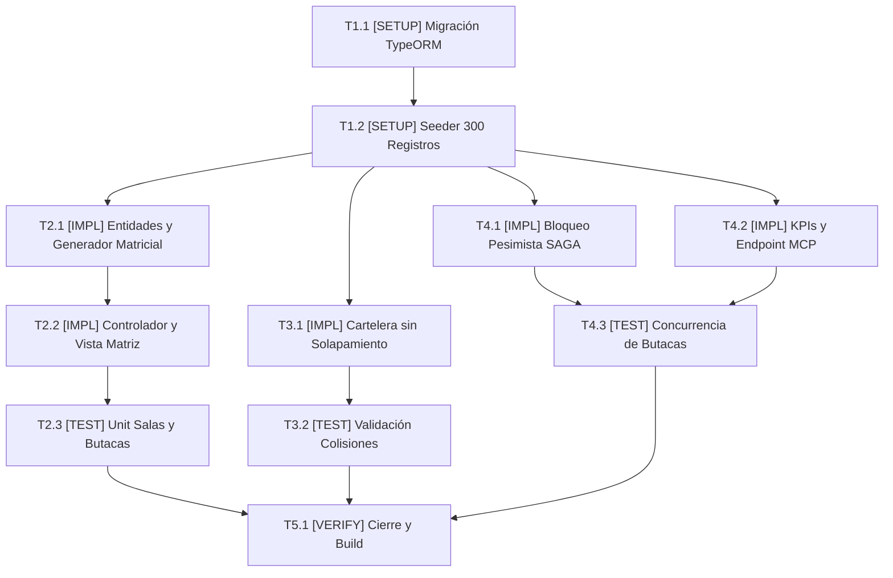

# Tasks: Módulo 02 - Núcleo Cinematográfico, Salas, Butacas y Cartelera (MS CINEMA-CORE)

## Task Progress

| Métrica | Cantidad |
| :--- | ---: |
| Total de tareas | 11 |
| Tareas realizadas | 0 |
| Tareas por realizar | 11 |
| Tareas bloqueadas | 0 |
| Tareas en progreso | 0 |
| Progreso | 0% |

**Estado:** READY

---

## Checklist Rápido de Tareas por Vertical Slice

### Fase 0: Setup, Esquema Base y Carga de Datos Masivos
- [ ] `T1.1` `[SETUP]` Configuración de proyecto NestJS 10, TypeORM y migración de tablas `cinema_halls`, `seats`, `movies`, `showtimes`, `showtime_seats` (`PLAN-01`).
- [ ] `T1.2` `[SETUP]` Implementar `DatabaseSeeder` con fábricas para precargar ~300 registros variables de prueba (películas, salas, butacas y funciones programadas) (`PLAN-01`).

### Slice 1: Salas y Generación Matricial Paramétrica de Butacas
- [ ] `T2.1` `[IMPL]` Implementar entidades `CinemaHall`, `Seat` y el caso de uso `CreateHallWithMatrixUseCase` con autogeneración de filas A-Z y columnas 1-N (`PLAN-02`, `PLAN-03`).
- [ ] `T2.2` `[IMPL]` Implementar `HallsController` y vista React `HallMatrixDesigner` para visualización y tipificación de butacas (VIP, Movilidad Reducida) (`PLAN-05`).
- [ ] `T2.3` `[TEST]` Suite unitaria y BDD: validar creación paramétrica de cuadrícula de asientos y prevención de borrado físico si hay historial (`SC-02.1.1`, `RB-CORE-03`).

### Slice 2: Catálogo de Películas y Cartelera sin Solapamiento
- [ ] `T3.1` `[IMPL]` Implementar `MoviesModule` y el caso de uso `ScheduleShowtimeUseCase` con validación estricta de 20 minutos de limpieza sin solapamiento (`PLAN-02`, `PLAN-03`).
- [ ] `T3.2` `[TEST]` Suite de pruebas de colisión horaria: validar rechazo de funciones superpuestas en la misma sala (`SC-02.2.1`, `RB-CORE-02`).

### Slice 3: Bloqueo Atómico Pesimista SAGA y KPIs para Servidor MCP
- [ ] `T4.1` `[IMPL]` Implementar endpoints transaccionales de bloqueo pesimista `lockSeat` y liberación compensatoria `releaseSeat` para el flujo SAGA (`PLAN-03`, `PLAN-04`, `PLAN-05`).
- [ ] `T4.2` `[IMPL]` Implementar `MetricsController` con cálculo de aforo, porcentaje de ocupación y alerta de funciones subocupadas para la herramienta MCP `get_occupancy_metrics()` (`PLAN-03`, `PLAN-05`).
- [ ] `T4.3` `[TEST]` Suite de concurrencia: validar que dos solicitudes simultáneas sobre la misma butaca permitan solo una y rechacen la segunda con HTTP 409 (`SC-02.3.1`, `SC-02.4.1`).

### Fase Final: Verificación Consolidada y Cierre
- [ ] `T5.1` `[VERIFY]` Ejecución completa de suites Jest, análisis estático de tipos TypeScript y verificación de build de `ms-cinema-core`.

---

## 1. Resumen de Trazabilidad (`Spec` → `Plan` → `Tasks`)

| Requisito / Regla / Escenario (`spec.md`) | Componente Técnico (`plan.md`) | Tareas Asociadas (`tasks.md`) |
| :--- | :--- | :--- |
| `HU-04`, `RF-04.1`, `RB-CORE-01` | `PLAN-01`, `PLAN-02`, `PLAN-03` | `T1.1`, `T1.2`, `T2.1` |
| `RF-04.2`, `RF-04.3`, `SC-02.1.1` | `PLAN-04`, `PLAN-05` | `T2.2`, `T2.3` |
| `HU-05`, `RF-05.1`, `RF-05.2`, `SC-02.2.1` | `PLAN-02`, `PLAN-03`, `PLAN-05` | `T3.1`, `T3.2` |
| `RB-CORE-04`, `RB-CORE-05`, `SC-02.3.1`, `SC-02.3.2` | `PLAN-03`, `PLAN-04`, `PLAN-05` | `T4.1`, `T4.3` |
| `HU-06`, `RF-06.1`, `RF-06.3`, `SC-02.4.1` | `PLAN-03`, `PLAN-05` | `T4.2`, `T4.3` |
| Cierre y verificación de calidad | Todos los componentes `PLAN` | `T5.1` |

---

## 2. Grafo de Dependencias de Tareas

---

## 3. Desglose Detallado de Tareas Ejecutables

### Fase 0: Setup, Esquema Base y Carga de Datos Masivos

#### [ ] T1.1 [SETUP] Configuración de NestJS 10 y migración inicial TypeORM
* **Status:** PENDING
* **Traceability:** `PLAN-01`
* **Depends on:** —
* **Files:**
  * `[CREATE]` `services/ms-cinema-core/backend/src/database/migrations/1700000000000-InitCinemaCore.ts`
  * `[CREATE]` `services/ms-cinema-core/backend/src/database/ormconfig.ts`
* **Objective:** Crear las 5 tablas relacionales con restricciones `UNIQUE` y claves foráneas `RESTRICT`.
* **Work:** Codificar la migración TypeORM para `cinema_halls`, `seats`, `movies`, `showtimes`, `showtime_seats`.
* **Done when:** La migración corre exitosamente en la base de datos `db_cinema_core`.
* **Evidence:** `npm run typeorm:migration:run`

#### [ ] T1.2 [SETUP] Implementar DatabaseSeeder con ~300 registros variables
* **Status:** PENDING
* **Traceability:** `PLAN-01`, `constitution.md` (Población inicial de datos)
* **Depends on:** `T1.1`
* **Files:**
  * `[CREATE]` `services/ms-cinema-core/backend/src/database/seeds/initial-data.seeder.ts`
* **Objective:** Inyectar un volumen representativo de ~300 registros variables (múltiples salas, matrices completas de butacas, cartelera de películas y funciones en diferentes horarios).
* **Work:** Programar script de seed con factories que genere salas, películas, funciones y butacas asociadas listas para operar y probar.
* **Done when:** La base de datos contiene más de 300 registros relacionales verificables.
* **Evidence:** `npm run seed:run`

---

### Slice 1: Salas y Generación Matricial Paramétrica de Butacas

#### [ ] T2.1 [IMPL] Implementar entidades y caso de uso CreateHallWithMatrixUseCase
* **Status:** PENDING
* **Traceability:** `PLAN-02`, `PLAN-03` | `RF-04.1`, `RB-CORE-01`
* **Depends on:** `T1.2`
* **Files:**
  * `[CREATE]` `services/ms-cinema-core/backend/src/modules/halls/domain/cinema-hall.entity.ts`
  * `[CREATE]` `services/ms-cinema-core/backend/src/modules/halls/domain/seat.entity.ts`
  * `[CREATE]` `services/ms-cinema-core/backend/src/modules/halls/application/create-hall.use-case.ts`
* **Objective:** Autogenerar la matriz de asientos de $F \times C$ en un batch atómico al crear la sala.
* **Work:** Implementar el algoritmo que mapea índices $0..F-1$ a letras (A, B, C...) y genera códigos visibles correlativos (A-1, A-2...).
* **Done when:** Al crear una sala de 5x10, se generan y persisten exactamente 50 butacas asociadas.
* **Evidence:** `npm test halls-matrix.spec.ts`

#### [ ] T2.2 [IMPL] Implementar HallsController y visor gráfico HallMatrixDesigner
* **Status:** PENDING
* **Traceability:** `PLAN-05` | `RF-04.2`, `RF-04.3`
* **Depends on:** `T2.1`
* **Files:**
  * `[CREATE]` `services/ms-cinema-core/backend/src/modules/halls/presentation/halls.controller.ts`
  * `[CREATE]` `services/ms-cinema-core/frontend/src/components/HallMatrixDesigner.tsx`
* **Objective:** Interfaz interactiva de la cuadrícula de sala y endpoints para cambio de tipo de butaca.
* **Work:** Programar el controlador REST y la vista visual que permite hacer clic en asientos para marcarlos como VIP o Discapacidad.
* **Done when:** El frontend actualiza el tipo de butaca en base de datos al seleccionarla.
* **Evidence:** `npm test halls.controller.spec.ts`

#### [ ] T2.3 [TEST] Suite unitaria y BDD de gestión de salas
* **Status:** PENDING
* **Traceability:** `SC-02.1.1`, `RB-CORE-03`
* **Depends on:** `T2.2`
* **Files:**
  * `[CREATE]` `services/ms-cinema-core/backend/src/test/halls-matrix.spec.ts`
* **Objective:** Validar la capacidad total calculada y el bloqueo de borrado de salas con funciones.
* **Work:** Escribir pruebas unitarias sobre `CreateHallWithMatrixUseCase` e intentar borrado sobre sala activa.
* **Done when:** Los tests pasan verificando la integridad referencial.
* **Evidence:** `npm test halls-matrix.spec.ts`

---

### Slice 2: Catálogo de Películas y Cartelera sin Solapamiento

#### [ ] T3.1 [IMPL] Implementar MoviesModule y programación de funciones con +20 min de limpieza
* **Status:** PENDING
* **Traceability:** `PLAN-02`, `PLAN-03` | `RF-05.1`, `RF-05.2`, `RB-CORE-02`
* **Depends on:** `T1.2`
* **Files:**
  * `[CREATE]` `services/ms-cinema-core/backend/src/modules/movies/domain/movie.entity.ts`
  * `[CREATE]` `services/ms-cinema-core/backend/src/modules/showtimes/domain/showtime.entity.ts`
  * `[CREATE]` `services/ms-cinema-core/backend/src/modules/showtimes/application/schedule-showtime.use-case.ts`
* **Objective:** Impedir traslapes en la misma sala garantizando 20 minutos de limpieza obligatoria.
* **Work:** Calcular `end_time = start_time + duration + 20min` y verificar en base de datos la ausencia de solapamientos.
* **Done when:** El sistema rechaza con excepción si dos funciones se superponen en la misma sala.
* **Evidence:** `npm test showtime-overlap.spec.ts`

#### [ ] T3.2 [TEST] Suite de prevención de solapamientos en cartelera
* **Status:** PENDING
* **Traceability:** `SC-02.2.1`
* **Depends on:** `T3.1`
* **Files:**
  * `[CREATE]` `services/ms-cinema-core/backend/src/test/showtime-overlap.spec.ts`
* **Objective:** Validar que una función de 18:00 a 21:00 con 20 min de limpieza impida programar otra a las 20:30.
* **Work:** Implementar el test de colisión horaria BDD.
* **Done when:** El test pasa en verde confirmando el bloqueo de colisión.
* **Evidence:** `npm test showtime-overlap.spec.ts`

---

### Slice 3: Bloqueo Atómico Pesimista SAGA y KPIs para Servidor MCP

#### [ ] T4.1 [IMPL] Implementar comandos SAGA lockSeat y releaseSeat con SELECT ... FOR UPDATE
* **Status:** PENDING
* **Traceability:** `PLAN-03`, `PLAN-04`, `PLAN-05` | `RB-CORE-04`, `RB-CORE-05`
* **Depends on:** `T1.2`
* **Files:**
  * `[CREATE]` `services/ms-cinema-core/backend/src/modules/showtimes/application/lock-seat.use-case.ts`
  * `[CREATE]` `services/ms-cinema-core/backend/src/modules/showtimes/application/release-seat.use-case.ts`
  * `[CREATE]` `services/ms-cinema-core/backend/src/modules/showtimes/presentation/showtimes.controller.ts`
* **Objective:** Endpoint seguro para que MS TICKET-AUTH bloquee o libere butacas durante el checkout de 60 segundos.
* **Work:** Implementar el bloqueo pesimista en TypeORM dentro de una transacción serializable/pesimista.
* **Done when:** Si la butaca está libre, cambia a `RESERVADA_TEMPORAL`; si ya está reservada, arroja HTTP 409 Conflict.
* **Evidence:** `npm test seat-lock-concurrency.spec.ts`

#### [ ] T4.2 [IMPL] Implementar MetricsController con cálculo de aforo y alertas MCP
* **Status:** PENDING
* **Traceability:** `PLAN-03`, `PLAN-05` | `RF-06.1`, `RF-06.3`, `RB-CORE-06`
* **Depends on:** `T1.2`
* **Files:**
  * `[CREATE]` `services/ms-cinema-core/backend/src/modules/metrics/application/compute-kpis.use-case.ts`
  * `[CREATE]` `services/ms-cinema-core/backend/src/modules/metrics/presentation/metrics.controller.ts`
  * `[CREATE]` `services/ms-cinema-core/frontend/src/components/DashboardKPIs.tsx`
* **Objective:** Suministrar porcentajes de ocupación por sala y detectar funciones con $<15\%$ de aforo.
* **Work:** Implementar las queries de agregación SQL y el endpoint `/api/metrics/occupancy` que consume MS IA-MCP.
* **Done when:** El endpoint retorna el JSON estructurado con las funciones críticas y el promedio global.
* **Evidence:** `npm test compute-kpis.spec.ts`

#### [ ] T4.3 [TEST] Suite de concurrencia y validación de métricas MCP
* **Status:** PENDING
* **Traceability:** `SC-02.3.1`, `SC-02.4.1`
* **Depends on:** `T4.1`, `T4.2`
* **Files:**
  * `[CREATE]` `services/ms-cinema-core/backend/src/test/seat-lock-concurrency.spec.ts`
* **Objective:** Demostrar que dos promesas concurrentes intentando reservar la misma butaca producen un éxito y un conflicto HTTP 409.
* **Work:** Ejecutar dos peticiones simultáneas con `Promise.all` sobre el caso de uso `LockSeatUseCase`.
* **Done when:** Exactamente una promesa tiene éxito y la otra es rechazada.
* **Evidence:** `npm test seat-lock-concurrency.spec.ts`

---

### Fase Final: Verificación Consolidada y Cierre

#### [ ] T5.1 [VERIFY] Verificación completa del microservicio ms-cinema-core
* **Status:** PENDING
* **Traceability:** Cross-cutting (Cierre de Módulo 02)
* **Depends on:** `T2.3`, `T3.2`, `T4.3`
* **Objective:** Ejecutar todas las pruebas unitarias y de integración de NestJS y linter.
* **Work:** Ejecutar `npm run test && npm run lint && npm run build`.
* **Done when:** 100% de tests en verde y build completado sin errores de TypeScript.
* **Evidence:** `npm run test:cov && npm run build`

---

## 4. Bitácora de Evidencia de Ejecución (`/sdd-execution`)
* *(Pendiente de inicio de `/sdd-execution`)*
