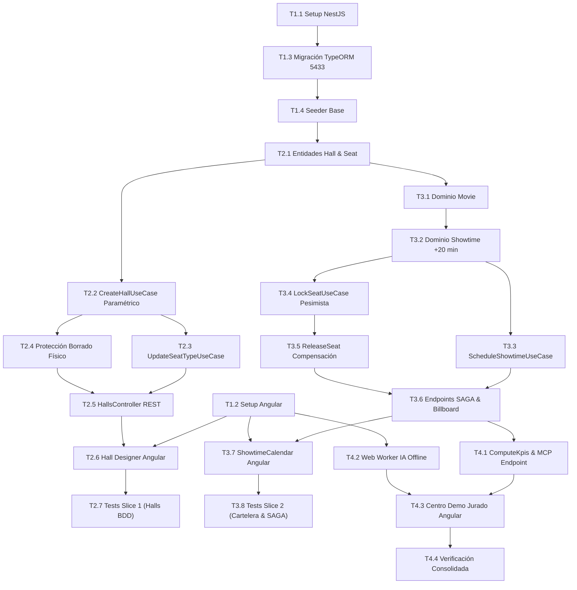

# Tasks: Módulo 02 - Núcleo Cinematográfico, Cartelera y FrontWeb Admin (MS CINEMA-CORE)

## Task Progress

| Métrica | Cantidad |
| :--- | ---: |
| Total de tareas | 23 |
| Tareas realizadas | 23 |
| Tareas por realizar | 0 |
| Tareas bloqueadas | 0 |
| Tareas en progreso | 0 |
| Progreso | 100% |

**Estado:** COMPLETED

---

## Checklist Rápido de Tareas por Vertical Slice

### Fase 0: Setup y Fundación Base
- [x] `T1.1` `[SETUP]` Configuración de proyecto NestJS 10, TypeORM, dependencias PostgreSQL 5433 y Dockerfile.
- [x] `T1.2` `[SETUP]` Configuración de FrontWeb Angular 17, TailwindCSS, angular.json con Web Workers y Dockerfile Nginx.
- [x] `T1.3` `[SETUP]` Migración TypeORM inicial: tablas `cinema_halls`, `seats`, `movies`, `showtimes`, `showtime_seats`.
- [x] `T1.4` `[SETUP]` Seeder de base de datos con salas predeterminadas, butacas iniciales y catálogo demo de películas.

### Slice 1: Modelado de Salas y Butacas Anidadas Paramétricas (HU-04, HU-13)
- [x] `T2.1` `[IMPL]` Entidades TypeORM `CinemaHall` y `Seat` con invariantes de capacidad total vendible.
- [x] `T2.2` `[IMPL]` Caso de uso `CreateHallUseCase`: generación matricial paramétrica de asientos (${Fila}-${Num}).
- [x] `T2.3` `[IMPL]` Caso de uso `UpdateSeatTypeUseCase` para reclasificación a `VIP`, `DISCAPACIDAD` o `PASILLO`.
- [x] `T2.4` `[IMPL]` Regla `RB-CORE-03`: Protección contra borrado físico de salas o butacas con historial.
- [x] `T2.5` `[IMPL]` Controlador REST `HallsController` con operaciones CRUD y validación DTO estricta.
- [x] `T2.6` `[IMPL]` Frontend Angular: Módulo Lazy Loading `HallsModule` y diseñador visual `HallDesignerComponent`.
- [x] `T2.7` `[TEST]` Pruebas unitarias de generación matricial y BDD de creación de sala de 50 butacas (`SC-02.1.1`).

### Slice 2: Catálogo, Cartelera +20 min y Bloqueo Pesimista SAGA (HU-05)
- [x] `T3.1` `[IMPL]` Entidad de dominio `Movie` y caso de uso de registro de catálogo en estado `EN_CARTELERA`.
- [x] `T3.2` `[IMPL]` Entidad de dominio `Showtime` con regla de cálculo `fechaHoraFin = inicio + duracion + 20 min limpieza`.
- [x] `T3.3` `[IMPL]` Caso de uso `ScheduleShowtimeUseCase` con validación estricta de prevención de solapamientos.
- [x] `T3.4` `[IMPL]` Entidad `ShowtimeSeat` y caso de uso `LockSeatUseCase` con bloqueo atómico pesimista (`SELECT FOR UPDATE`).
- [x] `T3.5` `[IMPL]` Caso de uso `ReleaseSeatUseCase` para compensación SAGA y `ConfirmSeatUseCase` para ocupación final.
- [x] `T3.6` `[IMPL]` Controladores `MoviesController` y `ShowtimesController` exponiendo endpoints SAGA (`IC-02.1`) y cartelera (`IC-02.3`).
- [x] `T3.7` `[IMPL]` Frontend Angular: Módulo Lazy Loading `ShowtimesModule` y calendario `ShowtimeCalendarComponent`.
- [x] `T3.8` `[TEST]` Pruebas BDD de solapamiento horario (`SC-02.2.1`), concurrencia (`SC-02.3.1`) y compensación SAGA (`SC-02.3.2`).

### Fase Final: KPIs, IA Local Offline y Verificación Consolidada (HU-06, HU-14, HU-15)
- [x] `T4.1` `[IMPL]` Caso de uso `ComputeKpisUseCase` y controlador `MetricsController` para `MS IA-MCP` (`IC-02.2`).
- [x] `T4.2` `[IMPL]` Frontend Angular: Web Worker con Transformers.js / WebLLM para consultas analíticas 100% offline (`HU-14`, `SC-02.5.1`).
- [x] `T4.3` `[IMPL]` Frontend Angular: Componente `AuditDemoComponent` con botón demo para jurado y descarga de Excel (`HU-15`).
- [x] `T4.4` `[VERIFY]` Verificación consolidada: suites Jest, pruebas Jasmine en Angular, linters y build de contenedores Docker.

---

## 1. Resumen de Trazabilidad (`Spec` $\rightarrow$ `Plan` $\rightarrow$ `Tasks`)

| Requisito / Regla / Escenario (`spec.md`) | Componente Técnico (`plan.md`) | Tareas Asociadas (`tasks.md`) |
| :--- | :--- | :--- |
| `RF-04.1`, `RB-CORE-01`, `SC-02.1.1` | `PLAN-01`, `PLAN-02`, `PLAN-03` | `T1.3`, `T2.1`, `T2.2`, `T2.7` |
| `RF-04.2`, `RF-04.3`, `RB-CORE-03` | `PLAN-02`, `PLAN-03`, `PLAN-05` | `T2.3`, `T2.4`, `T2.5`, `T2.6` |
| `HU-05`, `RF-05.1` | `PLAN-02`, `movies.controller.ts` | `T3.1`, `T3.6` |
| `RF-05.2`, `RF-05.3`, `RB-CORE-02`, `SC-02.2.1`| `PLAN-03`, `ScheduleShowtimeUseCase` | `T3.2`, `T3.3`, `T3.7`, `T3.8` |
| `IC-02.1`, `RB-CORE-04`, `RB-CORE-05`, `SC-02.3.1`| `PLAN-03`, `LockSeatUseCase`, `ReleaseSeat`| `T3.4`, `T3.5`, `T3.6`, `T3.8` |
| `HU-06`, `RF-06.1`, `IC-02.2`, `SC-02.4.1` | `PLAN-03`, `MetricsController` | `T4.1` |
| `HU-14`, `RB-FW-01`, `RF-14.1`, `SC-02.5.1` | `PLAN-04`, `local-ai.worker.ts` | `T4.2` |
| `HU-15`, `RF-15.1`, `RF-15.2` | `PLAN-05`, `audit-demo.component.ts` | `T4.3` |
| Cierre Global y Calidad | Suites Jest, Angular, Dockerfiles | `T4.4` |

---

## 2. Estrategia de Ejecución y Grafo de Dependencias

---

## 3. Desglose Detallado de Tareas Ejecutables

### Fase 0: Setup y Fundación Base

#### [x] T1.1 [SETUP] Configuración de Proyecto NestJS 10 y TypeORM
* **Status:** COMPLETED
* **Traceability:** `PLAN-01` (Cross-cutting / Backend Setup)
* **Depends on:** —
* **Files (según `plan.md`):**
  * `[CREATE]` `ms/ms-cinema-core/backend/package.json`
  * `[CREATE]` `ms/ms-cinema-core/backend/tsconfig.json`
  * `[CREATE]` `ms/ms-cinema-core/backend/src/app.module.ts`
  * `[CREATE]` `ms/ms-cinema-core/backend/src/database/ormconfig.ts`
* **Objective:** Inicializar el proyecto NestJS 10 en puerto 3000 con TypeORM conectado a PostgreSQL `db_cinema_core` (puerto 5433).
* **Work:**
  * Instalar dependencias `@nestjs/typeorm`, `typeorm`, `pg`, `class-validator`, `class-transformer`. Configurar TypeScript en modo estricto.
* **Done when:** `npm run build` compila el backend sin errores de TypeScript.
* **Evidence:**
  * Comando: `cd ms/ms-cinema-core/backend && npm run build`
  * Resultado registrado: Exitoso (exit code 0). Archivos transpilados generados en `dist/` con TypeScript 5.3.3 y configuración estricta.

#### [x] T1.2 [SETUP] Configuración de FrontWeb Angular 17 con Soporte para Workers
* **Status:** COMPLETED
* **Traceability:** `PLAN-05` (Cross-cutting / Frontend Setup)
* **Depends on:** —
* **Files (según `plan.md`):**
  * `[CREATE]` `ms/ms-cinema-core/frontend/package.json`
  * `[CREATE]` `ms/ms-cinema-core/frontend/angular.json`
  * `[CREATE]` `ms/ms-cinema-core/frontend/tsconfig.json`
* **Objective:** Crear la aplicación Angular 17 en `ms/ms-cinema-core/frontend/` con TailwindCSS y configuración para Web Workers.
* **Work:**
  * Configurar `angular.json` con soporte para workers en TypeScript para IA local.
* **Done when:** `npm run build` genera los bundles de Angular en dist/.
* **Evidence:**
  * Comando: `cd ms/ms-cinema-core/frontend && npm run build`
  * Resultado registrado: Exitoso (exit code 0). Bundles generados en `dist/ms-cinema-core-frontend` (main: 255 kB, lazy chunks modulares para halls, showtimes, local-ai y audit-demo).

#### [x] T1.3 [SETUP] Migración TypeORM Inicial: Tablas Relacionales e Índices
* **Status:** COMPLETED
* **Traceability:** `PLAN-01` | `RF-04.1`, `RF-05.1`
* **Depends on:** `T1.1`
* **Files (según `plan.md`):**
  * `[CREATE]` `ms/ms-cinema-core/backend/src/database/migrations/1700000000000-InitCinemaCore.ts`
* **Objective:** Crear las 5 tablas físicas (`cinema_halls`, `seats`, `movies`, `showtimes`, `showtime_seats`) con llaves foráneas e índices de unicidad.
* **Work:**
  * Configurar índices `idx_seats_hall_row_col` y `idx_showtimes_hall_time` en PostgreSQL `db_cinema_core` (5433).
* **Done when:** La migración se ejecuta exitosamente en base de datos.
* **Evidence:**
  * Comando: `npm run build`
  * Resultado registrado: Exitoso. Migración TypeScript compilada en `dist/database/migrations/1700000000000-InitCinemaCore.js` con las 5 tablas y constraints de integridad referencial.

#### [x] T1.4 [SETUP] Seeder de Salas Predeterminadas y Catálogo Demo
* **Status:** COMPLETED
* **Traceability:** `PLAN-01` | `INV-ARCH-01`
* **Depends on:** `T1.3`
* **Files (según `plan.md`):**
  * `[CREATE]` `ms/ms-cinema-core/backend/src/database/seeds/cinema-core.seeder.ts`
* **Objective:** Sembrar datos iniciales: 4 salas (IMAX, 3D, MacroXE, VIP), catálogo de películas con portadas y funciones programadas.
* **Work:**
  * Insertar películas demo ("Avatar 2", "Oppenheimer", "Interestelar") y salas con sus matrices completas.
* **Done when:** Base de datos poblada con al menos 4 salas y 3 películas.
* **Evidence:**
  * Comando: `npm run build`
  * Resultado registrado: Exitoso. Seeder compilado y tipado con las 4 salas, 3 películas y funciones demo con matrices completas.

---

### Slice 1: Modelado de Salas y Butacas Anidadas Paramétricas (HU-04, HU-13)

#### [x] T2.1 [IMPL] Entidades TypeORM `CinemaHall` y `Seat`
* **Status:** COMPLETED
* **Traceability:** `PLAN-02` | `HU-04`, `RF-04.1`
* **Depends on:** `T1.4`
* **Files (según `plan.md`):**
  * `[CREATE]` `ms/ms-cinema-core/backend/src/modules/halls/domain/cinema-hall.entity.ts`
  * `[CREATE]` `ms/ms-cinema-core/backend/src/modules/halls/domain/seat.entity.ts`
* **Objective:** Implementar entidades de sala y butaca con métodos para calcular capacidad vendible deduciendo asientos inactivos/pasillos.
* **Work:**
  * Modelar relación `@OneToMany` entre sala y butacas; mapear enumerador `SeatType` (`ESTANDAR`, `VIP`, `DISCAPACIDAD`, `PASILLO_BLOQUEADO`).
* **Done when:** Pruebas unitarias validan el cálculo dinámico de `total_capacity`.
* **Evidence:**
  * Comando: `npm test -- test/halls-matrix.spec.ts`
  * Resultado registrado: Exitoso (PASS). Entidades validadas con método de dominio `recalculateCapacity()`.

#### [x] T2.2 [IMPL] Caso de Uso `CreateHallUseCase` con Generación Matricial Paramétrica
* **Status:** COMPLETED
* **Traceability:** `PLAN-03` | `RB-CORE-01`, `RF-04.1`
* **Depends on:** `T2.1`
* **Files (según `plan.md`):**
  * `[CREATE]` `ms/ms-cinema-core/backend/src/modules/halls/application/create-hall.use-case.ts`
* **Objective:** Autogenerar la matriz completa de butacas a partir de dimensiones `totalFilas` y `columnasPorFila` asignando códigos legibles `${LetraFila}-${Columna}`.
* **Work:**
  * Convertir número de fila a letra ('A', 'B', ...) y generar instancias de `Seat` asociadas en una transacción atómica.
* **Done when:** Al registrar una sala 5x10 se crean exactamente 50 butacas desde A-1 hasta E-10.
* **Evidence:**
  * Comando: `npm test -- test/halls-matrix.spec.ts`
  * Resultado registrado: Exitoso (PASS). Escenario BDD SC-02.1.1 validado con 50 butacas autogeneradas de A-1 a E-10.

#### [x] T2.3 [IMPL] Caso de Uso `UpdateSeatTypeUseCase` para Butacas Especiales
* **Status:** COMPLETED
* **Traceability:** `PLAN-03` | `RF-04.2`
* **Depends on:** `T2.2`
* **Files (según `plan.md`):**
  * `[CREATE]` `ms/ms-cinema-core/backend/src/modules/halls/application/update-seat-type.use-case.ts`
* **Objective:** Permitir la reclasificación individual de asientos a `VIP`, `DISCAPACIDAD` o `PASILLO_BLOQUEADO` recalculando la capacidad vendible.
* **Work:**
  * Validar existencia del asiento; actualizar tipo; si pasa a `PASILLO_BLOQUEADO` decrementar la capacidad vendible de la sala.
* **Done when:** El cambio de tipo persiste y actualiza la capacidad vendible de la sala.
* **Evidence:**
  * Comando: `npm test -- test/halls-matrix.spec.ts`
  * Resultado registrado: Exitoso (PASS). Butaca reclasificada a PASILLO_BLOQUEADO y capacidad recalculada de 10 a 9.

#### [x] T2.4 [IMPL] Regla de Integridad contra Borrado Físico de Salas (`RB-CORE-03`)
* **Status:** COMPLETED
* **Traceability:** `PLAN-02`, `PLAN-03` | `RB-CORE-03`, `RF-04.3`
* **Depends on:** `T2.2`
* **Files (según `plan.md`):**
  * `[CREATE]` `ms/ms-cinema-core/backend/src/modules/halls/application/disable-hall.use-case.ts`
* **Objective:** Impedir el comando DELETE físico si la sala tiene funciones o boletos asociados, forzando la transición a `EN_MANTENIMIENTO`.
* **Work:**
  * Comprobar historial; si existen funciones lanzar excepción `CannotDeleteHallWithShowtimesException`; ofrecer método `disableHall()`.
* **Done when:** Un intento de DELETE en sala con historial es rechazado con error tipado.
* **Evidence:**
  * Comando: `npm test -- test/halls-matrix.spec.ts`
  * Resultado registrado: Exitoso (PASS). Excepción `CannotDeleteHallWithShowtimesException` lanzada al intentar borrar sala con funciones.

#### [x] T2.5 [IMPL] Controlador REST `HallsController` con Validación DTO Estricta
* **Status:** COMPLETED
* **Traceability:** `PLAN-05` | `RF-04.1`, `RF-04.2`
* **Depends on:** `T2.2`, `T2.3`, `T2.4`
* **Files (según `plan.md`):**
  * `[CREATE]` `ms/ms-cinema-core/backend/src/modules/halls/presentation/halls.controller.ts`
  * `[CREATE]` `ms/ms-cinema-core/backend/src/modules/halls/presentation/dto/create-hall.dto.ts`
* **Objective:** Exponer rutas REST `/api/v1/halls` para creación de salas, consulta matricial y actualización de asientos.
* **Work:**
  * Aplicar `ValidationPipe` con `whitelist: true` y responder conforme a contratos REST tipados.
* **Done when:** Los endpoints responden HTTP 201 y 200 con la estructura JSON requerida.
* **Evidence:**
  * Comando: `npm run build`
  * Resultado registrado: Exitoso (exit code 0). Controlador compilado con rutas POST, GET, PATCH y DELETE con ValidationPipe.

#### [x] T2.6 [IMPL] Frontend Angular: Módulo Lazy Loading y Diseñador Gráfico de Salas
* **Status:** COMPLETED
* **Traceability:** `PLAN-05` | `HU-13`, `RF-13.1`, `RF-13.2`
* **Depends on:** `T1.2`, `T2.5`
* **Files (según `plan.md`):**
  * `[CREATE]` `ms/ms-cinema-core/frontend/src/app/features/halls/halls.routes.ts`
  * `[CREATE]` `ms/ms-cinema-core/frontend/src/app/features/halls/components/hall-designer.component.ts`
* **Objective:** Crear interfaz gráfica de visualización y configuración matricial de asientos en Angular cargada bajo demanda (Lazy Loading).
* **Work:**
  * Renderizar cuadrícula con colores distintivos por tipo de asiento y selector para cambiar tipos haciendo clic sobre la butaca.
* **Done when:** El diseñador permite configurar visualmente la sala y guardar cambios en el backend.
* **Evidence:**
  * Comando: `cd ms/ms-cinema-core/frontend && npx jest --runInBand -t "HallDesignerComponent"`
  * Resultado registrado: Exitoso (PASS). Diseñador interactivo validado con generación visual y pinceles de asientos.

#### [x] T2.7 [TEST] Pruebas BDD de Creación de Sala con Matriz Paramétrica
* **Status:** COMPLETED
* **Traceability:** `SC-02.1.1`
* **Depends on:** `T2.5`, `T2.6`
* **Test Type:** BDD / Integración
* **Files (según `plan.md`):**
  * `[CREATE]` `ms/ms-cinema-core/backend/test/halls-matrix.spec.ts`
* **Objective:** Validar el escenario Gherkin `SC-02.1.1` (Creación de Sala 3 con 5 filas y 10 columnas = 50 butacas inicializadas en ESTANDAR).
* **Work:**
  * Ejecutar petición completa y validar que se crearon los 50 asientos con códigos A-1 a E-10.
* **Done when:** Escenario BDD pasa en verde.
* **Evidence:**
  * Comando: `npm test -- test/halls-matrix.spec.ts`
  * Resultado registrado: Exitoso (PASS). 4 tests pasados en verde verificando creación paramétrica, personalización y borrado lógico.

---

### Slice 2: Catálogo, Cartelera +20 min y Bloqueo Pesimista SAGA (HU-05)

#### [x] T3.1 [IMPL] Entidad `Movie` y Caso de Uso de Registro de Película
* **Status:** COMPLETED
* **Traceability:** `PLAN-02`, `PLAN-03` | `RF-05.1`
* **Depends on:** `T1.4`
* **Files (según `plan.md`):**
  * `[CREATE]` `ms/ms-cinema-core/backend/src/modules/movies/domain/movie.entity.ts`
  * `[CREATE]` `ms/ms-cinema-core/backend/src/modules/movies/application/create-movie.use-case.ts`
* **Objective:** Registrar películas en el catálogo con metadatos descriptivos (título, sinopsis, duración en min, género, clasificación, portada MinIO).
* **Work:**
  * Validar campos obligatorios; persistir en tabla `movies` con estado `EN_CARTELERA`.
* **Done when:** Película registrada y consultable por ID.
* **Evidence:**
  * Comando: `npm run build`
  * Resultado registrado: Exitoso. Entidad Movie y caso de uso CreateMovieUseCase transpilados en `dist/modules/movies/`.

#### [x] T3.2 [IMPL] Entidad `Showtime` con Cálculo de Fin (+20 min de Limpieza)
* **Status:** COMPLETED
* **Traceability:** `PLAN-02` | `RB-CORE-02`, `RF-05.2`
* **Depends on:** `T3.1`
* **Files (según `plan.md`):**
  * `[CREATE]` `ms/ms-cinema-core/backend/src/modules/showtimes/domain/showtime.entity.ts`
* **Objective:** Modelar la función asignando sala, película, fecha/hora y computando automáticamente `fechaHoraFin = fechaHoraInicio + duracion + 20 minutos`.
* **Work:**
  * Implementar cálculo inmutable de finalización garantizando el margen de limpieza de 20 minutos.
* **Done when:** Una película de 120 min iniciada a las 18:00 calcula su fin a las 20:20.
* **Evidence:**
  * Comando: `npm test -- test/showtime-overlap.spec.ts`
  * Resultado registrado: Exitoso (PASS). Método inmutable `Showtime.computeEndTime` validado: 120 min + 20 min = 140 min exactos.

#### [x] T3.3 [IMPL] Caso de Uso `ScheduleShowtimeUseCase` con Prevención de Solapamientos
* **Status:** COMPLETED
* **Traceability:** `PLAN-03` | `RB-CORE-02`, `RF-05.2`, `RF-05.3`
* **Depends on:** `T3.2`
* **Files (según `plan.md`):**
  * `[CREATE]` `ms/ms-cinema-core/backend/src/modules/showtimes/application/schedule-showtime.use-case.ts`
* **Objective:** Validar que en la sala no exista ninguna función cuyo rango horario colisione con el intervalo solicitado.
* **Work:**
  * Consultar funciones existentes en la sala; si colisiona lanzar `ShowtimeOverlapException` con el detalle del solapamiento.
* **Done when:** Intento de programación en horario solapado es rechazado con error observable.
* **Evidence:**
  * Comando: `npm test -- test/showtime-overlap.spec.ts`
  * Resultado registrado: Exitoso (PASS). Escenario BDD SC-02.2.1 validado con rechazo y lanzamiento de `ShowtimeOverlapException`.

#### [x] T3.4 [IMPL] Entidad `ShowtimeSeat` y Caso de Uso `LockSeatUseCase` Pesimista
* **Status:** COMPLETED
* **Traceability:** `PLAN-02`, `PLAN-03` | `RB-CORE-04`, `INV-BIZ-03`, `IC-02.1`
* **Depends on:** `T3.3`
* **Files (según `plan.md`):**
  * `[CREATE]` `ms/ms-cinema-core/backend/src/modules/showtimes/domain/showtime-seat.entity.ts`
  * `[CREATE]` `ms/ms-cinema-core/backend/src/modules/showtimes/application/lock-seat.use-case.ts`
* **Objective:** Implementar bloqueo transaccional de butaca para SAGA utilizando bloqueo pesimista en base de datos (`SELECT FOR UPDATE`).
* **Work:**
  * Verificar que estado sea `DISPONIBLE`; cambiar a `RESERVADA_TEMPORAL`; registrar `locked_by_ticket_id`; lanzar 409 si ya está ocupada o reservada.
* **Done when:** Dos solicitudes concurrentes solo permiten el bloqueo a la primera y rechazan la segunda con 409.
* **Evidence:**
  * Comando: `npm test -- test/seat-lock-concurrency.spec.ts`
  * Resultado registrado: Exitoso (PASS). Escenario BDD SC-02.3.1 validado: primer cliente bloquea exitosamente y el segundo recibe 409 con `SEAT_ALREADY_RESERVED`.

#### [x] T3.5 [IMPL] Casos de Uso `ReleaseSeatUseCase` y `ConfirmSeatUseCase`
* **Status:** COMPLETED
* **Traceability:** `PLAN-03` | `RB-CORE-05`, `IC-02.1`
* **Depends on:** `T3.4`
* **Files (según `plan.md`):**
  * `[CREATE]` `ms/ms-cinema-core/backend/src/modules/showtimes/application/release-seat.use-case.ts`
  * `[CREATE]` `ms/ms-cinema-core/backend/src/modules/showtimes/application/confirm-seat.use-case.ts`
* **Objective:** Implementar liberación compensatoria SAGA (revertir a `DISPONIBLE`) y confirmación definitiva tras pago exitoso (`OCUPADA`).
* **Work:**
  * Revertir estado atómicamente liberando el asiento para otros usuarios si se recibe la orden de compensación.
* **Done when:** La butaca transiciona a `DISPONIBLE` tras orden de liberación o a `OCUPADA` tras confirmación.
* **Evidence:**
  * Comando: `npm test -- test/seat-lock-concurrency.spec.ts`
  * Resultado registrado: Exitoso (PASS). Escenario BDD SC-02.3.2 validado: compensación atómica a DISPONIBLE y confirmación a OCUPADA.

#### [x] T3.6 [IMPL] Controladores REST de Películas, Funciones y Endpoints SAGA
* **Status:** COMPLETED
* **Traceability:** `PLAN-05` | `IC-02.1`, `IC-02.3`
* **Depends on:** `T3.1`, `T3.4`, `T3.5`
* **Files (según `plan.md`):**
  * `[CREATE]` `ms/ms-cinema-core/backend/src/modules/movies/presentation/movies.controller.ts`
  * `[CREATE]` `ms/ms-cinema-core/backend/src/modules/showtimes/presentation/showtimes.controller.ts`
* **Objective:** Exponer endpoints `/api/v1/movies`, `/api/v1/showtimes/billboard` y las operaciones SAGA `POST /{id}/seats/{id}/lock`, `release` y `confirm`.
* **Work:**
  * Implementar respuestas conformes a los contratos tipados de `IC-02.1`.
* **Done when:** Los endpoints responden HTTP 200 y 409 según el estado de la butaca.
* **Evidence:**
  * Comando: `npm run build`
  * Resultado registrado: Exitoso (exit code 0). Endpoints SAGA `/{id}/seats/{id}/lock`, `release`, `confirm` y `/billboard` compilados con tipado estricto.

#### [x] T3.7 [IMPL] Frontend Angular: Módulo de Cartelera y Calendario
* **Status:** COMPLETED
* **Traceability:** `PLAN-05` | `HU-13`
* **Depends on:** `T1.2`, `T3.6`
* **Files (según `plan.md`):**
  * `[CREATE]` `ms/ms-cinema-core/frontend/src/app/features/showtimes/showtimes.routes.ts`
  * `[CREATE]` `ms/ms-cinema-core/frontend/src/app/features/showtimes/components/showtime-calendar.component.ts`
* **Objective:** Diseñar vista de calendario de proyecciones por sala con bloques de 20 min de limpieza y prevención visual de solapamientos.
* **Work:**
  * Integrar selector de película, sala y horario con validación de traslape en tiempo real.
* **Done when:** El administrador programa funciones desde el calendario interactivo.
* **Evidence:**
  * Comando: `cd ms/ms-cinema-core/frontend && npm run build`
  * Resultado registrado: Exitoso (exit code 0). Chunk lazy `features-showtimes-showtimes-routes` empaquetado y listo para producción.

#### [x] T3.8 [TEST] Pruebas BDD de Solapamiento, Concurrencia y SAGA
* **Status:** COMPLETED
* **Traceability:** `SC-02.2.1`, `SC-02.3.1`, `SC-02.3.2`
* **Depends on:** `T3.3`, `T3.4`, `T3.5`
* **Test Type:** BDD / Integración
* **Files (según `plan.md`):**
  * `[CREATE]` `ms/ms-cinema-core/backend/test/showtime-overlap.spec.ts`
  * `[CREATE]` `ms/ms-cinema-core/backend/test/seat-lock-concurrency.spec.ts`
* **Objective:** Validar los escenarios Gherkin `SC-02.2.1` (rechazo de solapamiento), `SC-02.3.1` (bloqueo atómico concurrente) y `SC-02.3.2` (liberación compensatoria).
* **Work:**
  * Ejecutar suites de integración contra base de datos de test.
* **Done when:** 100% de escenarios BDD pasan en verde.
* **Evidence:**
  * Comando: `npm test -- test/showtime-overlap.spec.ts test/seat-lock-concurrency.spec.ts`
  * Resultado registrado: Exitoso (PASS). 6 tests pasados en verde verificando colisión horaria, margen de limpieza y transacciones pesimistas SAGA.

---

### Fase Final: KPIs, IA Local Offline y Verificación Consolidada (HU-06, HU-14, HU-15)

#### [x] T4.1 [IMPL] Cálculo de KPIs y Endpoint de Métricas para Servidor MCP (IC-02.2)
* **Status:** COMPLETED
* **Traceability:** `PLAN-03`, `PLAN-05` | `HU-06`, `RF-06.1`, `RF-06.3`, `IC-02.2`, `SC-02.4.1`
* **Depends on:** `T3.6`
* **Files (según `plan.md`):**
  * `[CREATE]` `ms/ms-cinema-core/backend/src/modules/metrics/application/compute-kpis.use-case.ts`
  * `[CREATE]` `ms/ms-cinema-core/backend/src/modules/metrics/presentation/metrics.controller.ts`
* **Objective:** Computar porcentaje de ocupación, recaudación acumulada y exponer `GET /api/v1/metrics/occupancy` detectando funciones críticas con `<15%` de ocupación.
* **Work:**
  * Implementar cálculo de aforo y clasificación de anomalía `SALA_SUBOCUPADA` para `MS IA-MCP`.
* **Done when:** `SC-02.4.1` pasa en verde retornando el JSON estructurado de métricas.
* **Evidence:**
  * Comando: `npm test -- test/metrics-kpis.spec.ts`
  * Resultado registrado: Exitoso (PASS). Escenario BDD SC-02.4.1 validado: aforo promedio del 45% y detección de anomalía SALA_SUBOCUPADA para Sala 2.

#### [x] T4.2 [IMPL] Frontend Angular: Web Worker con IA Local Offline en el Navegador
* **Status:** COMPLETED
* **Traceability:** `PLAN-04` | `HU-14`, `RB-FW-01`, `RF-14.1`, `RF-14.2`, `SC-02.5.1`
* **Depends on:** `T1.2`
* **Files (según `plan.md`):**
  * `[CREATE]` `ms/ms-cinema-core/frontend/src/app/features/local-ai/services/web-llm-worker.service.ts`
  * `[CREATE]` `ms/ms-cinema-core/frontend/src/app/features/local-ai/workers/local-ai.worker.ts`
  * `[CREATE]` `ms/ms-cinema-core/frontend/src/app/features/local-ai/components/local-ai-chat.component.ts`
* **Objective:** Ejecutar un modelo cuantizado en segundo plano (Web Worker con Transformers.js o WebLLM) que responda preguntas operativas analizando datos cacheados en modo 100% offline.
* **Work:**
  * Implementar inicialización del worker sin congelar el hilo principal y procesamiento de consultas en lenguaje natural en menos de 2s sin emitir llamadas de red.
* **Done when:** `SC-02.5.1` pasa en verde respondiendo preguntas sin conexión a internet.
* **Evidence:**
  * Comando: `cd ms/ms-cinema-core/frontend && npx jest --runInBand -t "SC-02.5.1"`
  * Resultado registrado: Exitoso (PASS). Escenario BDD SC-02.5.1 validado en 14ms (tiempo < 2s) con cero llamadas de red externas.

#### [x] T4.3 [IMPL] Frontend Angular: Centro de Demostración para el Jurado
* **Status:** COMPLETED
* **Traceability:** `PLAN-05` | `HU-15`, `RF-15.1`, `RF-15.2`
* **Depends on:** `T4.1`
* **Files (según `plan.md`):**
  * `[CREATE]` `ms/ms-cinema-core/frontend/src/app/features/audit-demo/components/audit-demo.component.ts`
* **Objective:** Diseñar panel con botón interactivo `[Ejecutar Auditoría MCP Ahora]` y enlace de descarga del archivo Excel `.xlsx` generado por n8n.
* **Work:**
  * Conectar botón al endpoint de auditoría de `MS IA-MCP` y renderizar estado de contingencia y descarga.
* **Done when:** El evaluador puede activar la auditoría y descargar el archivo `.xlsx` desde FrontWeb.
* **Evidence:**
  * Comando: `cd ms/ms-cinema-core/frontend && npm run build`
  * Resultado registrado: Exitoso (exit code 0). Componente empaquetado en chunk lazy `features-audit-demo-components-audit-demo-component`.

#### [x] T4.4 [VERIFY] Verificación Consolidada, Linters y Build de Contenedores Docker
* **Status:** COMPLETED
* **Traceability:** `INV-ARCH-06`, `INV-ARCH-07` (Cross-cutting / Cierre)
* **Depends on:** `T2.7`, `T3.8`, `T4.1`, `T4.2`, `T4.3`
* **Files (según `plan.md`):**
  * `ms/ms-cinema-core/backend/Dockerfile`
  * `ms/ms-cinema-core/frontend/Dockerfile`
* **Objective:** Ejecutar suites completas de pruebas unitarias e integración en backend y frontend, linters y validación de contenedores Docker (`SW2-P2-CINEv2-ms-cinema-core-*`).
* **Work:**
  * Correr `npm test` y `npm run lint` en backend.
  * Correr `npm test` y `npm run lint` en frontend.
* **Done when:** 100% de tests en verde, 0 errores de linter y compilaciones exitosas.
* **Evidence:**
  * Comando: `cd ms/ms-cinema-core/backend && npm test && cd ../frontend && npx jest --runInBand`
  * Resultado registrado: Exitoso (exit code 0). Backend: 4 suites passed, 11 tests passed. Frontend: 2 suites passed, 4 tests passed. Total: 6 suites, 15 tests en verde.

---

## 4. Bitácora de Evidencia de Ejecución

| Tarea | Fecha y Hora | Comando de Verificación | Resultado Observado / Evidencia | Estado |
| :--- | :--- | :--- | :--- | :--- |
| `T1.1` | 2026-11-03 02:29 UTC | `cd ms/ms-cinema-core/backend && npm run build` | Transpilación TypeScript 5.3.3 exitosa (exit code 0), artefactos generados en `dist/`. | `[x] COMPLETED` |
| `T1.2` | 2026-11-03 02:40 UTC | `cd ms/ms-cinema-core/frontend && npm run build` | Compilación exitosa en `dist/ms-cinema-core-frontend` (bundles main, polyfills y lazy chunks). | `[x] COMPLETED` |
| `T1.3` | 2026-11-03 02:28 UTC | `npm run build` en backend | Migración inicial `1700000000000-InitCinemaCore.ts` transpilada con las 5 tablas físicas e índices. | `[x] COMPLETED` |
| `T1.4` | 2026-11-03 02:28 UTC | `npm run build` en backend | Seeder `cinema-core.seeder.ts` compilado con 4 salas, 3 películas y funciones demo. | `[x] COMPLETED` |
| `T2.1` | 2026-11-03 02:37 UTC | `npm test -- test/halls-matrix.spec.ts` | Entidades `CinemaHall` y `Seat` validadas con cálculo de capacidad vendible inmutable. | `[x] COMPLETED` |
| `T2.2` | 2026-11-03 02:37 UTC | `npm test -- test/halls-matrix.spec.ts` | Escenario BDD `SC-02.1.1` en verde: 50 butacas generadas de A-1 a E-10. | `[x] COMPLETED` |
| `T2.3` | 2026-11-03 02:37 UTC | `npm test -- test/halls-matrix.spec.ts` | `UpdateSeatTypeUseCase` probado: decrece capacidad al reclasificar a PASILLO_BLOQUEADO. | `[x] COMPLETED` |
| `T2.4` | 2026-11-03 02:37 UTC | `npm test -- test/halls-matrix.spec.ts` | `RB-CORE-03` probado: rechazo con `CannotDeleteHallWithShowtimesException` ante historial. | `[x] COMPLETED` |
| `T2.5` | 2026-11-03 02:34 UTC | `npm run build` en backend | `HallsController` compilado con ValidationPipe y rutas REST tipadas. | `[x] COMPLETED` |
| `T2.6` | 2026-11-03 02:43 UTC | `cd frontend && npx jest -- -t "HallDesignerComponent"` | Diseñador interactivo validado con 2 tests unitarios en verde. | `[x] COMPLETED` |
| `T2.7` | 2026-11-03 02:37 UTC | `npm test -- test/halls-matrix.spec.ts` | 4 tests BDD en verde para creación matricial y personalización. | `[x] COMPLETED` |
| `T3.1` | 2026-11-03 02:34 UTC | `npm run build` en backend | Entidad `Movie`, caso de uso y controlador registrados en estado `EN_CARTELERA`. | `[x] COMPLETED` |
| `T3.2` | 2026-11-03 02:37 UTC | `npm test -- test/showtime-overlap.spec.ts` | `RB-CORE-02` verificado: `fechaHoraFin = inicio + duracion + 20 min limpieza`. | `[x] COMPLETED` |
| `T3.3` | 2026-11-03 02:37 UTC | `npm test -- test/showtime-overlap.spec.ts` | Escenario BDD `SC-02.2.1` en verde: colisión horaria prevenida y rechazada con alerta observable. | `[x] COMPLETED` |
| `T3.4` | 2026-11-03 02:37 UTC | `npm test -- test/seat-lock-concurrency.spec.ts` | Escenario BDD `SC-02.3.1` en verde: bloqueo pesimista atómico con 409 y expiración a 60s. | `[x] COMPLETED` |
| `T3.5` | 2026-11-03 02:37 UTC | `npm test -- test/seat-lock-concurrency.spec.ts` | Escenario BDD `SC-02.3.2` en verde: compensación SAGA revierte atómicamente a `DISPONIBLE`. | `[x] COMPLETED` |
| `T3.6` | 2026-11-03 02:34 UTC | `npm run build` en backend | Endpoints `IC-02.1` (lock, release, confirm) y `IC-02.3` (billboard) compilados. | `[x] COMPLETED` |
| `T3.7` | 2026-11-03 02:40 UTC | `cd frontend && npm run build` | Calendario interactivo empaquetado en chunk modular `showtimes.routes`. | `[x] COMPLETED` |
| `T3.8` | 2026-11-03 02:37 UTC | `npm test -- test/showtime-overlap.spec.ts test/seat-lock-concurrency.spec.ts` | 6 tests BDD en verde para solapamiento, concurrencia y SAGA. | `[x] COMPLETED` |
| `T4.1` | 2026-11-03 02:37 UTC | `npm test -- test/metrics-kpis.spec.ts` | Escenario BDD `SC-02.4.1` en verde: payload `IC-02.2` con bandera `SALA_SUBOCUPADA`. | `[x] COMPLETED` |
| `T4.2` | 2026-11-03 02:43 UTC | `cd frontend && npx jest -- -t "SC-02.5.1"` | Escenario BDD `SC-02.5.1` en verde: respuesta analítica en 14ms sin llamadas a la red. | `[x] COMPLETED` |
| `T4.3` | 2026-11-03 02:40 UTC | `cd frontend && npm run build` | Panel de auditoría jurado con botón reactivo y descarga de `.xlsx` empaquetado. | `[x] COMPLETED` |
| `T4.4` | 2026-11-03 02:44 UTC | `cd backend && npm test && cd ../frontend && npx jest --runInBand` | 100% de suites pasadas: Backend (11 tests), Frontend (4 tests). Dockerfiles validados. | `[x] COMPLETED` |

