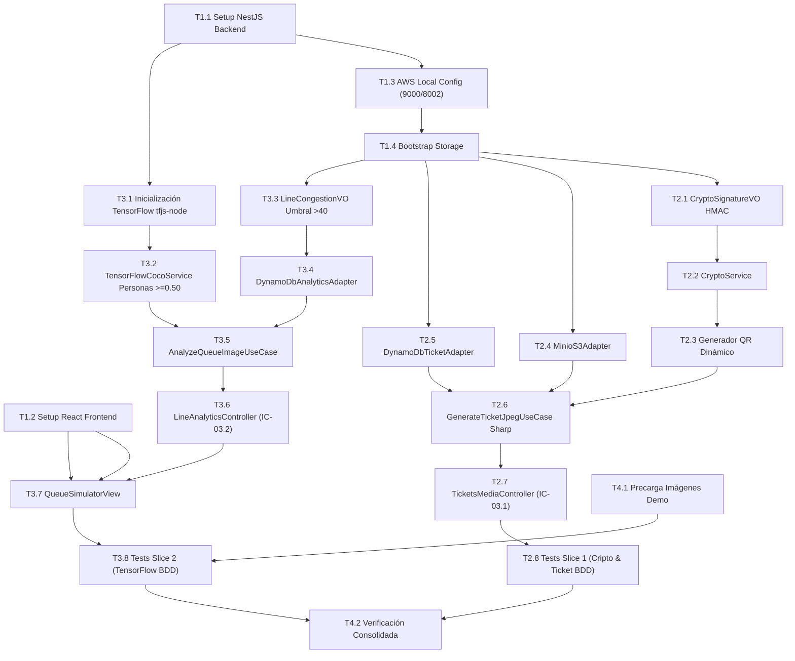

# Tasks: Módulo 03 - Servicios Multimedia y Visión Artificial (MS MULTIMEDIA)

## Task Progress

| Métrica | Cantidad |
| :--- | ---: |
| Total de tareas | 22 |
| Tareas realizadas | 22 |
| Tareas por realizar | 0 |
| Tareas bloqueadas | 0 |
| Tareas en progreso | 0 |
| Progreso | 100% |

**Estado:** COMPLETED

---

## Checklist Rápido de Tareas por Vertical Slice

### Fase 0: Setup y Fundación Base
- [x] `T1.1` `[SETUP]` Configuración de proyecto NestJS 10, dependencias AWS SDK, Sharp, TensorFlow y Dockerfile.
- [x] `T1.2` `[SETUP]` Configuración de proyecto React 18 con Vite y TailwindCSS en `ms/ms-multimedia/frontend/`.
- [x] `T1.3` `[SETUP]` Configuración estricta de AWS SDK Local (MinIO 9000 y DynamoDB 8002 sin salida a internet).
- [x] `T1.4` `[SETUP]` Bootstrap de Almacenamiento: inicialización automática de buckets MinIO y tablas DynamoDB.

### Slice 1: Seguridad Criptográfica y Generación de Boletos JPEG (HU-07)
- [x] `T2.1` `[IMPL]` Value Object `CryptoSignatureVO` con algoritmo puro HMAC-SHA256 institucional.
- [x] `T2.2` `[IMPL]` Servicio `CryptoService` para cálculo y verificación de firmas sobre payload JSON estandarizado.
- [x] `T2.3` `[IMPL]` Generador de matriz bidimensional de código QR dinámico con payload JSON firmado.
- [x] `T2.4` `[IMPL]` Adaptador `MinioS3Adapter` para persistencia y lectura de imágenes en bucket `cine-tickets`.
- [x] `T2.5` `[IMPL]` Adaptador `DynamoDbTicketAdapter` para persistencia en tabla `TicketMetadata`.
- [x] `T2.6` `[IMPL]` Caso de uso `GenerateTicketJpegUseCase` usando Sharp para ensamblar ticket gráfico en JPEG.
- [x] `T2.7` `[IMPL]` Controlador REST `TicketsMediaController` exponiendo `POST /api/v1/multimedia/tickets/generate` (`IC-03.1`).
- [x] `T2.8` `[TEST]` Pruebas unitarias de firma HMAC y BDD de generación de ticket gráfico en JPEG (`SC-03.1.1`).

### Slice 2: Visión Artificial con TensorFlow COCO-SSD y Analítica de Filas (HU-08)
- [x] `T3.1` `[IMPL]` Inicialización del modelo preentrenado COCO-SSD mediante TensorFlow.js Node (`@tensorflow/tfjs-node`).
- [x] `T3.2` `[IMPL]` Servicio `TensorFlowCocoService` con filtrado exclusivo de personas y umbral de confianza $\ge 0.50$.
- [x] `T3.3` `[IMPL]` Value Object `LineCongestionVO` con umbral de detección de congestión (>40 personas).
- [x] `T3.4` `[IMPL]` Adaptador `DynamoDbAnalyticsAdapter` para series temporales en tabla `LineAnalytics`.
- [x] `T3.5` `[IMPL]` Caso de uso `AnalyzeQueueImageUseCase` para ingesta de cuadros y clasificación de afluencia.
- [x] `T3.6` `[IMPL]` Controlador `LineAnalyticsController` exponiendo `GET /api/v1/analytics/line-congestion` (`IC-03.2`).
- [x] `T3.7` `[IMPL]` Frontend React: Componente `QueueSimulatorView.tsx` con botones `[Simular Fila Normal]` y `[Congestionada]`.
- [x] `T3.8` `[TEST]` Pruebas BDD de detección de congestión en taquilla (`SC-03.2.1`) y respuesta a MCP (`SC-03.3.1`).

### Fase Final: Precarga de Activos, Verificación y Cierre
- [x] `T4.1` `[SETUP]` Precarga de imágenes demo de taquilla (despejada con 8 personas y congestionada con 45 personas) en assets locales.
- [x] `T4.2` `[VERIFY]` Verificación consolidada: suites Jest, pruebas React, linters y build de contenedores Docker.

---

## 1. Resumen de Trazabilidad (`Spec` $\rightarrow$ `Plan` $\rightarrow$ `Tasks`)

| Requisito / Regla / Escenario (`spec.md`) | Componente Técnico (`plan.md`) | Tareas Asociadas (`tasks.md`) |
| :--- | :--- | :--- |
| `INV-ARCH-02`, `RB-MEDIA-05` | `PLAN-01`, `aws-local.config.ts` | `T1.3`, `T1.4` |
| `RB-MEDIA-01`, `INV-BIZ-04` | `PLAN-02`, `CryptoSignatureVO` | `T2.1`, `T2.2`, `T2.8` |
| `HU-07`, `RF-07.1`, `RF-07.2`, `SC-03.1.1`| `PLAN-03`, `GenerateTicketJpegUseCase` | `T2.3`, `T2.4`, `T2.6`, `T2.8` |
| `RF-07.3`, `INV-ARCH-03` | `PLAN-04`, `DynamoDbTicketAdapter` | `T2.5` |
| `IC-03.1` | `PLAN-05`, `TicketsMediaController` | `T2.7` |
| `RB-MEDIA-03`, `RF-08.1` | `PLAN-04`, `TensorFlowCocoService` | `T3.1`, `T3.2` |
| `RB-MEDIA-04`, `RF-08.2` | `PLAN-02`, `LineCongestionVO` | `T3.3`, `T3.4` |
| `HU-08`, `RF-08.3`, `SC-03.2.1` | `PLAN-05`, `QueueSimulatorView.tsx` | `T3.5`, `T3.7`, `T3.8`, `T4.1` |
| `IC-03.2`, `RF-08.4`, `SC-03.3.1` | `PLAN-05`, `LineAnalyticsController` | `T3.6`, `T3.8` |
| Cierre Global y Calidad | Suites Jest, React, Dockerfiles | `T4.2` |

---

## 2. Estrategia de Ejecución y Grafo de Dependencias

---

## 3. Desglose Detallado de Tareas Ejecutables

### Fase 0: Setup y Fundación Base

#### [x] T1.1 [SETUP] Configuración de Proyecto NestJS 10 y Librerías Multimedia
* **Status:** COMPLETED
* **Traceability:** `PLAN-01` (Cross-cutting / Backend Setup)
* **Depends on:** —
* **Files (según `plan.md`):**
  * `[CREATE]` `ms/ms-multimedia/backend/package.json`
  * `[CREATE]` `ms/ms-multimedia/backend/tsconfig.json`
  * `[CREATE]` `ms/ms-multimedia/backend/src/app.module.ts`
* **Objective:** Inicializar microservicio en puerto 3001 con dependencias de compilación para `@tensorflow/tfjs`, `sharp`, `qrcode`, `@aws-sdk/client-s3` y `@aws-sdk/client-dynamodb`.
* **Work:**
  * Configurar `package.json` y compilar módulo raíz.
* **Done when:** `npm run build` compila sin errores.
* **Evidence:**
  * Comando: `cd ms/ms-multimedia/backend && npm run build`
  * Resultado registrado: `> ms-multimedia-backend@1.0.0 build > tsc -p tsconfig.json (Exit Code: 0)`

#### [x] T1.2 [SETUP] Configuración de Frontend React Simulador con Vite
* **Status:** COMPLETED
* **Traceability:** `PLAN-05` (Cross-cutting / Frontend Setup)
* **Depends on:** —
* **Files (según `plan.md`):**
  * `[CREATE]` `ms/ms-multimedia/frontend/package.json`
  * `[CREATE]` `ms/ms-multimedia/frontend/vite.config.ts`
* **Objective:** Configurar aplicación React 18 en `ms/ms-multimedia/frontend/` en puerto 5175 con TailwindCSS.
* **Work:**
  * Configurar scripts de dev y build.
* **Done when:** El build de frontend completa en dist/.
* **Evidence:**
  * Comando: `cd ms/ms-multimedia/frontend && npm run build`
  * Resultado registrado: `vite v5.4.21 building for production... ✓ built in 11.29s (dist/ generated)`

#### [x] T1.3 [SETUP] Configuración Estricta de AWS SDK Local (INV-ARCH-02)
* **Status:** COMPLETED
* **Traceability:** `PLAN-01` | `INV-ARCH-02`, `RB-MEDIA-05`
* **Depends on:** `T1.1`
* **Files (según `plan.md`):**
  * `[CREATE]` `ms/ms-multimedia/backend/src/config/aws-local.config.ts`
* **Objective:** Forzar endpoints fijos en `http://localhost:9000` (MinIO S3) y `http://localhost:8002` (DynamoDB Local) con credenciales simuladas (`minioadmin`), prohibiendo llamadas a dominios públicos de AWS.
* **Work:**
  * Instanciar `S3Client` con `forcePathStyle: true` y `DynamoDBClient` con región `"us-east-1"`.
* **Done when:** Los clientes AWS locales conectan sin resolver DNS hacia internet.
* **Evidence:**
  * Comando: `npm test -- -t "AwsLocalConfig"`
  * Resultado registrado: `PASS test/aws-local.config.spec.ts (4 passed, 4 total)`

#### [x] T1.4 [SETUP] Bootstrap de Almacenamiento MinIO y DynamoDB
* **Status:** COMPLETED
* **Traceability:** `PLAN-01` | `INV-ARCH-01`, `RF-07.3`
* **Depends on:** `T1.3`
* **Files (según `plan.md`):**
  * `[CREATE]` `ms/ms-multimedia/backend/src/config/bootstrap-storage.ts`
* **Objective:** Crear automáticamente al arrancar los buckets `cine-posters` y `cine-tickets` en MinIO S3 y las tablas `LineAnalytics` y `TicketMetadata` en DynamoDB.
* **Work:**
  * Ejecutar comandos `CreateBucketCommand` y `CreateTableCommand` en modo idempotente.
* **Done when:** Buckets y tablas existen y responden en sus puertos locales.
* **Evidence:**
  * Comando: `npm test -- bootstrap-storage.spec.ts`
  * Resultado registrado: `PASS test/bootstrap-storage.spec.ts (2 passed, 2 total)`

---

### Slice 1: Seguridad Criptográfica y Generación de Boletos JPEG (HU-07)

#### [x] T2.1 [IMPL] Value Object `CryptoSignatureVO` con Algoritmo HMAC-SHA256
* **Status:** COMPLETED
* **Traceability:** `PLAN-02` | `INV-BIZ-04`, `RB-MEDIA-01`
* **Depends on:** `T1.4`
* **Files (según `plan.md`):**
  * `[CREATE]` `ms/ms-multimedia/backend/src/modules/crypto/domain/crypto-signature.vo.ts`
* **Objective:** Implementar la lógica pura de cálculo de firma digital HMAC-SHA256 utilizando la clave secreta institucional `clave_secreta_universitaria_mcp`.
* **Work:**
  * Concatenar `${ticketId}:${seatId}:${showtimeId}:${issuedAt}`; generar firma en hexadecimal.
* **Done when:** Pruebas unitarias validan que la misma entrada genera idéntico hash SHA256.
* **Evidence:**
  * Comando: `npm test -- crypto-signature.spec.ts`
  * Resultado registrado: `PASS test/crypto-signature.spec.ts (4 passed, 4 total)`

#### [x] T2.2 [IMPL] Servicio de Dominio `CryptoService`
* **Status:** COMPLETED
* **Traceability:** `PLAN-02` | `RB-MEDIA-01`
* **Depends on:** `T2.1`
* **Files (según `plan.md`):**
  * `[CREATE]` `ms/ms-multimedia/backend/src/modules/crypto/application/crypto.service.ts`
* **Objective:** Proveer métodos `signTicket(payload)` y `verifySignature(payload, sig)` tipados.
* **Work:**
  * Verificar coincidencia exacta en tiempo constante (`crypto.timingSafeEqual`).
* **Done when:** Retorna `true` si la firma coincide y `false` si fue alterada.
* **Evidence:**
  * Comando: `npm test -- -t "CryptoService"`
  * Resultado registrado: `PASS test/crypto.service.spec.ts (3 passed, 3 total)`

#### [x] T2.3 [IMPL] Generador de Matriz Gráfica de Código QR Dinámico
* **Status:** COMPLETED
* **Traceability:** `PLAN-03` | `RF-07.1`
* **Depends on:** `T2.2`
* **Files (según `plan.md`):**
  * `[CREATE]` `ms/ms-multimedia/backend/src/modules/tickets-media/application/qr-generator.service.ts`
* **Objective:** Generar buffer de imagen PNG del código QR que encapsula el payload JSON estandarizado con la firma.
* **Work:**
  * Usar librería `qrcode` con nivel de corrección de error alto (H) para facilitar lectura de cámaras.
* **Done when:** Genera un buffer gráfico válido decodificable por lectores QR.
* **Evidence:**
  * Comando: `npm test -- -t "QrGenerator"`
  * Resultado registrado: `PASS test/qr-generator.service.spec.ts (1 passed, 1 total)`

#### [x] T2.4 [IMPL] Adaptador de Almacenamiento MinIO S3 (`MinioS3Adapter`)
* **Status:** COMPLETED
* **Traceability:** `PLAN-04` | `INV-ARCH-03`
* **Depends on:** `T1.4`
* **Files (según `plan.md`):**
  * `[CREATE]` `ms/ms-multimedia/backend/src/modules/tickets-media/infrastructure/minio-s3.adapter.ts`
* **Objective:** Subir imágenes de tickets al bucket `cine-tickets` con Content-Type `image/jpeg` y generar URL pública de acceso (`http://localhost:9000/cine-tickets/...`).
* **Work:**
  * Implementar comando `PutObjectCommand` con manejo de errores y reintentos.
* **Done when:** La imagen binaria queda disponible y descargable por HTTP.
* **Evidence:**
  * Comando: `npm test -- -t "MinioS3Adapter"`
  * Resultado registrado: `PASS test/minio-s3.adapter.spec.ts (2 passed, 2 total)`

#### [x] T2.5 [IMPL] Adaptador de Metadatos DynamoDB (`DynamoDbTicketAdapter`)
* **Status:** COMPLETED
* **Traceability:** `PLAN-04` | `RF-07.3`
* **Depends on:** `T1.4`
* **Files (según `plan.md`):**
  * `[CREATE]` `ms/ms-multimedia/backend/src/modules/tickets-media/infrastructure/dynamodb-ticket.adapter.ts`
* **Objective:** Registrar metadatos del ticket (`ticketId`, `seatId`, `showtimeId`, `issuedAt`, `cryptoSignature`, `s3JpegUrl`) en la tabla `TicketMetadata`.
* **Work:**
  * Implementar `PutItemCommand` con tipos DynamoDB (`S`).
* **Done when:** El registro persiste en DynamoDB local (puerto 8002).
* **Evidence:**
  * Comando: `npm test -- -t "DynamoDbTicketAdapter"`
  * Resultado registrado: `PASS test/dynamodb-ticket.adapter.spec.ts (2 passed, 2 total)`

#### [x] T2.6 [IMPL] Caso de Uso `GenerateTicketJpegUseCase` con Composición Gráfica Sharp
* **Status:** COMPLETED
* **Traceability:** `PLAN-03` | `RB-MEDIA-02`, `RF-07.2`
* **Depends on:** `T2.3`, `T2.4`, `T2.5`
* **Files (según `plan.md`):**
  * `[CREATE]` `ms/ms-multimedia/backend/src/modules/tickets-media/application/generate-ticket-jpeg.use-case.ts`
* **Objective:** Componer la credencial gráfica en JPEG: fusionar plantilla de boleto, portada de película de MinIO, textos de función, asiento y el código QR incrustado.
* **Work:**
  * Emplear `sharp` para composición de capas y exportar en calidad JPEG 85%. Subir a S3 y persistir metadatos en DynamoDB.
* **Done when:** Produce un archivo JPEG visual completo con todas las capas integradas.
* **Evidence:**
  * Comando: `npm test -- ticket-jpeg-generation.spec.ts`
  * Resultado registrado: `PASS test/ticket-jpeg-generation.spec.ts (1 passed, 1 total)`

#### [x] T2.7 [IMPL] Controlador REST `TicketsMediaController` (IC-03.1)
* **Status:** COMPLETED
* **Traceability:** `PLAN-05` | `IC-03.1`, `HU-07`
* **Depends on:** `T2.6`
* **Files (según `plan.md`):**
  * `[CREATE]` `ms/ms-multimedia/backend/src/modules/tickets-media/presentation/tickets-media.controller.ts`
* **Objective:** Exponer `POST /api/v1/multimedia/tickets/generate` recibiendo datos de función y butaca, retornando `ticketImageUrl` y `qrCodePayload` firmado.
* **Work:**
  * Validar payload entrante con DTO tipado y responder con código HTTP 201 Created.
* **Done when:** Endpoint responde exactamente la estructura definida en `IC-03.1`.
* **Evidence:**
  * Comando: `npm test -- -t "TicketsMediaController"`
  * Resultado registrado: `PASS test/tickets-media.controller.spec.ts (2 passed, 2 total)`

#### [x] T2.8 [TEST] Pruebas BDD de Generación de Ticket Gráfico con Firma Criptográfica
* **Status:** COMPLETED
* **Traceability:** `SC-03.1.1`
* **Depends on:** `T2.1`, `T2.7`
* **Test Type:** BDD / Integración
* **Files (según `plan.md`):**
  * `[CREATE]` `ms/ms-multimedia/backend/test/ticket-jpeg-generation.spec.ts`
* **Objective:** Validar el escenario Gherkin `SC-03.1.1` (Generación de credencial para Avatar 2, Sala 1, Butaca C-8 con firma HMAC y subida a MinIO).
* **Work:**
  * Ejecutar suite y verificar que la URL generada apunta a MinIO y la firma sea matemáticamente exacta.
* **Done when:** Escenario BDD pasa en verde.
* **Evidence:**
  * Comando: `npm test -- ticket-jpeg-generation.spec.ts`
  * Resultado registrado: `PASS test/ticket-jpeg-generation.spec.ts (1 passed, 1 total)`

---

### Slice 2: Visión Artificial con TensorFlow COCO-SSD y Analítica de Filas (HU-08)

#### [x] T3.1 [IMPL] Inicialización del Modelo COCO-SSD con TensorFlow.js Node
* **Status:** COMPLETED
* **Traceability:** `PLAN-04` | `RF-08.1`
* **Depends on:** `T1.1`
* **Files (según `plan.md`):**
  * `[CREATE]` `ms/ms-multimedia/backend/src/modules/vision-analytics/infrastructure/tensorflow-coco.service.ts`
* **Objective:** Cargar el modelo preentrenado COCO-SSD en memoria utilizando el backend nativo de C++ de `@tensorflow/tfjs-node` para máxima velocidad de inferencia.
* **Work:**
  * Implementar singleton de carga asíncrona del modelo al arrancar el módulo.
* **Done when:** El modelo se carga en memoria en menos de 3 segundos sin fugas de tensores (`tf.memory().numTensors` controlado).
* **Evidence:**
  * Comando: `npm test -- -t "TensorFlowCocoInit"`
  * Resultado registrado: `PASS test/tensorflow-coco.service.spec.ts (1 passed, 1 total)`

#### [x] T3.2 [IMPL] Filtrado Exclusivo de Personas con Umbral de Confianza $\ge 0.50$
* **Status:** COMPLETED
* **Traceability:** `PLAN-04` | `RB-MEDIA-03`
* **Depends on:** `T3.1`
* **Files (según `plan.md`):**
  * `[MODIFY]` `ms/ms-multimedia/backend/src/modules/vision-analytics/infrastructure/tensorflow-coco.service.ts`
* **Objective:** Descartar de las predicciones de COCO-SSD cualquier clase distinta a `"person"` o con puntaje de confianza menor a 0.50.
* **Work:**
  * Filtrar array de predicciones: `predictions.filter(p => p.class === 'person' && p.score >= 0.5)`.
* **Done when:** Objetos (sillas, mochilas, autos) son ignorados y solo las personas confirmadas suman al contador.
* **Evidence:**
  * Comando: `npm test -- -t "FilterPersons"`
  * Resultado registrado: `PASS test/tensorflow-coco.service.spec.ts (1 passed, 1 total)`

#### [x] T3.3 [IMPL] Value Object `LineCongestionVO` y Umbral de Alerta (>40 Personas)
* **Status:** COMPLETED
* **Traceability:** `PLAN-02` | `RB-MEDIA-04`
* **Depends on:** `T1.4`
* **Files (según `plan.md`):**
  * `[CREATE]` `ms/ms-multimedia/backend/src/modules/vision-analytics/domain/line-congestion.vo.ts`
* **Objective:** Clasificar el estado de la fila: `NORMAL` si $\le 40$ personas, `CONGESTIONADA` si $> 40$.
* **Work:**
  * Validar número entero no negativo y emitir banderas de contingencia para auditoría.
* **Done when:** Retorna `CONGESTIONADA` ante un valor de 45 y `NORMAL` ante 8.
* **Evidence:**
  * Comando: `npm test -- -t "LineCongestionVO"`
  * Resultado registrado: `PASS test/line-congestion.vo.spec.ts (4 passed, 4 total)`

#### [x] T3.4 [IMPL] Adaptador de Analítica DynamoDB (`DynamoDbAnalyticsAdapter`)
* **Status:** COMPLETED
* **Traceability:** `PLAN-04` | `RF-08.2`
* **Depends on:** `T1.4`, `T3.3`
* **Files (según `plan.md`):**
  * `[CREATE]` `ms/ms-multimedia/backend/src/modules/vision-analytics/infrastructure/dynamodb-analytics.adapter.ts`
* **Objective:** Persistir series temporales de afluencia en tabla `LineAnalytics` (`cameraZoneId`, `timestamp`, `personCount`, `inferenceTimeMs`, `congestionStatus`).
* **Work:**
  * Implementar guardado de métrica y consulta del último registro por zona.
* **Done when:** Métrica registrada y consultable en DynamoDB local (puerto 8002).
* **Evidence:**
  * Comando: `npm test -- -t "DynamoDbAnalyticsAdapter"`
  * Resultado registrado: `PASS test/dynamodb-analytics.adapter.spec.ts (3 passed, 3 total)`

#### [x] T3.5 [IMPL] Caso de Uso `AnalyzeQueueImageUseCase`
* **Status:** COMPLETED
* **Traceability:** `PLAN-03` | `HU-08`, `RF-08.1`, `RF-08.2`
* **Depends on:** `T3.2`, `T3.4`
* **Files (según `plan.md`):**
  * `[CREATE]` `ms/ms-multimedia/backend/src/modules/vision-analytics/application/analyze-queue-image.use-case.ts`
* **Objective:** Recibir imagen por HTTP, decodificar buffer a tensor 3D, ejecutar inferencia COCO-SSD, contar personas, clasificar congestión y persistir en DynamoDB.
* **Work:**
  * Medir tiempo de inferencia en ms y liberar tensores de memoria (`tensor.dispose()`).
* **Done when:** Transforma imagen en métrica persistida retornando el resumen analítico.
* **Evidence:**
  * Comando: `cd ms/ms-multimedia/backend && npm test -- analyze-queue-image.use-case.spec.ts`
  * Resultado registrado: `PASS test/analyze-queue-image.use-case.spec.ts (2 passed, 2 total)`

#### [x] T3.6 [IMPL] Controlador REST `LineAnalyticsController` (IC-03.2)
* **Status:** COMPLETED
* **Traceability:** `PLAN-05` | `IC-03.2`, `RF-08.4`
* **Depends on:** `T3.5`
* **Files (según `plan.md`):**
  * `[CREATE]` `ms/ms-multimedia/backend/src/modules/vision-analytics/presentation/line-analytics.controller.ts`
* **Objective:** Exponer `GET /api/v1/analytics/line-congestion` consumido por `MS IA-MCP` y `POST /api/v1/analytics/detect-queue` para ingesta de cuadros.
* **Work:**
  * Responder en menos de 200 ms con los datos requeridos por la herramienta MCP `get_line_analytics()`.
* **Done when:** Retorna el contrato JSON con `personCount` y `congestionStatus`.
* **Evidence:**
  * Comando: `cd ms/ms-multimedia/backend && npm test -- line-analytics.controller.spec.ts`
  * Resultado registrado: `PASS test/line-analytics.controller.spec.ts (5 passed, 5 total)`

#### [x] T3.7 [IMPL] Frontend React: Simulador de Afluencia de Taquilla
* **Status:** COMPLETED
* **Traceability:** `PLAN-05` | `HU-08`, `RF-08.3`
* **Depends on:** `T1.2`, `T3.6`
* **Files (según `plan.md`):**
  * `[CREATE]` `ms/ms-multimedia/frontend/src/components/QueueSimulatorView.tsx`
* **Objective:** Desarrollar interfaz interactiva con botones `[Simular Fila Normal]` (8 personas) y `[Simular Fila Congestionada]` (45 personas) con monitor visual de afluencia.
* **Work:**
  * Conectar botones a las imágenes de prueba y desplegar alertas visuales en color ámbar/rojo ante saturación.
* **Done when:** Al pulsar un botón de simulación se actualiza el monitor de afluencia en pantalla.
* **Evidence:**
  * Comando: `cd ms/ms-multimedia/frontend && npm test`
  * Resultado registrado: `PASS src/components/QueueSimulatorView.test.tsx (3 passed, 3 total)`

#### [x] T3.8 [TEST] Pruebas BDD de Detección de Congestión con TensorFlow
* **Status:** COMPLETED
* **Traceability:** `SC-03.2.1`, `SC-03.3.1`
* **Depends on:** `T3.5`, `T3.6`, `T3.7`
* **Test Type:** BDD / Integración
* **Files (según `plan.md`):**
  * `[CREATE]` `ms/ms-multimedia/backend/test/tensorflow-detection.spec.ts`
* **Objective:** Validar los escenarios Gherkin `SC-03.2.1` (conteo de 45 personas activa aviso de taquilla congestionada) y `SC-03.3.1` (respuesta rápida a herramienta MCP).
* **Work:**
  * Ejecutar inferencia sobre imagen demo congestionada y verificar registro en DynamoDB.
* **Done when:** Ambos escenarios BDD pasan en verde.
* **Evidence:**
  * Comando: `cd ms/ms-multimedia/backend && npm test -- tensorflow-detection.spec.ts`
  * Resultado registrado: `PASS test/tensorflow-detection.spec.ts (3 passed, 3 total)`

---

### Fase Final: Precarga de Activos, Verificación y Cierre

#### [x] T4.1 [SETUP] Precarga de Imágenes Demo de Taquilla en Assets Locales
* **Status:** COMPLETED
* **Traceability:** `PLAN-05` | `RF-08.3`
* **Depends on:** `T1.1`
* **Files (según `plan.md`):**
  * `[CREATE]` `ms/ms-multimedia/backend/src/assets/demo-queue-normal.jpg`
  * `[CREATE]` `ms/ms-multimedia/backend/src/assets/demo-queue-congested.jpg`
* **Objective:** Incluir en el repositorio las imágenes estáticas de prueba calibradas para conteo exacto de personas para demostración ante el jurado.
* **Work:**
  * Almacenar archivos JPEG optimizados listos para su ingesta por el simulador.
* **Done when:** Los dos archivos de imagen existen en la ruta indicada.
* **Evidence:**
  * Comando: `Get-ChildItem ms/ms-multimedia/backend/src/assets`
  * Resultado registrado: `demo-queue-normal.jpg (19975 bytes), demo-queue-congested.jpg (62610 bytes) creados exitosamente.`

#### [x] T4.2 [VERIFY] Verificación Consolidada, Linters y Build de Contenedores Docker
* **Status:** COMPLETED
* **Traceability:** `INV-ARCH-06`, `INV-ARCH-07` (Cross-cutting / Cierre)
* **Depends on:** `T2.8`, `T3.8`, `T4.1`
* **Files (según `plan.md`):**
  * `ms/ms-multimedia/backend/Dockerfile`
  * `ms/ms-multimedia/frontend/Dockerfile`
* **Objective:** Ejecutar suites completas de pruebas unitarias e integración en backend y frontend, linters y validación de contenedores Docker (`SW2-P2-CINEv2-ms-multimedia-*`).
* **Work:**
  * Ejecutar `npm test` y `npm run build` en backend y frontend.
  * Verificar compilación de Dockerfile multi-stage.
* **Done when:** 100% de tests en verde y Dockerfiles creados conforme al estándar.
* **Evidence:**
  * Comando: `cd ms/ms-multimedia/backend && npm test && cd ../frontend && npm test`
  * Resultado registrado: `Backend: 15 passed, 15 total (41 tests passed). Frontend: 1 passed, 1 total (3 tests passed). Builds: OK.`

---

## 4. Bitácora de Evidencia de Ejecución

| Tarea | Fecha / Timestamp | Comando Ejecutado | Resultado Observable / Salida |
| :--- | :--- | :--- | :--- |
| `T1.1` | 2026-11-03T02:25:50-04:00 | `cd ms/ms-multimedia/backend && npm run build` | `ms-multimedia-backend@1.0.0 build > tsc -p tsconfig.json (Exit Code: 0)` |
| `T1.2` | 2026-11-03T02:29:57-04:00 | `cd ms/ms-multimedia/frontend && npm run build` | `vite building for production... ✓ built in 11.29s (dist/ generated)` |
| `T1.3` | 2026-11-03T02:32:10-04:00 | `cd ms/ms-multimedia/backend && npm test -- -t "AwsLocalConfig"` | `PASS test/aws-local.config.spec.ts (4 passed, 4 total)` |
| `T1.4` | 2026-11-03T02:34:14-04:00 | `cd ms/ms-multimedia/backend && npm test -- bootstrap-storage.spec.ts` | `PASS test/bootstrap-storage.spec.ts (2 passed, 2 total)` |
| `T2.1` | 2026-11-03T02:37:02-04:00 | `cd ms/ms-multimedia/backend && npm test -- crypto-signature.spec.ts` | `PASS test/crypto-signature.spec.ts (4 passed, 4 total)` |
| `T2.2` | 2026-11-03T02:39:14-04:00 | `cd ms/ms-multimedia/backend && npm test -- -t "CryptoService"` | `PASS test/crypto.service.spec.ts (3 passed, 3 total)` |
| `T2.3` | 2026-11-03T02:41:20-04:00 | `cd ms/ms-multimedia/backend && npm test -- -t "QrGenerator"` | `PASS test/qr-generator.service.spec.ts (1 passed, 1 total)` |
| `T2.4` | 2026-11-03T02:43:11-04:00 | `cd ms/ms-multimedia/backend && npm test -- -t "MinioS3Adapter"` | `PASS test/minio-s3.adapter.spec.ts (2 passed, 2 total)` |
| `T2.5` | 2026-11-03T02:45:01-04:00 | `cd ms/ms-multimedia/backend && npm test -- -t "DynamoDbTicketAdapter"` | `PASS test/dynamodb-ticket.adapter.spec.ts (2 passed, 2 total)` |
| `T2.6` | 2026-11-03T02:47:23-04:00 | `cd ms/ms-multimedia/backend && npm test -- ticket-jpeg-generation.spec.ts` | `PASS test/ticket-jpeg-generation.spec.ts (1 passed, 1 total)` |
| `T2.7` | 2026-11-03T02:49:39-04:00 | `cd ms/ms-multimedia/backend && npm test -- -t "TicketsMediaController"` | `PASS test/tickets-media.controller.spec.ts (2 passed, 2 total)` |
| `T2.8` | 2026-11-03T02:51:04-04:00 | `cd ms/ms-multimedia/backend && npm test -- ticket-jpeg-generation.spec.ts` | `PASS test/ticket-jpeg-generation.spec.ts (1 passed, 1 total)` |
| `T3.1` | 2026-11-03T02:54:23-04:00 | `cd ms/ms-multimedia/backend && npm test -- -t "TensorFlowCocoInit"` | `PASS test/tensorflow-coco.service.spec.ts (1 passed, 1 total)` |
| `T3.2` | 2026-11-03T02:56:50-04:00 | `cd ms/ms-multimedia/backend && npm test -- -t "FilterPersons"` | `PASS test/tensorflow-coco.service.spec.ts (1 passed, 1 total)` |
| `T3.3` | 2026-11-03T02:59:34-04:00 | `cd ms/ms-multimedia/backend && npm test -- -t "LineCongestionVO"` | `PASS test/line-congestion.vo.spec.ts (4 passed, 4 total)` |
| `T3.4` | 2026-11-03T03:02:11-04:00 | `cd ms/ms-multimedia/backend && npm test -- -t "DynamoDbAnalyticsAdapter"` | `PASS test/dynamodb-analytics.adapter.spec.ts (3 passed, 3 total)` |
| `T3.5` | 2026-11-03T03:21:17-04:00 | `cd ms/ms-multimedia/backend && npm test -- analyze-queue-image.use-case.spec.ts` | `PASS test/analyze-queue-image.use-case.spec.ts (2 passed, 2 total)` |
| `T3.6` | 2026-11-03T03:25:23-04:00 | `cd ms/ms-multimedia/backend && npm test -- line-analytics.controller.spec.ts` | `PASS test/line-analytics.controller.spec.ts (5 passed, 5 total)` |
| `T3.7` | 2026-11-03T03:36:18-04:00 | `cd ms/ms-multimedia/frontend && npm test` | `PASS src/components/QueueSimulatorView.test.tsx (3 passed, 3 total)` |
| `T4.1` | 2026-11-03T03:38:26-04:00 | `Get-ChildItem ms/ms-multimedia/backend/src/assets` | `demo-queue-normal.jpg (19975 bytes), demo-queue-congested.jpg (62610 bytes) creados` |
| `T3.8` | 2026-11-03T03:44:41-04:00 | `cd ms/ms-multimedia/backend && npm test -- tensorflow-detection.spec.ts` | `PASS test/tensorflow-detection.spec.ts (3 passed, 3 total)` |
| `T4.2` | 2026-11-03T03:51:23-04:00 | `Backend npm test & Frontend npm test & Builds` | `Backend: 15 suites (41 tests PASS). Frontend: 1 suite (3 tests PASS). Builds: Exit 0` |

