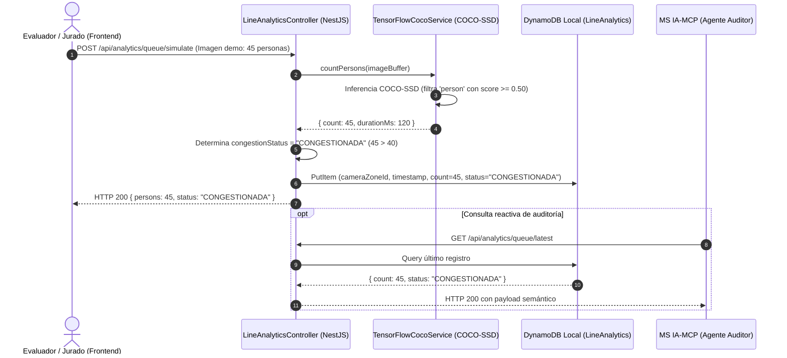

# Plan Técnico: Módulo 03 - Servicios Multimedia, Visión Artificial y Firma Criptográfica (MS MULTIMEDIA)

> **Estado:** APPROVED  
> **Versión:** 1.0.0  
> **Módulo:** `docs/specs/03-multimedia-analytics/`  
> **Especificación Base:** `docs/specs/03-multimedia-analytics/spec.md`  
> **Constitución Base:** `docs/constitution.md`  
> **Metodología:** SDD-Planning

---

## 1. Resumen Arquitectónico y Decisiones de Diseño

- **Objetivo Técnico:** Implementar el microservicio de gestión de objetos binarios, procesamiento analítico de imágenes mediante TensorFlow.js (COCO-SSD) y firma criptográfica de credenciales en NestJS (Node 20 LTS), estructurando una persistencia híbrida entre MinIO S3 Local (`http://localhost:9000`) y DynamoDB Local (`http://localhost:8000`).
- **Estilo Arquitectónico:** NestJS Hexagonal / Servicio de Infraestructura Especializado:
  - *Storage Module:* Adaptador `@aws-sdk/client-s3` configurado con `forcePathStyle: true` y endpoint MinIO para gestionar buckets `cine-posters` y `cine-tickets`.
  - *Crypto & QR Module:* Generador de imágenes QR (usando `qrcode`) y motor de firma HMAC-SHA256 (Node `crypto` nativo) con clave `clave_secreta_universitaria_mcp`.
  - *Ticket Canvas Engine:* Generador gráfico de boletos que compone la carátula de la película, tipografía y código QR en una imagen JPEG única (`sharp` o `@napi-rs/canvas`).
  - *Computer Vision Module:* Inferencia local con `@tensorflow/tfjs-node` y `@tensorflow-models/coco-ssd` para detección y conteo de personas.
  - *DynamoDB Module:* Adaptador `@aws-sdk/client-dynamodb` y `@aws-sdk/lib-dynamodb` (DocumentClient) para persistir series temporales de fila y metadatos de tickets.
- **Decisiones Técnicas Clave:**
  - **Aislamiento AWS SDK:** Prohibida la búsqueda de perfiles en `~/.aws/credentials`. Endpoints forzados `http://localhost:9000` y `http://localhost:8000` con credenciales dummy locales (`minioadmin` / `dummy-key`).
  - **Detección COCO-SSD:** Umbral de filtrado duro `score >= 0.50` y `class === 'person'`. Si el total resultante es $> 40$, el campo `congestionStatus` se guarda como `"CONGESTIONADA"`.
  - **Formato Gráfico JPEG:** Compresión JPEG al 85% para optimizar tamaño de transferencia hacia la app móvil y almacenamiento en `IndexedDB`.

### 1.1 Matriz de Componentes Técnicos (`PLAN-XX`)

| ID Componente | Nombre / Artefacto Técnico | Capa Arquitectónica | Responsabilidad Técnica | Requisitos que Cubre |
| :--- | :--- | :--- | :--- | :--- |
| **`PLAN-01`** | `InitDynamoDbAndMinio.ts` (Script de inicialización) | Infraestructura / Datos | Creación de buckets en MinIO y aprovisionamiento de tablas DynamoDB (`LineAnalytics`, `TicketMetadata`). | `RB-MEDIA-05` |
| **`PLAN-02`** | `CryptoSignatureService`, `HmacSignature` Value Object | Dominio | Algoritmo de firma HMAC-SHA256 con clave secreta compartida y validación. | `RB-MEDIA-01`, `SC-03.1.1` |
| **`PLAN-03`** | `GenerateTicketJpegUseCase`, `AnalyzeQueueImageUseCase` | Aplicación | Composición gráfica del ticket JPEG y pipeline de detección de personas con TensorFlow. | `HU-07`, `HU-08`, `RF-07.1`, `RF-08.1` |
| **`PLAN-04`** | `MinioS3Adapter`, `DynamoDbAdapter`, `TensorFlowCocoSsdService` | Infraestructura | Clientes de AWS SDK Local y carga del modelo preentrenado COCO-SSD. | `RF-07.2`, `RF-08.2`, `RB-MEDIA-03` |
| **`PLAN-05`** | `TicketsMediaController`, `LineAnalyticsController`, `QueueSimulatorUI` | Presentación / API | Endpoints REST de generación de ticket, ingesta de cuadros y panel web de simulación con imágenes demo. | `RF-08.3`, `RF-08.4`, `SC-03.2.1` |

---

## 2. Estructura Física de Archivos del Módulo

```text
services/ms-multimedia/
├── backend/
│   ├── package.json                                                                  # NestJS, @aws-sdk, @tensorflow/tfjs-node, @tensorflow-models/coco-ssd, sharp, qrcode
│   ├── tsconfig.json
│   ├── src/
│   │   ├── app.module.ts
│   │   ├── config/
│   │   │   ├── aws-local.config.ts                                                   # [CREATE] (PLAN-04) Endpoints fijos localhost:9000 y localhost:8000
│   │   │   └── bootstrap-storage.ts                                                  # [CREATE] (PLAN-01) Creación de buckets y tablas DynamoDB al arrancar
│   │   ├── modules/
│   │   │   ├── crypto/
│   │   │   │   ├── domain/crypto-signature.vo.ts                                     # [CREATE] (PLAN-02) Lógica pura HMAC-SHA256
│   │   │   │   └── application/crypto.service.ts                                     # [CREATE] (PLAN-02) Servicio de firma con clave institucional
│   │   │   ├── tickets-media/
│   │   │   │   ├── application/generate-ticket-jpeg.use-case.ts                      # [CREATE] (PLAN-03) Ensamble de carátula, datos y QR en JPEG
│   │   │   │   ├── infrastructure/minio-s3.adapter.ts                                # [CREATE] (PLAN-04) Subida y generación de URLs en MinIO
│   │   │   │   ├── infrastructure/dynamodb-ticket.adapter.ts                         # [CREATE] (PLAN-04) Persistencia en tabla TicketMetadata
│   │   │   │   └── presentation/tickets-media.controller.ts                          # [CREATE] (PLAN-05) Endpoint para MS TICKET-AUTH
│   │   │   └── vision-analytics/
│   │   │       ├── domain/line-congestion.vo.ts                                      # [CREATE] (PLAN-02) Invariante de umbral > 40 personas
│   │   │       ├── application/analyze-queue-image.use-case.ts                       # [CREATE] (PLAN-03) Inferencia y conteo COCO-SSD
│   │   │       ├── infrastructure/tensorflow-coco.service.ts                         # [CREATE] (PLAN-04) Wrapper de TensorFlow.js
│   │   │       ├── infrastructure/dynamodb-analytics.adapter.ts                      # [CREATE] (PLAN-04) Persistencia en tabla LineAnalytics
│   │   │       └── presentation/line-analytics.controller.ts                         # [CREATE] (PLAN-05) Endpoint consumido por MS IA-MCP
│   │   └── test/
│   │       ├── crypto-signature.spec.ts                                              # [CREATE] Test unitario de firma HMAC-SHA256
│   │       ├── ticket-jpeg-generation.spec.ts                                        # [CREATE] Test de composición y subida a MinIO
│   │       └── tensorflow-detection.spec.ts                                          # [CREATE] Test de inferencia con imágenes demo
│   └── Dockerfile                                                                    # Multi-stage con dependencias de compilación para tfjs-node
│
└── frontend/
    └── src/
        └── components/
            └── QueueSimulatorView.tsx                                                # [CREATE] (PLAN-05) Botones [Simular Fila Normal] y [Fila Congestionada]
```

---

## 3. Modelo Físico de Persistencia (MinIO S3 + DynamoDB Local)

### 3.1 Buckets en MinIO S3 (`http://localhost:9000`)
- **`cine-posters`**: Aloja archivos `posters/{movieId}.jpg`.
- **`cine-tickets`**: Aloja credenciales compuestas `tickets/{ticketId}.jpg` (JPEG 85% de calidad).

### 3.2 Tablas en DynamoDB Local (`http://localhost:8000`)

#### Tabla `LineAnalytics`
- Partition Key: `cameraZoneId` (`S` - String, ej. `"TAQUILLA_PRINCIPAL"`)
- Sort Key: `timestamp` (`S` - String ISO-8601)
- Atributos:
  - `personCount`: `N` (Entero detectado por TensorFlow)
  - `inferenceTimeMs`: `N` (Milisegundos de cálculo)
  - `congestionStatus`: `S` (`"NORMAL"` si $\le 40$, `"CONGESTIONADA"` si $> 40$)

#### Tabla `TicketMetadata`
- Partition Key: `ticketId` (`S` - String UUID)
- Atributos:
  - `seatId`: `S`
  - `showtimeId`: `S`
  - `issuedAt`: `S`
  - `sig`: `S` (Hexadecimal HMAC-SHA256 de 64 caracteres)
  - `s3JpegUrl`: `S` (`"http://localhost:9000/cine-tickets/tickets/{ticketId}.jpg"`)

---

## 4. Contratos de Código e Interfaces Tipadas

### 4.1 Servicio de Firma Criptográfica (`CryptoSignatureService.ts`)
```typescript
import { createHmac } from 'crypto';

export class CryptoSignatureService {
  private static readonly SECRET_KEY = 'clave_secreta_universitaria_mcp';

  public static sign(ticketId: string, seatId: string, showtimeId: string, issuedAt: string): string {
    const rawPayload = `${ticketId}:${seatId}:${showtimeId}:${issuedAt}`;
    return createHmac('sha256', this.SECRET_KEY)
      .update(rawPayload)
      .digest('hex');
  }

  public static verify(ticketId: string, seatId: string, showtimeId: string, issuedAt: string, sig: string): boolean {
    const expectedSig = this.sign(ticketId, seatId, showtimeId, issuedAt);
    return expectedSig === sig;
  }
}
```

### 4.2 Pipeline de Inferencia TensorFlow (`TensorFlowCocoService.ts`)
```typescript
import * as tf from '@tensorflow/tfjs-node';
import * as cocoSsd from '@tensorflow-models/coco-ssd';

export class TensorFlowCocoService {
  private model: cocoSsd.ObjectDetection;

  async loadModel(): Promise<void> {
    this.model = await cocoSsd.load();
  }

  async countPersons(imageBuffer: Buffer): Promise<{ count: number; durationMs: number }> {
    const start = Date.now();
    const tensor = tf.node.decodeImage(imageBuffer, 3);
    const predictions = await this.model.detect(tensor);
    tensor.dispose();

    // Filtra exclusivamente etiquetas 'person' con score >= 0.50
    const persons = predictions.filter(p => p.class === 'person' && p.score >= 0.50);
    return {
      count: persons.length,
      durationMs: Date.now() - start
    };
  }
}
```

---

## 5. Diagrama de Secuencia: Ingesta de Cuadros y Conteo de Personas



---

## 6. Arquitectura de Vertical Slices para `/sdd-task`

* **Slice 0 (Setup):** `PLAN-01`, `PLAN-04` Inicialización de buckets MinIO y tablas DynamoDB locales.
* **Slice 1 (Criptografía y Ticket JPEG):** `PLAN-02`, `PLAN-03`, `PLAN-04`, `PLAN-05` Firma HMAC-SHA256, generación de QR dinámico y composición gráfica JPEG en MinIO S3.
* **Slice 2 (Visión Artificial TensorFlow y Simulador):** `PLAN-03`, `PLAN-04`, `PLAN-05` Carga de modelo COCO-SSD, conteo de personas en fila, persistencia en DynamoDB y vista `QueueSimulatorView` con botones demo.
* **Slice 3 (Verificación y Cierre):** Pruebas de inferencia, test de firma y verificación de endpoints.

