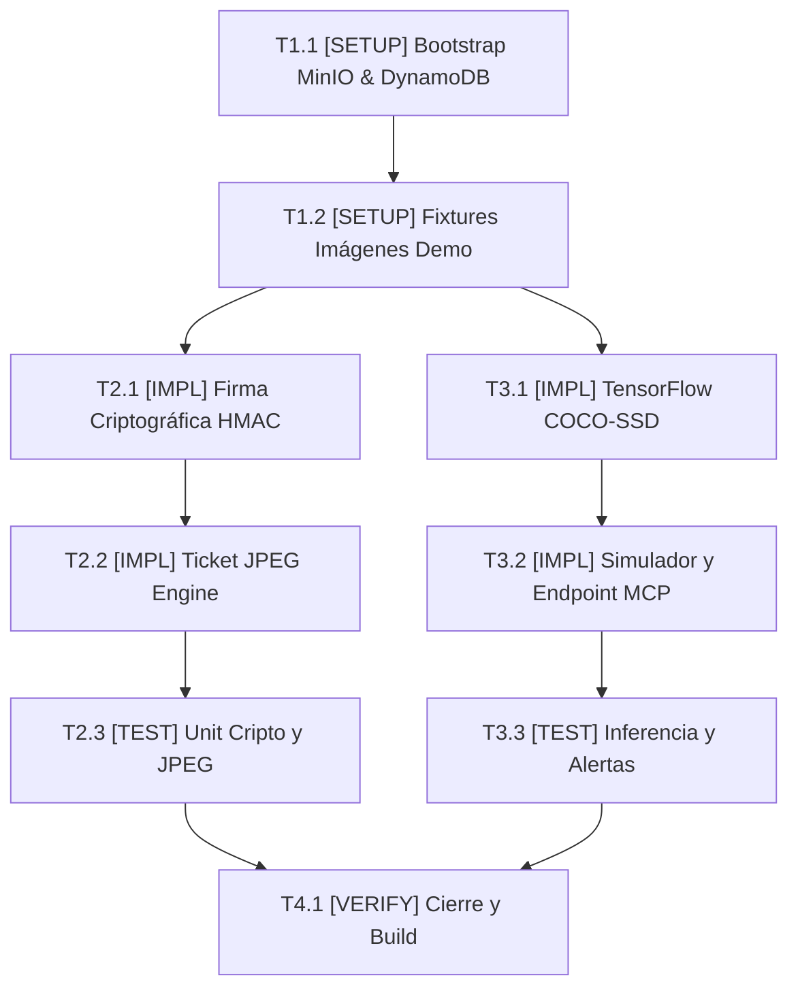

# Tasks: Módulo 03 - Servicios Multimedia, Visión Artificial y Firma Criptográfica (MS MULTIMEDIA)

## Task Progress

| Métrica | Cantidad |
| :--- | ---: |
| Total de tareas | 9 |
| Tareas realizadas | 0 |
| Tareas por realizar | 9 |
| Tareas bloqueadas | 0 |
| Tareas en progreso | 0 |
| Progreso | 0% |

**Estado:** READY

---

## Checklist Rápido de Tareas por Vertical Slice

### Fase 0: Setup de Persistencia Híbrida y Fixtures
- [ ] `T1.1` `[SETUP]` Script de inicialización de buckets MinIO S3 (`cine-posters`, `cine-tickets`) y tablas DynamoDB Local (`LineAnalytics`, `TicketMetadata`) (`PLAN-01`, `PLAN-04`).
- [ ] `T1.2` `[SETUP]` Precarga de imágenes demo de fila (cuadro con 8 personas vs cuadro congestionado con 45 personas) en el directorio de assets para pruebas del jurado (`PLAN-01`).

### Slice 1: Firma Criptográfica y Generación de Ticket JPEG
- [ ] `T2.1` `[IMPL]` Implementar `CryptoSignatureService` con firma HMAC-SHA256 (`clave_secreta_universitaria_mcp`) y generador de matriz de QR dinámico (`PLAN-02`).
- [ ] `T2.2` `[IMPL]` Implementar caso de uso `GenerateTicketJpegUseCase` con ensamblaje visual de carátula, datos y QR en imagen JPEG y subida a MinIO S3 (`PLAN-03`, `PLAN-04`, `PLAN-05`).
- [ ] `T2.3` `[TEST]` Suite de pruebas criptográficas y de composición gráfica: validar coincidencia de firma HMAC y persistencia de URL en DynamoDB (`SC-03.1.1`, `RB-MEDIA-01`).

### Slice 2: Visión Artificial con TensorFlow (COCO-SSD) y Simulador
- [ ] `T3.1` `[IMPL]` Implementar `TensorFlowCocoService` con modelo COCO-SSD filtrando exclusivamente clase `person` con confianza $> 0.50$ y persistencia en DynamoDB (`PLAN-03`, `PLAN-04`).
- [ ] `T3.2` `[IMPL]` Implementar `LineAnalyticsController` y panel React `QueueSimulatorView` con los botones `[Simular Fila Normal]` y `[Simular Fila Congestionada]` (`PLAN-05`).
- [ ] `T3.3` `[TEST]` Suite BDD de analítica de video: verificar que una imagen con 45 personas marque estado `CONGESTIONADA` y sea legible por la herramienta MCP (`SC-03.2.1`, `SC-03.3.1`).

### Fase Final: Verificación Consolidada y Cierre
- [ ] `T4.1` `[VERIFY]` Ejecución completa de pruebas de NestJS, verificación de endpoints locales de AWS SDK y build del contenedor `ms-multimedia`.

---

## 1. Resumen de Trazabilidad (`Spec` → `Plan` → `Tasks`)

| Requisito / Regla / Escenario (`spec.md`) | Componente Técnico (`plan.md`) | Tareas Asociadas (`tasks.md`) |
| :--- | :--- | :--- |
| `RB-MEDIA-05` (Aislamiento AWS SDK Local) | `PLAN-01`, `PLAN-04` | `T1.1`, `T1.2` |
| `HU-07`, `RF-07.1`, `RB-MEDIA-01` | `PLAN-02`, `PLAN-03` | `T2.1` |
| `RF-07.2`, `RF-07.3`, `SC-03.1.1` | `PLAN-03`, `PLAN-04`, `PLAN-05` | `T2.2`, `T2.3` |
| `HU-08`, `RF-08.1`, `RF-08.2`, `RB-MEDIA-03`, `RB-MEDIA-04` | `PLAN-02`, `PLAN-03`, `PLAN-04` | `T3.1` |
| `RF-08.3`, `RF-08.4`, `SC-03.2.1`, `SC-03.3.1` | `PLAN-05` | `T3.2`, `T3.3` |
| Cierre y verificación de calidad | Todos los componentes `PLAN` | `T4.1` |

---

## 2. Grafo de Dependencias de Tareas

---

## 3. Desglose Detallado de Tareas Ejecutables

### Fase 0: Setup de Persistencia Híbrida y Fixtures

#### [ ] T1.1 [SETUP] Inicialización de MinIO S3 y tablas DynamoDB Local
* **Status:** PENDING
* **Traceability:** `PLAN-01`, `PLAN-04` | `RB-MEDIA-05`
* **Depends on:** —
* **Files:**
  * `[CREATE]` `services/ms-multimedia/backend/src/config/aws-local.config.ts`
  * `[CREATE]` `services/ms-multimedia/backend/src/config/bootstrap-storage.ts`
* **Objective:** Garantizar que los buckets `cine-posters` y `cine-tickets` en MinIO (`localhost:9000`) y las tablas `LineAnalytics` y `TicketMetadata` en DynamoDB (`localhost:8000`) existan al arrancar.
* **Work:** Implementar comando `CreateBucketCommand` y `CreateTableCommand` con endpoints locales y credenciales dummy.
* **Done when:** MinIO y DynamoDB tienen los recursos creados sin fallas de conexión.
* **Evidence:** `npm test bootstrap-storage.spec.ts`

#### [ ] T1.2 [SETUP] Precarga de imágenes demo de prueba en el directorio de assets
* **Status:** PENDING
* **Traceability:** `PLAN-01`, `RF-08.3`
* **Depends on:** `T1.1`
* **Files:**
  * `[CREATE]` `services/ms-multimedia/backend/assets/demo_queue_normal.jpg`
  * `[CREATE]` `services/ms-multimedia/backend/assets/demo_queue_congested.jpg`
* **Objective:** Disponer físicamente de las dos imágenes fijas de prueba para el simulador de cámara.
* **Work:** Incorporar en la carpeta de assets las dos imágenes reales calibradas (una con 8 personas y otra con 45 personas detectables por COCO-SSD).
* **Done when:** Las dos imágenes existen en el proyecto y son accesibles por el servicio de simulación.
* **Evidence:** `ls services/ms-multimedia/backend/assets/demo_queue_*.jpg`

---

### Slice 1: Firma Criptográfica y Generación de Ticket JPEG

#### [ ] T2.1 [IMPL] Implementar CryptoSignatureService con clave secreta compartida
* **Status:** PENDING
* **Traceability:** `PLAN-02` | `RF-07.1`, `RB-MEDIA-01`
* **Depends on:** `T1.2`
* **Files:**
  * `[CREATE]` `services/ms-multimedia/backend/src/modules/crypto/domain/crypto-signature.vo.ts`
  * `[CREATE]` `services/ms-multimedia/backend/src/modules/crypto/application/crypto.service.ts`
* **Objective:** Generar y verificar la firma HMAC-SHA256 con `clave_secreta_universitaria_mcp`.
* **Work:** Implementar los métodos estáticos `sign` y `verify` utilizando el módulo nativo `crypto` de Node.js.
* **Done when:** La firma producida coincide exactamente con el formato hexadecimal de 64 caracteres.
* **Evidence:** `npm test crypto-signature.spec.ts`

#### [ ] T2.2 [IMPL] Implementar caso de uso GenerateTicketJpegUseCase y almacenamiento en MinIO
* **Status:** PENDING
* **Traceability:** `PLAN-03`, `PLAN-04`, `PLAN-05` | `RF-07.2`, `RF-07.3`, `RB-MEDIA-02`
* **Depends on:** `T2.1`
* **Files:**
  * `[CREATE]` `services/ms-multimedia/backend/src/modules/tickets-media/application/generate-ticket-jpeg.use-case.ts`
  * `[CREATE]` `services/ms-multimedia/backend/src/modules/tickets-media/infrastructure/minio-s3.adapter.ts`
  * `[CREATE]` `services/ms-multimedia/backend/src/modules/tickets-media/presentation/tickets-media.controller.ts`
* **Objective:** Ensamblar la imagen de entrada en JPEG (con carátula y QR firmado) y guardarla en MinIO S3.
* **Work:** Usar `sharp` para componer la imagen visual con resolución óptima y subirla al bucket `cine-tickets`.
* **Done when:** La imagen JPEG se genera y la URL pública es retornada.
* **Evidence:** `npm test ticket-jpeg-generation.spec.ts`

#### [ ] T2.3 [TEST] Suite de pruebas criptográficas y de composición JPEG
* **Status:** PENDING
* **Traceability:** `SC-03.1.1`
* **Depends on:** `T2.2`
* **Files:**
  * `[CREATE]` `services/ms-multimedia/backend/src/test/ticket-jpeg-generation.spec.ts`
* **Objective:** Validar la generación completa de credencial JPEG y su registro en DynamoDB `TicketMetadata`.
* **Work:** Test BDD que envía payload de ticket y comprueba la existencia del archivo en MinIO.
* **Done when:** El test pasa en verde.
* **Evidence:** `npm test ticket-jpeg-generation.spec.ts`

---

### Slice 2: Visión Artificial con TensorFlow (COCO-SSD) y Simulador

#### [ ] T3.1 [IMPL] Implementar TensorFlowCocoService y conteo de personas en fila
* **Status:** PENDING
* **Traceability:** `PLAN-03`, `PLAN-04` | `RF-08.1`, `RF-08.2`, `RB-MEDIA-03`, `RB-MEDIA-04`
* **Depends on:** `T1.2`
* **Files:**
  * `[CREATE]` `services/ms-multimedia/backend/src/modules/vision-analytics/infrastructure/tensorflow-coco.service.ts`
  * `[CREATE]` `services/ms-multimedia/backend/src/modules/vision-analytics/application/analyze-queue-image.use-case.ts`
  * `[CREATE]` `services/ms-multimedia/backend/src/modules/vision-analytics/infrastructure/dynamodb-analytics.adapter.ts`
* **Objective:** Cargar el modelo preentrenado COCO-SSD y filtrar cajas de clase `person` con confianza $\ge 0.50$.
* **Work:** Implementar el pipeline de decodificación de buffer de imagen a tensor y almacenamiento del conteo en DynamoDB.
* **Done when:** Si el conteo es $> 40$, el estado se registra como `"CONGESTIONADA"`.
* **Evidence:** `npm test tensorflow-detection.spec.ts`

#### [ ] T3.2 [IMPL] Implementar LineAnalyticsController y visor React QueueSimulatorView
* **Status:** PENDING
* **Traceability:** `PLAN-05` | `RF-08.3`, `RF-08.4`
* **Depends on:** `T3.1`
* **Files:**
  * `[CREATE]` `services/ms-multimedia/backend/src/modules/vision-analytics/presentation/line-analytics.controller.ts`
  * `[CREATE]` `services/ms-multimedia/frontend/src/components/QueueSimulatorView.tsx`
* **Objective:** Exponer endpoint `GET /api/analytics/queue/latest` para MCP y vista con botones demo para la defensa.
* **Work:** Crear la interfaz de usuario con dos botones que despachan las imágenes de prueba precargadas de 8 y 45 personas.
* **Done when:** Al hacer clic en `[Simular Fila Congestionada]`, DynamoDB se actualiza al instante con 45 personas.
* **Evidence:** `npm test line-analytics.controller.spec.ts`

#### [ ] T3.3 [TEST] Suite BDD de analítica de video y alertas de congestión
* **Status:** PENDING
* **Traceability:** `SC-03.2.1`, `SC-03.3.1`
* **Depends on:** `T3.2`
* **Files:**
  * `[CREATE]` `services/ms-multimedia/backend/src/test/tensorflow-detection.spec.ts`
* **Objective:** Validar la respuesta de la herramienta MCP ante una fila congestionada simulada.
* **Work:** Simular ingesta de cuadro y comprobar el payload JSON devuelto a MS IA-MCP.
* **Done when:** El test pasa en verde.
* **Evidence:** `npm test tensorflow-detection.spec.ts`

---

### Fase Final: Verificación Consolidada y Cierre

#### [ ] T4.1 [VERIFY] Verificación completa del microservicio ms-multimedia
* **Status:** PENDING
* **Traceability:** Cross-cutting (Cierre de Módulo 03)
* **Depends on:** `T2.3`, `T3.3`
* **Objective:** Compilación completa, type-check y verificación de suites de prueba.
* **Work:** Ejecutar `npm run test && npm run build`.
* **Done when:** 100% de tests en verde y 0 errores en build de Dockerfile.
* **Evidence:** `npm test && npm run build`

---

## 4. Bitácora de Evidencia de Ejecución (`/sdd-execution`)
* *(Pendiente de inicio de `/sdd-execution`)*
