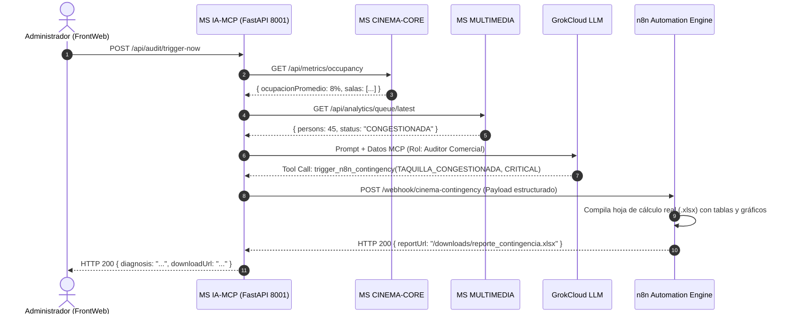

# Plan Técnico: Módulo 04 - Servidor MCP, Agente Auditor GrokCloud y Automatización n8n (MS IA-MCP)

> **Estado:** APPROVED  
> **Versión:** 1.0.0  
> **Módulo:** `docs/specs/04-ia-mcp-agent/`  
> **Especificación Base:** `docs/specs/04-ia-mcp-agent/spec.md`  
> **Constitución Base:** `docs/constitution.md`  
> **Metodología:** SDD-Planning

---

## 1. Resumen Arquitectónico y Decisiones de Diseño

- **Objetivo Técnico:** Implementar el microservicio de inteligencia artificial contextual, servidor de protocolo Model Context Protocol (MCP) y motor de auditoría comercial en FastAPI (Python 3.11+), integrando el SDK de GrokCloud, orquestación de webhooks salientes hacia n8n para generación de archivos Excel binarios (`.xlsx`) y provisión de un endpoint de lenguaje natural para el Chatbot de clientes.
- **Estilo Arquitectónico:** Arquitectura Clean/Modular en Python con FastAPI:
  - *MCP Server Module:* Implementación del protocolo Model Context Protocol exponiendo un endpoint JSON-RPC 2.0 y el manifiesto con las 3 herramientas requeridas (`get_occupancy_metrics`, `get_line_analytics`, `trigger_n8n_contingency`).
  - *GrokCloud Agent Engine:* Cliente HTTP asíncrono configurado con la variable de entorno `${GROQ_API_KEY}`, dotado del System Prompt de *Auditor Comercial de Operaciones de Cine* y bucle de evaluación programado (APScheduler / asyncio).
  - *N8N Webhook Dispatcher:* Adaptador de llamadas seguras hacia n8n con payload estructurado para disparar la generación de reportes en hojas de cálculo `.xlsx`.
  - *Sales Chatbot Router:* Endpoint WebSocket / REST para procesar el diálogo de compra asistida del cliente.
- **Decisiones Técnicas Clave:**
  - **Manejo Dual de Auditoría:** Tarea en background (`asyncio.create_task` cada 60 segundos) combinada con el endpoint inmediato `POST /api/audit/trigger-now` para activar la evaluación en vivo ante el jurado.
  - **Resiliencia de LLM:** Configuración de timeout duro de 5000 ms en llamadas hacia GrokCloud con circuit breaker heurístico si el servicio externo no responde.

### 1.1 Matriz de Componentes Técnicos (`PLAN-XX`)

| ID Componente | Nombre / Artefacto Técnico | Capa Arquitectónica | Responsabilidad Técnica | Requisitos que Cubre |
| :--- | :--- | :--- | :--- | :--- |
| **`PLAN-01`** | `mcp_manifest.json` y `MCPServer` | Servidor / Protocolo | Exposición del protocolo JSON-RPC y declaración formal de las 3 herramientas. | `HU-09`, `RF-09.1` |
| **`PLAN-02`** | `CommercialAnomalyEvaluator`, Modelos Pydantic | Dominio | Lógica de evaluación de afluencia (>40) y aforo (<15%) con contratos fuertemente tipados. | `RB-MCP-02`, `SC-04.1.1` |
| **`PLAN-03`** | `GrokCloudAgentService`, `AuditCycleScheduler` | Aplicación / IA | Ciclo de auditoría autónoma, razonamiento de GrokCloud y llamadas MCP. | `HU-09`, `RF-09.2`, `RF-09.3` |
| **`PLAN-04`** | `N8NWebhookAdapter`, `MicroservicesClients` | Infraestructura | Clientes HTTP hacia Cinema Core, Multimedia y Webhook saliente hacia n8n. | `HU-10`, `RF-10.1`, `RF-10.2` |
| **`PLAN-05`** | `AuditController`, `ChatbotController`, `AuditConsoleUI` | Presentación / API | Endpoints REST, consola web de auditoría con botón `[Ejecutar Auditoría MCP Ahora]` y chat. | `HU-11`, `RF-11.1`, `SC-04.3.1` |

---

## 2. Estructura Física de Archivos del Módulo

```text
services/ms-ia-mcp/
├── backend/
│   ├── pyproject.toml                                                                # FastAPI, uvicorn, pydantic, httpx, apscheduler, pytest
│   ├── requirements.txt
│   ├── main.py                                                                       # Punto de entrada de la aplicación FastAPI (puerto 8001)
│   ├── app/
│   │   ├── config.py                                                                 # Configuración de GrokCloud API Key y URLs de n8n
│   │   ├── domain/
│   │   │   ├── models.py                                                             # [CREATE] (PLAN-02) Esquemas Pydantic de anomalías y métricas
│   │   │   └── anomaly_rules.py                                                      # [CREATE] (PLAN-02) Invariantes de aforo y afluencia
│   │   ├── mcp/
│   │   │   ├── server.py                                                             # [CREATE] (PLAN-01) Servidor JSON-RPC de MCP
│   │   │   ├── manifest.py                                                           # [CREATE] (PLAN-01) Manifiesto de las 3 herramientas
│   │   │   └── tools/
│   │   │       ├── occupancy_tool.py                                                 # [CREATE] (PLAN-01) Implementación get_occupancy_metrics
│   │   │       ├── line_analytics_tool.py                                            # [CREATE] (PLAN-01) Implementación get_line_analytics
│   │   │       └── n8n_contingency_tool.py                                           # [CREATE] (PLAN-01) Implementación trigger_n8n_contingency
│   │   ├── agent/
│   │   │   ├── grok_client.py                                                        # [CREATE] (PLAN-03) Cliente GrokCloud con API Key
│   │   │   ├── system_prompt.py                                                      # [CREATE] (PLAN-03) Rol: Auditor Comercial de Cine
│   │   │   └── auditor_agent.py                                                      # [CREATE] (PLAN-03) Bucle de evaluación del agente
│   │   ├── infrastructure/
│   │   │   ├── n8n_client.py                                                         # [CREATE] (PLAN-04) Despachador de Webhooks n8n
│   │   │   └── service_clients.py                                                    # [CREATE] (PLAN-04) Clientes HTTP hacia Cinema Core y Multimedia
│   │   └── presentation/
│   │       ├── audit_routes.py                                                       # [CREATE] (PLAN-05) Endpoints /api/audit (manual trigger y estado)
│   │       └── chatbot_routes.py                                                     # [CREATE] (PLAN-05) Endpoints /api/chat para la app cliente
│   ├── tests/
│   │   ├── test_mcp_tools.py                                                         # [CREATE] Test unitario de herramientas JSON-RPC
│   │   ├── test_anomaly_detection.py                                                 # [CREATE] Test de reglas de detección de anomalías
│   │   └── test_n8n_webhook.py                                                       # [CREATE] Test de emisión de payload a n8n
│   └── Dockerfile                                                                    # Python 3.11-slim
│
└── frontend/
    └── src/
        └── components/
            └── AuditMonitorConsole.tsx                                               # [CREATE] (PLAN-05) Consola con botón [Ejecutar Auditoría MCP Ahora]
```

---

## 3. Contratos de Datos y Esquemas Pydantic

### 3.1 Payload de Webhook hacia n8n (`models.py`)
```python
from pydantic import BaseModel, Field
from typing import Dict, Any, Literal
from datetime import datetime

class N8NContingencyPayload(BaseModel):
    anomaly_type: Literal["TAQUILLA_CONGESTIONADA", "SALA_SUBOCUPADA"]
    severity_level: Literal["CRITICAL", "WARNING"]
    raw_mcp_data: Dict[str, Any]
    timestamp: datetime = Field(default_factory=datetime.utcnow)
```

### 3.2 Manifiesto MCP JSON-RPC (`manifest.py`)
```python
MCP_TOOLS_MANIFEST = {
    "tools": [
        {
            "name": "get_occupancy_metrics",
            "description": "Consulta a MS CINEMA-CORE para obtener aforo por sala y funciones subocupadas.",
            "parameters": {"type": "object", "properties": {}}
        },
        {
            "name": "get_line_analytics",
            "description": "Consulta a MS MULTIMEDIA para obtener el conteo de personas en taquilla por TensorFlow.",
            "parameters": {"type": "object", "properties": {}}
        },
        {
            "name": "trigger_n8n_contingency",
            "description": "Dispara el flujo de contingencia en n8n para compilar el informe Excel (.xlsx).",
            "parameters": {
                "type": "object",
                "properties": {
                    "anomaly_type": {"type": "string", "enum": ["TAQUILLA_CONGESTIONADA", "SALA_SUBOCUPADA"]},
                    "severity_level": {"type": "string", "enum": ["CRITICAL", "WARNING"]},
                    "raw_mcp_data": {"type": "object"}
                },
                "required": ["anomaly_type", "severity_level", "raw_mcp_data"]
            }
        }
    ]
}
```

---

## 4. Diagrama de Secuencia: Ciclo de Auditoría y Generación de Excel en n8n



---

## 5. Arquitectura de Vertical Slices para `/sdd-task`

* **Slice 0 (Setup):** `PLAN-01`, `PLAN-04` Configuración FastAPI, cliente HTTP y manifiesto MCP JSON-RPC.
* **Slice 1 (Herramientas MCP e Integraciones):** `PLAN-01`, `PLAN-02`, `PLAN-04` Implementación de las 3 tools y clientes hacia Cinema Core y Multimedia.
* **Slice 2 (Agente GrokCloud y Webhook n8n):** `PLAN-02`, `PLAN-03`, `PLAN-04`, `PLAN-05` Inyección de API Key, lógica de detección de anomalías, despacho a n8n y consola con botón `[Ejecutar Auditoría MCP Ahora]`.
* **Slice 3 (Chatbot de Compra y Verificación):** `PLAN-05` Endpoint para el Chatbot deslizable de la app cliente, pruebas pytest y build consolidado.

