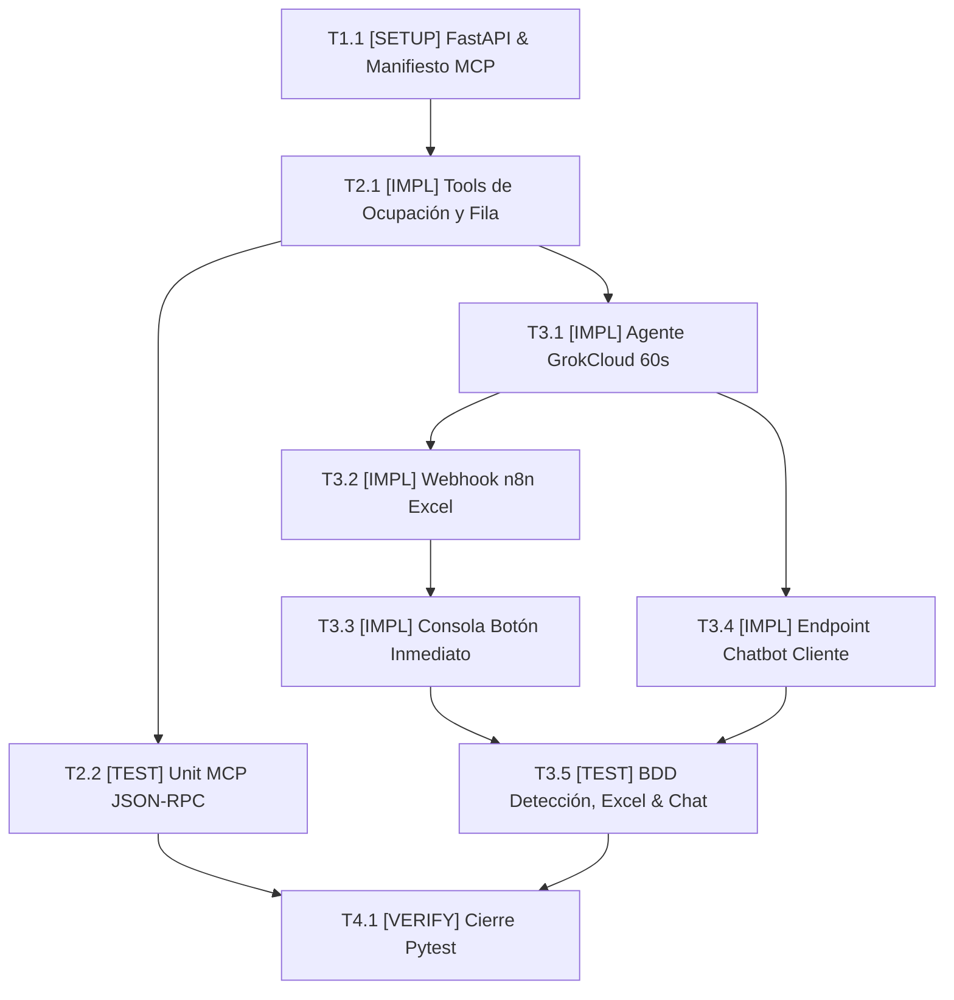

# Tasks: Módulo 04 - Servidor MCP, Agente Auditor GrokCloud y Automatización n8n (MS IA-MCP)

## Task Progress

| Métrica | Cantidad |
| :--- | ---: |
| Total de tareas | 9 |
| Tareas realizadas | 0 |
| Tareas por realizar | 9 |
| Tareas bloqueadas | 0 |
| Tareas en progreso | 0 |
| Progreso | 0% |

**Estado:** READY

---

## Checklist Rápido de Tareas por Vertical Slice

### Fase 0: Setup del Servidor FastAPI y Manifiesto MCP
- [ ] `T1.1` `[SETUP]` Configuración de proyecto FastAPI en Python 3.11+ y manifiesto JSON-RPC 2.0 con las 3 herramientas declaradas (`PLAN-01`, `PLAN-02`).

### Slice 1: Implementación de Herramientas Semánticas MCP
- [ ] `T2.1` `[IMPL]` Implementar herramienta `get_occupancy_metrics` (conexión a MS CINEMA-CORE) y `get_line_analytics` (conexión a MS MULTIMEDIA) (`PLAN-01`, `PLAN-04`).
- [ ] `T2.2` `[TEST]` Suite unitaria de herramientas MCP: validar invocación JSON-RPC y formateo de respuestas (`RF-09.1`).

### Slice 2: Agente Auditor GrokCloud, Consola y Automatización n8n
- [ ] `T3.1` `[IMPL]` Implementar `GrokCloudAgentService` con la API Key oficial, System Prompt de Auditor Comercial y bucle de background de 60 segundos (`PLAN-02`, `PLAN-03`).
- [ ] `T3.2` `[IMPL]` Implementar herramienta `trigger_n8n_contingency` con envío de payload estructurado hacia n8n y recepción de URL del archivo Excel `.xlsx` (`PLAN-01`, `PLAN-04`).
- [ ] `T3.3` `[IMPL]` Construir la consola de control `AuditMonitorConsole` con el botón `[Ejecutar Auditoría MCP Ahora]` y visualizador de diagnóstico (`PLAN-05`).
- [ ] `T3.4` `[IMPL]` Implementar endpoints del Chatbot de compra del cliente (`chatbot_routes.py`) para responder dudas de cartelera y sugerir butacas (`PLAN-05`, `HU-11`).
- [ ] `T3.5` `[TEST]` Suite BDD de auditoría y n8n: verificar que una taquilla saturada (>40) gatille el webhook a n8n y retorne el enlace del archivo `.xlsx` (`SC-04.1.1`, `SC-04.2.1`, `SC-04.3.1`).

### Fase Final: Verificación Consolidada y Cierre
- [ ] `T4.1` `[VERIFY]` Ejecución de batería completa de pruebas pytest, linter ruff/flake8 y verificación de Dockerfile de `ms-ia-mcp`.

---

## 1. Resumen de Trazabilidad (`Spec` → `Plan` → `Tasks`)

| Requisito / Regla / Escenario (`spec.md`) | Componente Técnico (`plan.md`) | Tareas Asociadas (`tasks.md`) |
| :--- | :--- | :--- |
| `HU-09`, `RF-09.1` | `PLAN-01`, `PLAN-02` | `T1.1`, `T2.1`, `T2.2` |
| `RF-09.2`, `RF-09.3`, `RB-MCP-01`, `RB-MCP-02` | `PLAN-02`, `PLAN-03`, `PLAN-05` | `T3.1`, `T3.3` |
| `HU-10`, `RF-10.1`, `RF-10.2`, `RF-10.3`, `SC-04.2.1` | `PLAN-01`, `PLAN-04`, `PLAN-05` | `T3.2`, `T3.5` |
| `HU-11`, `RF-11.1`, `RF-11.2`, `SC-04.3.1` | `PLAN-05` | `T3.4`, `T3.5` |
| `SC-04.1.1` | `PLAN-03`, `PLAN-04` | `T3.5` |
| Cierre y verificación de calidad | Todos los componentes `PLAN` | `T4.1` |

---

## 2. Grafo de Dependencias de Tareas

---

## 3. Desglose Detallado de Tareas Ejecutables

### Fase 0: Setup del Servidor FastAPI y Manifiesto MCP

#### [ ] T1.1 [SETUP] Configuración de FastAPI y manifiesto JSON-RPC de MCP
* **Status:** PENDING
* **Traceability:** `PLAN-01`, `PLAN-02` | `RF-09.1`
* **Depends on:** —
* **Files:**
  * `[CREATE]` `services/ms-ia-mcp/backend/app/mcp/manifest.py`
  * `[CREATE]` `services/ms-ia-mcp/backend/app/mcp/server.py`
  * `[CREATE]` `services/ms-ia-mcp/backend/main.py`
* **Objective:** Levantar el servidor en el puerto 8001 exponiendo el manifiesto de herramientas semánticas.
* **Work:** Declarar el endpoint `/mcp` con compatibilidad JSON-RPC 2.0 y el listado de las 3 herramientas.
* **Done when:** `GET /mcp/manifest` responde con el esquema completo de parámetros.
* **Evidence:** `pytest tests/test_mcp_tools.py::test_manifest_schema`

---

### Slice 1: Implementación de Herramientas Semánticas MCP

#### [ ] T2.1 [IMPL] Implementar get_occupancy_metrics y get_line_analytics
* **Status:** PENDING
* **Traceability:** `PLAN-01`, `PLAN-04` | `RF-09.1`
* **Depends on:** `T1.1`
* **Files:**
  * `[CREATE]` `services/ms-ia-mcp/backend/app/mcp/tools/occupancy_tool.py`
  * `[CREATE]` `services/ms-ia-mcp/backend/app/mcp/tools/line_analytics_tool.py`
  * `[CREATE]` `services/ms-ia-mcp/backend/app/infrastructure/service_clients.py`
* **Objective:** Conectar MCP con MS Cinema Core (puerto 3000) y MS Multimedia (puerto 3001).
* **Work:** Usar `httpx.AsyncClient` con timeout de 3 segundos para consultar los endpoints de métricas.
* **Done when:** Las llamadas a las herramientas devuelven los diccionarios de datos consolidados.
* **Evidence:** `pytest tests/test_mcp_tools.py::test_tools_execution`

#### [ ] T2.2 [TEST] Suite unitaria de herramientas MCP
* **Status:** PENDING
* **Traceability:** `RF-09.1`
* **Depends on:** `T2.1`
* **Files:**
  * `[CREATE]` `services/ms-ia-mcp/backend/tests/test_mcp_tools.py`
* **Objective:** Probar con mocks las respuestas de Cinema Core y Multimedia.
* **Work:** Test unitario de JSON-RPC.
* **Done when:** Los tests pasan en verde.
* **Evidence:** `pytest tests/test_mcp_tools.py`

---

### Slice 2: Agente Auditor GrokCloud, Consola y Automatización n8n

#### [ ] T3.1 [IMPL] Implementar GrokCloudAgentService con API Key y System Prompt
* **Status:** PENDING
* **Traceability:** `PLAN-02`, `PLAN-03` | `RF-09.2`, `RB-MCP-01`, `RB-MCP-02`
* **Depends on:** `T2.1`
* **Files:**
  * `[CREATE]` `services/ms-ia-mcp/backend/app/agent/grok_client.py`
  * `[CREATE]` `services/ms-ia-mcp/backend/app/agent/system_prompt.py`
  * `[CREATE]` `services/ms-ia-mcp/backend/app/agent/auditor_agent.py`
* **Objective:** Configurar el agente con la variable de entorno `${GROQ_API_KEY}` y bucle de 60s.
* **Work:** Programar la llamada al LLM enviando los datos de las herramientas MCP y evaluando el umbral de 40 personas.
* **Done when:** El agente razona y decide invocar `trigger_n8n_contingency` cuando hay anomalía.
* **Evidence:** `pytest tests/test_anomaly_detection.py`

#### [ ] T3.2 [IMPL] Implementar trigger_n8n_contingency y webhook a n8n
* **Status:** PENDING
* **Traceability:** `PLAN-01`, `PLAN-04` | `RF-10.1`, `RF-10.2`
* **Depends on:** `T3.1`
* **Files:**
  * `[CREATE]` `services/ms-ia-mcp/backend/app/mcp/tools/n8n_contingency_tool.py`
  * `[CREATE]` `services/ms-ia-mcp/backend/app/infrastructure/n8n_client.py`
* **Objective:** Emitir el payload `{ anomaly_type, severity_level, raw_mcp_data, timestamp }` hacia n8n.
* **Work:** Despachar petición HTTP POST asíncrona hacia el webhook de n8n y retornar el enlace de descarga `.xlsx`.
* **Done when:** n8n recibe el payload y devuelve el estado de éxito.
* **Evidence:** `pytest tests/test_n8n_webhook.py`

#### [ ] T3.3 [IMPL] Construir AuditMonitorConsole con botón [Ejecutar Auditoría MCP Ahora]
* **Status:** PENDING
* **Traceability:** `PLAN-05` | `RF-09.3`, `RF-10.3`
* **Depends on:** `T3.2`
* **Files:**
  * `[CREATE]` `services/ms-ia-mcp/backend/app/presentation/audit_routes.py`
  * `[CREATE]` `services/ms-ia-mcp/frontend/src/components/AuditMonitorConsole.tsx`
* **Objective:** Endpoint `/api/audit/trigger-now` y componente React para demostración en vivo ante el jurado.
* **Work:** Crear la interfaz visual con el botón destacado que dispara la auditoría inmediata y muestra el veredicto en pantalla.
* **Done when:** Al pulsar el botón, en menos de 3 segundos se despliega el diagnóstico y el enlace de descarga del Excel de n8n.
* **Evidence:** `pytest tests/test_audit_api.py`

#### [ ] T3.4 [IMPL] Implementar endpoints del Chatbot de compra del cliente
* **Status:** PENDING
* **Traceability:** `PLAN-05` | `HU-11`, `RF-11.1`, `RF-11.2`
* **Depends on:** `T3.1`
* **Files:**
  * `[CREATE]` `services/ms-ia-mcp/backend/app/presentation/chatbot_routes.py`
* **Objective:** Endpoint `/api/chat/recommend` para procesar consultas de los clientes en lenguaje natural.
* **Work:** Conectar el prompt de ventas con las funciones de MS CINEMA-CORE y devolver recomendaciones con tarjetas de butacas seleccionables.
* **Done when:** El endpoint devuelve respuestas contextuales y tarjetas de asientos para el drawer.
* **Evidence:** `pytest tests/test_chatbot_routes.py`

#### [ ] T3.5 [TEST] Suite BDD de auditoría completa, contingencia en n8n y Chatbot
* **Status:** PENDING
* **Traceability:** `SC-04.1.1`, `SC-04.2.1`, `SC-04.3.1`
* **Depends on:** `T3.3`, `T3.4`
* **Files:**
  * `[CREATE]` `services/ms-ia-mcp/backend/tests/test_audit_integration.py`
* **Objective:** Demostrar con tests que una afluencia de 45 personas produce una contingencia `CRITICAL` con n8n y que el chat responde recomendaciones válidas.
* **Work:** Ejecutar el flujo completo de extremo a extremo.
* **Done when:** Todos los tests de integración pasan en verde.
* **Evidence:** `pytest tests/test_audit_integration.py`

---

### Fase Final: Verificación Consolidada y Cierre

#### [ ] T4.1 [VERIFY] Verificación completa del microservicio ms-ia-mcp
* **Status:** PENDING
* **Traceability:** Cross-cutting (Cierre de Módulo 04)
* **Depends on:** `T2.2`, `T3.5`
* **Objective:** Correr todos los tests de Python, linters y validación de sintaxis.
* **Work:** Ejecutar `pytest && ruff check .`.
* **Done when:** 100% de tests en verde y 0 errores de tipado Pydantic.
* **Evidence:** `pytest -v`

---

## 4. Bitácora de Evidencia de Ejecución (`/sdd-execution`)
* *(Pendiente de inicio de `/sdd-execution`)*
