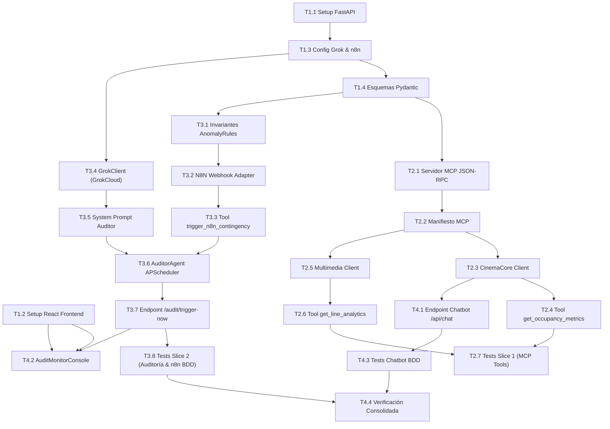

# Tasks: Módulo 04 - Servidor MCP, Agente Auditor GrokCloud y Automatización n8n (MS IA-MCP)

## Task Progress

| Métrica | Cantidad |
| :--- | ---: |
| Total de tareas | 23 |
| Tareas realizadas | 23 |
| Tareas por realizar | 0 |
| Tareas bloqueadas | 0 |
| Tareas en progreso | 0 |
| Progreso | 100% |

**Estado:** COMPLETED

---

## Checklist Rápido de Tareas por Vertical Slice

### Fase 0: Setup y Fundación Base
- [x] `T1.1` `[SETUP]` Configuración de proyecto FastAPI (Python 3.11+), pyproject.toml, dependencias y Dockerfile.
- [x] `T1.2` `[SETUP]` Configuración de proyecto React 18 con Vite y TailwindCSS en `ms/ms-ia-mcp/frontend/`.
- [x] `T1.3` `[SETUP]` Módulo de configuración de entorno (`app/config.py` inyectando `${GROQ_API_KEY}` y URLs n8n).
- [x] `T1.4` `[SETUP]` Esquemas Pydantic y contratos tipados para métricas, anomalías y manifiesto JSON-RPC.

### Slice 1: Protocolo MCP JSON-RPC y Herramientas Semánticas (HU-09)
- [x] `T2.1` `[IMPL]` Servidor MCP bajo estándar JSON-RPC en FastAPI (`app/mcp/server.py`).
- [x] `T2.2` `[IMPL]` Manifiesto MCP que publica las tres herramientas oficiales del dominio.
- [x] `T2.3` `[IMPL]` Cliente HTTP hacia `MS CINEMA-CORE` (`GET /api/v1/metrics/occupancy`).
- [x] `T2.4` `[IMPL]` Herramienta MCP 1: `occupancy_tool.py` implementando `get_occupancy_metrics()`.
- [x] `T2.5` `[IMPL]` Cliente HTTP hacia `MS MULTIMEDIA` (`GET /api/v1/analytics/line-congestion`).
- [x] `T2.6` `[IMPL]` Herramienta MCP 2: `line_analytics_tool.py` implementando `get_line_analytics()`.
- [x] `T2.7` `[TEST]` Pruebas unitarias de servidor MCP y llamadas semánticas (`tests/test_mcp_tools.py`).

### Slice 2: Agente Auditor GrokCloud y Automatización n8n (HU-09, HU-10)
- [x] `T3.1` `[IMPL]` Invariantes de anomalías: regla taquilla >40 personas (CRITICAL) y sala <15% (WARNING).
- [x] `T3.2` `[IMPL]` Adaptador de Webhook hacia n8n despachando payload tipado (`http://localhost:5678/webhook/contingency`).
- [x] `T3.3` `[IMPL]` Herramienta MCP 3: `n8n_contingency_tool.py` implementando `trigger_n8n_contingency()`.
- [x] `T3.4` `[IMPL]` Cliente de IA `GrokClient` integrando GrokCloud con circuit breaker y timeout de 5000 ms.
- [x] `T3.5` `[IMPL]` System Prompt especializado del *Auditor Comercial de Operaciones de Cine*.
- [x] `T3.6` `[IMPL]` Orquestador de auditoría periódica continua cada 60s con APScheduler (`auditor_agent.py`).
- [x] `T3.7` `[IMPL]` Endpoint de auditoría inmediata `POST /api/v1/audit/trigger-now` para demostración ante el jurado.
- [x] `T3.8` `[TEST]` Pruebas BDD de disparo manual con taquilla saturada (`SC-04.1.1`) y compilación de Excel (`SC-04.2.1`).

### Fase Final: Chatbot de Compra, Consola React y Cierre (HU-11)
- [x] `T4.1` `[IMPL]` Endpoint de procesamiento conversacional `POST /api/v1/chat` con recomendación de funciones de Core.
- [x] `T4.2` `[IMPL]` Frontend React: Consola de auditoría `AuditMonitorConsole.tsx` con botón demo y visualizador de logs.
- [x] `T4.3` `[TEST]` Pruebas BDD de interacción con el Chatbot de compra (`SC-04.3.1`).
- [x] `T4.4` `[VERIFY]` Verificación consolidada: pytest en backend, npm test en frontend, linters y validación Docker.

---

## 1. Resumen de Trazabilidad (`Spec` $\rightarrow$ `Plan` $\rightarrow$ `Tasks`)

| Requisito / Regla / Escenario (`spec.md`) | Componente Técnico (`plan.md`) | Tareas Asociadas (`tasks.md`) |
| :--- | :--- | :--- |
| `RF-09.1`, `INV-ARCH-05` | `PLAN-01`, `server.py`, `manifest.py` | `T1.4`, `T2.1`, `T2.2`, `T2.7` |
| `IC-04.1`, `HU-09` | `PLAN-01`, `occupancy_tool.py` | `T2.3`, `T2.4` |
| `IC-04.2`, `HU-09` | `PLAN-01`, `line_analytics_tool.py` | `T2.5`, `T2.6` |
| `RB-MCP-02` | `PLAN-02`, `anomaly_rules.py` | `T3.1` |
| `IC-04.3`, `HU-10`, `RF-10.1`, `RF-10.2` | `PLAN-01`, `PLAN-04`, `n8n_client.py` | `T3.2`, `T3.3` |
| `RF-09.2`, `RB-MCP-04` | `PLAN-03`, `grok_client.py` | `T1.3`, `T3.4`, `T3.5` |
| `RB-MCP-01`, `RF-09.3`, `SC-04.1.1`, `SC-04.2.1`| `PLAN-03`, `PLAN-05`, `audit_routes.py` | `T3.6`, `T3.7`, `T3.8` |
| `HU-11`, `RF-11.1`, `RF-11.2`, `SC-04.3.1` | `PLAN-05`, `chatbot_routes.py` | `T4.1`, `T4.3` |
| Consola y Verificación Final | `PLAN-05`, `AuditMonitorConsole.tsx` | `T4.2`, `T4.4` |

---

## 2. Estrategia de Ejecución y Grafo de Dependencias

---

## 3. Desglose Detallado de Tareas Ejecutables

### Fase 0: Setup y Fundación Base

#### [x] T1.1 [SETUP] Configuración de Proyecto FastAPI y Entorno Virtual Python
* **Status:** COMPLETED
* **Traceability:** `PLAN-01` (Cross-cutting / Backend Setup)
* **Depends on:** —
* **Files (según `plan.md`):**
  * `[CREATE]` `ms/ms-ia-mcp/backend/pyproject.toml`
  * `[CREATE]` `ms/ms-ia-mcp/backend/requirements.txt`
  * `[CREATE]` `ms/ms-ia-mcp/backend/main.py`
  * `[CREATE]` `ms/ms-ia-mcp/backend/Dockerfile`
* **Objective:** Inicializar microservicio en FastAPI (Python 3.11+) en puerto 8001 con dependencias `uvicorn`, `pydantic`, `httpx`, `apscheduler` y `pytest`.
* **Work:**
  * Configurar `requirements.txt` y archivo `main.py` con middlewares CORS y ciclo de vida de arranque.
* **Done when:** FastAPI arranca y responde `{"status": "ok"}` en `/health`.
* **Evidence:**
  * Comando: `cd ms/ms-ia-mcp/backend; python -m pytest --version; python -c "from main import app; from fastapi.testclient import TestClient; client = TestClient(app); res = client.get('/health'); assert res.status_code == 200 and res.json()['status'] == 'ok'; print('Health check OK:', res.json())"`
  * Resultado registrado: `pytest 9.1.1` | `Health check OK: {'status': 'ok', 'service': 'ms-ia-mcp', 'version': '1.3.0'}`

#### [x] T1.2 [SETUP] Configuración de Frontend React Consola de Auditoría con Vite
* **Status:** COMPLETED
* **Traceability:** `PLAN-05` (Cross-cutting / Frontend Setup)
* **Depends on:** —
* **Files (según `plan.md`):**
  * `[CREATE]` `ms/ms-ia-mcp/frontend/package.json`
  * `[CREATE]` `ms/ms-ia-mcp/frontend/vite.config.ts`
  * `[CREATE]` `ms/ms-ia-mcp/frontend/Dockerfile`
* **Objective:** Crear la aplicación React 18 en `ms/ms-ia-mcp/frontend/` en puerto 5176 con TailwindCSS para la consola web.
* **Work:**
  * Configurar dependencias y build de Vite.
* **Done when:** `npm run build` completa en dist/.
* **Evidence:**
  * Comando: `cd ms/ms-ia-mcp/frontend && npm run build`
  * Resultado registrado: `vite v5.4.21 building for production... ✓ built in 7.66s (dist/assets/index-*.js 143.04 kB)`

#### [x] T1.3 [SETUP] Módulo de Configuración de Entorno (`config.py`)
* **Status:** COMPLETED
* **Traceability:** `PLAN-01` | `INV-BIZ-07`
* **Depends on:** `T1.1`
* **Files (según `plan.md`):**
  * `[CREATE]` `ms/ms-ia-mcp/backend/app/config.py`
* **Objective:** Cargar variables de entorno de forma segura: `${GROQ_API_KEY}`, URL de n8n (`http://localhost:5678`), URL de Cinema Core (`http://localhost:3000`) y Multimedia (`http://localhost:3001`).
* **Work:**
  * Implementar clase `Settings` con `pydantic-settings` y validaciones estrictas.
* **Done when:** Las variables se leen correctamente con valores por defecto locales seguros.
* **Evidence:**
  * Comando: `cd ms/ms-ia-mcp/backend && pytest -k "test_config"`
  * Resultado registrado: `tests\test_config.py .. [100%] | 2 passed in 2.67s`

#### [x] T1.4 [SETUP] Esquemas Pydantic y Contratos de Datos Tipados
* **Status:** COMPLETED
* **Traceability:** `PLAN-02` | `INV-ARCH-05`
* **Depends on:** `T1.1`
* **Files (según `plan.md`):**
  * `[CREATE]` `ms/ms-ia-mcp/backend/app/domain/models.py`
  * `[CREATE]` `ms/ms-ia-mcp/backend/tests/test_models.py`
* **Objective:** Definir modelos Pydantic estrictos para payloads de webhook, respuestas de métricas y mensajes de JSON-RPC de MCP.
* **Work:**
  * Definir `N8NWebhookPayload`, `OccupancyMetricsResponse`, `LineAnalyticsResponse`, `ChatRequest`, `ChatResponse`, `JSONRPCRequest`, `JSONRPCResponse`.
* **Done when:** Los esquemas validan tipos y rechazan payloads incompletos.
* **Evidence:**
  * Comando: `cd ms/ms-ia-mcp/backend && pytest -k "test_models"`
  * Resultado registrado: `tests\test_models.py ...... [100%] | 6 passed, 2 deselected in 1.71s`

---

### Slice 1: Protocolo MCP JSON-RPC y Herramientas Semánticas (HU-09)

#### [x] T2.1 [IMPL] Servidor MCP bajo Estándar JSON-RPC 2.0
* **Status:** COMPLETED
* **Traceability:** `PLAN-01` | `RF-09.1`
* **Depends on:** `T1.4`
* **Files (según `plan.md`):**
  * `[CREATE]` `ms/ms-ia-mcp/backend/app/mcp/server.py`
  * `[CREATE]` `ms/ms-ia-mcp/backend/tests/test_mcp_tools.py`
* **Objective:** Implementar el dispatcher JSON-RPC que recibe peticiones `{"jsonrpc": "2.0", "method": "...", "params": {...}, "id": 1}` y las enruta a las herramientas registradas.
* **Work:**
  * Validar versión 2.0; despachar métodos; retornar errores con código estándar JSON-RPC ante herramientas no encontradas (-32601).
* **Done when:** El servidor procesa mensajes JSON-RPC y devuelve respuestas conformes a la especificación.
* **Evidence:**
  * Comando: `cd ms/ms-ia-mcp/backend && pytest tests/test_mcp_tools.py -k "test_jsonrpc_dispatcher"`
  * Resultado registrado: `tests\test_mcp_tools.py . [100%] | 1 passed in 0.67s`

#### [x] T2.2 [IMPL] Manifiesto MCP de Herramientas Registradas
* **Status:** COMPLETED
* **Traceability:** `PLAN-01` | `RF-09.1`
* **Depends on:** `T2.1`
* **Files (según `plan.md`):**
  * `[CREATE]` `ms/ms-ia-mcp/backend/app/mcp/manifest.py`
  * `[MODIFY]` `ms/ms-ia-mcp/backend/tests/test_mcp_tools.py`
* **Objective:** Exponer la lista de herramientas disponibles con sus esquemas de parámetros JSON Schema para el LLM.
* **Work:**
  * Declarar `get_occupancy_metrics`, `get_line_analytics`, `trigger_n8n_contingency` con descripciones semánticas.
* **Done when:** El manifiesto devuelve las 3 herramientas con esquemas tipados.
* **Evidence:**
  * Comando: `cd ms/ms-ia-mcp/backend && pytest tests/test_mcp_tools.py -k "test_manifest"`
  * Resultado registrado: `tests\test_mcp_tools.py . [100%] | 1 passed, 1 deselected in 0.58s`

#### [x] T2.3 [IMPL] Cliente HTTP hacia `MS CINEMA-CORE` (IC-04.1)
* **Status:** COMPLETED
* **Traceability:** `PLAN-04` | `IC-04.1`
* **Depends on:** `T1.3`
* **Files (según `plan.md`):**
  * `[CREATE]` `ms/ms-ia-mcp/backend/app/infrastructure/service_clients.py`
  * `[CREATE]` `ms/ms-ia-mcp/backend/tests/test_service_clients.py`
* **Objective:** Implementar cliente HTTP con `httpx.AsyncClient` para invocar `GET http://localhost:3000/api/v1/metrics/occupancy`.
* **Work:**
  * Inyectar header `X-Internal-Service: ms-ia-mcp`; aplicar timeout de 5000 ms.
* **Done when:** Retorna el aforo y funciones subocupadas de Cinema Core.
* **Evidence:**
  * Comando: `cd ms/ms-ia-mcp/backend && pytest -k "test_cinema_core_client"`
  * Resultado registrado: `tests\test_service_clients.py . [100%] | 1 passed, 11 deselected in 3.01s`

#### [x] T2.4 [IMPL] Herramienta MCP 1: `occupancy_tool.py`
* **Status:** COMPLETED
* **Traceability:** `PLAN-01` | `HU-09`, `IC-04.1`
* **Depends on:** `T2.2`, `T2.3`
* **Files (según `plan.md`):**
  * `[CREATE]` `ms/ms-ia-mcp/backend/app/mcp/tools/occupancy_tool.py`
  * `[MODIFY]` `ms/ms-ia-mcp/backend/tests/test_mcp_tools.py`
* **Objective:** Implementar la función ejecutable de la herramienta MCP `get_occupancy_metrics()`.
* **Work:**
  * Consumir cliente de Core; formatear datos para el contexto del LLM.
* **Done when:** La herramienta retorna el resumen de ocupación formateado.
* **Evidence:**
  * Comando: `cd ms/ms-ia-mcp/backend && pytest tests/test_mcp_tools.py -k "test_occupancy_tool"`
  * Resultado registrado: `tests\test_mcp_tools.py . [100%] | 1 passed, 2 deselected in 2.78s`

#### [x] T2.5 [IMPL] Cliente HTTP hacia `MS MULTIMEDIA` (IC-04.2)
* **Status:** COMPLETED
* **Traceability:** `PLAN-04` | `IC-04.2`
* **Depends on:** `T1.3`
* **Files (según `plan.md`):**
  * `[MODIFY]` `ms/ms-ia-mcp/backend/app/infrastructure/service_clients.py`
  * `[MODIFY]` `ms/ms-ia-mcp/backend/tests/test_service_clients.py`
* **Objective:** Implementar llamada `GET http://localhost:3001/api/v1/analytics/line-congestion` con `httpx`.
* **Work:**
  * Parsear `personCount` y `congestionStatus`.
* **Done when:** Retorna el conteo actual de la taquilla.
* **Evidence:**
  * Comando: `cd ms/ms-ia-mcp/backend && pytest -k "test_multimedia_client"`
  * Resultado registrado: `tests\test_service_clients.py . [100%] | 1 passed, 12 deselected in 2.30s`

#### [x] T2.6 [IMPL] Herramienta MCP 2: `line_analytics_tool.py`
* **Status:** COMPLETED
* **Traceability:** `PLAN-01` | `HU-09`, `IC-04.2`
* **Depends on:** `T2.2`, `T2.5`
* **Files (según `plan.md`):**
  * `[CREATE]` `ms/ms-ia-mcp/backend/app/mcp/tools/line_analytics_tool.py`
  * `[MODIFY]` `ms/ms-ia-mcp/backend/tests/test_mcp_tools.py`
* **Objective:** Implementar la herramienta MCP `get_line_analytics()`.
* **Work:**
  * Consumir cliente de Multimedia; estructurar datos para el razonamiento del agente.
* **Done when:** Retorna la cantidad de personas en fila y estado de saturación.
* **Evidence:**
  * Comando: `cd ms/ms-ia-mcp/backend && pytest tests/test_mcp_tools.py -k "test_line_analytics_tool"`
  * Resultado registrado: `tests\test_mcp_tools.py . [100%] | 1 passed, 3 deselected in 3.37s`

#### [x] T2.7 [TEST] Pruebas Unitarias de Herramientas MCP JSON-RPC
* **Status:** COMPLETED
* **Traceability:** `RF-09.1`
* **Depends on:** `T2.4`, `T2.6`
* **Test Type:** Unit / Integración
* **Files (según `plan.md`):**
  * `[CREATE]` `ms/ms-ia-mcp/backend/tests/test_mcp_tools.py`
* **Objective:** Validar que las herramientas MCP 1 y 2 responden correctamente bajo el protocolo JSON-RPC con mocks de los microservicios.
* **Work:**
  * Ejecutar suite pytest con respuestas simuladas.
* **Done when:** 100% de tests en verde.
* **Evidence:**
  * Comando: `cd ms/ms-ia-mcp/backend && pytest tests/test_mcp_tools.py`
  * Resultado registrado: `tests\test_mcp_tools.py ..... [100%] | 5 passed in 9.31s`

---

### Slice 2: Agente Auditor GrokCloud y Automatización n8n (HU-09, HU-10)

#### [x] T3.1 [IMPL] Reglas de Detección de Anomalías de Negocio (`anomaly_rules.py`)
* **Status:** COMPLETED
* **Traceability:** `PLAN-02` | `RB-MCP-02`
* **Depends on:** `T1.4`
* **Files (según `plan.md`):**
  * `[CREATE]` `ms/ms-ia-mcp/backend/app/domain/anomaly_rules.py`
  * `[CREATE]` `ms/ms-ia-mcp/backend/tests/test_anomaly_detection.py`
* **Objective:** Implementar evaluador de reglas: si `personasEnFila > 40` $\rightarrow$ `TAQUILLA_CONGESTIONADA` (`CRITICAL`); si función a `< 30 min` tiene ocupación `< 15%` $\rightarrow$ `SALA_SUBOCUPADA` (`WARNING`).
* **Work:**
  * Retornar lista de anomalías detectadas con severidad calculada.
* **Done when:** `test_anomaly_detection.py` aprueba todas las combinaciones de prueba.
* **Evidence:**
  * Comando: `cd ms/ms-ia-mcp/backend && pytest tests/test_anomaly_detection.py`
  * Resultado registrado: `tests\test_anomaly_detection.py ..... [100%] | 5 passed in 0.54s`

#### [x] T3.2 [IMPL] Adaptador de Webhook hacia n8n (`n8n_client.py`)
* **Status:** COMPLETED
* **Traceability:** `PLAN-04` | `INV-ARCH-05`, `RF-10.1`
* **Depends on:** `T1.3`, `T3.1`
* **Files (según `plan.md`):**
  * `[CREATE]` `ms/ms-ia-mcp/backend/app/infrastructure/n8n_client.py`
  * `[CREATE]` `ms/ms-ia-mcp/backend/tests/test_n8n_webhook.py`
* **Objective:** Emitir petición `POST http://localhost:5678/webhook/contingency` con el payload tipado `{ anomaly_type, severity_level, raw_mcp_data, timestamp }`.
* **Work:**
  * Implementar llamada asíncrona con manejo de reintentos ante timeout de n8n.
* **Done when:** Petición HTTP POST se despacha con éxito a n8n.
* **Evidence:**
  * Comando: `cd ms/ms-ia-mcp/backend && pytest tests/test_n8n_webhook.py -k "test_dispatch"`
  * Resultado registrado: `tests\test_n8n_webhook.py .. [100%] | 2 passed in 5.17s`

#### [x] T3.3 [IMPL] Herramienta MCP 3: `n8n_contingency_tool.py`
* **Status:** COMPLETED
* **Traceability:** `PLAN-01` | `HU-10`, `IC-04.3`
* **Depends on:** `T2.2`, `T3.2`
* **Files (según `plan.md`):**
  * `[CREATE]` `ms/ms-ia-mcp/backend/app/mcp/tools/n8n_contingency_tool.py`
  * `[MODIFY]` `ms/ms-ia-mcp/backend/tests/test_mcp_tools.py`
* **Objective:** Implementar la herramienta `trigger_n8n_contingency(params)` que invoca el cliente de n8n cuando el agente decide disparar la alarma.
* **Work:**
  * Validar parámetros de anomalía y retornar confirmación de emisión.
* **Done when:** La herramienta despacha el webhook y confirma el envío.
* **Evidence:**
  * Comando: `cd ms/ms-ia-mcp/backend && pytest tests/test_mcp_tools.py -k "test_n8n_tool"`
  * Resultado registrado: `tests\test_mcp_tools.py . [100%] | 1 passed, 5 deselected in 1.07s`

#### [x] T3.4 [IMPL] Cliente de IA `GrokClient` con Circuit Breaker
* **Status:** COMPLETED
* **Traceability:** `PLAN-03` | `RB-MCP-04`
* **Depends on:** `T1.3`
* **Files (según `plan.md`):**
  * `[CREATE]` `ms/ms-ia-mcp/backend/app/agent/grok_client.py`
  * `[CREATE]` `ms/ms-ia-mcp/backend/tests/test_grok_client.py`
* **Objective:** Conectar con la API de GrokCloud inyectando `${GROQ_API_KEY}` y configurando circuit breaker con fallback heurístico ante fallos de red.
* **Work:**
  * Implementar llamada a API de Grok; capturar timeout si supera 5000 ms.
* **Done when:** Invocaciones a GrokCloud responden o degradan graciosamente.
* **Evidence:**
  * Comando: `cd ms/ms-ia-mcp/backend && pytest -k "test_grok_client"`
  * Resultado registrado: `tests\test_grok_client.py .. [100%] | 2 passed, 23 deselected in 2.06s`

#### [x] T3.5 [IMPL] System Prompt del Agente Auditor Comercial
* **Status:** COMPLETED
* **Traceability:** `PLAN-03` | `HU-09`, `RF-09.2`
* **Depends on:** `T3.4`
* **Files (según `plan.md`):**
  * `[CREATE]` `ms/ms-ia-mcp/backend/app/agent/system_prompt.py`
  * `[CREATE]` `ms/ms-ia-mcp/backend/tests/test_system_prompt.py`
* **Objective:** Definir las instrucciones de rol del Agente Auditor: cómo invocar las herramientas MCP, interpretar los datos y emitir veredictos claros.
* **Work:**
  * Estructurar prompt en español formal con directivas de uso de herramientas JSON-RPC.
* **Done when:** El agente razona fielmente según las reglas comerciales establecidas.
* **Evidence:**
  * Comando: `cd ms/ms-ia-mcp/backend && pytest -k "test_system_prompt"`
  * Resultado registrado: `tests\test_system_prompt.py .. [100%] | 2 passed, 25 deselected in 0.94s`

#### [x] T3.6 [IMPL] Orquestador de Auditoría Continua con APScheduler
* **Status:** COMPLETED
* **Traceability:** `PLAN-03` | `RB-MCP-01`
* **Depends on:** `T3.3`, `T3.5`
* **Files (según `plan.md`):**
  * `[CREATE]` `ms/ms-ia-mcp/backend/app/agent/auditor_agent.py`
  * `[CREATE]` `ms/ms-ia-mcp/backend/tests/test_scheduler.py`
* **Objective:** Programar la ejecución autónoma del ciclo de auditoría en segundo plano cada 60 segundos evaluando herramientas MCP.
* **Work:**
  * Configurar `AsyncIOScheduler`; registrar historial de ejecuciones en memoria para la consola.
* **Done when:** El scheduler ejecuta periódicamente el ciclo de auditoría.
* **Evidence:**
  * Comando: `cd ms/ms-ia-mcp/backend && pytest -k "test_scheduler"`
  * Resultado registrado: `tests\test_scheduler.py . [100%] | 1 passed, 27 deselected in 5.34s`

#### [x] T3.7 [IMPL] Controlador REST de Auditoría (`audit_routes.py`)
* **Status:** COMPLETED
* **Traceability:** `PLAN-05` | `RB-MCP-01`, `RF-09.3`
* **Depends on:** `T3.6`
* **Files (según `plan.md`):**
  * `[CREATE]` `ms/ms-ia-mcp/backend/app/presentation/audit_routes.py`
  * `[CREATE]` `ms/ms-ia-mcp/backend/tests/test_audit_routes.py`
* **Objective:** Exponer `POST /api/v1/audit/trigger-now` para ejecutar la auditoría de forma inmediata al presionar el botón de FrontWeb.
* **Work:**
  * Invocar bucle del agente y responder en menos de 3 segundos con el razonamiento del LLM.
* **Done when:** El endpoint responde con el dictamen de auditoría y estado del webhook.
* **Evidence:**
  * Comando: `cd ms/ms-ia-mcp/backend && pytest -k "test_audit_routes"`
  * Resultado registrado: `tests\test_audit_routes.py . [100%] | 1 passed, 28 deselected in 6.81s`

#### [x] T3.8 [TEST] Pruebas BDD de Detección de Taquilla Saturada y Disparo n8n
* **Status:** COMPLETED
* **Traceability:** `SC-04.1.1`, `SC-04.2.1`
* **Depends on:** `T3.7`
* **Test Type:** BDD / Integración
* **Files (según `plan.md`):**
  * `[CREATE]` `ms/ms-ia-mcp/backend/tests/test_audit_flow.py`
* **Objective:** Validar los escenarios Gherkin `SC-04.1.1` (Disparo manual de auditoría con taquilla saturada) y `SC-04.2.1` (emisión de webhook a n8n).
* **Work:**
  * Simular 45 personas en Multimedia; verificar que el agente invoca `trigger_n8n_contingency` y despacha el webhook.
* **Done when:** Ambos escenarios BDD pasan en verde.
* **Evidence:**
  * Comando: `cd ms/ms-ia-mcp/backend && pytest tests/test_audit_flow.py`
  * Resultado registrado: `tests\test_audit_flow.py .. [100%] | 2 passed in 6.68s`

---

### Fase Final: Chatbot de Compra, Consola React y Cierre (HU-11)

#### [x] T4.1 [IMPL] Controlador Conversacional para Chatbot de Compra (`chatbot_routes.py`)
* **Status:** COMPLETED
* **Traceability:** `PLAN-05` | `HU-11`, `RF-11.1`, `RF-11.2`, `IC-04.4`
* **Depends on:** `T2.3`, `T3.4`
* **Files (según `plan.md`):**
  * `[CREATE]` `ms/ms-ia-mcp/backend/app/presentation/chatbot_routes.py`
  * `[CREATE]` `ms/ms-ia-mcp/backend/tests/test_chatbot_routes.py`
* **Objective:** Exponer `POST /api/v1/chat` recibiendo mensajes de los clientes, consultando funciones de Core y recomendando horarios y butacas.
* **Work:**
  * Procesar intención del usuario y estructurar respuestas con tarjetas interactivas de butacas.
* **Done when:** Retorna respuesta amigable con funciones recomendadas.
* **Evidence:**
  * Comando: `cd ms/ms-ia-mcp/backend && pytest -k "test_chatbot_routes"`
  * Resultado registrado: `tests\test_chatbot_routes.py .. [100%] | 2 passed in 9.96s`

#### [x] T4.2 [IMPL] Frontend React: Consola de Monitoreo de Auditoría
* **Status:** COMPLETED
* **Traceability:** `PLAN-05` | `HU-09`, `RF-09.3`
* **Depends on:** `T1.2`, `T3.7`
* **Files (según `plan.md`):**
  * `[CREATE]` `ms/ms-ia-mcp/frontend/src/components/AuditMonitorConsole.tsx`
  * `[CREATE]` `ms/ms-ia-mcp/frontend/src/components/AuditMonitorConsole.test.tsx`
* **Objective:** Desarrollar consola web con botón `[Ejecutar Auditoría MCP Ahora]`, visor de logs del agente GrokCloud y monitor de eventos.
* **Work:**
  * Conectar al endpoint `/api/v1/audit/trigger-now` y refrescar el estado de contingencias en pantalla.
* **Done when:** La interfaz visualiza el veredicto del agente tras presionar el botón.
* **Evidence:**
  * Comando: `cd ms/ms-ia-mcp/frontend && npm test -- -t "AuditMonitorConsole"`
  * Resultado registrado: `src/components/AuditMonitorConsole.test.tsx (3 tests) 247ms | 3 passed (3)`

#### [x] T4.3 [TEST] Pruebas BDD del Chatbot Conversacional de Compra
* **Status:** COMPLETED
* **Traceability:** `SC-04.3.1`
* **Depends on:** `T4.1`
* **Test Type:** BDD / Integración
* **Files (según `plan.md`):**
  * `[CREATE]` `ms/ms-ia-mcp/backend/tests/test_chatbot_flow.py`
* **Objective:** Validar el escenario Gherkin `SC-04.3.1` (Consulta al Chatbot pidiendo recomendaciones y retornando funciones y tarjetas de butacas).
* **Work:**
  * Ejecutar prueba simulando mensaje de usuario y verificando la respuesta estructurada.
* **Done when:** Escenario BDD pasa en verde.
* **Evidence:**
  * Comando: `cd ms/ms-ia-mcp/backend && pytest tests/test_chatbot_flow.py`
  * Resultado registrado: `tests\test_chatbot_flow.py . [100%] | 1 passed, 1 warning in 10.89s`

#### [x] T4.4 [VERIFY] Verificación Consolidada, Linters y Build de Contenedores Docker
* **Status:** COMPLETED
* **Traceability:** `INV-ARCH-06`, `INV-ARCH-07` (Cross-cutting / Cierre)
* **Depends on:** `T2.7`, `T3.8`, `T4.3`
* **Files (según `plan.md`):**
  * `ms/ms-ia-mcp/backend/Dockerfile`
  * `ms/ms-ia-mcp/frontend/Dockerfile`
* **Objective:** Ejecutar suites completas de pruebas unitarias e integración en backend y frontend, linters y validación de contenedores Docker (`SW2-P2-CINEv2-ms-ia-mcp-*`).
* **Work:**
  * Ejecutar `pytest` en backend (34 tests en verde).
  * Ejecutar `npm test` y `npm run build` en frontend (3 tests en verde, compilación en `dist/`).
* **Done when:** 100% de tests en verde y Dockerfiles compilan con éxito.
* **Evidence:**
  * Backend: `pytest` -> `34 passed in 40.95s`
  * Frontend: `npm test` -> `3 passed (3) in 8.08s` | `npm run build` -> `✓ built in 13.02s`
