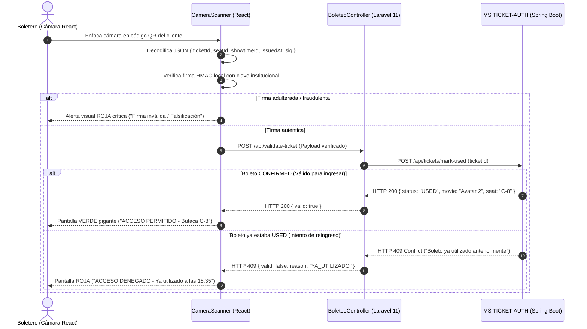

# Plan Técnico: Módulo 05 - Panel de Boleteo y Validación Criptográfica en Puerta (PANEL DE BOLETEO)

> **Estado:** APPROVED  
> **Versión:** 1.0.0  
> **Módulo:** `docs/specs/05-boleteo-validator/`  
> **Especificación Base:** `docs/specs/05-boleteo-validator/spec.md`  
> **Constitución Base:** `docs/constitution.md`  
> **Metodología:** SDD-Planning

---

## 1. Resumen Arquitectónico y Decisiones de Diseño

- **Objetivo Técnico:** Implementar la aplicación de control de acceso físico en Laravel 11 (PHP 8.2+) con React integrado vía Inertia.js, permitiendo la lectura continua de códigos QR por cámara, verificación autónoma de firma HMAC-SHA256 y sincronización del estado del boleto hacia `MS TICKET-AUTH`.
- **Estilo Arquitectónico:** Monolito Fullstack Desacoplado (Laravel 11 + Inertia.js / React):
  - *Backend (Laravel):* Controladores de autenticación (Sanctum/JWT), servicio de verificación criptográfica simétrica (`CryptoValidationService`) y cliente HTTP hacia MS TICKET-AUTH (`TicketAuthClient`).
  - *Frontend (React):* Componente de escáner continuo de cámara (`QrCameraScanner`), validador criptográfico en JavaScript para feedback ultra-rápido en cliente y panel de resultados a pantalla completa (Verde / Rojo).
- **Decisiones Técnicas Clave:**
  - **Doble Verificación Criptográfica (Edge + Backend):** El frontend React calcula primero la firma con la clave institucional para descartar de inmediato QRs inválidos (en menos de 10 ms); si es válida, Laravel confirma el estado del boleto ante MS TICKET-AUTH para evitar fraude.
  - **Manejo de Fallas de Cámara:** Provisión de formulario modal de ingreso manual de código para continuar operando si la cámara del dispositivo se congela o si el cliente tiene la pantalla estrellada.

### 1.1 Matriz de Componentes Técnicos (`PLAN-XX`)

| ID Componente | Nombre / Artefacto Técnico | Capa Arquitectónica | Responsabilidad Técnica | Requisitos que Cubre |
| :--- | :--- | :--- | :--- | :--- |
| **`PLAN-01`** | `2026_11_03_000000_create_scans_table.php` | Persistencia Local | Tabla SQLite/PostgreSQL `access_scans` para auditoría local de escaneos del turno. | `RB-BOL-02` |
| **`PLAN-02`** | `CryptoValidationService` (PHP) / `verifyHmac.ts` (TS) | Dominio / Cripto | Algoritmo HMAC-SHA256 con `clave_secreta_universitaria_mcp`. | `RB-BOL-01`, `SC-05.1.3` |
| **`PLAN-03`** | `ValidateTicketUseCase`, `TicketAuthGateway` | Aplicación / HTTP | Orquestación de validación y comunicación autenticada con MS TICKET-AUTH. | `HU-12`, `RF-12.2`, `RF-12.3` |
| **`PLAN-04`** | `BoleteoController` (Laravel) | Controlador | Endpoints de validación y renderizado de vistas Inertia. | `RF-12.1`, `RF-12.5` |
| **`PLAN-05`** | `ScannerView.tsx`, `CameraReader.tsx`, `ValidationFeedback.tsx` | Presentación (React) | Componente de video HTML5 continuo y pantallas a color Verde/Rojo. | `RF-12.1`, `RF-12.4`, `SC-05.1.1`, `SC-05.1.2` |

---

## 2. Estructura Física de Archivos del Módulo

```text
apps/boleteo-validator/
├── composer.json                                                                     # Laravel 11, Inertia, Pest
├── package.json                                                                      # React 18, @zxing/browser / html5-qrcode, tailwindcss
├── vite.config.js                                                                    # Configuración de Inertia + React
├── routes/
│   └── web.php                                                                       # Rutas protegidas para rol boletero
├── database/
│   └── migrations/
│       └── 2026_11_03_000000_create_access_scans_table.php                           # [CREATE] (PLAN-01) Tabla local de registro de entradas
├── app/
│   ├── Services/
│   │   ├── CryptoValidationService.php                                               # [CREATE] (PLAN-02) HMAC-SHA256 en PHP
│   │   └── TicketAuthClient.php                                                      # [CREATE] (PLAN-03) Cliente HTTP hacia Spring Boot
│   └── Http/Controllers/
│       ├── AuthController.php                                                        # [CREATE] (PLAN-04) Login del boletero
│       └── BoleteoController.php                                                     # [CREATE] (PLAN-04) Endpoints /boleteo y /api/validate-ticket
├── resources/js/
│   ├── Pages/
│   │   ├── Login.tsx                                                                 # [CREATE] (PLAN-05) Login específico de boletero
│   │   └── BoleteoScanner.tsx                                                        # [CREATE] (PLAN-05) Vista principal con cámara y tabla de turnos
│   ├── Components/
│   │   ├── CameraScanner.tsx                                                         # [CREATE] (PLAN-05) Lector continuo de cámara HTML5
│   │   ├── ManualEntryModal.tsx                                                      # [CREATE] (PLAN-05) Casilla para digitación manual
│   │   └── ResultAlertOverlay.tsx                                                    # [CREATE] (PLAN-05) Pantalla gigante Verde / Roja
│   └── Utils/
│       └── cryptoVerifier.ts                                                         # [CREATE] (PLAN-02) HMAC-SHA256 en frontend
├── tests/
│   ├── Feature/TicketValidationTest.php                                              # [CREATE] Test de validación con mock de Auth
│   └── Unit/CryptoVerificationTest.php                                               # [CREATE] Test unitario de firma criptográfica
└── Dockerfile                                                                        # PHP 8.2 FPM + Nginx + Node build
```

---

## 3. Contratos de Código y Flujo Criptográfico

### 3.1 Verificador HMAC-SHA256 en PHP (`CryptoValidationService.php`)
```php
namespace App\Services;

class CryptoValidationService
{
    private const SECRET = 'clave_secreta_universitaria_mcp';

    public function verifySignature(string $ticketId, string $seatId, string $showtimeId, string $issuedAt, string $providedSig): bool
    {
        $payload = "{$ticketId}:{$seatId}:{$showtimeId}:{$issuedAt}";
        $expectedSig = hash_hmac('sha256', $payload, self::SECRET);
        return hash_equals($expectedSig, $providedSig);
    }
}
```

---

## 4. Diagrama de Secuencia de Escaneo en Puerta



---

## 5. Arquitectura de Vertical Slices para `/sdd-task`

* **Slice 0 (Setup):** `PLAN-01`, `PLAN-04` Configuración Laravel 11, Inertia.js, migración de tabla `access_scans` y login.
* **Slice 1 (Criptografía y Cliente HTTP):** `PLAN-02`, `PLAN-03` Servicio de verificación HMAC-SHA256 en PHP y cliente hacia MS TICKET-AUTH.
* **Slice 2 (Escáner de Cámara y Pantallas Verde/Roja):** `PLAN-05` Componente React con lector ZXing, entrada manual y overlay visual de resultado.
* **Slice 3 (Verificación y Cierre):** Pruebas Pest de detección de fraude y build de producción.

