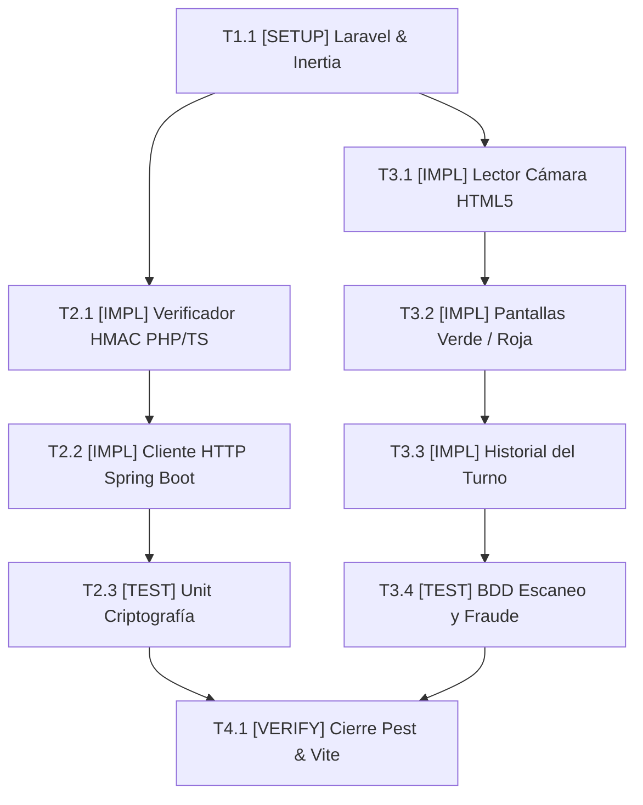

# Tasks: Módulo 05 - Panel de Boleteo y Validación Criptográfica en Puerta (PANEL DE BOLETEO)

## Task Progress

| Métrica | Cantidad |
| :--- | ---: |
| Total de tareas | 8 |
| Tareas realizadas | 0 |
| Tareas por realizar | 8 |
| Tareas bloqueadas | 0 |
| Tareas en progreso | 0 |
| Progreso | 0% |

**Estado:** READY

---

## Checklist Rápido de Tareas por Vertical Slice

### Fase 0: Setup y Estructura Laravel 11
- [ ] `T1.1` `[SETUP]` Configuración de proyecto Laravel 11 + Inertia.js + React y migración de tabla `access_scans` (`PLAN-01`, `PLAN-04`).

### Slice 1: Verificación Criptográfica y Comunicación Inter-Servicio
- [ ] `T2.1` `[IMPL]` Implementar `CryptoValidationService` en PHP y `cryptoVerifier.ts` en TypeScript con HMAC-SHA256 y clave institucional (`PLAN-02`).
- [ ] `T2.2` `[IMPL]` Implementar `TicketAuthClient` para notificar a Spring Boot el pase a estado `USED` (`PLAN-03`, `PLAN-04`).
- [ ] `T2.3` `[TEST]` Suite unitaria de criptografía: validar coincidencia con firmas legítimas y rechazo de payloads alterados (`SC-05.1.3`, `RB-BOL-01`).

### Slice 2: Escáner Continuo por Cámara Web y Pantalla de Resultados
- [ ] `T3.1` `[IMPL]` Construir componente React `CameraScanner` con lectura continua por video HTML5 y modal de digitación manual de emergencia (`PLAN-05`).
- [ ] `T3.2` `[IMPL]` Construir componente `ResultAlertOverlay` con pantalla completa en color Verde (éxito con butaca) y Rojo (fraude o ya usado) (`PLAN-05`).
- [ ] `T3.3` `[IMPL]` Implementar tabla en pantalla con los últimos 20 boletos escaneados durante el turno del boletero (`PLAN-01`, `PLAN-05`).
- [ ] `T3.4` `[TEST]` Suite BDD de validación en acceso: verificar que un boleto confirmado pase a verde y un reingreso dispare la alarma roja (`SC-05.1.1`, `SC-05.1.2`).

### Fase Final: Verificación Consolidada y Cierre
- [ ] `T4.1` `[VERIFY]` Ejecución de pruebas Pest en Laravel, type-check de React y verificación de assets con Vite.

---

## 1. Resumen de Trazabilidad (`Spec` → `Plan` → `Tasks`)

| Requisito / Regla / Escenario (`spec.md`) | Componente Técnico (`plan.md`) | Tareas Asociadas (`tasks.md`) |
| :--- | :--- | :--- |
| `RB-BOL-01`, `SC-05.1.3` | `PLAN-02` | `T2.1`, `T2.3` |
| `RB-BOL-02`, `RB-BOL-04`, `SC-05.1.1` | `PLAN-01`, `PLAN-03`, `PLAN-04` | `T1.1`, `T2.2`, `T3.4` |
| `HU-12`, `RF-12.1`, `RF-12.5` | `PLAN-05` | `T3.1` |
| `RF-12.3`, `RF-12.4`, `SC-05.1.2` | `PLAN-05` | `T3.2`, `T3.3`, `T3.4` |
| Cierre y verificación de calidad | Todos los componentes `PLAN` | `T4.1` |

---

## 2. Grafo de Dependencias de Tareas

---

## 3. Desglose Detallado de Tareas Ejecutables

### Fase 0: Setup y Estructura Laravel 11

#### [ ] T1.1 [SETUP] Configuración de Laravel 11 con Inertia.js y tabla access_scans
* **Status:** PENDING
* **Traceability:** `PLAN-01`, `PLAN-04`
* **Depends on:** —
* **Files:**
  * `[CREATE]` `apps/boleteo-validator/database/migrations/2026_11_03_000000_create_access_scans_table.php`
  * `[CREATE]` `apps/boleteo-validator/routes/web.php`
* **Objective:** Crear la base de datos local y las rutas de autenticación de boleteros.
* **Work:** Configurar Inertia con React 18 y migrar la tabla para auditoría de lecturas de códigos.
* **Done when:** `php artisan migrate` corre limpiamente.
* **Evidence:** `php artisan test`

---

### Slice 1: Verificación Criptográfica y Comunicación Inter-Servicio

#### [ ] T2.1 [IMPL] Implementar CryptoValidationService con HMAC-SHA256
* **Status:** PENDING
* **Traceability:** `PLAN-02` | `RB-BOL-01`
* **Depends on:** `T1.1`
* **Files:**
  * `[CREATE]` `apps/boleteo-validator/app/Services/CryptoValidationService.php`
  * `[CREATE]` `apps/boleteo-validator/resources/js/Utils/cryptoVerifier.ts`
* **Objective:** Validar la firma con `clave_secreta_universitaria_mcp` tanto en backend PHP como en frontend React.
* **Work:** Implementar el cálculo de HMAC-SHA256 y comparación segura con `hash_equals`.
* **Done when:** La función retorna `true` solo si el hash coincide exactamente con el payload.
* **Evidence:** `./vendor/bin/pest tests/Unit/CryptoVerificationTest.php`

#### [ ] T2.2 [IMPL] Implementar TicketAuthClient y endpoint de validación
* **Status:** PENDING
* **Traceability:** `PLAN-03`, `PLAN-04` | `RB-BOL-02`, `RB-BOL-04`
* **Depends on:** `T2.1`
* **Files:**
  * `[CREATE]` `apps/boleteo-validator/app/Services/TicketAuthClient.php`
  * `[CREATE]` `apps/boleteo-validator/app/Http/Controllers/BoleteoController.php`
* **Objective:** Conectar con MS TICKET-AUTH para confirmar el paso del boleto a `USED`.
* **Work:** Programar la llamada HTTP autenticada con JWT para actualizar el boleto en PostgreSQL.
* **Done when:** El controlador responde con los datos de la butaca y película tras confirmar con Spring Boot.
* **Evidence:** `php artisan test --filter=TicketValidationTest`

#### [ ] T2.3 [TEST] Suite unitaria de criptografía y rechazo de firmas falsas
* **Status:** PENDING
* **Traceability:** `SC-05.1.3`
* **Depends on:** `T2.2`
* **Files:**
  * `[CREATE]` `apps/boleteo-validator/tests/Unit/CryptoVerificationTest.php`
* **Objective:** Validar que una firma alterada sea rechazada de forma inmediata sin llamar a la base de datos.
* **Work:** Test unitario con payloads adulterados.
* **Done when:** Todos los tests unitarios pasan en verde.
* **Evidence:** `./vendor/bin/pest`

---

### Slice 2: Escáner Continuo por Cámara Web y Pantalla de Resultados

#### [ ] T3.1 [IMPL] Construir componente CameraScanner con lector continuo y entrada manual
* **Status:** PENDING
* **Traceability:** `PLAN-05` | `RF-12.1`, `RF-12.5`
* **Depends on:** `T1.1`
* **Files:**
  * `[CREATE]` `apps/boleteo-validator/resources/js/Components/CameraScanner.tsx`
  * `[CREATE]` `apps/boleteo-validator/resources/js/Components/ManualEntryModal.tsx`
  * `[CREATE]` `apps/boleteo-validator/resources/js/Pages/BoleteoScanner.tsx`
* **Objective:** Interfaz de cámara continua en vivo y modal para digitación de código en caso de pantalla rota.
* **Work:** Integrar ZXing o html5-qrcode para lectura automática de frames de video y desencadenamiento de validación.
* **Done when:** La cámara decodifica el QR al enfocarlo y despacha la petición al controlador.
* **Evidence:** `npm test CameraScanner.test.tsx`

#### [ ] T3.2 [IMPL] Construir componente ResultAlertOverlay (Pantallas Verde y Roja)
* **Status:** PENDING
* **Traceability:** `PLAN-05` | `RF-12.3`, `RF-12.4`
* **Depends on:** `T3.1`
* **Files:**
  * `[CREATE]` `apps/boleteo-validator/resources/js/Components/ResultAlertOverlay.tsx`
* **Objective:** Notificación visual inmediata a pantalla completa tras cada escaneo.
* **Work:** Crear la vista en verde brillante para éxito (mostrando butaca y película) y rojo parpadeante para rechazo (boleto ya usado o falsificado) durante 2.5 segundos.
* **Done when:** La pantalla se actualiza inmediatamente tras la validación y vuelve a activar la cámara.
* **Evidence:** `npm test ResultAlertOverlay.test.tsx`

#### [ ] T3.3 [IMPL] Implementar tabla de historial de validaciones del turno
* **Status:** PENDING
* **Traceability:** `PLAN-01`, `PLAN-05` | `RB-BOL-02`
* **Depends on:** `T3.2`
* **Files:**
  * `[CREATE]` `apps/boleteo-validator/resources/js/Components/TurnHistoryTable.tsx`
* **Objective:** Mostrar en la parte inferior los últimos 20 escaneos realizados durante la sesión del boletero.
* **Work:** Renderizar tabla con `ticketId`, código de asiento, timestamp y etiqueta de estado (`EXITOSO` / `RECHAZADO`).
* **Done when:** Cada escaneo exitoso o fallido agrega una fila en tiempo real al historial en pantalla.
* **Evidence:** `npm test TurnHistoryTable.test.tsx`

#### [ ] T3.4 [TEST] Suite BDD de validación en acceso físico
* **Status:** PENDING
* **Traceability:** `SC-05.1.1`, `SC-05.1.2`
* **Depends on:** `T3.3`
* **Files:**
  * `[CREATE]` `apps/boleteo-validator/tests/Feature/TicketValidationTest.php`
* **Objective:** Demostrar con pruebas automatizadas el acceso autorizado en verde y el rechazo en rojo ante reingreso.
* **Work:** Test Feature de Laravel simulando escaneos consecutivos.
* **Done when:** El primer intento responde exitoso y el segundo intento con el mismo código es rechazado.
* **Evidence:** `php artisan test --filter=TicketValidationTest`

---

### Fase Final: Verificación Consolidada y Cierre

#### [ ] T4.1 [VERIFY] Verificación completa de boleteo-validator
* **Status:** PENDING
* **Traceability:** Cross-cutting (Cierre de Módulo 05)
* **Depends on:** `T2.3`, `T3.4`
* **Objective:** Ejecutar todas las pruebas Pest, linter Laravel Pint y compilación Vite.
* **Work:** Correr `./vendor/bin/pest && ./vendor/bin/pint --test && npm run build`.
* **Done when:** 100% de pruebas en verde y assets compilados sin errores.
* **Evidence:** `./vendor/bin/pest && npm run build`

---

## 4. Bitácora de Evidencia de Ejecución (`/sdd-execution`)
* *(Pendiente de inicio de `/sdd-execution`)*
