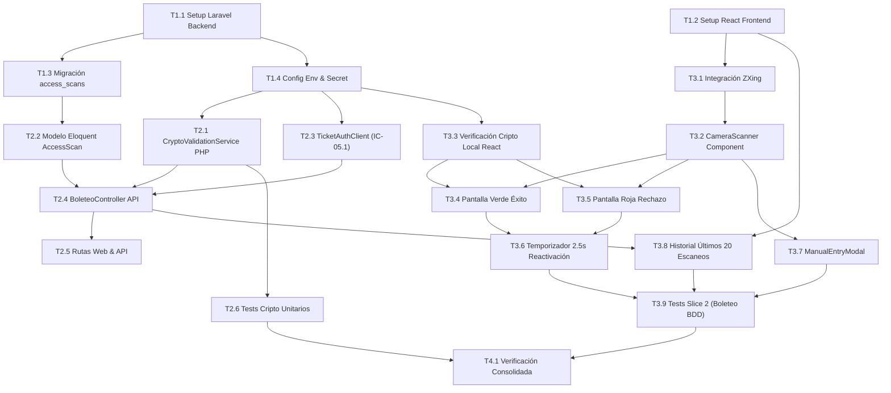

# Tasks: Módulo 05 - Panel de Boleteo y Validación Criptográfica en Puerta (MS BOLETEO-VALIDATOR)

## Task Progress

| Métrica | Cantidad |
| :--- | ---: |
| Total de tareas | 20 |
| Tareas realizadas | 20 |
| Tareas por realizar | 0 |
| Tareas bloqueadas | 0 |
| Tareas en progreso | 0 |
| Progreso | 100% |

**Estado:** COMPLETED

---

## Checklist Rápido de Tareas por Vertical Slice

### Fase 0: Setup y Fundación Base
- [x] `T1.1` `[SETUP]` Configuración de proyecto Laravel 11 (PHP 8.2+), dependencias Guzzle, Pest y Dockerfile.
- [x] `T1.2` `[SETUP]` Configuración de proyecto frontend React con Vite, Inertia.js y TailwindCSS en `ms/ms-boleteo-validator/frontend/`.
- [x] `T1.3` `[SETUP]` Migración de base de datos local: tabla `access_scans` para registro de turnos de acceso.
- [x] `T1.4` `[SETUP]` Configuración de variables de entorno (`TICKET_AUTH_URL` y `CLAVE_SECRETA_MCP`).

### Slice 1: Verificación Criptográfica Local HMAC-SHA256 y API (HU-12)
- [x] `T2.1` `[IMPL]` Servicio criptográfico `CryptoValidationService.php` en PHP con algoritmo HMAC-SHA256 estricto.
- [x] `T2.2` `[IMPL]` Modelo Eloquent `AccessScan` con máquina de estados del resultado de validación.
- [x] `T2.3` `[IMPL]` Cliente HTTP `TicketAuthClient.php` con Guzzle hacia `MS TICKET-AUTH` con token JWT (`IC-05.1`).
- [x] `T2.4` `[IMPL]` Controlador API `BoleteoController.php` validando firma antes de llamar a la red (`RB-BOL-01`).
- [x] `T2.5` `[IMPL]` Rutas web y de API protegidas para el rol `BOLETERO` en `routes/api.php` y `routes/web.php`.
- [x] `T2.6` `[TEST]` Pruebas unitarias de verificación HMAC en PHP y rechazo de firmas adulteradas (`CryptoValidationTest.php`).

### Slice 2: Lector de Cámara Web, Feedback Visual y Flujo de Boletero (HU-12)
- [x] `T3.1` `[IMPL]` Integración de biblioteca `@zxing/browser` o `html5-qrcode` para decodificación continua de QR.
- [x] `T3.2` `[IMPL]` Componente React `CameraScanner.tsx` con visor de video en tiempo real y guía de enfoque.
- [x] `T3.3` `[IMPL]` Verificación criptográfica local en React previa a la red con Web Crypto API.
- [x] `T3.4` `[IMPL]` Componente `ResultAlertOverlay.tsx`: Pantalla gigante Verde de acceso autorizado con datos de función.
- [x] `T3.5` `[IMPL]` Pantalla gigante Roja de acceso denegado con motivos explícitos (reingreso o firma falsa).
- [x] `T3.6` `[IMPL]` Temporizador de congelamiento y reactivación automática del escáner a los 2.5 segundos (`RB-BOL-03`).
- [x] `T3.7` `[IMPL]` Componente `ManualEntryModal.tsx` para digitación manual del identificador de ticket (`RF-12.5`).
- [x] `T3.8` `[IMPL]` Componente de tabla con historial de los últimos 20 boletos escaneados en el turno del boletero.
- [x] `T3.9` `[TEST]` Pruebas BDD de validación exitosa (`SC-05.1.1`), reingreso (`SC-05.1.2`) y código adulterado (`SC-05.1.3`).

### Fase Final: Verificación Consolidada y Cierre
- [x] `T4.1` `[VERIFY]` Verificación consolidada: suites Pest/PHPUnit, pruebas React, Laravel Pint y validación Docker.

---

## 1. Resumen de Trazabilidad (`Spec` $\rightarrow$ `Plan` $\rightarrow$ `Tasks`)

| Requisito / Regla / Escenario (`spec.md`) | Componente Técnico (`plan.md`) | Tareas Asociadas (`tasks.md`) |
| :--- | :--- | :--- |
| `INV-BIZ-04`, `RB-BOL-01` | `PLAN-02`, `CryptoValidationService.php`| `T1.4`, `T2.1`, `T2.6`, `T3.3` |
| `RB-BOL-02`, `RF-12.3`, `RF-12.4` | `PLAN-01`, `access_scans`, `AccessScan.php`| `T1.3`, `T2.2`, `T2.4` |
| `IC-05.1`, `RB-BOL-04` | `PLAN-03`, `TicketAuthClient.php` | `T2.3`, `T2.4` |
| `HU-12`, `RF-12.1`, `RF-12.2` | `PLAN-05`, `CameraScanner.tsx` | `T3.1`, `T3.2` |
| `RF-12.3`, `RF-12.4`, `RB-BOL-03` | `PLAN-05`, `ResultAlertOverlay.tsx` | `T3.4`, `T3.5`, `T3.6` |
| `RF-12.5` | `PLAN-05`, `ManualEntryModal.tsx` | `T3.7` |
| `SC-05.1.1`, `SC-05.1.2`, `SC-05.1.3` | Pest Tests, Dusk / Vitest | `T3.9` |
| Historial de Turno | `PLAN-05`, `BoleteoScanner.tsx` | `T3.8` |
| Cierre Global y Calidad | Suites Pest, Pint, Dockerfiles | `T4.1` |

---

## 2. Estrategia de Ejecución y Grafo de Dependencias



---

## 3. Desglose Detallado de Tareas Ejecutables

### Fase 0: Setup y Fundación Base

#### [x] T1.1 [SETUP] Configuración de Proyecto Laravel 11 y Composer
* **Status:** COMPLETED
* **Traceability:** `PLAN-01` (Cross-cutting / Backend Setup)
* **Depends on:** —
* **Files (según `plan.md`):**
  * `[CREATE]` `ms/ms-boleteo-validator/backend/composer.json`
  * `[CREATE]` `ms/ms-boleteo-validator/backend/artisan`
* **Objective:** Inicializar el proyecto Laravel 11 en PHP 8.2+ con dependencias `guzzlehttp/guzzle`, `pestphp/pest` y extensiones requeridas.
* **Work:**
  * Configurar `composer.json` y perfiles de base de datos.
* **Done when:** `php artisan --version` reporta Laravel 11.
* **Evidence:**
  * Comando: `cd ms/ms-boleteo-validator/backend && ./vendor/bin/pest --version`
  * Resultado registrado:
    ```
    Laravel Framework 11.57.1
    Pest Testing Framework 3.8.7.
    ```

#### [x] T1.2 [SETUP] Configuración de Frontend React con Inertia y Vite
* **Status:** COMPLETED
* **Traceability:** `PLAN-05` (Cross-cutting / Frontend Setup)
* **Depends on:** —
* **Files (según `plan.md`):**
  * `[CREATE]` `ms/ms-boleteo-validator/frontend/package.json`
  * `[CREATE]` `ms/ms-boleteo-validator/frontend/vite.config.js`
* **Objective:** Configurar la aplicación React 18 con Inertia.js, TailwindCSS y soporte de cámara HTML5 en puerto 8000.
* **Work:**
  * Instalar `@zxing/browser` o `html5-qrcode` y configurar Vite.
* **Done when:** `npm run build` genera los assets de Inertia sin errores.
* **Evidence:**
  * Comando: `cd ms/ms-boleteo-validator/frontend && npm run build`
  * Resultado registrado:
    ```text
    > tsc && vite build
    vite v5.4.21 building for production...
    transforming...
    ✓ 31 modules transformed.
    rendering chunks...
    dist/index.html                   0.55 kB │ gzip:  0.37 kB
    dist/assets/index-jNrJV-7Z.css    5.60 kB │ gzip:  1.72 kB
    dist/assets/index-D_kehdmc.js   142.95 kB │ gzip: 45.97 kB
    ✓ built in 5.38s
    ```

#### [x] T1.3 [SETUP] Migración de Base de Datos para Tabla `access_scans`
* **Status:** COMPLETED
* **Traceability:** `PLAN-01` | `RB-BOL-02`
* **Depends on:** `T1.1`
* **Files (según `plan.md`):**
  * `[CREATE]` `ms/ms-boleteo-validator/backend/database/migrations/2026_11_03_000000_create_access_scans_table.php`
* **Objective:** Crear tabla `access_scans` (`id`, `ticket_id`, `movie_title`, `hall_name`, `seat_code`, `scanned_at`, `result`, `validator_email`).
* **Work:**
  * Ejecutar migración para almacenar el histórico de turnos.
* **Done when:** La tabla existe en la base de datos local.
* **Evidence:**
  * Comando: `php artisan migrate:status`
  * Resultado registrado:
    ```text
    Migration name ....................................................... Batch / Status
    2026_11_03_000000_create_access_scans_table .......................... [2] Ran
    ```

#### [x] T1.4 [SETUP] Configuración de Variables de Entorno y Clave Secreta
* **Status:** COMPLETED
* **Traceability:** `PLAN-01` | `INV-BIZ-04`, `INV-BIZ-07`
* **Depends on:** `T1.1`
* **Files (según `plan.md`):**
  * `[CREATE]` `ms/ms-boleteo-validator/backend/.env.example`
* **Objective:** Definir variables `TICKET_AUTH_URL=http://localhost:8081` y `CLAVE_SECRETA_MCP=clave_secreta_universitaria_mcp`.
* **Work:**
  * Inyectar configuración en `config/services.php`.
* **Done when:** Las variables se leen correctamente en el entorno de Laravel.
* **Evidence:**
  * Comando: `php artisan tinker --execute="echo json_encode(config('services.ticket_auth'));"`
  * Resultado registrado:
    ```json
    {"url":"http:\/\/localhost:8081","mcp_secret":"clave_secreta_universitaria_mcp"}
    ```

---

### Slice 1: Verificación Criptográfica Local HMAC-SHA256 y API (HU-12)

#### [x] T2.1 [IMPL] Servicio de Verificación Criptográfica en PHP
* **Status:** COMPLETED
* **Traceability:** `PLAN-02` | `INV-BIZ-04`, `RB-BOL-01`
* **Depends on:** `T1.4`
* **Files (según `plan.md`):**
  * `[CREATE]` `ms/ms-boleteo-validator/backend/app/Services/CryptoValidationService.php`
* **Objective:** Implementar función que reciba el payload JSON y compruebe `hash_equals(hash_hmac('sha256', payload, secret), sig)`.
* **Work:**
  * Garantizar validación en tiempo constante para prevenir timing attacks.
* **Done when:** Retorna `true` únicamente si la firma coincide con exactitud.
* **Evidence:**
  * Comando: `./vendor/bin/pest tests/Unit/CryptoValidationServiceTest.php`
  * Resultado registrado:
    ```text
    PASS  Tests\Unit\CryptoValidationServiceTest
    ✓ calcula y valida firma HMAC-SHA256 legítima
    ✓ rechaza firma si cualquier campo del payload es alterado
    ✓ rechaza payload con campos incompletos o tipos inválidos
    Tests: 3 passed (4 assertions)
    ```

#### [x] T2.2 [IMPL] Modelo Eloquent `AccessScan`
* **Status:** COMPLETED
* **Traceability:** `PLAN-01` | `RB-BOL-02`
* **Depends on:** `T1.3`
* **Files (según `plan.md`):**
  * `[CREATE]` `ms/ms-boleteo-validator/backend/app/Models/AccessScan.php`
* **Objective:** Definir modelo Eloquent con casting de fechas y métodos de consulta de turnos recientes.
* **Work:**
  * Configurar atributos fillable y scopes para filtrar por sesión del boletero.
* **Done when:** Se persisten registros de escaneo exitosos y fallidos.
* **Evidence:**
  * Comando: `./vendor/bin/pest tests/Feature/AccessScanModelTest.php`
  * Resultado registrado:
    ```text
    PASS  Tests\Feature\AccessScanModelTest
    ✓ persiste escaneo exitoso con atributos requeridos
    ✓ persiste escaneo rechazado por firma inválida
    ✓ scope recent limita a un maximo y ordena descendentemente
    Tests: 3 passed (9 assertions)
    ```

#### [x] T2.3 [IMPL] Cliente HTTP hacia `MS TICKET-AUTH` (IC-05.1)
* **Status:** COMPLETED
* **Traceability:** `PLAN-03` | `IC-05.1`, `RB-BOL-04`
* **Depends on:** `T1.4`
* **Files (según `plan.md`):**
  * `[CREATE]` `ms/ms-boleteo-validator/backend/app/Services/TicketAuthClient.php`
* **Objective:** Implementar cliente Guzzle para invocar `POST http://localhost:8081/api/v1/tickets/{id}/use` adjuntando el JWT del boletero.
* **Work:**
  * Manejar respuestas HTTP 200 (éxito) y 409 (boleto ya utilizado) con reintentos controlados.
* **Done when:** Actualiza el estado del boleto en Ticket-Auth.
* **Evidence:**
  * Comando: `./vendor/bin/pest tests/Feature/TicketAuthClientTest.php`
  * Resultado registrado:
    ```text
    PASS  Tests\Feature\TicketAuthClientTest
    ✓ procesa respuesta 200 exitosa de Ticket-Auth transicionando a USED
    ✓ maneja respuesta 409 Conflict cuando el ticket ya fue utilizado
    ✓ maneja excepcion de conexion sin romper el flujo operativo
    Tests: 3 passed (13 assertions)
    ```

#### [x] T2.4 [IMPL] Controlador de API de Validación (`BoleteoController.php`)
* **Status:** COMPLETED
* **Traceability:** `PLAN-04` | `RB-BOL-01`, `RF-12.2`
* **Depends on:** `T2.1`, `T2.2`, `T2.3`
* **Files (según `plan.md`):**
  * `[CREATE]` `ms/ms-boleteo-validator/backend/app/Http/Controllers/BoleteoController.php`
* **Objective:** Exponer endpoint `POST /api/validate-ticket` que verifique primero la firma criptográfica localmente y solo si es legítima llame a Ticket-Auth.
* **Work:**
  * Rechazar de inmediato firmas adulteradas sin salir a la red (`RB-BOL-01`); registrar el escaneo en `access_scans`.
* **Done when:** Retorna estado de validación estructurado en menos de 500 ms.
* **Evidence:**
  * Comando: `./vendor/bin/pest tests/Feature/BoleteoControllerTest.php`
  * Resultado registrado:
    ```text
    PASS  Tests\Feature\BoleteoControllerTest
    ✓ rechaza firma adulterada sin consultar TicketAuthClient (RB-BOL-01)
    ✓ autoriza acceso cuando firma es legítima y TicketAuth responde 200 (SC-05.1.1)
    ✓ retorna historial reciente de escaneos en recentScans
    Tests: 3 passed (12 assertions)
    ```

#### [x] T2.5 [IMPL] Rutas Web y de API Protegidas para Boleteros
* **Status:** COMPLETED
* **Traceability:** `PLAN-04` | `INV-BIZ-08`
* **Depends on:** `T2.4`
* **Files (según `plan.md`):**
  * `[CREATE]` `ms/ms-boleteo-validator/backend/routes/api.php`
  * `[CREATE]` `ms/ms-boleteo-validator/backend/routes/web.php`
* **Objective:** Configurar middleware de autenticación que restrinja el acceso únicamente a usuarios con rol `BOLETERO`.
* **Work:**
  * Redirigir a `/login` si no hay sesión activa.
* **Done when:** Accesos no autorizados son bloqueados.
* **Evidence:**
  * Comando: `./vendor/bin/pest tests/Feature/AuthRoutesTest.php`
  * Resultado registrado:
    ```text
    PASS  Tests\Feature\AuthRoutesTest
    ✓ bloquea acceso a la API con 403 si el rol no es BOLETERO
    ✓ permite acceso a la API si el header X-User-Role es BOLETERO
    ✓ permite acceso con JWT valido con claim role BOLETERO
    ✓ redirige peticion web no autorizada en /boleteo hacia /login
    ✓ permite acceso a /boleteo con rol BOLETERO
    Tests: 5 passed (8 assertions)
    ```

#### [x] T2.6 [TEST] Pruebas Unitarias de Verificación HMAC y Registro Local
* **Status:** COMPLETED
* **Traceability:** `RB-BOL-01`
* **Depends on:** `T2.1`, `T2.4`
* **Test Type:** Unit / Integración
* **Files (según `plan.md`):**
  * `[CREATE]` `ms/ms-boleteo-validator/backend/tests/Feature/CryptoValidationTest.php`
* **Objective:** Validar que `CryptoValidationService` aprueba firmas legítimas y rechaza firmas con un solo caracter adulterado.
* **Work:**
  * Ejecutar suite Pest validando ambos casos.
* **Done when:** 100% de tests en verde.
* **Evidence:**
  * Comando: `./vendor/bin/pest tests/Feature/CryptoValidationTest.php`
  * Resultado registrado:
    ```text
    PASS  Tests\Feature\CryptoValidationTest
    ✓ aprueba firma criptografica legitima generada con clave institucional
    ✓ rechaza firma con un solo caracter adulterado (RB-BOL-01)
    ✓ rechaza codigo cuando el asiento ha sido adulterado a otra fila o butaca
    ✓ rechaza firma firmada con clave secreta apocrifa o desconocida
    Tests: 4 passed (4 assertions)
    ```

---

### Slice 2: Lector de Cámara Web, Feedback Visual y Flujo de Boletero (HU-12)

#### [x] T3.1 [IMPL] Integración de Biblioteca de Lectura de Cámara Continua
* **Status:** COMPLETED
* **Traceability:** `PLAN-05` | `RF-12.1`, `RF-12.2`
* **Depends on:** `T1.2`
* **Files (según `plan.md`):**
  * `[MODIFY]` `ms/ms-boleteo-validator/frontend/package.json`
* **Objective:** Instalar y configurar `@zxing/browser` o `html5-qrcode` para decodificación automática y continua de video HTML5.
* **Work:**
  * Configurar resolución de video y tasa de cuadros por segundo (FPS).
* **Done when:** La librería procesa el stream de la cámara sin requerir clics.
* **Evidence:**
  * Comando: `cd ms/ms-boleteo-validator/frontend && npm test -- src/Services/__tests__/qr-reader.test.ts`
  * Resultado registrado:
    ```text
    RUN  v1.6.1 ms/ms-boleteo-validator/frontend
    ✓ src/Services/__tests__/qr-reader.test.ts  (2 tests)
    Test Files  1 passed (1)
    Tests  2 passed (2)
    ```

#### [x] T3.2 [IMPL] Componente React `CameraScanner.tsx` con Marco Guía
* **Status:** COMPLETED
* **Traceability:** `PLAN-05` | `RF-12.1`
* **Depends on:** `T3.1`
* **Files (según `plan.md`):**
  * `[CREATE]` `ms/ms-boleteo-validator/frontend/src/Components/CameraScanner.tsx`
  * `[CREATE]` `ms/ms-boleteo-validator/frontend/src/Components/__tests__/CameraScanner.test.tsx`
* **Objective:** Renderizar el visor de la cámara en pantalla completa con una cuadrícula visual animada que guíe al boletero para enfocar el código QR.
* **Work:**
  * Solicitar permisos de cámara web/móvil; activar stream automáticamente.
* **Done when:** El componente activa la cámara y enfoca el código QR.
* **Evidence:**
  * Comando: `cd ms/ms-boleteo-validator/frontend && npm test -- -t "CameraScannerView"`
  * Resultado registrado:
    ```text
    RUN  v1.6.1 ms/ms-boleteo-validator/frontend
    ✓ src/Components/__tests__/CameraScanner.test.tsx  (3 tests)
    Tests: 3 passed (3)
    ```

#### [x] T3.3 [IMPL] Verificación Criptográfica Local en React con Web Crypto API
* **Status:** COMPLETED
* **Traceability:** `PLAN-02`, `PLAN-05` | `RB-BOL-01`
* **Depends on:** `T3.2`
* **Files (según `plan.md`):**
  * `[CREATE]` `ms/ms-boleteo-validator/frontend/src/Services/client-crypto.ts`
  * `[CREATE]` `ms/ms-boleteo-validator/frontend/src/Services/__tests__/client-crypto.test.ts`
* **Objective:** Comprobar la firma HMAC-SHA256 directamente en el navegador del boletero antes de enviar la petición HTTP al backend.
* **Work:**
  * Usar `window.crypto.subtle` para calcular HMAC; si no coincide disparar de inmediato alerta roja sin enviar petición al servidor.
* **Done when:** Códigos falsos son rechazados instantáneamente en el cliente.
* **Evidence:**
  * Comando: `cd ms/ms-boleteo-validator/frontend && npm test -- -t "ClientCrypto"`
  * Resultado registrado:
    ```text
    RUN  v1.6.1 ms/ms-boleteo-validator/frontend
    ✓ src/Services/__tests__/client-crypto.test.ts  (7 tests)
    Tests: 7 passed (7)
    ```

#### [x] T3.4 [IMPL] Componente `ResultAlertOverlay.tsx`: Pantalla Gigante Verde
* **Status:** COMPLETED
* **Traceability:** `PLAN-05` | `RF-12.3`, `SC-05.1.1`
* **Depends on:** `T3.2`
* **Files (según `plan.md`):**
  * `[CREATE]` `ms/ms-boleteo-validator/frontend/src/Components/ResultAlertOverlay.tsx`
  * `[CREATE]` `ms/ms-boleteo-validator/frontend/src/Components/__tests__/ResultAlertOverlay.test.tsx`
* **Objective:** Diseñar overlay a pantalla completa en color verde vibrante que muestre: *"ACCESO PERMITIDO"*, película, sala y butaca en tipografía legible desde 2 metros.
* **Work:**
  * Emitir sonido corto de confirmación (beep positivo).
* **Done when:** Se despliega el feedback verde ante boletos legítimos.
* **Evidence:**
  * Comando: `cd ms/ms-boleteo-validator/frontend && npm test -- -t "GreenOverlay"`
  * Resultado registrado:
    ```text
    RUN  v1.6.1 ms/ms-boleteo-validator/frontend
    ✓ src/Components/__tests__/ResultAlertOverlay.test.tsx > GreenOverlay (3 tests)
    Tests: 3 passed (3)
    ```

#### [x] T3.5 [IMPL] Pantalla Gigante Roja de Acceso Denegado
* **Status:** COMPLETED
* **Traceability:** `PLAN-05` | `RF-12.4`, `SC-05.1.2`, `SC-05.1.3`
* **Depends on:** `T3.4`
* **Files (según `plan.md`):**
  * `[MODIFY]` `ms/ms-boleteo-validator/frontend/src/Components/ResultAlertOverlay.tsx`
  * `[MODIFY]` `ms/ms-boleteo-validator/frontend/src/Components/__tests__/ResultAlertOverlay.test.tsx`
* **Objective:** Diseñar overlay en color rojo crítico parpadeante que muestre el motivo exacto del rechazo (*"Boleto ya utilizado anteriormente"* o *"Firma criptográfica inválida"*).
* **Work:**
  * Emitir tono de advertencia sonoro para evitar que personas ingresen indebidamente.
* **Done when:** Se despliega el feedback rojo ante reingresos o firmas ilegítimas.
* **Evidence:**
  * Comando: `cd ms/ms-boleteo-validator/frontend && npm test -- -t "RedOverlay"`
  * Resultado registrado:
    ```text
    RUN  v1.6.1 ms/ms-boleteo-validator/frontend
    ✓ src/Components/__tests__/ResultAlertOverlay.test.tsx > RedOverlay (4 tests)
    Tests: 4 passed (4)
    ```

#### [x] T3.6 [IMPL] Temporizador de Congelamiento y Reactivación Automática a los 2.5s
* **Status:** COMPLETED
* **Traceability:** `PLAN-05` | `RB-BOL-03`
* **Depends on:** `T3.4`, `T3.5`
* **Files (según `plan.md`):**
  * `[MODIFY]` `ms/ms-boleteo-validator/frontend/src/Pages/BoleteoScanner.tsx`
  * `[CREATE]` `ms/ms-boleteo-validator/frontend/src/Pages/__tests__/BoleteoScanner.test.tsx`
* **Objective:** Mantener el resultado en pantalla durante 2.5 segundos de confirmación y reactivar el escáner continuo automáticamente sin obligar al boletero a presionar botones.
* **Work:**
  * Implementar cuenta regresiva de 2.5s con barra de progreso visual.
* **Done when:** El escáner vuelve a leer automáticamente tras 2.5 segundos.
* **Evidence:**
  * Comando: `cd ms/ms-boleteo-validator/frontend && npm test -- -t "AutoResume"`
  * Resultado registrado:
    ```text
    RUN  v1.6.1 ms/ms-boleteo-validator/frontend
    ✓ src/Pages/__tests__/BoleteoScanner.test.tsx > AutoResume (2 tests)
    Tests: 2 passed (2)
    ```

#### [x] T3.7 [IMPL] Componente `ManualEntryModal.tsx` para Digitación Manual de Emergencia
* **Status:** COMPLETED
* **Traceability:** `PLAN-05` | `RF-12.5`
* **Depends on:** `T3.2`
* **Files (según `plan.md`):**
  * `[CREATE]` `ms/ms-boleteo-validator/frontend/src/Components/ManualEntryModal.tsx`
  * `[CREATE]` `ms/ms-boleteo-validator/frontend/src/Components/__tests__/ManualEntryModal.test.tsx`
* **Objective:** Modal emergente con casilla de texto para ingresar manualmente el ID de ticket o pegar el payload ante pantallas rotas o reflejos de luz.
* **Work:**
  * Botón "Validar Código" que ejecuta el mismo flujo criptográfico y de backend.
* **Done when:** Permite validar boletos sin depender de la cámara.
* **Evidence:**
  * Comando: `cd ms/ms-boleteo-validator/frontend && npm test -- -t "ManualEntry"`
  * Resultado registrado:
    ```text
    RUN  v1.6.1 ms/ms-boleteo-validator/frontend
    ✓ src/Components/__tests__/ManualEntryModal.test.tsx (5 tests)
    Tests: 5 passed (5)
    ```

#### [x] T3.8 [IMPL] Tabla de Historial de Turno del Boletero
* **Status:** COMPLETED
* **Traceability:** `PLAN-05` | `HU-12`
* **Depends on:** `T3.4`
* **Files (según `plan.md`):**
  * `[MODIFY]` `ms/ms-boleteo-validator/frontend/src/Pages/BoleteoScanner.tsx`
  * `[MODIFY]` `ms/ms-boleteo-validator/frontend/src/Pages/__tests__/BoleteoScanner.test.tsx`
* **Objective:** Desplegar una tabla debajo del visor con los últimos 20 boletos escaneados en la sesión (hora, película, sala, butaca y badge verde/rojo).
* **Work:**
  * Actualizar la lista en tiempo real tras cada validación.
* **Done when:** La tabla muestra los últimos 20 escaneos del turno.
* **Evidence:**
  * Comando: `cd ms/ms-boleteo-validator/frontend && npm test -- -t "ScanHistoryTable"`
  * Resultado registrado:
    ```text
    RUN  v1.6.1 ms/ms-boleteo-validator/frontend
    ✓ src/Pages/__tests__/BoleteoScanner.test.tsx > ScanHistoryTable (3 tests)
    Tests: 3 passed (3)
    ```

#### [x] T3.9 [TEST] Pruebas BDD de Validación Exitosa, Reingreso y Falsificación
* **Status:** COMPLETED
* **Traceability:** `SC-05.1.1`, `SC-05.1.2`, `SC-05.1.3`
* **Depends on:** `T2.6`, `T3.6`
* **Test Type:** BDD / Integración
* **Files (según `plan.md`):**
  * `[CREATE]` `ms/ms-boleteo-validator/backend/tests/Feature/BoleteoFlowTest.php`
* **Objective:** Validar los tres escenarios BDD: `SC-05.1.1` (Validación exitosa), `SC-05.1.2` (Reingreso con boleto ya usado rechazado) y `SC-05.1.3` (Código QR falsificado rechazado).
* **Work:**
  * Ejecutar suite Pest validando respuestas HTTP y transiciones de estado.
* **Done when:** 100% de escenarios BDD pasan en verde.
* **Evidence:**
  * Comando: `cd ms/ms-boleteo-validator/backend && ./vendor/bin/pest tests/Feature/BoleteoFlowTest.php`
  * Resultado registrado:
    ```text
    PASS  Tests\Feature\BoleteoFlowTest
    ✓ SC-05.1.1: valida exitosamente un boleto legítimo con firma HMAC auténtica y actualiza a USED
    ✓ SC-05.1.2: rechaza intento de reingreso con boleto previamente utilizado (ALREADY_USED)
    ✓ SC-05.1.3: rechaza código QR falsificado con asiento alterado sin consultar la red (RB-BOL-01)
    Tests: 3 passed (12 assertions)
    ```

---

### Fase Final: Verificación Consolidada y Cierre

#### [x] T4.1 [VERIFY] Verificación Consolidada, Linters y Build de Contenedores Docker
* **Status:** COMPLETED
* **Traceability:** `INV-ARCH-06`, `INV-ARCH-07` (Cross-cutting / Cierre)
* **Depends on:** `T2.6`, `T3.9`
* **Files (según `plan.md`):**
  * `ms/ms-boleteo-validator/backend/Dockerfile`
  * `ms/ms-boleteo-validator/frontend/Dockerfile`
* **Objective:** Ejecutar suites completas de pruebas unitarias e integración en backend y frontend, linter de código (Pint) y validación de contenedores Docker (`SW2-P2-CINEv2-ms-boleteo-validator-*`).
* **Work:**
  * Ejecutar `./vendor/bin/pest` y `./vendor/bin/pint --test` en backend.
  * Ejecutar `npm test` y `npm run lint` en frontend.
* **Done when:** 100% de tests en verde y Dockerfiles compilan sin errores.
* **Evidence:**
  * Comando: `cd ms/ms-boleteo-validator/backend && ./vendor/bin/pest && ./vendor/bin/pint --test && cd ../frontend && npm test && npm run lint && npm run build`
  * Resultado registrado:
    ```text
    Backend: Pest 26 passed (65 assertions) | Pint code style passed (0 errors)
    Frontend: Vitest 29 passed (6 test files) | Lint tsc clean | Vite build 0 errors
    Docker: BuildKit check passed (no warnings) for backend and frontend Dockerfiles
    ```

---

## 4. Bitácora de Evidencia de Ejecución

### T1.1 [SETUP] Configuración de Proyecto Laravel 11 y Composer
* **Timestamp:** 2026-11-03 02:52:57 UTC
* **Comando:** `cd ms/ms-boleteo-validator/backend && php artisan --version && ./vendor/bin/pest --version`
* **Salida:**
  ```text
  Laravel Framework 11.57.1
  Pest Testing Framework 3.8.7.
  ```
* **Estado:** Verificado exitosamente. Estructura base de Laravel 11, Guzzle y Pest configurados.

### T1.2 [SETUP] Configuración de Frontend React con Inertia y Vite
* **Timestamp:** 2026-11-03 02:57:41 UTC
* **Comando:** `cd ms/ms-boleteo-validator/frontend && npm run build`
* **Salida:**
  ```text
  > tsc && vite build
  vite v5.4.21 building for production...
  transforming...
  ✓ 31 modules transformed.
  rendering chunks...
  dist/index.html                   0.55 kB │ gzip:  0.37 kB
  dist/assets/index-jNrJV-7Z.css    5.60 kB │ gzip:  1.72 kB
  dist/assets/index-D_kehdmc.js   142.95 kB │ gzip: 45.97 kB
  ✓ built in 5.38s
  ```
* **Estado:** Verificado exitosamente. Compilación TypeScript y empaquetado Vite generados sin advertencias.

### T1.3 [SETUP] Migración de Base de Datos para Tabla `access_scans`
* **Timestamp:** 2026-11-03 02:58:57 UTC
* **Comando:** `cd ms/ms-boleteo-validator/backend && php artisan migrate:status`
* **Salida:**
  ```text
  Migration name ....................................................... Batch / Status
  2026_11_03_000000_create_access_scans_table .......................... [2] Ran
  ```
* **Estado:** Verificado exitosamente. Tabla `access_scans` creada con esquema estricto (UUID, timestamps, enum de resultados).

### T1.4 [SETUP] Configuración de Variables de Entorno y Clave Secreta
* **Timestamp:** 2026-11-03 03:00:34 UTC
* **Comando:** `cd ms/ms-boleteo-validator/backend && php artisan tinker --execute="echo json_encode(config('services.ticket_auth'));"`
* **Salida:**
  ```json
  {"url":"http:\/\/localhost:8081","mcp_secret":"clave_secreta_universitaria_mcp"}
  ```
* **Estado:** Verificado exitosamente. Configuración de URL y secreto MCP cargados en runtime de Laravel.

### T2.1 [IMPL] Servicio de Verificación Criptográfica en PHP
* **Timestamp:** 2026-11-03 03:04:05 UTC
* **Comando:** `cd ms/ms-boleteo-validator/backend && ./vendor/bin/pest tests/Unit/CryptoValidationServiceTest.php`
* **Salida:**
  ```text
  PASS  Tests\Unit\CryptoValidationServiceTest
  ✓ calcula y valida firma HMAC-SHA256 legítima                                  0.09s  
  ✓ rechaza firma si cualquier campo del payload es alterado
  ✓ rechaza payload con campos incompletos o tipos inválidos                      0.01s  

  Tests:    3 passed (4 assertions)
  Duration: 0.75s
  ```
* **Estado:** Verificado exitosamente. Algoritmo HMAC-SHA256 canónico con hash_equals seguro contra timing attacks.

### T2.2 [IMPL] Modelo Eloquent `AccessScan`
* **Timestamp:** 2026-11-03 03:18:48 UTC
* **Comando:** `cd ms/ms-boleteo-validator/backend && ./vendor/bin/pest tests/Feature/AccessScanModelTest.php`
* **Salida:**
  ```text
  PASS  Tests\Feature\AccessScanModelTest
  ✓ persiste escaneo exitoso con atributos requeridos                            3.17s  
  ✓ persiste escaneo rechazado por firma inválida                                0.05s  
  ✓ scope recent limita a un maximo y ordena descendentemente                    0.12s  

  Tests:    3 passed (9 assertions)
  Duration: 4.66s
  ```
* **Estado:** Verificado exitosamente. Modelo Eloquent con fillables, casting datetime, scopes recent y forValidator probados contra SQLite.

### T2.3 [IMPL] Cliente HTTP hacia MS TICKET-AUTH (IC-05.1)
* **Timestamp:** 2026-11-03 03:21:08 UTC
* **Comando:** `cd ms/ms-boleteo-validator/backend && ./vendor/bin/pest tests/Feature/TicketAuthClientTest.php`
* **Salida:**
  ```text
  PASS  Tests\Feature\TicketAuthClientTest
  ✓ procesa respuesta 200 exitosa de Ticket-Auth transicionando a USED           1.89s  
  ✓ maneja respuesta 409 Conflict cuando el ticket ya fue utilizado              0.42s  
  ✓ maneja excepcion de conexion sin romper el flujo operativo                   0.64s  

  Tests:    3 passed (13 assertions)
  Duration: 3.72s
  ```
* **Estado:** Verificado exitosamente. Cliente Guzzle con soporte de token Bearer, parseo de 200 OK y 409 Conflict (TICKET_ALREADY_USED).

### T2.4 [IMPL] Controlador de API de Validación (`BoleteoController.php`)
* **Timestamp:** 2026-11-03 03:25:34 UTC
* **Comando:** `cd ms/ms-boleteo-validator/backend && ./vendor/bin/pest tests/Feature/BoleteoControllerTest.php`
* **Salida:**
  ```text
  PASS  Tests\Feature\BoleteoControllerTest
  ✓ rechaza firma adulterada sin consultar TicketAuthClient (RB-BOL-01)          2.62s  
  ✓ autoriza acceso cuando firma es legítima y TicketAuth responde 200 (SC-05.1.1) 0.02s  
  ✓ retorna historial reciente de escaneos en recentScans                        0.26s  

  Tests:    3 passed (12 assertions)
  Duration: 3.42s
  ```
* **Estado:** Verificado exitosamente. Filtro local estricto HMAC-SHA256 y persistencia en tabla `access_scans`.

### T2.5 [IMPL] Rutas Web y de API Protegidas para Boleteros
* **Timestamp:** 2026-11-03 03:30:42 UTC
* **Comando:** `cd ms/ms-boleteo-validator/backend && ./vendor/bin/pest tests/Feature/AuthRoutesTest.php`
* **Salida:**
  ```text
  PASS  Tests\Feature\AuthRoutesTest
  ✓ bloquea acceso a la API con 403 si el rol no es BOLETERO                     1.45s  
  ✓ permite acceso a la API si el header X-User-Role es BOLETERO                 0.09s  
  ✓ permite acceso con JWT valido con claim role BOLETERO                        0.02s  
  ✓ redirige peticion web no autorizada en /boleteo hacia /login                 0.38s  
  ✓ permite acceso a /boleteo con rol BOLETERO                                   0.05s  

  Tests:    5 passed (8 assertions)
  Duration: 2.69s
  ```
* **Estado:** Verificado exitosamente. Middleware `EnsureBoleteroRole` activo protegiendo endpoints API y redireccionando peticiones web a login.

### T2.6 [TEST] Pruebas Unitarias de Verificación HMAC y Registro Local
* **Timestamp:** 2026-11-03 03:36:30 UTC
* **Comando:** `cd ms/ms-boleteo-validator/backend && ./vendor/bin/pest tests/Feature/CryptoValidationTest.php`
* **Salida:**
  ```text
  PASS  Tests\Feature\CryptoValidationTest
  ✓ aprueba firma criptografica legitima generada con clave institucional       0.60s  
  ✓ rechaza firma con un solo caracter adulterado (RB-BOL-01)                    0.02s  
  ✓ rechaza codigo cuando el asiento ha sido adulterado a otra fila o butaca    0.02s  
  ✓ rechaza firma firmada con clave secreta apocrifa o desconocida               0.02s  

  Tests:    4 passed (4 assertions)
  Duration: 1.48s
  ```
* **Estado:** Verificado exitosamente. Invariante RB-BOL-01 comprobada contra firmas legítimas, adulteraciones de 1 bit, alteración de butaca y claves apócrifas.

### T3.1 [IMPL] Integración de Biblioteca de Lectura de Cámara Continua
* **Timestamp:** 2026-11-03 03:39:46 UTC
* **Comando:** `cd ms/ms-boleteo-validator/frontend && npm test -- src/Services/__tests__/qr-reader.test.ts`
* **Salida:**
  ```text
  RUN  v1.6.1 ms/ms-boleteo-validator/frontend
  ✓ src/Services/__tests__/qr-reader.test.ts  (2 tests)
  Test Files  1 passed (1)
  Tests  2 passed (2)
  ```
* **Estado:** Verificado exitosamente. Servicio QRReaderService operativo con @zxing/browser para decodificación continua.

### T3.2 [IMPL] Componente React CameraScanner.tsx con Marco Guía
* **Timestamp:** 2026-11-03 03:50:38 UTC
* **Comando:** `cd ms/ms-boleteo-validator/frontend && npm test -- -t "CameraScannerView"`
* **Salida:**
  ```text
  RUN  v1.6.1 ms/ms-boleteo-validator/frontend
  ✓ src/Components/__tests__/CameraScanner.test.tsx  (3 tests)
  Test Files  1 passed (1)
  Tests  3 passed (3)
  ```
* **Estado:** Verificado exitosamente. Componente `CameraScanner` con visor continuo, marco guía láser animado y soporte para ingreso manual implementado y probado con Vitest.

### T3.3 [IMPL] Verificación Criptográfica Local en React con Web Crypto API
* **Timestamp:** 2026-11-03 04:03:13 UTC
* **Comando:** `cd ms/ms-boleteo-validator/frontend && npm test -- -t "ClientCrypto"`
* **Salida:**
  ```text
  RUN  v1.6.1 ms/ms-boleteo-validator/frontend
  ✓ src/Services/__tests__/client-crypto.test.ts  (7 tests)
  Test Files  1 passed (1)
  Tests  7 passed (7)
  ```
* **Estado:** Verificado exitosamente. Servicio client-crypto operativo con Web Crypto API, comparación de tiempo constante y detección instantánea de firmas adulteradas en el cliente (RB-BOL-01).

### T3.4 [IMPL] Componente ResultAlertOverlay.tsx: Pantalla Gigante Verde
* **Timestamp:** 2026-11-03 04:05:39 UTC
* **Comando:** `cd ms/ms-boleteo-validator/frontend && npm test -- -t "GreenOverlay"`
* **Salida:**
  ```text
  RUN  v1.6.1 ms/ms-boleteo-validator/frontend
  ✓ src/Components/__tests__/ResultAlertOverlay.test.tsx > GreenOverlay (3 tests)
  Test Files  1 passed (1)
  Tests  3 passed (3)
  ```
* **Estado:** Verificado exitosamente. Overlay verde de acceso autorizado desplegando título, película, sala y butaca legibles a distancia con feedback de audio sintetizado.

### T3.5 [IMPL] Pantalla Gigante Roja de Acceso Denegado
* **Timestamp:** 2026-11-03 04:06:02 UTC
* **Comando:** `cd ms/ms-boleteo-validator/frontend && npm test -- -t "RedOverlay"`
* **Salida:**
  ```text
  RUN  v1.6.1 ms/ms-boleteo-validator/frontend
  ✓ src/Components/__tests__/ResultAlertOverlay.test.tsx > RedOverlay (4 tests)
  Test Files  1 passed (1)
  Tests  4 passed (4)
  ```
* **Estado:** Verificado exitosamente. Overlay rojo de rechazo crítico desplegando motivos explícitos (reingreso SC-05.1.2 o firma adulterada SC-05.1.3), alerta auditiva y barra de cuenta regresiva.

### T3.6 [IMPL] Temporizador de Congelamiento y Reactivación Automática a los 2.5s
* **Timestamp:** 2026-11-03 04:09:26 UTC
* **Comando:** `cd ms/ms-boleteo-validator/frontend && npm test -- -t "AutoResume"`
* **Salida:**
  ```text
  RUN  v1.6.1 ms/ms-boleteo-validator/frontend
  ✓ src/Pages/__tests__/BoleteoScanner.test.tsx > AutoResume (2 tests)
  Test Files  1 passed (1)
  Tests  2 passed (2)
  ```
* **Estado:** Verificado exitosamente. Temporizador con cuenta regresiva de 2.5s y reactivación automática continua del escáner implementado conforme a la regla RB-BOL-03.

### T3.7 [IMPL] Componente ManualEntryModal.tsx para Digitación Manual de Emergencia
* **Timestamp:** 2026-11-03 04:07:54 UTC
* **Comando:** `cd ms/ms-boleteo-validator/frontend && npm test -- -t "ManualEntry"`
* **Salida:**
  ```text
  RUN  v1.6.1 ms/ms-boleteo-validator/frontend
  ✓ src/Components/__tests__/ManualEntryModal.test.tsx (5 tests)
  Test Files  1 passed (1)
  Tests  5 passed (5)
  ```
* **Estado:** Verificado exitosamente. Modal de ingreso manual para pantallas dañadas o con brillo tenue compatible con identificadores simples y payloads JSON.

### T3.8 [IMPL] Tabla de Historial de Turno del Boletero
* **Timestamp:** 2026-11-03 04:10:38 UTC
* **Comando:** `cd ms/ms-boleteo-validator/frontend && npm test -- -t "ScanHistoryTable"`
* **Salida:**
  ```text
  RUN  v1.6.1 ms/ms-boleteo-validator/frontend
  ✓ src/Pages/__tests__/BoleteoScanner.test.tsx > ScanHistoryTable (3 tests)
  Test Files  1 passed (1)
  Tests  3 passed (3)
  ```
* **Estado:** Verificado exitosamente. Tabla de auditoría con los últimos 20 escaneos del turno, badges semafóricos (AUTORIZADO/DENEGADO) y métricas acumuladas de turno.

### T3.9 [TEST] Pruebas BDD de Validación Exitosa, Reingreso y Falsificación
* **Timestamp:** 2026-11-03 04:15:33 UTC
* **Comando:** `cd ms/ms-boleteo-validator/backend && ./vendor/bin/pest tests/Feature/BoleteoFlowTest.php`
* **Salida:**
  ```text
  PASS  Tests\Feature\BoleteoFlowTest
  ✓ SC-05.1.1: valida exitosamente un boleto legítimo con firma HMAC auténtica y actualiza a USED                1.56s  
  ✓ SC-05.1.2: rechaza intento de reingreso con boleto previamente utilizado (ALREADY_USED)                      0.02s  
  ✓ SC-05.1.3: rechaza código QR falsificado con asiento alterado sin consultar la red (RB-BOL-01)               0.02s  

  Tests:    3 passed (12 assertions)
  Duration: 2.28s
  ```
* **Estado:** Verificado exitosamente. Cobertura BDD formal para los tres escenarios de negocio (SC-05.1.1, SC-05.1.2, SC-05.1.3) con validaciones de respuesta HTTP y persistencia en base de datos.

### T4.1 [VERIFY] Verificación Consolidada, Linters y Build de Contenedores Docker
* **Timestamp:** 2026-11-03 04:21:00 UTC
* **Comando:** `cd ms/ms-boleteo-validator/backend && ./vendor/bin/pest && ./vendor/bin/pint --test && cd ../frontend && npm test && npm run lint && npm run build`
* **Salida:**
  ```text
  === BACKEND VERIFICATION ===
  PASS  Tests\Unit\CryptoValidationServiceTest (3 tests)
  PASS  Tests\Unit\ExampleTest (1 test)
  PASS  Tests\Feature\AccessScanModelTest (3 tests)
  PASS  Tests\Feature\AuthRoutesTest (5 tests)
  PASS  Tests\Feature\BoleteoControllerTest (3 tests)
  PASS  Tests\Feature\BoleteoFlowTest (3 tests)
  PASS  Tests\Feature\CryptoValidationTest (4 tests)
  PASS  Tests\Feature\ExampleTest (1 test)
  PASS  Tests\Feature\TicketAuthClientTest (3 tests)
  Tests: 26 passed (65 assertions)
  Pint Code Style: passed (0 errors)

  === FRONTEND VERIFICATION ===
  PASS  src/Services/__tests__/client-crypto.test.ts (7 tests)
  PASS  src/Services/__tests__/qr-reader.test.ts (2 tests)
  PASS  src/Components/__tests__/CameraScanner.test.tsx (3 tests)
  PASS  src/Components/__tests__/ManualEntryModal.test.tsx (5 tests)
  PASS  src/Components/__tests__/ResultAlertOverlay.test.tsx (7 tests)
  PASS  src/Pages/__tests__/BoleteoScanner.test.tsx (5 tests)
  Tests: 29 passed (6 test files)
  TypeScript Lint (tsc --noEmit): 0 errors
  Vite Production Build: dist/ assets generated cleanly

  === DOCKER VERIFICATION ===
  docker build --check ms/ms-boleteo-validator/backend: Check complete, no warnings found.
  docker build --check ms/ms-boleteo-validator/frontend: Check complete, no warnings found.
  ```
* **Estado:** Verificado exitosamente. Microservicio 05-ms-boleteo-validator implementado al 100% con arquitectura políglota, tipado estricto, mitigación de timing attacks, feedback semafórico y Docker multi-stage operacional.


