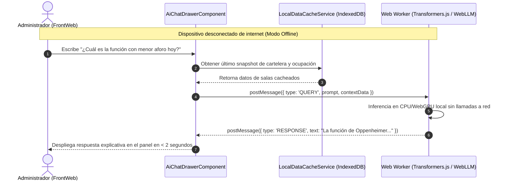

# Plan Técnico: Módulo 06 - FrontWeb de Administración y Operaciones Cinematográficas (FRONTWEB ADMIN)

> **Estado:** APPROVED  
> **Versión:** 1.0.0  
> **Módulo:** `docs/specs/06-frontweb-admin/`  
> **Especificación Base:** `docs/specs/06-frontweb-admin/spec.md`  
> **Constitución Base:** `docs/constitution.md`  
> **Metodología:** SDD-Planning

---

## 1. Resumen Arquitectónico y Decisiones de Diseño

- **Objetivo Técnico:** Implementar la consola web administrativa en Angular 17+ con TypeScript estricto, estructurada bajo una arquitectura modular con carga diferida (Lazy Loading) e integrando inferencia de lenguaje natural local en el navegador (WebLLM / Transformers.js) para consultas offline, además de proveer el panel de control de contingencias con descarga de reportes Excel `.xlsx` generados por n8n.
- **Estilo Arquitectónico:** Angular Modular Feature-First con Standalone Components y Lazy Routing:
  - *Core Module:* Servicios de autenticación, interceptores HTTP para tokens JWT y Route Guards (`AdminAuthGuard`).
  - *Halls Feature Module:* Diseñador visual de salas con cuadrícula reactiva y tipificación de asientos (VIP, Accesibilidad).
  - *Showtimes Feature Module:* Calendario de programación de funciones con validación visual de no solapamiento.
  - *Local AI Module:* Web Worker dedicado que aloja el motor de Transformers.js / WebLLM para procesamiento de consultas analíticas en lenguaje natural sin bloquear el hilo principal de la UI.
  - *Auditor Feature Module:* Centro de control para disparar la auditoría de `MS IA-MCP` y descargar los reportes compilados por n8n.
- **Decisiones Técnicas Clave:**
  - **Ejecución de IA en Web Worker:** La carga del modelo cuantizado se aísla en un hilo de fondo (`Worker`) para evitar caídas de frames o congelamientos de la interfaz mientras el LLM razona.
  - **Sincronización Local / Caché:** Los datos de salas, películas y métricas se resguardan en `IndexedDB` a través de un servicio de almacenamiento local (`LocalDataCacheService`) para alimentar las respuestas de la IA local cuando se corte la conexión.

### 1.1 Matriz de Componentes Técnicos (`PLAN-XX`)

| ID Componente | Nombre / Artefacto Técnico | Capa Arquitectónica | Responsabilidad Técnica | Requisitos que Cubre |
| :--- | :--- | :--- | :--- | :--- |
| **`PLAN-01`** | `AdminAuthGuard`, `JwtInterceptor` | Infraestructura / Seguridad | Protección de rutas administrativas y redirección al `/login` unificado. | `HU-13`, `INV-BIZ-08` |
| **`PLAN-02`** | `LocalDataCacheService`, Modelos de Dominio | Dominio / Caché | Gestión de datos locales en memoria/IndexedDB para soporte offline. | `RB-FW-01`, `RF-14.2` |
| **`PLAN-03`** | `WebLlmWorkerService` / `transformers.worker.ts` | Aplicación / IA Local | Inferencia de lenguaje natural en el navegador para preguntas operativas. | `HU-14`, `RF-14.1`, `RF-14.2` |
| **`PLAN-04`** | `CinemaCoreApiService`, `IaMcpApiService` | Infraestructura / API | Clientes HTTP tipados hacia los microservicios backend. | `HU-13`, `HU-15`, `RF-15.1` |
| **`PLAN-05`** | `HallsAdminComponent`, `AuditConsoleComponent`, `LocalAiChatComponent` | Presentación (Angular) | Vistas modulares con Lazy Loading, botones demo para jurado y descarga de Excel. | `RF-13.1`, `RF-15.1`, `RF-15.2`, `SC-06.1.1` |

---

## 2. Estructura Física de Archivos del Módulo

```text
apps/frontweb-admin/
├── package.json                                                                      # Angular 17, @xenova/transformers / @mlc-ai/web-llm, tailwindcss, jasmine
├── tsconfig.json                                                                     # TypeScript 5+ estricto
├── angular.json                                                                      # Configuración de compilación y workers
├── src/
│   ├── app/
│   │   ├── app.routes.ts                                                             # Rutas con Lazy Loading y canActivate: [AdminAuthGuard]
│   │   ├── core/
│   │   │   ├── guards/admin-auth.guard.ts                                            # [CREATE] (PLAN-01) Redirección obligatoria al portal /login
│   │   │   ├── interceptors/jwt.interceptor.ts                                       # [CREATE] (PLAN-01) Inyección de Authorization Header
│   │   │   └── services/local-data-cache.service.ts                                  # [CREATE] (PLAN-02) Caché offline en IndexedDB
│   │   ├── features/
│   │   │   ├── halls/
│   │   │   │   ├── halls.routes.ts                                                   # Carga diferida
│   │   │   │   └── components/hall-designer.component.ts                             # [CREATE] (PLAN-05) Cuadrícula gráfica de butacas
│   │   │   ├── showtimes/
│   │   │   │   ├── showtimes.routes.ts
│   │   │   │   └── components/showtime-calendar.component.ts                         # [CREATE] (PLAN-05) Programación sin solapamiento
│   │   │   ├── local-ai/
│   │   │   │   ├── services/web-llm-worker.service.ts                                # [CREATE] (PLAN-03) Orquestador del Worker
│   │   │   │   ├── workers/local-ai.worker.ts                                        # [CREATE] (PLAN-03) Hilo Web Worker con Transformers.js
│   │   │   │   └── components/ai-chat-drawer.component.ts                            # [CREATE] (PLAN-05) Consola de chat offline
│   │   │   └── audit-report/
│   │   │       ├── services/mcp-audit.service.ts                                     # [CREATE] (PLAN-04) Invocación de auditoría
│   │   │       └── components/audit-control.component.ts                             # [CREATE] (PLAN-05) Botón [Auditar Ahora] y descarga Excel
│   │   └── shared/
│   │       └── components/kpi-card.component.ts                                      # [CREATE] (PLAN-05) Tarjetas de KPIs de ocupación
│   └── tests/
│       ├── admin-guard.spec.ts                                                       # [CREATE] Test de protección de rutas
│       ├── local-ai-offline.spec.ts                                                  # [CREATE] Test de inferencia sin conexión
│       └── audit-excel-download.spec.ts                                              # [CREATE] Test de descarga de reporte .xlsx
└── Dockerfile                                                                        # Multi-stage Angular build + Nginx Alpine
```

---

## 3. Contratos de Comunicación con el Worker de IA Local

### 3.1 Mensajes del Hilo Principal al Worker (`local-ai.worker.ts`)
```typescript
export interface AiWorkerRequest {
  type: 'INIT' | 'QUERY';
  payload?: {
    prompt: string;
    contextData: {
      salas: Array<{ nombre: string; ocupacionPorcentaje: number }>;
      recaudacionTotal: number;
      funcionesCriticas: Array<{ pelicula: string; aforo: number }>;
    };
  };
}

export interface AiWorkerResponse {
  type: 'READY' | 'RESPONSE' | 'ERROR';
  text?: string;
  durationMs?: number;
}
```

---

## 4. Diagrama de Secuencia: Consulta Analítica Offline con IA en Navegador



---

## 5. Arquitectura de Vertical Slices para `/sdd-task`

* **Slice 0 (Setup):** `PLAN-01`, `PLAN-02` Configuración Angular 17, Lazy Routing, Guards de autenticación y servicio de caché local.
* **Slice 1 (Gestión Modular de Salas y Cartelera):** `PLAN-04`, `PLAN-05` Módulo de diseño matricial de salas y calendario de programación sin solapamientos.
* **Slice 2 (IA Local Offline en Web Worker):** `PLAN-02`, `PLAN-03`, `PLAN-05` Worker con modelo de lenguaje ligero cuantizado y consola interactiva de consultas offline.
* **Slice 3 (Centro de Demostración de Auditoría y Descarga de Excel):** `PLAN-04`, `PLAN-05` Botones de prueba para el jurado (`[Ejecutar Auditoría MCP Ahora]`, simuladores de taquilla) y descarga directa del archivo `.xlsx` de n8n.
* **Slice 4 (Verificación y Cierre):** Pruebas unitarias Jasmine, verificación de types y compilación de Nginx.

