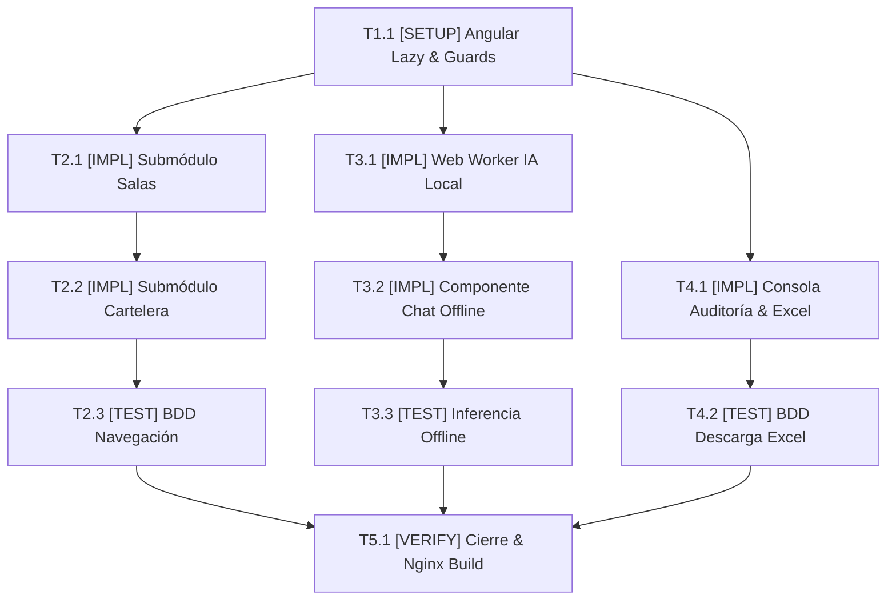

# Tasks: Módulo 06 - FrontWeb de Administración y Operaciones Cinematográficas (FRONTWEB ADMIN)

## Task Progress

| Métrica | Cantidad |
| :--- | ---: |
| Total de tareas | 10 |
| Tareas realizadas | 0 |
| Tareas por realizar | 10 |
| Tareas bloqueadas | 0 |
| Tareas en progreso | 0 |
| Progreso | 0% |

**Estado:** READY

---

## Checklist Rápido de Tareas por Vertical Slice

### Fase 0: Setup y Arquitectura Modular Angular 17
- [ ] `T1.1` `[SETUP]` Configuración de proyecto Angular 17 con Lazy Loading, Standalone Components y `AdminAuthGuard` con intercepción JWT (`PLAN-01`, `PLAN-02`).

### Slice 1: Módulos de Salas, Butacas y Cartelera Horaria
- [ ] `T2.1` `[IMPL]` Implementar submódulo diferido de Salas con diseñador gráfico de cuadrícula matricial y selector de tipo de butaca (`PLAN-04`, `PLAN-05`).
- [ ] `T2.2` `[IMPL]` Implementar submódulo de Cartelera con calendario de programación y validación visual de no solapamiento (+20 min de limpieza) (`PLAN-04`, `PLAN-05`).
- [ ] `T2.3` `[TEST]` Suite BDD de navegación y guardas: validar intercepción de acceso anónimo y carga bajo demanda de submódulos (`HU-13`, `INV-BIZ-08`).

### Slice 2: Asistente Analítico Offline con IA en el Navegador
- [ ] `T3.1` `[IMPL]` Implementar Web Worker con Transformers.js / WebLLM y `LocalDataCacheService` para procesamiento analítico en memoria sin conexión (`PLAN-02`, `PLAN-03`).
- [ ] `T3.2` `[IMPL]` Construir componente `AiChatDrawerComponent` para que el administrador formule preguntas en lenguaje natural sobre las salas y recaudación (`PLAN-05`).
- [ ] `T3.3` `[TEST]` Suite de pruebas offline: simular desconexión total de red y verificar que la IA local responde correctamente en menos de 2 segundos (`SC-06.1.1`, `RB-FW-01`).

### Slice 3: Centro de Demostración de Auditoría MCP y Descarga de Excel
- [ ] `T4.1` `[IMPL]` Implementar `AuditControlComponent` con botón `[Ejecutar Auditoría MCP Ahora]`, simuladores de taquilla y enlace de descarga del `.xlsx` compilado por n8n (`PLAN-04`, `PLAN-05`).
- [ ] `T4.2` `[TEST]` Suite BDD de auditoría y descarga: verificar la actualización reactiva del veredicto del agente y la descarga del archivo Excel (`SC-06.2.1`).

### Fase Final: Verificación Consolidada y Cierre
- [ ] `T5.1` `[VERIFY]` Ejecución completa de suites de prueba de Angular, linter ESLint y build de producción con Nginx.

---

## 1. Resumen de Trazabilidad (`Spec` → `Plan` → `Tasks`)

| Requisito / Regla / Escenario (`spec.md`) | Componente Técnico (`plan.md`) | Tareas Asociadas (`tasks.md`) |
| :--- | :--- | :--- |
| `INV-BIZ-08`, `HU-13` | `PLAN-01`, `PLAN-02` | `T1.1`, `T2.3` |
| `RF-13.1`, `RF-13.2` | `PLAN-04`, `PLAN-05` | `T2.1`, `T2.2` |
| `HU-14`, `RF-14.1`, `RF-14.2`, `RB-FW-01`, `SC-06.1.1` | `PLAN-02`, `PLAN-03`, `PLAN-05` | `T3.1`, `T3.2`, `T3.3` |
| `HU-15`, `RF-15.1`, `RF-15.2`, `SC-06.2.1` | `PLAN-04`, `PLAN-05` | `T4.1`, `T4.2` |
| Cierre y verificación de calidad | Todos los componentes `PLAN` | `T5.1` |

---

## 2. Grafo de Dependencias de Tareas

---

## 3. Desglose Detallado de Tareas Ejecutables

### Fase 0: Setup y Arquitectura Modular Angular 17

#### [ ] T1.1 [SETUP] Configuración de Angular 17 con Lazy Loading y Guards
* **Status:** PENDING
* **Traceability:** `PLAN-01`, `PLAN-02`
* **Depends on:** —
* **Files:**
  * `[CREATE]` `apps/frontweb-admin/src/app/core/guards/admin-auth.guard.ts`
  * `[CREATE]` `apps/frontweb-admin/src/app/core/interceptors/jwt.interceptor.ts`
  * `[CREATE]` `apps/frontweb-admin/src/app/app.routes.ts`
* **Objective:** Establecer la arquitectura base modular y bloquear cualquier ruta si no hay sesión de administrador activa.
* **Work:** Configurar las rutas lazy de Angular e implementar el guardián de autorización que redirige al `/login`.
* **Done when:** Un intento de acceso a `/admin/salas` sin token redirige a `/login`.
* **Evidence:** `ng test --include=**/admin-guard.spec.ts`

---

### Slice 1: Módulos de Salas, Butacas y Cartelera Horaria

#### [ ] T2.1 [IMPL] Implementar submódulo diferido de Salas con diseñador gráfico
* **Status:** PENDING
* **Traceability:** `PLAN-04`, `PLAN-05` | `RF-13.1`, `RF-13.2`
* **Depends on:** `T1.1`
* **Files:**
  * `[CREATE]` `apps/frontweb-admin/src/app/features/halls/halls.routes.ts`
  * `[CREATE]` `apps/frontweb-admin/src/app/features/halls/components/hall-designer.component.ts`
* **Objective:** Cuadrícula visual de butacas con colores diferenciados por tipo.
* **Work:** Consumir `MS CINEMA-CORE` para cargar las salas y permitir reclasificar butacas interactivamente.
* **Done when:** El administrador visualiza la matriz de asientos y puede alternar tipos de butaca con un clic.
* **Evidence:** `ng test --include=**/hall-designer.spec.ts`

#### [ ] T2.2 [IMPL] Implementar submódulo de Cartelera con validación de no solapamiento
* **Status:** PENDING
* **Traceability:** `PLAN-04`, `PLAN-05` | `RF-13.1`
* **Depends on:** `T2.1`
* **Files:**
  * `[CREATE]` `apps/frontweb-admin/src/app/features/showtimes/components/showtime-calendar.component.ts`
* **Objective:** Tablero visual de horarios de funciones por sala.
* **Work:** Renderizar los bloques de proyección impidiendo solapamientos horarios y mostrando los 20 min de limpieza.
* **Done when:** El calendario alerta visualmente si dos horarios se traslapan.
* **Evidence:** `ng test --include=**/showtime-calendar.spec.ts`

#### [ ] T2.3 [TEST] Suite BDD de navegación y guardas
* **Status:** PENDING
* **Traceability:** `HU-13`
* **Depends on:** `T2.2`
* **Files:**
  * `[CREATE]` `apps/frontweb-admin/src/tests/admin-guard.spec.ts`
* **Objective:** Validar la carga diferida de chunks y la protección de rutas.
* **Work:** Test unitario con Angular RouterTestingModule.
* **Done when:** 100% de tests en verde.
* **Evidence:** `ng test --include=**/admin-guard.spec.ts`

---

### Slice 2: Asistente Analítico Offline con IA en el Navegador

#### [ ] T3.1 [IMPL] Implementar Web Worker con Transformers.js / WebLLM y caché local
* **Status:** PENDING
* **Traceability:** `PLAN-02`, `PLAN-03` | `RB-FW-01`, `RF-14.1`
* **Depends on:** `T1.1`
* **Files:**
  * `[CREATE]` `apps/frontweb-admin/src/app/features/local-ai/workers/local-ai.worker.ts`
  * `[CREATE]` `apps/frontweb-admin/src/app/features/local-ai/services/web-llm-worker.service.ts`
  * `[CREATE]` `apps/frontweb-admin/src/app/core/services/local-data-cache.service.ts`
* **Objective:** Aislar la carga del modelo cuantizado en un worker sin congelar el hilo visual.
* **Work:** Configurar el Web Worker para escuchar mensajes de consulta y responder utilizando los datos de IndexedDB.
* **Done when:** El worker inicializa el modelo y responde a peticiones locales.
* **Evidence:** `ng test --include=**/local-ai-offline.spec.ts`

#### [ ] T3.2 [IMPL] Construir componente AiChatDrawerComponent
* **Status:** PENDING
* **Traceability:** `PLAN-05` | `RF-14.2`
* **Depends on:** `T3.1`
* **Files:**
  * `[CREATE]` `apps/frontweb-admin/src/app/features/local-ai/components/ai-chat-drawer.component.ts`
* **Objective:** Panel deslizable donde el administrador escribe dudas operativas en lenguaje natural.
* **Work:** Crear la interfaz de chat que despacha el texto al servicio del worker y presenta la respuesta.
* **Done when:** El chat muestra la respuesta analítica en menos de 2 segundos.
* **Evidence:** `ng test --include=**/ai-chat-drawer.spec.ts`

#### [ ] T3.3 [TEST] Suite de pruebas offline de la IA local
* **Status:** PENDING
* **Traceability:** `SC-06.1.1`
* **Depends on:** `T3.2`
* **Files:**
  * `[CREATE]` `apps/frontweb-admin/src/tests/local-ai-offline.spec.ts`
* **Objective:** Validar la respuesta de la IA desconectando la red (navigator.onLine = false).
* **Work:** Test que comprueba que la consulta devuelve el análisis de la sala con menor aforo sin peticiones HTTP.
* **Done when:** El test pasa en verde sin errores de red.
* **Evidence:** `ng test --include=**/local-ai-offline.spec.ts`

---

### Slice 3: Centro de Demostración de Auditoría MCP y Descarga de Excel

#### [ ] T4.1 [IMPL] Implementar AuditControlComponent con botones demo y descarga de Excel
* **Status:** PENDING
* **Traceability:** `PLAN-04`, `PLAN-05` | `RF-15.1`, `RF-15.2`
* **Depends on:** `T1.1`
* **Files:**
  * `[CREATE]` `apps/frontweb-admin/src/app/features/audit-report/services/mcp-audit.service.ts`
  * `[CREATE]` `apps/frontweb-admin/src/app/features/audit-report/components/audit-control.component.ts`
* **Objective:** Consola visual para disparar la auditoría de MS IA-MCP y descargar el archivo `.xlsx` de n8n.
* **Work:** Programar los botones `[Ejecutar Auditoría MCP Ahora]` y el enlace de descarga directa del Excel generado.
* **Done when:** Al pulsar el botón de descarga, el navegador guarda el archivo `.xlsx`.
* **Evidence:** `ng test --include=**/audit-excel-download.spec.ts`

#### [ ] T4.2 [TEST] Suite BDD de auditoría y descarga de reporte
* **Status:** PENDING
* **Traceability:** `SC-06.2.1`
* **Depends on:** `T4.1`
* **Files:**
  * `[CREATE]` `apps/frontweb-admin/src/tests/audit-excel-download.spec.ts`
* **Objective:** Comprobar la recepción del payload de contingencia y la generación del enlace de descarga.
* **Work:** Test con mock de MS IA-MCP.
* **Done when:** El test pasa en verde.
* **Evidence:** `ng test --include=**/audit-excel-download.spec.ts`

---

### Fase Final: Verificación Consolidada y Cierre

#### [ ] T5.1 [VERIFY] Verificación completa de frontweb-admin
* **Status:** PENDING
* **Traceability:** Cross-cutting (Cierre de Módulo 06)
* **Depends on:** `T2.3`, `T3.3`, `T4.2`
* **Objective:** Compilación en producción con Ahead-of-Time (AOT) y linter.
* **Work:** Ejecutar `ng test --watch=false && ng lint && ng build --configuration production`.
* **Done when:** 100% de tests en verde y bundle de producción generado sin warnings críticos.
* **Evidence:** `npm run build`

---

## 4. Bitácora de Evidencia de Ejecución (`/sdd-execution`)
* *(Pendiente de inicio de `/sdd-execution`)*
