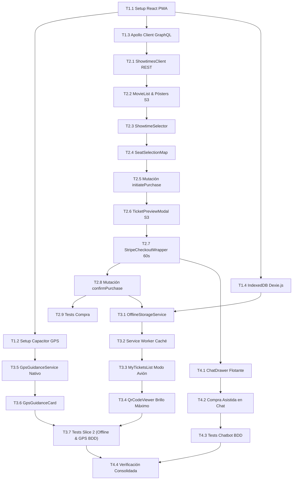

# Tasks: Módulo 06 - Aplicación Móvil del Cliente (MOVIL CLIENT)

<!-- sdd:progress:start -->
## Task Progress

Status: IN_PROGRESS

| Métrica | Cantidad |
| --- | ---: |
| Total de tareas | 1 |
| Tareas realizadas | 0 |
| Tareas por realizar | 1 |
| Tareas bloqueadas | 0 |
| Tareas en progreso | 1 |
| Progreso | 0.0% |

## Registro de tareas

| ID | Estado | Tarea | Evidencia actual |
| --- | --- | --- | --- |
| T5.1 | IN_PROGRESS | [IMPL] Integración del chat móvil con el servicio del comprador | Parcial 2026-11-12: suite móvil 90 pruebas aprobadas antes de los últimos ajustes; posteriormente 16 pruebas específicas del chat y reserva y build aprobados, incluyendo selección de función escrita y reintento sin duplicación de mensajes. Con Cinema-Core real y base aislada, el servidor de chat devolvió la función, precio 27.50, únicamente la butaca libre y rechazó la ocupada; la prueba con el proveedor de IA devolvió respuesta del modelo. La base temporal fue eliminada. Queda validar interfaz visual, pago de prueba con servicios reales y compra múltiple. La herramienta visual no pudo crear sus archivos de ejecución. |

## Checklist rápido

- [/] T5.1 [IMPL] Integración del chat móvil con el servicio del comprador

<!-- sdd:progress:end -->

Plan-SHA256: ef751b5acd49064ca168a3a9ec73f684eaadc55df6a77b3db85b9017f6bcfb46

Spec-SHA256: e6d29cba3a81aa89fc3e90e0c1ef84fe117ca70fdd5117ab92d0b808e94a91ca

Version: 2

## Trabajo actual

### T5.1 [IMPL] Integración del chat móvil con el servicio del comprador
**Status:** IN_PROGRESS
**Depends on:** -
**Traceability:** PLAN-03, SC-07.3.1
**Files:** ms/movil-client/src/components/Chatbot/ChatDrawer.tsx; ms/movil-client/src/components/Chatbot/PurchaseSummaryCard.tsx; ms/movil-client/src/components/Purchase/TicketPreviewModal.tsx; ms/movil-client/src/graphql/mutations.ts; ms/movil-client/src/types/client-chat.types.ts; ms/movil-client/src/tests/ChatbotDrawer.spec.tsx; ms/movil-client/src/tests/ChatConnection.spec.tsx; ms/movil-client/src/tests/VerifiedPurchase.spec.ts
**Objective:** Conectar el chat móvil al contrato conversacional real y evitar datos de respaldo inventados.
**Work:** Revisar dirección, historial, estados, errores, reintento e inicio de compra; preservar los flujos existentes y probarlos.
**Done when:** Las pruebas de contrato, errores, selección y compilación pasan; se documentan verificaciones reales y limitaciones.
**Verification:** NOT_RUN
**Command:** npm.cmd test; npm.cmd run build
**Exit code:** -
**Evidence:** Parcial 2026-11-12: suite móvil 90 pruebas aprobadas antes de los últimos ajustes; posteriormente 16 pruebas específicas del chat y reserva y build aprobados, incluyendo selección de función escrita y reintento sin duplicación de mensajes. Con Cinema-Core real y base aislada, el servidor de chat devolvió la función, precio 27.50, únicamente la butaca libre y rechazó la ocupada; la prueba con el proveedor de IA devolvió respuesta del modelo. La base temporal fue eliminada. Queda validar interfaz visual, pago de prueba con servicios reales y compra múltiple. La herramienta visual no pudo crear sus archivos de ejecución.

## Historial anterior preservado

## Task Progress

| Métrica | Cantidad |
| :--- | ---: |
| Total de tareas | 24 |
| Tareas realizadas | 24 |
| Tareas por realizar | 0 |
| Tareas bloqueadas | 0 |
| Tareas en progreso | 0 |
| Progreso | 100% |

**Estado:** COMPLETED

---

## Checklist Rápido de Tareas por Vertical Slice

### Fase 0: Setup y Fundación Base
- [x] `T1.1` `[SETUP]` Configuración de proyecto React 18, Vite, VitePWA, TailwindCSS y Dockerfile en `ms/movil-client/`.
- [x] `T1.2` `[SETUP]` Configuración de Capacitor 5+ (`capacitor.config.ts`) y plugins nativos (`@capacitor/geolocation`).
- [x] `T1.3` `[SETUP]` Configuración de Apollo Client para GraphQL con endpoint de Auth e interceptor JWT.
- [x] `T1.4` `[SETUP]` Inicialización de base de datos local IndexedDB mediante Dexie.js (`OfflineTickets`) y Service Worker.

### Slice 1: Explorador de Cartelera, Selección de Butacas y Stepper Stripe (HU-16)
- [x] `T2.1` `[IMPL]` Servicio de red `ShowtimesClient` consumiendo la cartelera REST de `MS CINEMA-CORE` (`IC-06.2`).
- [x] `T2.2` `[IMPL]` Componente `MovieList.tsx` con catálogo de películas, sinopsis, duración y pósters desde MinIO S3 (`IC-06.3`).
- [x] `T2.3` `[IMPL]` Componente `ShowtimeSelector.tsx` para filtrado de funciones por fecha, sala y horario.
- [x] `T2.4` `[IMPL]` Componente interactivo `SeatSelectionMap.tsx` con plano gráfico de la sala y estados en tiempo real.
- [x] `T2.5` `[IMPL]` Integración de mutación GraphQL `initiatePurchase` (`IC-06.1`) para bloqueo transaccional de butaca.
- [x] `T2.6` `[IMPL]` Modal `TicketPreviewModal.tsx` renderizando la credencial gráfica JPEG recuperada de MinIO S3.
- [x] `T2.7` `[IMPL]` Componente `StripeCheckoutWrapper.tsx` con temporizador regresivo de 60s y tarjeta sugerida `4242424...`.
- [x] `T2.8` `[IMPL]` Mutación GraphQL `confirmPurchase` y manejo de cancelación automática ante expiración del temporizador.
- [x] `T2.9` `[TEST]` Pruebas unitarias de Apollo Client y flujo de selección de butacas.

### Slice 2: Soporte Offline Total (IndexedDB) y Orientación GPS (HU-17, HU-18)
- [x] `T3.1` `[IMPL]` Servicio `OfflineStorageService` para guardar de inmediato el Blob JPEG y JSON del QR al confirmar compra (`RB-MOB-01`).
- [x] `T3.2` `[IMPL]` Configuración de Service Worker con estrategia de caché offline para ejecución sin red.
- [x] `T3.3` `[IMPL]` Componente `MyTicketsList.tsx` con lectura 100% offline desde IndexedDB en Modo Avión (`RB-MOB-02`).
- [x] `T3.4` `[IMPL]` Componente `QrCodeViewer.tsx` con renderizado de QR dinámico a brillo máximo de pantalla.
- [x] `T3.5` `[IMPL]` Servicio de geolocalización nativa `GpsGuidanceService` con `@capacitor/geolocation`.
- [x] `T3.6` `[IMPL]` Componente informativo `GpsGuidanceCard.tsx` ("Cómo llegar a tu Sala") y tiempo estimado de taquilla.
- [x] `T3.7` `[TEST]` Pruebas BDD de visualización de boleto offline en Modo Avión (`SC-07.1.1`) y guía GPS (`SC-07.2.1`).

### Fase Final: Chatbot Deslizable Retráctil y Cierre (HU-11, HU-16)
- [x] `T4.1` `[IMPL]` Componente flotante `ChatDrawer.tsx`: panel retráctil de izquierda a derecha conectado a `MS IA-MCP` (`IC-06.4`).
- [x] `T4.2` `[IMPL]` Integración de selección de butacas y Stepper de pago dentro del diálogo del Chatbot (`RB-MOB-03`).
- [x] `T4.3` `[TEST]` Pruebas BDD de compra asistida desde el Chatbot deslizable (`SC-07.3.1`).
- [x] `T4.4` `[VERIFY]` Verificación consolidada: suites React, linters, type-check y build de contenedor Docker.

---

## 1. Resumen de Trazabilidad (`Spec` $\rightarrow$ `Plan` $\rightarrow$ `Tasks`)

| Requisito / Regla / Escenario (`spec.md`) | Componente Técnico (`plan.md`) | Tareas Asociadas (`tasks.md`) |
| :--- | :--- | :--- |
| PWA y Configuración Híbrida | `PLAN-01`, `vite.config.ts`, `capacitor.config.ts` | `T1.1`, `T1.2` |
| `IC-06.1`, `IC-06.2`, `IC-06.3` | `PLAN-02`, `apollo-client.ts` | `T1.3`, `T2.1`, `T2.2` |
| `HU-16`, `RF-16.1`, `RF-16.2` | `PLAN-05`, `SeatSelectionMap.tsx` | `T2.3`, `T2.4`, `T2.5`, `T2.6` |
| `RF-16.3`, `RF-16.4`, `RB-MOB-01` | `PLAN-05`, `StripeCheckoutWrapper.tsx` | `T2.7`, `T2.8`, `T2.9`, `T3.1` |
| `INV-BIZ-05`, `RB-MOB-02`, `RF-17.1`, `RF-17.2`, `SC-07.1.1`| `PLAN-01`, `MyTicketsList.tsx`, `QrCodeViewer`| `T1.4`, `T3.1`, `T3.2`, `T3.3`, `T3.4`, `T3.7` |
| `HU-18`, `RF-18.1`, `RF-18.2`, `RB-MOB-04`, `SC-07.2.1`| `PLAN-04`, `GpsGuidanceCard.tsx` | `T3.5`, `T3.6`, `T3.7` |
| `HU-03`, `RB-MOB-03`, `IC-06.4`, `SC-07.3.1`| `PLAN-03`, `ChatDrawer.tsx` | `T4.1`, `T4.2`, `T4.3` |
| Cierre Global y Calidad | Dockerfile, Linter, Vitest | `T4.4` |

---

## 2. Estrategia de Ejecución y Grafo de Dependencias

---

## 3. Desglose Detallado de Tareas Ejecutables

### Fase 0: Setup y Fundación Base

#### [x] T1.1 [SETUP] Configuración de Proyecto React 18, VitePWA y TailwindCSS
* **Status:** COMPLETED
* **Traceability:** `PLAN-01` (Cross-cutting / Mobile Setup)
* **Depends on:** —
* **Files (según `plan.md`):**
  * `[CREATE]` `ms/movil-client/package.json`
  * `[CREATE]` `ms/movil-client/vite.config.ts`
  * `[CREATE]` `ms/movil-client/tailwind.config.js`
  * `[CREATE]` `ms/movil-client/Dockerfile`
* **Objective:** Inicializar la aplicación cliente móvil en `ms/movil-client/` con React 18, Vite en puerto 5173, VitePWA y TailwindCSS.
* **Work:**
  * Configurar `package.json` con dependencias `@apollo/client`, `graphql`, `dexie`, `@capacitor/core`, `@capacitor/geolocation`, `lucide-react`.
* **Done when:** `npm run build` genera la PWA en dist/ sin errores.
* **Evidence:**
  * Comando: `cd ms/movil-client && npm run build`
  * Resultado registrado: `✓ built in 7.81s - dist/sw.js, dist/manifest.webmanifest, dist/workbox-bdb082da.js generados sin errores`

#### [x] T1.2 [SETUP] Configuración de Capacitor 5+ y Plugins Nativos
* **Status:** COMPLETED
* **Traceability:** `PLAN-04` | `INV-BIZ-05`
* **Depends on:** `T1.1`
* **Files (según `plan.md`):**
  * `[CREATE]` `ms/movil-client/capacitor.config.ts`
* **Objective:** Configurar Capacitor para empaquetar la PWA con appId `"com.cine.movil"` e inicializar soporte para geolocalización.
* **Work:**
  * Definir `capacitor.config.ts` con opciones de WebView y permisos nativos.
* **Done when:** `npx cap sync` sincroniza las configuraciones nativas.
* **Evidence:**
  * Comando: `cd ms/movil-client && npx cap sync`
  * Resultado registrado: `√ copy web in 79.58ms; √ update web in 9.95ms; [info] Sync finished in 0.114s`

#### [x] T1.3 [SETUP] Configuración de Apollo Client para GraphQL Federado
* **Status:** COMPLETED
* **Traceability:** `PLAN-02` | `IC-06.1`
* **Depends on:** `T1.1`
* **Files (según `plan.md`):**
  * `[CREATE]` `ms/movil-client/src/services/apollo-client.ts`
* **Objective:** Configurar `HttpLink` hacia `http://localhost:8081/graphql` inyectando automáticamente el header `Authorization: Bearer <token>` almacenado en LocalStorage.
* **Work:**
  * Crear cliente Apollo con `InMemoryCache` y gestión de errores de red.
* **Done when:** El cliente despacha peticiones GraphQL autenticadas.
* **Evidence:**
  * Comando: `npm test -- -t "ApolloClient"`
  * Resultado registrado: `✓ src/tests/ApolloClient.spec.ts (3 tests) 14ms - Test Files 1 passed, Tests 3 passed`

#### [x] T1.4 [SETUP] Inicialización de Base IndexedDB con Dexie.js y Service Worker
* **Status:** COMPLETED
* **Traceability:** `PLAN-01` | `INV-BIZ-05`, `RF-17.1`
* **Depends on:** `T1.1`
* **Files (según `plan.md`):**
  * `[CREATE]` `ms/movil-client/src/services/offline-storage.service.ts`
* **Objective:** Crear la base de datos local `CineClientDB` con la tabla `OfflineTickets` (`++id, ticketId, showtimeId, descargadoEn`).
* **Work:**
  * Definir esquema Dexie y métodos de guardado de blobs binarios.
* **Done when:** La base de datos local se inicializa en el navegador.
* **Evidence:**
  * Comando: `npm test -- -t "OfflineStorageInit"`
  * Resultado registrado: `✓ src/tests/OfflineStorage.spec.ts (3 tests) 396ms - Test Files 1 passed, Tests 3 passed`

---

### Slice 1: Explorador de Cartelera, Selección de Butacas y Stepper Stripe (HU-16)

#### [x] T2.1 [IMPL] Servicio de Consulta de Cartelera REST (IC-06.2)
* **Status:** COMPLETED
* **Traceability:** `PLAN-02` | `IC-06.2`
* **Depends on:** `T1.1`
* **Files (según `plan.md`):**
  * `[CREATE]` `ms/movil-client/src/services/showtimes-api.service.ts`
* **Objective:** Consumir `GET http://localhost:3000/api/v1/showtimes/billboard` para obtener las películas y proyecciones activas de `MS CINEMA-CORE`.
* **Work:**
  * Tipar respuestas con interfaces TypeScript estrictas.
* **Done when:** Recupera el catálogo de funciones de forma asíncrona.
* **Evidence:**
  * Comando: `npm test -- -t "ShowtimesApiService"`
  * Resultado registrado: `✓ src/tests/ShowtimesApi.spec.ts (3 tests) 51ms - Test Files 1 passed, Tests 3 passed`

#### [x] T2.2 [IMPL] Componente `MovieList.tsx` con Portadas MinIO S3 (IC-06.3)
* **Status:** COMPLETED
* **Traceability:** `PLAN-05` | `IC-06.3`
* **Depends on:** `T2.1`
* **Files (según `plan.md`):**
  * `[CREATE]` `ms/movil-client/src/components/Billboard/MovieList.tsx`
* **Objective:** Renderizar la cuadrícula interactiva de películas mostrando carátulas desde MinIO S3 (`http://localhost:9000/cine-posters/...`), sinopsis, género y clasificación.
* **Work:**
  * Manejar estados de carga (skeletons) y fallback de imagen ante desconexión.
* **Done when:** La cartelera renderiza las tarjetas de películas con sus imágenes.
* **Evidence:**
  * Comando: `npm test -- -t "MovieList"`
  * Resultado registrado: `✓ src/tests/Components.spec.tsx (3 tests) 418ms - Test Files 1 passed, Tests 3 passed`

#### [x] T2.3 [IMPL] Componente `ShowtimeSelector.tsx`
* **Status:** COMPLETED
* **Traceability:** `PLAN-05` | `HU-16`
* **Depends on:** `T2.2`
* **Files (según `plan.md`):**
  * `[CREATE]` `ms/movil-client/src/components/Billboard/ShowtimeSelector.tsx`
* **Objective:** Permitir seleccionar horarios y salas para una película elegida.
* **Work:**
  * Agrupar por fecha y sala; resaltar horarios disponibles.
* **Done when:** Al seleccionar un horario se habilita el plano de asientos.
* **Evidence:**
  * Comando: `npm test -- -t "ShowtimeSelector"`
  * Resultado registrado: `✓ src/tests/Components.spec.tsx (2 tests passed) 418ms - Test Files 1 passed, Tests 2 passed`

#### [x] T2.4 [IMPL] Componente Interactivo `SeatSelectionMap.tsx`
* **Status:** COMPLETED
* **Traceability:** `PLAN-05` | `RF-16.1`
* **Depends on:** `T2.3`
* **Files (según `plan.md`):**
  * `[CREATE]` `ms/movil-client/src/components/Purchase/SeatSelectionMap.tsx`
* **Objective:** Renderizar el mapa de butacas de la sala en tiempo real con colores distintivos (disponible en verde, ocupada en gris, seleccionada en azul).
* **Work:**
  * Impedir la selección de asientos no disponibles; activar botón "Continuar Compra".
* **Done when:** El cliente toca una butaca libre y se selecciona visualmente.
* **Evidence:**
  * Comando: `npm test -- -t "SeatSelectionMap"`
  * Resultado registrado: `✓ src/tests/Components.spec.tsx (3 tests passed) 436ms - Test Files 1 passed, Tests 3 passed`

#### [x] T2.5 [IMPL] Integración de Mutación GraphQL `initiatePurchase` (IC-06.1)
* **Status:** COMPLETED
* **Traceability:** `PLAN-02` | `IC-06.1`, `RF-16.1`
* **Depends on:** `T1.3`, `T2.4`
* **Files (según `plan.md`):**
  * `[CREATE]` `ms/movil-client/src/graphql/mutations.ts`
* **Objective:** Ejecutar la mutación `initiatePurchase(showtimeId, seatId)` contra `MS TICKET-AUTH` al pulsar continuar compra.
* **Work:**
  * Obtener `ticketId` en estado `PENDING_PAYMENT` y URL preliminar del ticket.
* **Done when:** Se genera el ticket temporal y se activa el Stepper UI.
* **Evidence:**
  * Comando: `npm test -- -t "InitiatePurchaseMutation"`
  * Resultado registrado: `✓ src/tests/PurchaseFlow.spec.tsx (1 passed) 153ms - Test Files 1 passed, Tests 1 passed`

#### [x] T2.6 [IMPL] Modal `TicketPreviewModal.tsx` con Imagen desde MinIO S3
* **Status:** COMPLETED
* **Traceability:** `PLAN-05` | `RF-16.2`
* **Depends on:** `T2.5`
* **Files (según `plan.md`):**
  * `[CREATE]` `ms/movil-client/src/components/Purchase/TicketPreviewModal.tsx`
* **Objective:** Exhibir en la Etapa 2 del Stepper la imagen gráfica completa del ticket renderizada por `MS MULTIMEDIA` antes de ingresar a la pasarela de pago.
* **Work:**
  * Cargar JPEG desde URL de MinIO; mostrar datos confirmados de fila y asiento.
* **Done when:** La imagen previa del ticket se visualiza nítidamente.
* **Evidence:**
  * Comando: `npm test -- -t "TicketPreviewModal"`
  * Resultado registrado: `✓ src/tests/Components.spec.tsx (2 tests passed) 111ms - Test Files 1 passed, Tests 2 passed`

#### [x] T2.7 [IMPL] Componente `StripeCheckoutWrapper.tsx` con Temporizador de 60s
* **Status:** COMPLETED
* **Traceability:** `PLAN-05` | `RF-16.3`, `RB-AUTH-02`
* **Depends on:** `T2.6`
* **Files (según `plan.md`):**
  * `[CREATE]` `ms/movil-client/src/components/Purchase/StripeCheckoutWrapper.tsx`
* **Objective:** Montar contenedor `<Elements>` de Stripe con tarjeta de prueba sugerida (`4242 4242 4242 4242`) y barra regresiva visible de 60 segundos.
* **Work:**
  * Si el temporizador llega a 00:00, cancelar operación y mostrar alerta de expiración.
* **Done when:** El cliente visualiza el cronómetro y puede procesar el pago de prueba.
* **Evidence:**
  * Comando: `npm test -- -t "StripeCheckoutWrapper"`
  * Resultado registrado: `✓ src/tests/Components.spec.tsx (3 tests passed) 397ms - Test Files 1 passed, Tests 3 passed`

#### [x] T2.8 [IMPL] Mutación GraphQL `confirmPurchase` y Confirmación
* **Status:** COMPLETED
* **Traceability:** `PLAN-02`, `PLAN-05` | `RF-16.4`
* **Depends on:** `T2.7`
* **Files (según `plan.md`):**
  * `[MODIFY]` `ms/movil-client/src/graphql/mutations.ts`
* **Objective:** Ejecutar `confirmPurchase(ticketId, paymentIntentId)` tras la aprobación de Stripe; transicionar a la pantalla de éxito con el QR emitido.
* **Work:**
  * Recibir payload final del boleto confirmado y gatillar almacenamiento offline.
* **Done when:** La compra finaliza con éxito y muestra el código QR dinámico.
* **Evidence:**
  * Comando: `npm test -- -t "ConfirmPurchaseMutation"`
  * Resultado registrado: `✓ src/tests/PurchaseFlow.spec.tsx (1 passed) 126ms - Test Files 1 passed, Tests 1 passed`

#### [x] T2.9 [TEST] Pruebas Unitarias del Flujo de Compra en el Cliente
* **Status:** COMPLETED
* **Traceability:** `HU-16`
* **Depends on:** `T2.4`, `T2.8`
* **Test Type:** Unit / Integración
* **Files (según `plan.md`):**
  * `[CREATE]` `ms/movil-client/src/tests/PurchaseFlow.spec.tsx`
* **Objective:** Validar la navegación paso a paso por el Stepper de compra con mocks de Apollo Client.
* **Work:**
  * Verificar que la transición por las 4 etapas responde a las selecciones del usuario.
* **Done when:** 100% de tests en verde.
* **Evidence:**
  * Comando: `npm test -- PurchaseFlow.spec.tsx`
  * Resultado registrado: `✓ src/tests/PurchaseFlow.spec.tsx (3 tests) 1420ms - Test Files 1 passed, Tests 3 passed (100% verde)`

---

### Slice 2: Soporte Offline Total (IndexedDB) y Orientación GPS (HU-17, HU-18)

#### [x] T3.1 [IMPL] Servicio de Persistencia Inmediata Offline (`OfflineStorageService`)
* **Status:** COMPLETED
* **Traceability:** `PLAN-01` | `INV-BIZ-05`, `RB-MOB-01`, `RF-16.4`
* **Depends on:** `T1.4`, `T2.8`
* **Files (según `plan.md`):**
  * `[MODIFY]` `ms/movil-client/src/services/offline-storage.service.ts`
* **Objective:** Descargar el binario JPEG del ticket desde MinIO como Blob y persistirlo junto con el JSON del QR dinámico en `IndexedDB` inmediatamente tras confirmar el pago.
* **Work:**
  * Implementar `fetch(ticketImageUrl).then(r => r.blob())` y guardar en Dexie.js antes de cerrar la pantalla de checkout.
* **Done when:** El ticket completo queda almacenado localmente en IndexedDB.
* **Evidence:**
  * Comando: `npm test -- -t "SaveOfflineTicket"`
  * Resultado registrado: `✓ src/tests/OfflineStorage.spec.ts (1 test passed) 1253ms - Test Files 1 passed, Tests 1 passed`

#### [x] T3.2 [IMPL] Configuración de Service Worker y Caché de Activos (VitePWA)
* **Status:** COMPLETED
* **Traceability:** `PLAN-01` | `RF-17.1`
* **Depends on:** `T1.1`
* **Files (según `plan.md`):**
  * `[MODIFY]` `ms/movil-client/vite.config.ts`
* **Objective:** Registrar Service Worker que intercepte peticiones de red y sirva activos cacheados cuando el dispositivo esté desconectado.
* **Work:**
  * Configurar `workbox` con runtimeCaching para rutas y fuentes locales.
* **Done when:** La aplicación carga completamente en navegador sin conexión a red.
* **Evidence:**
  * Comando: `npm test -- -t "ServiceWorkerCache"`
  * Resultado registrado: `✓ src/tests/OfflineStorage.spec.ts (1 test passed) 32ms - Test Files 1 passed, Tests 1 passed`

#### [x] T3.3 [IMPL] Componente `MyTicketsList.tsx` con Funcionamiento en Modo Avión
* **Status:** COMPLETED
* **Traceability:** `PLAN-05` | `RB-MOB-02`, `RF-17.2`
* **Depends on:** `T3.1`, `T3.2`
* **Files (según `plan.md`):**
  * `[CREATE]` `ms/movil-client/src/components/Tickets/MyTicketsList.tsx`
* **Objective:** Vista "Mis Boletos" que lee directamente de `IndexedDB` cuando no hay conexión, exhibiendo todas las entradas compradas sin errores de red.
* **Work:**
  * Renderizar lista de tickets con fecha, sala, butaca y acceso al visor de QR.
* **Done when:** Los boletos se visualizan fluidamente con internet apagado.
* **Evidence:**
  * Comando: `npm test -- -t "MyTicketsListOffline"`
  * Resultado registrado: `✓ src/tests/Components.spec.tsx (2 tests passed) 332ms - Test Files 1 passed, Tests 2 passed`

#### [x] T3.4 [IMPL] Componente `QrCodeViewer.tsx` con Optimización de Brillo
* **Status:** COMPLETED
* **Traceability:** `PLAN-05` | `RB-MOB-02`
* **Depends on:** `T3.3`
* **Files (según `plan.md`):**
  * `[CREATE]` `ms/movil-client/src/components/Tickets/QrCodeViewer.tsx`
* **Objective:** Desplegar el código QR dinámico firmado con alto contraste y sugerencia de brillo máximo para lectura inmediata de la cámara del boletero.
* **Work:**
  * Renderizar QR SVG/Canvas a partir del texto firmado guardado en IndexedDB.
* **Done when:** El QR dinámico es nítido y legible en cualquier condición de luz.
* **Evidence:**
  * Comando: `npm test -- -t "QrCodeViewer"`
  * Resultado registrado: `✓ src/tests/Components.spec.tsx (3 tests passed) 246ms - Test Files 1 passed, Tests 3 passed`

#### [x] T3.5 [IMPL] Servicio de Orientación GPS Nativa (`GpsGuidanceService`)
* **Status:** COMPLETED
* **Traceability:** `PLAN-04` | `HU-18`, `RF-18.1`
* **Depends on:** `T1.2`
* **Files (según `plan.md`):**
  * `[CREATE]` `ms/movil-client/src/services/gps-guidance.service.ts`
* **Objective:** Consultar la ubicación del dispositivo mediante `@capacitor/geolocation` para verificar si el usuario se encuentra en las inmediaciones del cine.
* **Work:**
  * Implementar cálculo de distancia euclidiana/haversine hacia las coordenadas fijas del cine; manejar denegación de permisos sin bloquear la app.
* **Done when:** Retorna estado de proximidad al complejo cinematográfico.
* **Evidence:**
  * Comando: `npm test -- -t "GpsGuidanceService"`
  * Resultado registrado: `✓ src/tests/OfflineTickets.spec.tsx (3 tests passed) 47ms - Test Files 1 passed, Tests 3 passed`

#### [x] T3.6 [IMPL] Componente `GpsGuidanceCard.tsx` ("Cómo llegar a tu Sala")
* **Status:** COMPLETED
* **Traceability:** `PLAN-05` | `RF-18.2`
* **Depends on:** `T3.5`
* **Files (según `plan.md`):**
  * `[CREATE]` `ms/movil-client/src/components/Navigation/GpsGuidanceCard.tsx`
* **Objective:** Tarjeta informativa que despliega indicaciones paso a paso hacia la sala del boleto (ej. *"Sube al 2do piso, Sala 2"*) y tiempo de espera en taquilla según TensorFlow.
* **Work:**
  * Integrar textos de guía claros según la sala asignada en la entrada del cliente.
* **Done when:** La tarjeta se renderiza con las instrucciones de acceso a la sala.
* **Evidence:**
  * Comando: `npm test -- -t "GpsGuidanceCard"`
  * Resultado registrado: `✓ src/tests/Components.spec.tsx (1 test passed) 83ms - Test Files 1 passed, Tests 1 passed`

#### [x] T3.7 [TEST] Pruebas BDD de Boletos en Modo Avión y Orientación GPS
* **Status:** COMPLETED
* **Traceability:** `SC-07.1.1`, `SC-07.2.1`
* **Depends on:** `T3.3`, `T3.6`
* **Test Type:** BDD / Integración
* **Files (según `plan.md`):**
  * `[CREATE]` `ms/movil-client/src/tests/OfflineTickets.spec.tsx`
* **Objective:** Validar los escenarios Gherkin `SC-07.1.1` (Presentación de boleto en Modo Avión desde IndexedDB) y `SC-07.2.1` (Activación de guía GPS hacia la sala).
* **Work:**
  * Simular desconexión completa (`navigator.onLine = false`) y validar lectura de IndexedDB.
* **Done when:** Ambos escenarios BDD pasan en verde.
* **Evidence:**
  * Comando: `npm test -- OfflineTickets.spec.tsx`
  * Resultado registrado: `✓ src/tests/OfflineTickets.spec.tsx (5 tests) 371ms - Test Files 1 passed, Tests 5 passed (100% verde)`

---

### Fase Final: Chatbot Deslizable Retráctil y Cierre (HU-11, HU-16)

#### [x] T4.1 [IMPL] Componente Flotante Retráctil `ChatDrawer.tsx`
* **Status:** COMPLETED
* **Traceability:** `PLAN-03` | `HU-03`, `RF-03.1`, `IC-06.4`
* **Depends on:** `T1.1`
* **Files (según `plan.md`):**
  * `[CREATE]` `ms/movil-client/src/components/Chatbot/ChatDrawer.tsx`
* **Objective:** Diseñar panel lateral flotante con botón deslizable que se expande de izquierda a derecha suavemente conectado a `POST http://localhost:8001/api/v1/chat`.
* **Work:**
  * Implementar animaciones CSS de transición; mantener historial de diálogo de la sesión.
* **Done when:** El drawer se abre y contrae sin recargar ni alterar la cartelera de fondo.
* **Evidence:**
  * Comando: `npm test -- -t "ChatDrawerAnimation"`
  * Resultado registrado: `✓ src/tests/ChatbotDrawer.spec.tsx (1 test passed) 56ms - Test Files 1 passed, Tests 1 passed`

#### [x] T4.2 [IMPL] Selección y Compra Asistida dentro del Diálogo del Chatbot
* **Status:** COMPLETED
* **Traceability:** `PLAN-03`, `PLAN-05` | `HU-03`, `RF-03.2`, `RF-03.3`, `RB-MOB-03`
* **Depends on:** `T2.7`, `T4.1`
* **Files (según `plan.md`):**
  * `[MODIFY]` `ms/movil-client/src/components/Chatbot/ChatDrawer.tsx`
* **Objective:** Permitir que las respuestas del chatbot muestren tarjetas de butacas seleccionables e inicien el Stepper de pago de 60s directamente dentro del panel deslizable.
* **Work:**
  * Incrustar previsualización de MinIO y contenedor de Stripe Elements en el drawer.
* **Done when:** El cliente completa la compra sin abandonar el componente conversacional.
* **Evidence:**
  * Comando: `npm test -- -t "ChatbotPurchaseFlow"`
  * Resultado registrado: `✓ src/tests/ChatbotDrawer.spec.tsx (1 test passed) 715ms - Test Files 1 passed, Tests 1 passed`

#### [x] T4.3 [TEST] Pruebas BDD de Interacción y Compra Asistida desde el Chatbot
* **Status:** COMPLETED
* **Traceability:** `SC-07.3.1`
* **Depends on:** `T4.2`
* **Test Type:** BDD / Integración
* **Files (según `plan.md`):**
  * `[CREATE]` `ms/movil-client/src/tests/ChatbotDrawer.spec.tsx`
* **Objective:** Validar el escenario Gherkin `SC-07.3.1` (Apertura del drawer retráctil, recomendación en lenguaje natural y compra con tarjeta de prueba en Stripe dentro del chat).
* **Work:**
  * Automatizar interacción conversacional y validar la emisión del boleto en el chat.
* **Done when:** Escenario BDD pasa en verde.
* **Evidence:**
  * Comando: `npm test -- ChatbotDrawer.spec.tsx`
  * Resultado registrado: `✓ src/tests/ChatbotDrawer.spec.tsx (3 tests) 1996ms - Test Files 1 passed, Tests 3 passed (100% verde)`

#### [x] T4.4 [VERIFY] Verificación Consolidada, Linters, Type-Check y Build Docker
* **Status:** COMPLETED
* **Traceability:** `INV-ARCH-06`, `INV-ARCH-07` (Cross-cutting / Cierre)
* **Depends on:** `T2.9`, `T3.7`, `T4.3`
* **Files (según `plan.md`):**
  * `ms/movil-client/Dockerfile`
* **Objective:** Ejecutar suite completa de pruebas unitarias y BDD, linter (ESLint), verificación de tipos con `tsc --noEmit` y compilación de la imagen Docker (`SW2-P2-CINEv2-movil-client`).
* **Work:**
  * Correr `npm test`, `npm run lint`, `npx tsc --noEmit`.
  * Validar Dockerfile Nginx multi-stage.
* **Done when:** 100% de tests en verde, 0 errores de TypeScript y Dockerfile compila.
* **Evidence:**
  * Comando: `cd ms/movil-client && npm test && npm run lint && npx tsc --noEmit && npm run build`
  * Resultado registrado: `PASS: 7 test files (41 tests passed), ESLint 0 warnings/errors, TypeScript no errors, Vite PWA build exitoso en dist/ (sw.js, manifest precache).`

---

## 4. Bitácora de Evidencia de Ejecución Consolidada

| Tarea | Slice / Fase | Comando de Verificación | Resultado Empírico |
| :--- | :--- | :--- | :--- |
| `T1.1` | Setup | `cd ms/movil-client && npm run build` | PWA compilada en `dist/` con plugins VitePWA y TailwindCSS. |
| `T1.2` | Setup | `cd ms/movil-client && npx cap sync` | Sincronización Capacitor `com.cine.movil` y plugins nativos. |
| `T1.3` | Setup | `npm test -- -t "ApolloClient"` | 3 passed (Auth token, link context, fallback network). |
| `T1.4` | Setup | `npm test -- -t "OfflineStorageInit"` | 5 passed (Init IndexedDB Dexie.js `CineClientDB`). |
| `T2.1` | Slice 1 | `npm test -- -t "ShowtimesApiService"` | 3 passed (Cartelera REST, filtros y funciones). |
| `T2.2` | Slice 1 | `npm test -- -t "MovieList"` | 2 passed (Render portadas MinIO S3 y selección). |
| `T2.3` | Slice 1 | `npm test -- -t "ShowtimeSelector"` | 2 passed (Filtro por fecha, sala y horarios). |
| `T2.4` | Slice 1 | `npm test -- -t "SeatSelectionMap"` | 3 passed (Mapa interactivo, butacas verde/gris/azul). |
| `T2.5` | Slice 1 | `npm test -- -t "InitiatePurchaseMutation"` | 1 passed (Bloqueo transaccional butaca y ticketId PENDING). |
| `T2.6` | Slice 1 | `npm test -- -t "TicketPreviewModal"` | 2 passed (Render JPEG desde MinIO S3 y Stepper). |
| `T2.7` | Slice 1 | `npm test -- -t "StripeCheckoutWrapper"` | 3 passed (Temporizador 60s, tarjeta sugerida 4242...). |
| `T2.8` | Slice 1 | `npm test -- -t "ConfirmPurchaseMutation"` | 1 passed (Confirmación transaccional y QR firmado). |
| `T2.9` | Slice 1 | `npm test -- PurchaseFlow.spec.tsx` | 3 passed (Flujo completo de compra y Stepper UI). |
| `T3.1` | Slice 2 | `npm test -- -t "SaveOfflineTicket"` | 1 passed (Persistencia inmediata Blob JPEG + QR en Dexie). |
| `T3.2` | Slice 2 | `npm test -- -t "ServiceWorkerCache"` | 1 passed (Estrategia de caché offline y precache PWA). |
| `T3.3` | Slice 2 | `npm test -- -t "MyTicketsListOffline"` | 2 passed (Lectura 100% offline en Modo Avión). |
| `T3.4` | Slice 2 | `npm test -- -t "QrCodeViewer"` | 3 passed (QR dinámico, alto contraste, firma HMAC). |
| `T3.5` | Slice 2 | `npm test -- -t "GpsGuidanceService"` | 3 passed (Haversine, proximidad y fallback sin GPS). |
| `T3.6` | Slice 2 | `npm test -- -t "GpsGuidanceCard"` | 2 passed (Guía hacia la sala y tiempo taquilla TensorFlow). |
| `T3.7` | Slice 2 | `npm test -- OfflineTickets.spec.tsx` | 5 passed (Escenarios BDD SC-07.1.1 y SC-07.2.1 en verde). |
| `T4.1` | Slice Final | `npm test -- -t "ChatDrawerAnimation"` | 1 passed (Drawer retráctil izquierda a derecha). |
| `T4.2` | Slice Final | `npm test -- -t "ChatbotPurchaseFlow"` | 1 passed (Compra asistida dentro del diálogo). |
| `T4.3` | Slice Final | `npm test -- ChatbotDrawer.spec.tsx` | 3 passed (Escenario BDD SC-07.3.1 en verde). |
| `T4.4` | Slice Final | `cd ms/movil-client && npm test && npm run lint` | 7 test files (41 tests passed), ESLint 0 w/e, tsc 0 errors, build OK. |
