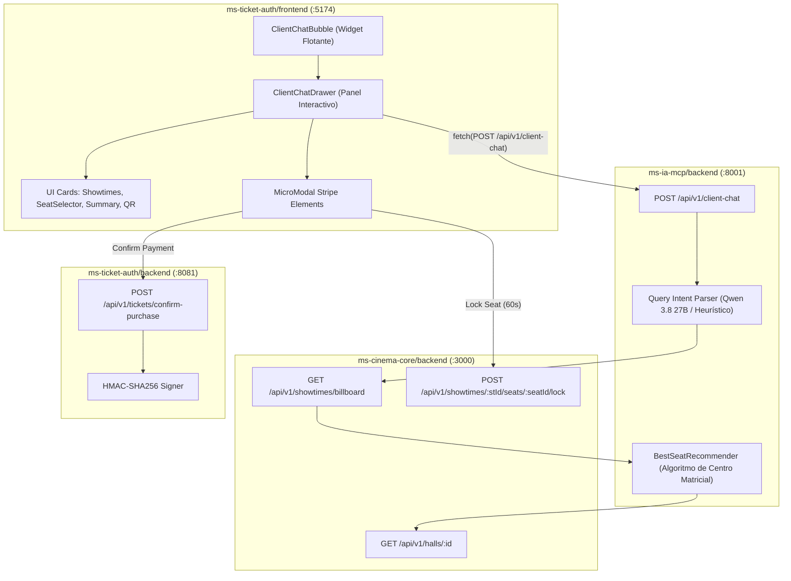

# Technical Plan: Módulo 07 - Chatbot Asistente de Compra para Clientes (CLIENT SALES CHATBOT)
Constitution-SHA256: bf9282dc4cc5ac79d835e768865b29b9544a02c8cd2af2489d72cfc304cb8e84
Spec-SHA256: 37417fedbe86643a80445c83155c35e05f134df1823b323475fa80002cc9ce94
Status: APPROVED
Version: 1

Revisión técnica 2026-11-12: para cumplir RF-17.2 a RF-17.5, el orquestador consulta funciones y detalle de butacas de Cinema-Core; debe informar la indisponibilidad de la dependencia cuando no pueda verificarla. Los campos existentes del contrato se conservan. La heurística de IA utiliza únicamente datos obtenidos del servicio. La verificación del bloqueo en compra corresponde al flujo transaccional de Ticket-Auth.

Para la transición de selección a compra, el resumen incluirá `seats` con pares de código visible e identificador de butaca devueltos por Cinema-Core. Es un campo adicional retrocompatible; nunca se deducirá un UUID a partir del código. La reserva continúa siendo responsabilidad de Ticket-Auth.

> **Estado:** APPROVED  
> **Módulo:** `docs/specs/07-client-chat/`  
> **Metodología:** SDD-Plan-Tecnico (Zero-Loss Engineering)  
> **Subordinación:** `docs/constitution.md` (v1.3.0) y `docs/specs/07-client-chat/spec.md` (Status: APPROVED)

---

## 1. Arquitectura del Sistema y Patrones de Diseño

El sistema se estructura bajo una arquitectura desacoplada y orientada a eventos livianos entre el frontend React del cliente (`ms-ticket-auth/frontend`), el microservicio orquestador de IA (`ms-ia-mcp/backend`) y el núcleo del complejo (`ms-cinema-core/backend`).



---

## 2. Contratos Tipados y Modelos de Datos

### 2.1 Backend (`ms-ia-mcp/backend/app/domain/models.py`)
```python
from pydantic import BaseModel, Field
from typing import List, Optional

class ShowtimeCard(BaseModel):
    showtimeId: str
    movieTitle: str
    posterUrl: Optional[str] = None
    hallName: str
    hallType: str  # '2D' | '3D' | 'IMAX'
    startTime: str
    price: float

class RecommendedSeat(BaseModel):
    seatCode: str  # Ej: 'C-8'
    row: str
    number: int
    isOptimal: bool = True
    badge: str = "Mejor Visibilidad"

class ClientChatRequest(BaseModel):
    userId: Optional[str] = "cliente-anonimo"
    message: str
    currentState: str = "EXPLORING"  # EXPLORING | SHOWTIME_SELECTED | SEAT_ASSIGNED | PAYMENT_PENDING
    selectedShowtimeId: Optional[str] = None
    selectedSeatCode: Optional[str] = None

class ClientChatResponse(BaseModel):
    reply: str
    nextState: str
    suggestedChips: List[str] = Field(default_factory=list)
    showtimeCards: List[ShowtimeCard] = Field(default_factory=list)
    recommendedSeats: List[RecommendedSeat] = Field(default_factory=list)
    summary: Optional[dict] = None
```

### 2.2 Frontend (`ms/ms-ticket-auth/frontend/src/types/client-chat.types.ts`)
```typescript
export type ChatFlowState = 
  | 'EXPLORING' 
  | 'SHOWTIME_SELECTED' 
  | 'SEAT_ASSIGNED' 
  | 'PAYMENT_PENDING' 
  | 'TICKET_ISSUED';

export interface ChatMessage {
  id: string;
  sender: 'user' | 'assistant';
  text: string;
  timestamp: string;
  showtimeCards?: ShowtimeCard[];
  recommendedSeats?: RecommendedSeat[];
  summary?: PurchaseSummary;
  issuedTicket?: IssuedTicketInfo;
  quickChips?: string[];
}

export interface ShowtimeCard {
  showtimeId: string;
  movieTitle: string;
  posterUrl?: string;
  hallName: string;
  hallType: string;
  startTime: string;
  price: number;
}

export interface RecommendedSeat {
  seatCode: string;
  row: string;
  number: number;
  isOptimal: boolean;
  badge: string;
}

export interface PurchaseSummary {
  showtimeId: string;
  movieTitle: string;
  hallName: string;
  seatCode: string;
  startTime: string;
  unitPrice: number;
  totalPrice: number;
}

export interface IssuedTicketInfo {
  ticketId: string;
  qrPayload: string;
  movieTitle: string;
  seatCode: string;
  hallName: string;
  formattedDate: string;
}
```

---

## 3. Algoritmo de Sugerencia de Butacas Óptimas (`BestSeatRecommender`)

Ubicado en `ms-ia-mcp/backend/app/domain/seat_recommender.py`:
1. **Lectura de la matriz de la sala** desde `ms-cinema-core` (`GET /api/v1/halls/:id`).
2. **Filtrado de asientos disponibles** (excluyendo reservados u ocupados en la función `showtimeId`).
3. **Cálculo de Distancia Geométrica al Centro de la Pantalla:**
   $$\text{Score} = |r - \text{Row}_{\text{centro}}| \times 1.5 + |c - \text{Col}_{\text{centro}}|$$
4. Los 3 asientos con menor score (más cercanos al punto focal de audio y pantalla) se devuelven como `recommendedSeats`.

---

## 4. Árbol Físico de Archivos a Crear y Modificar

```text
ms/
├── ms-ia-mcp/backend/
│   ├── app/
│   │   ├── domain/
│   │   │   ├── models.py                     # [MODIFICAR] Incorporar ClientChatRequest/Response
│   │   │   └── seat_recommender.py           # [CREAR] Algoritmo de scoring de butacas óptimas
│   │   └── presentation/
│   │       └── client_chat_routes.py         # [CREAR] Endpoint POST /api/v1/client-chat
│   └── tests/
│       └── test_client_chat.py               # [CREAR] Tests unitarios del backend conversacional
│
└── ms-ticket-auth/frontend/
    ├── src/
    │   ├── types/
    │   │   └── client-chat.types.ts          # [CREAR] Tipos de datos e interfaces
    │   ├── components/
    │   │   └── ClientChat/
    │   │       ├── ClientChatBubble.tsx      # [CREAR] Botón flotante FAB con badge
    │   │       ├── ClientChatWindow.tsx      # [CREAR] Ventana de chat desplegable
    │   │       ├── ShowtimeCardList.tsx      # [CREAR] Lista cliqueable de funciones
    │   │       ├── SeatSelectorPills.tsx     # [CREAR] Selector de butacas recomendadas
    │   │       ├── PurchaseSummaryCard.tsx   # [CREAR] Tarjeta de resumen de compra
    │   │       ├── StripeMicroModal.tsx      # [CREAR] Micro-modal de Stripe Elements
    │   │       └── IssuedTicketCard.tsx      # [CREAR] Tarjeta de éxito y QR firmado
    │   ├── services/
    │   │   └── client-chat.service.ts        # [CREAR] Cliente HTTP hacia ms-ia-mcp
    │   ├── App.tsx                           # [MODIFICAR] Montar <ClientChatBubble />
    │   └── tests/
    │       └── ClientChat.spec.tsx           # [CREAR] Suite de pruebas Vitest frontend
```

---

## 5. Estrategia de Pruebas y Criterios de Done (DoD)

1. **Frontend Vitest:**
   - Montaje del widget flotante y apertura de ventana.
   - Envío de chips y despacho de mensajes.
   - Selección de tarjetas de funciones y butacas actualizando el estado.
   - Disparo del micro-modal de Stripe ante el botón de pago.
2. **Backend Pytest:**
   - Procesamiento de queries temporales (*"hoy en la tarde"*, *"estrenos"*).
   - Recomendar butacas centrales ante una matriz dada.
   - Fallback heurístico si Groq Cloud no está disponible.

