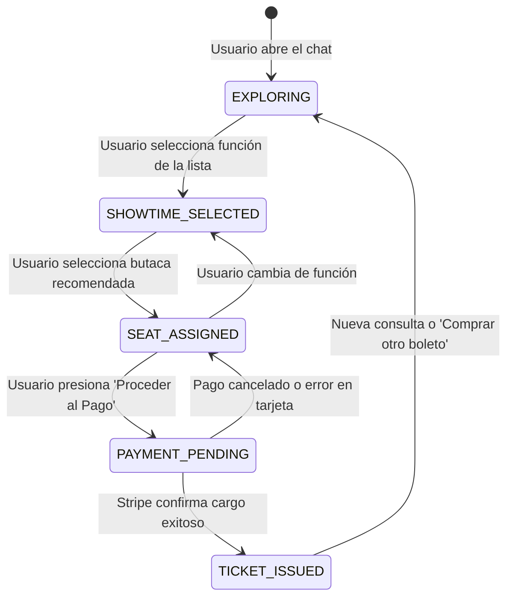

# Specification: Módulo 07 - Chatbot Asistente de Compra para Clientes (CLIENT SALES CHATBOT)
Status: APPROVED
Version: 1

Revisión 2026-11-12: se conserva la aprobación previa. RF-17.2 a RF-17.5 y RB-CCH-02 exigen datos reales de Cinema-Core; las respuestas de ejemplo y la ausencia de verificación observadas en la implementación no constituyen una regla de negocio aprobada. La contingencia de RB-CCH-05 se refiere a fallas del proveedor de IA con cartelera disponible, no autoriza inventar cartelera o disponibilidad cuando falla Cinema-Core.

> **Estado:** APPROVED  
> **Módulo:** `docs/specs/07-client-chat/`  
> **Ubicación en Código:** `ms/ms-ticket-auth/frontend/` (Burbuja Flotante Web) + `ms/ms-ia-mcp/backend/` (Endpoint Orquestador `/api/v1/client-chat`)  
> **Metodología:** SDD-Spec-Assisted (Inferencia Proactiva y Selección Asistida)  
> **Subordinación:** Sujeto estrictamente a `docs/constitution.md` (v1.3.0)

---

## 1. Objetivo y Alcance

### 1.1 Objetivo de Negocio
Brindar a los clientes del cine una experiencia conversacional fluida, moderna y asistida mediante un widget flotante en la esquina inferior derecha de la plataforma web oficial (`ms-ticket-auth/frontend :5174`). El asistente de IA interpreta intenciones en lenguaje natural (ej. *"quiero una película para ver hoy en la tarde"*), presenta funciones y salas disponibles en formato de tarjetas y listas enriquecidas cliqueables, recomienda butacas con visibilidad óptima y conduce al usuario a través de un micro-modal de pago seguro con Stripe, culminando con la emisión inmediata del boleto oficial y su código QR dinámico criptográficamente firmado.

### 1.2 Alcance Funcional (In-Scope)
- **Widget de Burbuja Flotante (Floating Action Button):** Botón flotante accesible desde cualquier vista del portal web del cliente con estado minimizado/expandido, contador de mensajes no leídos y animación sutil de apertura.
- **Panel Conversacional Enriquecido:** Interfaz de mensajería con soporte de componentes interactivos (UI Cards) que trascienden el texto plano:
  - *Pastillas de Sugerencia Rápida (Quick Reply Chips):* Opciones contextuales predefinidas como *"Funciones de hoy"*, *"Estrenos"*, *"Películas de la tarde"*.
  - *Tarjetas de Salas y Funciones Cliqueables:* Lista interactiva con póster, título de película, horario, formato de proyección (2D, 3D, IMAX), sala y precio unitario.
  - *Selector Inteligente de Butacas Recomendadas:* Visualización interactiva de las mejores ubicaciones en sala (zonas centrales con badge de visibilidad óptima) permitiendo seleccionar o cambiar de asiento con 1 clic.
  - *Tarjeta Resumen de Compra:* Desglose de película, sala, butaca elegida, horario y monto total con botón de acción directa *"Proceder al Pago"*.
  - *Micro-Modal / Contenedor de Stripe Integrado:* Despliegue de pasarela de pago segura sin redirigir al usuario fuera del chat, preservando el contexto de la conversación.
  - *Tarjeta de Boleto Emitido:* Despliegue del código QR dinámico firmado con HMAC-SHA256 y botón de descarga directa del ticket en formato digital.
- **Motor de Orquestación e Inferencia en Backend (`ms-ia-mcp`):**
  - Endpoint especializado `POST /api/v1/client-chat` potenciado por Groq Cloud (`qwen/qwen3.8-27b`).
  - Herramientas internas de consulta en tiempo real hacia `ms-cinema-core` (`/api/v1/showtimes/billboard`, `/api/v1/halls/:id`) para validar cartelera y disponibilidad de butacas.
- **Máquina de Estados Conversacional Estricta:** Gobernanza del flujo para impedir transiciones anómalas o compras incompletas.

### 1.3 Exclusiones Explícitas (Out-of-Scope)
- **Venta de Alimentos y Confitería:** Exclusión total conforme al mandato supremo de `docs/constitution.md` (Sección 1.4).
- **Procesamiento de Dinero Real:** Solo se utilizarán tokens y tarjetas de prueba de desarrollador de Stripe (`424242...`).
- **Cancelaciones o Reembolsos vía Chat:** Los boletos emitidos son definitivos y deben gestionarse por los canales administrativos autorizados.

---

## 2. Actores y Matriz de Autorización

| Actor | Permisos en este Módulo | Restricciones |
| :--- | :--- | :--- |
| **Cliente Autenticado (`cliente`)** | Interactuar con la IA; consultar funciones; seleccionar butacas sugeridas; pagar y emitir boletos asociados a su usuario. | No puede acceder a datos confidenciales del complejo ni reservar asientos de funciones pasadas. |
| **Visitante Anónimo** | Abrir la burbuja de chat; explorar recomendaciones de películas y cartelera; consultar horarios. | Al intentar presionar *"Proceder al Pago"*, el chat le solicita iniciar sesión o registrarse mediante un chip interactivo de autenticación. |

---

## 3. Modelo Funcional y Reglas de Negocio Específicas (`RB-CCH-XX`)

### 3.1 Máquina de Estados del Flujo Conversacional
El asistente opera bajo una máquina de estados determinista (`ChatFlowState`):



### 3.2 Reglas de Negocio Formalizadas
- **`RB-CCH-01` (Invariante de Selección Escalonada):** El sistema tiene prohibido invocar la pasarela de pago si el estado actual es diferente de `SEAT_ASSIGNED`. No se puede pagar sin haber seleccionado previamente una función vigente y una butaca específica.
- **`RB-CCH-02` (Validación de Integridad en Tiempo Real):** Antes de transicionar a `PAYMENT_PENDING`, el backend del chat debe verificar con `ms-cinema-core` que la butaca seleccionada continúe en estado `LIBRE`. Si otro usuario la bloqueó concurrentemente, el chat debe alertar: *"La butaca seleccionada acaba de ser ocupada"* y ofrecer inmediatamente la siguiente mejor butaca contigua.
- **`RB-CCH-03` (Bloqueo Atómico Temporal):** Al ingresar al micro-modal de pago, la butaca queda bloqueada con un temporizador de cuenta regresiva de 60 segundos. Si el temporizador expira sin confirmación, la butaca se libera automáticamente y el chat regresa a `SEAT_ASSIGNED`.
- **`RB-CCH-04` (Firma Criptográfica HMAC-SHA256):** Tras la confirmación de pago por Stripe, el boleto emitido debe incorporar un código QR dinámico generado con el payload estructurado y firmado con la clave compartida `clave_secreta_universitaria_mcp`, garantizando que el validador en puerta (`ms-boleteo-validator`) lo reconozca como válido (SC-05.1.1).
- **`RB-CCH-05` (Degradación Elegante por Timeout de IA):** Si la llamada hacia Groq Cloud excede los 3 segundos o reporta falla de conectividad, el chat debe activar su motor de recomendación local basado en reglas heurísticas sobre la cartelera de `ms-cinema-core`, garantizando cero interrupciones en la compra.

---

## 4. Requerimientos Funcionales Estructurados (Patrón EARS)

### Historia de Usuario `HU-17`: Asistente Conversacional Inteligente para Clientes
*Como cliente del cine, quiero interactuar con un asistente virtual accesible desde una burbuja en la página web, para recibir recomendaciones personalizadas de horarios, elegir fácilmente mis asientos y pagar mis entradas sin salir de la conversación.*

#### Requerimientos del Sistema
- **`RF-17.1` (Burbuja Flotante y Apertura Reactiva):** Cuando el usuario navega en el portal web (`:5174`), el sistema deberá mostrar un botón flotante con ícono de asistente en la esquina inferior derecha. Al hacer clic, el sistema deberá desplegar el panel de chat con animación de desvanecimiento y foco en el campo de texto.
- **`RF-17.2` (Procesamiento de Lenguaje Natural Contextual):** Cuando el usuario envía un mensaje libre (ej. *"quiero una película para ver hoy en la tarde"*), el sistema deberá clasificar la intención, extraer los parámetros temporales (tarde = 14:00 a 19:00 hrs) y consultar la cartelera activa en `ms-cinema-core`.
- **`RF-17.3` (Renderizado de Lista Cliqueable de Salas y Horarios):** Si existen funciones que coincidan con la búsqueda, el sistema deberá responder con un mensaje explicativo acompañado de una lista de tarjetas cliqueables con portada, título, sala, formato y horario. Al hacer clic en una tarjeta, se fija el `showtimeId`.
- **`RF-17.4` (Sugerencia Dinámica de Butacas Centrales):** Al fijar la función, el sistema deberá analizar la matriz de butacas de la sala y presentar hasta 3 opciones recomendadas con el badge *"Mejor Visibilidad"*. Al hacer clic en un asiento, este se asigna a la compra.
- **`RF-17.5` (Tarjeta Resumen y Lanzamiento de Micro-Modal Stripe):** Cuando se tiene función y asiento seleccionados, el sistema deberá renderizar la tarjeta de resumen financiero. Al pulsar *"Proceder al Pago"*, se abre el micro-modal con Stripe Elements.
- **`RF-17.6` (Emisión de Boleto y QR Descargable):** Una vez procesado el pago exitoso, el sistema deberá actualizar la vista del chat con la tarjeta de confirmación conteniendo el código QR dinámico, código de boleto, y el botón *"Descargar Boleto"* en formato imagen/PDF.

---

## 5. Criterios de Aceptación BDD (Gherkin / Given-When-Then)

### Escenario `SC-17.1.1`: Recomendación interactiva de funciones por franja horaria
```gherkin
Given que el cliente se encuentra en el portal web con el chat abierto
  And existen funciones activas para la película "Inception" a las 15:30 y 18:00
When el usuario escribe "quiero ver una película hoy en la tarde"
Then el asistente responde en texto natural sugiriendo las opciones vespertinas
  And renderiza 2 tarjetas interactivas cliqueables con los horarios 15:30 y 18:00
  And cada tarjeta muestra el título, formato de sala y precio de la entrada
```

### Escenario `SC-17.1.2`: Asignación interactiva de butaca recomendada
```gherkin
Given que el usuario hizo clic en la tarjeta de la función de las 18:00
When el sistema consulta la disponibilidad de asientos en la sala correspondiente
Then el chat despliega un selector interactivo con las 3 butacas centrales libres más óptimas (ej. C-7, C-8, C-9)
  And al tocar la butaca "C-8", el sistema actualiza el estado a SEAT_ASSIGNED
  And presenta la tarjeta de confirmación previa con el desglose total del pago
```

### Escenario `SC-17.1.3`: Detección de colisión de butaca ocupada concurrentemente
```gherkin
Given que el usuario seleccionó la butaca "C-8" en el chat
  And otro cliente completó la compra de la butaca "C-8" milisegundos antes
When el usuario presiona el botón "Proceder al Pago"
Then el sistema detecta que el asiento ya no está libre en Cinema-Core
  And el chat muestra una alerta preventiva: "La butaca C-8 acaba de ser ocupada"
  And ofrece automáticamente la butaca contigua libre "C-9" sin reiniciar la conversación
```

### Escenario `SC-17.1.4`: Emisión exitosa de boleto con código QR dinámico tras pago
```gherkin
Given que el usuario completó exitosamente el pago simulado con tarjeta de prueba en Stripe
When la transacción retorna estado "succeeded"
Then el micro-modal de pago se cierra automáticamente
  And el chat renderiza la tarjeta de éxito con el código de confirmación del boleto
  And se dibuja el Código QR firmado con HMAC-SHA256
  And se habilita el botón de descarga del boleto digital
```

---

## 6. Especificación de Pruebas Unitarias y de Integración (`TEST-CCH-XX`)

Las siguientes suites de pruebas son de cumplimiento obligatorio durante la fase de ejecución técnica:

### 6.1 Pruebas Unitarias de Frontend (`ms-ticket-auth/frontend`)
- **`TEST-CCH-01` (Renderizado y Toggle del Widget Flotante):**
  - Verifica que el botón flotante se monte en el DOM en la esquina inferior derecha.
  - Verifica que el evento `onClick` alterne la visibilidad del panel de chat (`isOpen: true/false`).
- **`TEST-CCH-02` (Extracción de Entidades y Manejo de Chips):**
  - Verifica que al hacer clic en un Quick Reply Chip (ej. *"Estrenos"*), el texto se despache automáticamente como mensaje del usuario.
- **`TEST-CCH-03` (Renderizado Condicional de Componentes UI):**
  - Verifica que cuando el mensaje del bot contenga `suggestedShowtimes`, se renderice la lista de tarjetas interactivas.
  - Verifica que cuando contenga `suggestedSeats`, se rendericen los botones de selección de butacas con su respectivo badge.
- **`TEST-CCH-04` (Validación de Transiciones de la Máquina de Estados):**
  - Asegura que el botón *"Proceder al Pago"* permanezca deshabilitado si `seatCode` es nulo o indefinido.

### 6.2 Pruebas de Integración y Backend (`ms-ia-mcp/backend`)
- **`TEST-CCH-05` (Parsing y Clasificación de Intenciones):**
  - Test unitario sobre el parser de lenguaje natural: verifica que entradas como *"hoy en la tarde"*, *"para la noche"*, *"acción"* filtren adecuadamente los registros de cartelera.
- **`TEST-CCH-06` (Algoritmo de Selección de Butacas Óptimas):**
  - Verifica que dada una matriz de asientos (filas A a F, columnas 1 a 10), el algoritmo de scoring priorice asientos de filas intermedias (C, D) y columnas centrales (4 a 7).
- **`TEST-CCH-07` (Contrato Criptográfico del QR):**
  - Verifica que el payload devuelto para el QR post-compra contenga el campo `signature` y que sea validable contra la función de verificación HMAC-SHA256 con la clave compartida.
- **`TEST-CCH-08` (Manejo de Fallas de IA / Circuit Breaker):**
  - Simula timeout de 5s en Groq Cloud y verifica que el endpoint retorne `HTTP 200` con la respuesta heurística de contingencia sin arrojar excepción no controlada.

