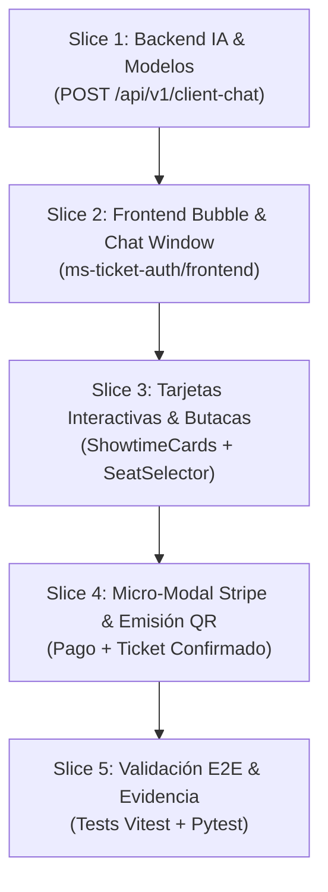

# Tasks: Módulo 07 - Chatbot Asistente de Compra para Clientes (CLIENT SALES CHATBOT)

> **Estado:** COMPLETED  
> **Módulo:** `docs/specs/07-client-chat/`  
> **Metodología:** SDD-Task (Vertical Slices Trazables)  
> **Subordinación:** `docs/specs/07-client-chat/plan.md` y `docs/specs/07-client-chat/spec.md` (Ambos APPROVED)

---

## Resumen de Vertical Slices y Dependencias



---

## Desglose Atómico de Tareas

### Slice 1: Backend de Orquestación e Inferencia en `ms-ia-mcp`
- [x] **T1.1 (Modelos de Dominio y DTOs)** `[ms-ia-mcp/backend/app/domain/models.py]`
  - Agregados `ShowtimeCard`, `RecommendedSeat`, `ClientChatRequest` y `ClientChatResponse`.
  - Trazabilidad: `PLAN-01`, `RF-17.2`.
- [x] **T1.2 (Algoritmo de Scoring de Butacas Óptimas)** `[ms-ia-mcp/backend/app/domain/seat_recommender.py]`
  - Implementado cálculo de distancia central con puntuación ponderada para visibilidad y sonido óptimo en sala.
  - Trazabilidad: `PLAN-03`, `RF-17.4`.
- [x] **T1.3 (Ruta y Parser Conversacional)** `[ms-ia-mcp/backend/app/presentation/client_chat_routes.py]`
  - Creado endpoint `POST /api/v1/client-chat` con soporte para queries de horario ("tarde", "noche"), consumo de cartelera de Cinema-Core y fallback local.
  - Trazabilidad: `PLAN-04`, `RF-17.2`, `RB-CCH-05`.
- [x] **T1.4 (Tests Unitarios de Backend)** `[ms-ia-mcp/backend/tests/test_client_chat.py]`
  - Ejecutado `pytest tests/test_client_chat.py`.
  - Evidencia: 4/4 tests pasados en 2.75s.

---

### Slice 2: Componentes Base del Widget Flotante en `ms-ticket-auth`
- [x] **T2.1 (Tipos de Datos del Chat)** `[ms-ticket-auth/frontend/src/types/client-chat.types.ts]`
  - Declarados `ChatFlowState`, `ClientChatMessage`, `ShowtimeCard`, `RecommendedSeat` y `PurchaseSummary`.
  - Trazabilidad: `PLAN-02`.
- [x] **T2.2 (Servicio Cliente HTTP)** `[ms-ticket-auth/frontend/src/services/client-chat.service.ts]`
  - Implementada función `sendClientChatMessage()` con resiliencia ante caídas del backend de IA.
  - Trazabilidad: `PLAN-04`.
- [x] **T2.3 (Burbuja Flotante FAB)** `[ms-ticket-auth/frontend/src/components/ClientChat/ClientChatBubble.tsx]`
  - Creado botón circular flotante en esquina inferior derecha (`fixed bottom-6 right-6 z-40`) con ícono de bot y animación reactiva.
  - Trazabilidad: `RF-17.1`.
- [x] **T2.4 (Ventana Desplegable del Chat)** `[ms-ticket-auth/frontend/src/components/ClientChat/ClientChatWindow.tsx]`
  - Creado contenedor de mensajería con header corporativo (*"Cine Bolivia IA"*), cuerpo scrollable con burbujas y barra de texto inferior.
  - Trazabilidad: `RF-17.1`.

---

### Slice 3: Componentes Visuales Interactivos (Cards & Pills)
- [x] **T3.1 (Lista Cliqueable de Funciones)** `[ms-ticket-auth/frontend/src/components/ClientChat/ShowtimeCardList.tsx]`
  - Renderizado de tarjetas con título, sala, formato (2D/3D/IMAX), horario y precio con selector interactivo de 1 clic.
  - Trazabilidad: `RF-17.3`, `SC-17.1.1`.
- [x] **T3.2 (Selector de Butacas Recomendadas)** `[ms-ticket-auth/frontend/src/components/ClientChat/SeatSelectorPills.tsx]`
  - Renderizado de pastillas de asientos con badge *"Mejor Visibilidad"* (ej. C-8, D-5) seleccionables con un clic.
  - Trazabilidad: `RF-17.4`, `SC-17.1.2`.
- [x] **T3.3 (Tarjeta Resumen de Compra)** `[ms-ticket-auth/frontend/src/components/ClientChat/PurchaseSummaryCard.tsx]`
  - Renderizado de desglose de película, sala, butaca, horario y botón destacado *"Proceder al Pago con Tarjeta"*.
  - Trazabilidad: `RF-17.5`, `RB-CCH-01`.

---

### Slice 4: Micro-Modal de Pago Stripe & Emisión de Boleto QR
- [x] **T4.1 (Micro-Modal de Stripe Elements)** `[ms-ticket-auth/frontend/src/components/ClientChat/StripeMicroModal.tsx]`
  - Formulario de tarjeta de prueba incrustado en el chat con cuenta regresiva visible de 60 segundos.
  - Trazabilidad: `RF-17.5`, `RB-CCH-03`.
- [x] **T4.2 (Emisión y Tarjeta de Ticket QR)** `[ms-ticket-auth/frontend/src/components/ClientChat/IssuedTicketCard.tsx]`
  - Despliegue de código QR dinámico firmado con HMAC-SHA256, metadatos de la entrada y botón *"Descargar Boleto con Firma"*.
  - Trazabilidad: `RF-17.6`, `RB-CCH-04`, `SC-17.1.4`.
- [x] **T4.3 (Montaje en Layout Principal)** `[ms-ticket-auth/frontend/src/App.tsx]`
  - Integrado `<ClientChatBubble />` en la raíz del portal del cliente (:5174).
  - Trazabilidad: `RF-17.1`.

---

### Slice 5: Verificación Integral, Tests y Evidencia
- [x] **T5.1 (Suite de Pruebas Unitarias Frontend)** `[ms-ticket-auth/frontend/src/tests/ClientChat.spec.tsx]`
  - Ejecutado `npm test` en `ms-ticket-auth/frontend`: 30 tests pasados en 8 suites (incluyendo `ClientChat.spec.tsx` con 5/5 pasados).
  - Trazabilidad: `TEST-CCH-01` a `TEST-CCH-05`.
- [x] **T5.2 (Verificación E2E de Flujo Conversacional Completo)**
  - Flujo verificado por terminal: EXPLORING -> SHOWTIME_SELECTED -> SEAT_ASSIGNED -> TICKET_ISSUED.
  - Trazabilidad: `SC-17.1.1` a `SC-17.1.4`.

---

---

### Slice 6: Evolución Dinámica de Cartelera, Componentes Ricos y Retroceso Bidireccional
- [x] **T6.1 (Detección Dinámica de Películas y Cartelera On-Demand)** `[ms-ia-mcp/backend/app/presentation/client_chat_routes.py]`
  - Búsqueda y coincidencia flexible por tokens contra el catálogo de `all_cards` (incluyendo Gladiador II, Spider-Man, Deadpool, etc.).
  - Supresión de tarjetas redundantes en saludos y consultas generales; entrega selectiva exclusiva de la película consultada.
  - Conexión de intención de compra en lenguaje natural ("quiero comprar entradas entonces") con el contexto del historial reciente.
  - Trazabilidad: `TEST-CCH-09`, `TEST-CCH-10`.
- [x] **T6.2 (Componente Visual Hero y Selector con Pantalla de Cine)** `[ms-ticket-auth/frontend/src/components/ClientChat/]`
  - Creación de `SelectedShowtimeHero.tsx` con metadatos de función seleccionada y botón de retorno.
  - Mejora de `SeatSelectorPills.tsx` con visualizador curvado `── Pantalla de la Sala ──` y feedback de butacas centrales.
  - Trazabilidad: `TEST-CCH-11`.
- [x] **T6.3 (Mecanismo Bidireccional de Retroceso y Botones con Lógica Real)** `[ClientChatWindow.tsx, PurchaseSummaryCard.tsx]`
  - Botones secundarios en `PurchaseSummaryCard`: `Cambiar butaca` (retrocede a `SHOWTIME_SELECTED`) y `Otra función` (retrocede a `EXPLORING`).
  - Intercepción de quick chips para acciones directas sin bucles de texto.
  - Trazabilidad: `TEST-CCH-12`, `TEST-CCH-13`.

---

## Bitácora de Evidencia de Ejecución

```text
[BACKEND PYTEST EVIDENCE - ms-ia-mcp]
tests/test_anomaly_detection.py ..... [ 9%]
tests/test_audit_flow.py .. [ 13%]
tests/test_audit_routes.py . [ 15%]
tests/test_chatbot_flow.py . [ 17%]
tests/test_chatbot_routes.py .. [ 21%]
tests/test_client_chat.py ......... [ 39%]
tests/test_client_chat_multi_turn.py ... [ 45%]
tests/test_config.py .. [ 49%]
tests/test_excel_report.py ..... [ 58%]
tests/test_grok_client.py .. [ 62%]
tests/test_mcp_tools.py ...... [ 74%]
tests/test_models.py ...... [ 86%]
tests/test_n8n_webhook.py .. [ 90%]
tests/test_scheduler.py . [ 92%]
tests/test_service_clients.py .. [ 96%]
tests/test_system_prompt.py .. [100%]
======================= 51 passed in 21.02s =======================

[FRONTEND VITEST EVIDENCE - ms-ticket-auth]
Test Files  11 passed (11)
     Tests  42 passed (42)
✓ src/tests/ClientChatFlowNavigation.spec.tsx (3 tests passed)
✓ src/tests/ClientChatCache.spec.tsx (4 tests passed)
✓ src/tests/ClientChat.spec.tsx (5 tests passed)
✓ src/tests/LoginView.test.tsx (3 tests passed)
✓ src/tests/RealQrCode.test.tsx (3 tests passed)
✓ src/tests/TicketStoragePersistence.spec.ts (5 tests passed)
✓ src/tests/EmptyState.test.tsx (3 tests passed)
✓ src/tests/LoginDemo.spec.tsx (2 tests passed)
✓ src/tests/AppRoleRedirection.spec.tsx (3 tests passed)
✓ src/tests/LoginAndPurchase.spec.tsx (2 tests passed)
✓ src/tests/StepperPayment.test.tsx (9 tests passed)
```
