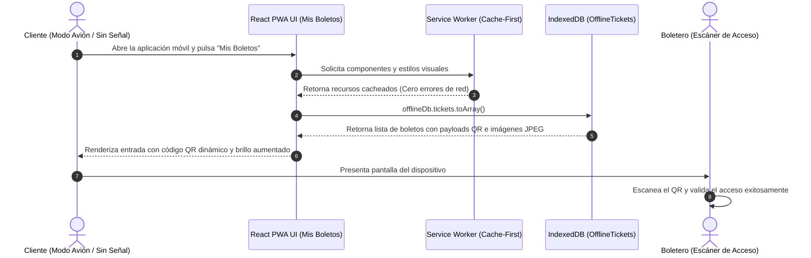

# Plan Técnico: Módulo 07 - Aplicación Móvil del Cliente (MOVIL APP CLIENTE)

> **Estado:** APPROVED  
> **Versión:** 1.0.0  
> **Módulo:** `docs/specs/07-mobile-client/`  
> **Especificación Base:** `docs/specs/07-mobile-client/spec.md`  
> **Constitución Base:** `docs/constitution.md`  
> **Metodología:** SDD-Planning

---

## 1. Resumen Arquitectónico y Decisiones de Diseño

- **Objetivo Técnico:** Implementar la aplicación de usuario final en React 18+ estructurada como Progressive Web App (PWA) y empaquetada con Capacitor 5+ para ejecución nativa, integrando Apollo Client para consumo de GraphQL federado, persistencia offline en IndexedDB de boletos digitales y códigos QR, asistente conversacional en un drawer deslizable y geolocalización GPS interna para asistencia de navegación a la sala.
- **Estilo Arquitectónico:** React Component-Based Architecture con Service Workers y Capas Desacopladas:
  - *GraphQL Data Layer:* Cliente Apollo con caché normalizada y suscripciones/consultas hacia `MS TICKET-AUTH`.
  - *Offline Storage Engine:* Abstracción sobre IndexedDB (`idb` o `Dexie.js`) para persistir entradas completas (JSON del QR + Blobs de imágenes JPEG) inmediatamente después de la confirmación de pago.
  - *PWA Service Worker:* Registro de Service Worker (Workbox / Vite PWA) para caching de recursos estáticos (HTML, JS, CSS, iconos).
  - *Native Device Bridge:* Capacitor Geolocation Plugin (`@capacitor/geolocation`) para acceso al GPS del terminal.
  - *Sales Drawer Module:* Drawer lateral retráctil conectado con el endpoint de chat de `MS IA-MCP`.
- **Decisiones Técnicas Clave:**
  - **Doble Persistencia Inmediata:** Tras el pago exitoso en Stripe, la app descarga el binario JPEG y el payload del QR a `IndexedDB` antes de transicionar a la pantalla de éxito, blindando al usuario contra pérdidas de señal en el cine.
  - **Indicaciones GPS Informativas:** Procesamiento de coordenadas GPS locales para calcular la proximidad al complejo y renderizar la tarjeta con indicaciones fijas hacia la sala asignada en el boleto.

### 1.1 Matriz de Componentes Técnicos (`PLAN-XX`)

| ID Componente | Nombre / Artefacto Técnico | Capa Arquitectónica | Responsabilidad Técnica | Requisitos que Cubre |
| :--- | :--- | :--- | :--- | :--- |
| **`PLAN-01`** | `IndexedDbStorageService` (Dexie/idb) | Persistencia Local | Esquema de base de datos local `OfflineTickets` en IndexedDB. | `HU-17`, `RF-17.2`, `RB-MOB-01` |
| **`PLAN-02`** | `GraphQLClientService` (Apollo) | Red / API Gateway | Consultas y mutaciones hacia el esquema federado de MS TICKET-AUTH. | `HU-16`, `RF-16.1`, `RF-16.4` |
| **`PLAN-03`** | `ServiceWorkerRegistration` (Vite PWA) | Infraestructura PWA | Estrategia Cache-First para ejecución offline total (Modo Avión). | `HU-17`, `RF-17.1`, `RB-MOB-02` |
| **`PLAN-04`** | `GpsOrientationService` (Capacitor) | Hardware / Dispositivo | Detección de posición por GPS nativo y cálculo de indicaciones hacia la sala. | `HU-18`, `RF-18.1`, `RF-18.2` |
| **`PLAN-05`** | `BillboardView`, `MyTicketsView`, `GpsGuidanceCard`, `ChatDrawer` | Presentación (React) | Interfaz de cartelera, Stepper de compra, visualizador offline de QR y chat. | `RF-16.1`, `RF-16.2`, `RF-18.2`, `SC-07.1.1` |

---

## 2. Estructura Física de Archivos del Módulo

```text
apps/movil-client/
├── package.json                                                                      # React 18, @apollo/client, @capacitor/core, @capacitor/geolocation, dexie, tailwindcss
├── vite.config.ts                                                                    # Configuración de Vite + VitePWA plugin
├── capacitor.config.ts                                                               # Configuración de empaquetado nativo Capacitor
├── src/
│   ├── main.tsx
│   ├── App.tsx                                                                       # Enrutamiento principal y Drawer del Chatbot
│   ├── services/
│   │   ├── apollo-client.ts                                                          # [CREATE] (PLAN-02) Cliente GraphQL
│   │   ├── offline-storage.service.ts                                                # [CREATE] (PLAN-01) Operaciones CRUD en IndexedDB
│   │   └── gps-guidance.service.ts                                                   # [CREATE] (PLAN-04) API de geolocalización nativa
│   ├── components/
│   │   ├── Billboard/
│   │   │   ├── MovieList.tsx                                                         # [CREATE] (PLAN-05) Catálogo de películas
│   │   │   └── ShowtimeSelector.tsx                                                  # [CREATE] (PLAN-05) Selección de horario
│   │   ├── Purchase/
│   │   │   ├── SeatSelectionMap.tsx                                                  # [CREATE] (PLAN-05) Mapa interactivo de butacas
│   │   │   ├── TicketPreviewModal.tsx                                                # [CREATE] (PLAN-05) Imagen JPEG desde MinIO S3
│   │   │   └── StripeCheckoutWrapper.tsx                                             # [CREATE] (PLAN-05) Contenedor Stripe con temporizador 60s
│   │   ├── Tickets/
│   │   │   ├── MyTicketsList.tsx                                                     # [CREATE] (PLAN-05) Vista "Mis Boletos" (Online/Offline)
│   │   │   └── QrCodeViewer.tsx                                                      # [CREATE] (PLAN-05) Render de QR dinámico con brillo alto
│   │   ├── Navigation/
│   │   │   └── GpsGuidanceCard.tsx                                                   # [CREATE] (PLAN-05) Tarjeta "Cómo llegar a tu Sala"
│   │   └── Chatbot/
│   │       └── ChatDrawer.tsx                                                        # [CREATE] (PLAN-05) Panel lateral deslizable retráctil
│   └── tests/
│       ├── offline-tickets.spec.ts                                                   # [CREATE] Test de lectura de tickets en modo avión
│       ├── gps-guidance.spec.ts                                                      # [CREATE] Test de tarjeta de orientación
│       └── chat-drawer.spec.ts                                                       # [CREATE] Test de compra asistida en el drawer
└── Dockerfile                                                                        # Node dev server / Nginx PWA
```

---

## 3. Modelo Físico de Persistencia en IndexedDB (`offline-storage.service.ts`)

```typescript
import Dexie, { Table } from 'dexie';

export interface OfflineTicket {
  ticketId: string;
  movieTitle: string;
  hallName: string;
  seatCode: string;
  showtimeDate: string;
  qrPayloadJson: string;
  jpegImageBlob: Blob;
  downloadedAt: Date;
}

export class CineOfflineDatabase extends Dexie {
  tickets!: Table<OfflineTicket, string>;

  constructor() {
    super('CineV2_OfflineDB');
    this.version(1).stores({
      tickets: 'ticketId, showtimeDate'
    });
  }
}

export const offlineDb = new CineOfflineDatabase();
```

---

## 4. Diagrama de Secuencia: Visualización de Boletos en Modo Desconectado (Modo Avión)



---

## 5. Arquitectura de Vertical Slices para `/sdd-task`

* **Slice 0 (Setup):** `PLAN-01`, `PLAN-03` Configuración PWA con Workbox, IndexedDB con Dexie y cliente Apollo.
* **Slice 1 (Cartelera y Stepper de Compra con Stripe):** `PLAN-02`, `PLAN-05` Selección de butacas, previsualización JPEG, checkout de 60s y emisión de QR.
* **Slice 2 (Soporte Offline Total en "Mis Boletos"):** `PLAN-01`, `PLAN-03`, `PLAN-05` Descarga automática post-pago y visualización sin red en Modo Avión.
* **Slice 3 (Orientación GPS y Chatbot Deslizable):** `PLAN-04`, `PLAN-05` Tarjeta informativa de acceso a sala por GPS y drawer lateral conversacional.
* **Slice 4 (Verificación y Cierre):** Pruebas Jest/Vitest, auditoría Lighthouse PWA y build de producción.

