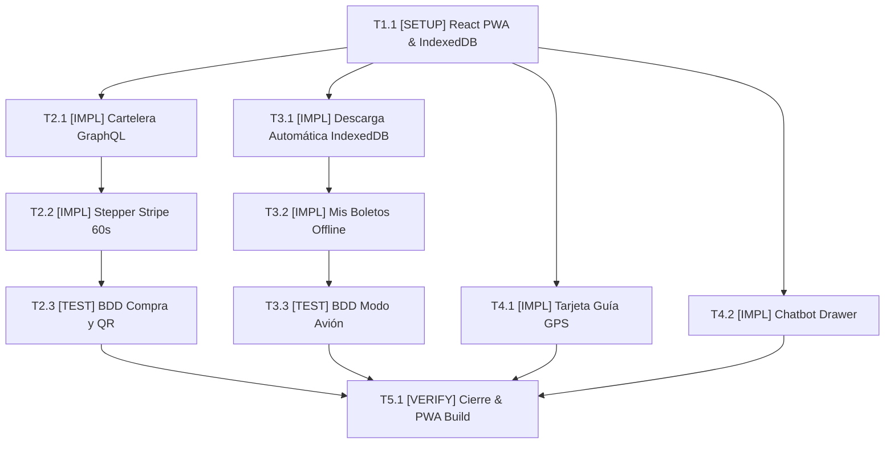

# Tasks: Módulo 07 - Aplicación Móvil del Cliente (MOVIL APP CLIENTE)

## Task Progress

| Métrica | Cantidad |
| :--- | ---: |
| Total de tareas | 10 |
| Tareas realizadas | 0 |
| Tareas por realizar | 10 |
| Tareas bloqueadas | 0 |
| Tareas en progreso | 0 |
| Progreso | 0% |

**Estado:** READY

---

## Checklist Rápido de Tareas por Vertical Slice

### Fase 0: Setup PWA, IndexedDB y Apollo GraphQL
- [ ] `T1.1` `[SETUP]` Configuración de proyecto React 18 + Vite PWA + Capacitor, Dexie.js para IndexedDB y Apollo Client (`PLAN-01`, `PLAN-02`, `PLAN-03`).

### Slice 1: Cartelera Dinámica y Stepper de Compra con Stripe
- [ ] `T2.1` `[IMPL]` Construir explorador de cartelera (`MovieList`, `ShowtimeSelector`) consumiendo GraphQL federado (`PLAN-02`, `PLAN-05`).
- [ ] `T2.2` `[IMPL]` Implementar Stepper de compra con mapa de butacas, modal de previsualización JPEG de MinIO y pasarela Stripe con temporizador de 60s (`PLAN-05`).
- [ ] `T2.3` `[TEST]` Suite BDD de compra: verificar flujo completo con tarjeta de prueba y emisión de código QR (`RF-16.1`, `RF-16.3`).

### Slice 2: Soporte Offline Total de Boletos (Modo Avión)
- [ ] `T3.1` `[IMPL]` Implementar descarga automática inmediata del boleto (JSON + JPEG Blob) en IndexedDB tras la confirmación de Stripe (`PLAN-01`, `PLAN-03`).
- [ ] `T3.2` `[IMPL]` Construir componentes `MyTicketsList` y `QrCodeViewer` que leen exclusivamente de IndexedDB cuando el terminal no tiene señal (`PLAN-01`, `PLAN-05`).
- [ ] `T3.3` `[TEST]` Suite de pruebas offline: simular "Modo Avión" y verificar la disponibilidad visual del código QR y brillo de pantalla (`SC-07.1.1`, `RB-MOB-02`).

### Slice 3: Orientación GPS Interna y Chatbot Deslizable
- [ ] `T4.1` `[IMPL]` Implementar `GpsGuidanceCard` con detección GPS nativa de Capacitor e indicaciones textuales paso a paso hacia la sala (`PLAN-04`, `PLAN-05`).
- [ ] `T4.2` `[IMPL]` Implementar `ChatDrawer` retráctil de izquierda a derecha con integración conversacional de compra asistida (`PLAN-05`).

### Fase Final: Verificación Consolidada y Cierre
- [ ] `T5.1` `[VERIFY]` Ejecución completa de suites de prueba, auditoría Lighthouse PWA offline y build de Capacitor.

---

## 1. Resumen de Trazabilidad (`Spec` → `Plan` → `Tasks`)

| Requisito / Regla / Escenario (`spec.md`) | Componente Técnico (`plan.md`) | Tareas Asociadas (`tasks.md`) |
| :--- | :--- | :--- |
| `HU-16`, `RF-16.1`, `RF-16.2`, `RF-16.3` | `PLAN-02`, `PLAN-05` | `T1.1`, `T2.1`, `T2.2`, `T2.3` |
| `HU-17`, `RF-17.1`, `RF-17.2`, `RB-MOB-01`, `SC-07.1.1` | `PLAN-01`, `PLAN-03`, `PLAN-05` | `T3.1`, `T3.2`, `T3.3` |
| `HU-18`, `RF-18.1`, `RF-18.2`, `SC-07.2.1` | `PLAN-04`, `PLAN-05` | `T4.1` |
| `SC-07.3.1`, `RB-MOB-03` | `PLAN-05` | `T4.2` |
| Cierre y verificación de calidad | Todos los componentes `PLAN` | `T5.1` |

---

## 2. Grafo de Dependencias de Tareas

---

## 3. Desglose Detallado de Tareas Ejecutables

### Fase 0: Setup PWA, IndexedDB y Apollo GraphQL

#### [ ] T1.1 [SETUP] Configuración de React 18, Vite PWA, Dexie.js y Capacitor
* **Status:** PENDING
* **Traceability:** `PLAN-01`, `PLAN-02`, `PLAN-03`
* **Depends on:** —
* **Files:**
  * `[CREATE]` `apps/movil-client/src/services/apollo-client.ts`
  * `[CREATE]` `apps/movil-client/src/services/offline-storage.service.ts`
  * `[CREATE]` `apps/movil-client/vite.config.ts`
* **Objective:** Establecer el cliente GraphQL y la base de datos local `CineV2_OfflineDB`.
* **Work:** Configurar Apollo Client apuntando al puerto 8081 y definir la tabla Dexie `tickets`.
* **Done when:** La base de datos IndexedDB se inicializa y el cliente GraphQL está listo.
* **Evidence:** `npm test offline-storage.spec.ts`

---

### Slice 1: Cartelera Dinámica y Stepper de Compra con Stripe

#### [ ] T2.1 [IMPL] Construir explorador de cartelera y horarios
* **Status:** PENDING
* **Traceability:** `PLAN-02`, `PLAN-05` | `RF-16.1`
* **Depends on:** `T1.1`
* **Files:**
  * `[CREATE]` `apps/movil-client/src/components/Billboard/MovieList.tsx`
  * `[CREATE]` `apps/movil-client/src/components/Billboard/ShowtimeSelector.tsx`
* **Objective:** Catálogo visual de películas consumiendo portadas de MinIO S3 y horarios.
* **Work:** Renderizar tarjetas interactivas de películas con sinopsis, duración y selector de sala.
* **Done when:** El usuario selecciona un horario y avanza a la selección de butacas.
* **Evidence:** `npm test MovieList.spec.tsx`

#### [ ] T2.2 [IMPL] Implementar Stepper de compra con mapa de butacas y Stripe Elements
* **Status:** PENDING
* **Traceability:** `PLAN-05` | `RF-16.1`, `RF-16.2`, `RF-16.3`
* **Depends on:** `T2.1`
* **Files:**
  * `[CREATE]` `apps/movil-client/src/components/Purchase/SeatSelectionMap.tsx`
  * `[CREATE]` `apps/movil-client/src/components/Purchase/TicketPreviewModal.tsx`
  * `[CREATE]` `apps/movil-client/src/components/Purchase/StripeCheckoutWrapper.tsx`
* **Objective:** Flujo de 4 pasos con temporizador visible de 60 segundos y tarjeta de prueba.
* **Work:** Integrar la previsualización del ticket JPEG desde MinIO antes de activar el contenedor de Stripe.
* **Done when:** El pago de prueba confirma y devuelve el código QR dinámico.
* **Evidence:** `npm test StepperPurchase.spec.tsx`

#### [ ] T2.3 [TEST] Suite BDD de compra de entradas
* **Status:** PENDING
* **Traceability:** `RF-16.1`, `RF-16.3`
* **Depends on:** `T2.2`
* **Files:**
  * `[CREATE]` `apps/movil-client/src/tests/purchase-flow.spec.ts`
* **Objective:** Validar la compra completa con tarjeta `4242...` y emisión de QR firmado.
* **Work:** Test simulando la respuesta de Stripe y la recepción del token.
* **Done when:** Los tests pasan en verde.
* **Evidence:** `npm test purchase-flow.spec.ts`

---

### Slice 2: Soporte Offline Total de Boletos (Modo Avión)

#### [ ] T3.1 [IMPL] Implementar descarga automática inmediata a IndexedDB post-pago
* **Status:** PENDING
* **Traceability:** `PLAN-01`, `PLAN-03` | `RB-MOB-01`, `RF-16.4`
* **Depends on:** `T1.1`
* **Files:**
  * `[CREATE]` `apps/movil-client/src/services/offline-storage.service.ts`
* **Objective:** Guardar el payload JSON del QR y descargar el Blob de la imagen JPEG localmente.
* **Work:** Implementar el hook post-confirmación que ejecuta `offlineDb.tickets.add(...)`.
* **Done when:** El boleto queda persistido en IndexedDB de forma verificable.
* **Evidence:** `npm test offline-storage.spec.ts`

#### [ ] T3.2 [IMPL] Construir componentes MyTicketsList y QrCodeViewer offline
* **Status:** PENDING
* **Traceability:** `PLAN-01`, `PLAN-05` | `RB-MOB-02`, `RF-17.2`
* **Depends on:** `T3.1`
* **Files:**
  * `[CREATE]` `apps/movil-client/src/components/Tickets/MyTicketsList.tsx`
  * `[CREATE]` `apps/movil-client/src/components/Tickets/QrCodeViewer.tsx`
* **Objective:** Visualizar las entradas sin señal de red con brillo de pantalla aumentado para el escáner.
* **Work:** Consultar `offlineDb.tickets.toArray()` y renderizar el código QR firmado sin peticiones HTTP.
* **Done when:** En modo desconectado, los boletos se despliegan fluidamente.
* **Evidence:** `npm test MyTicketsList.spec.tsx`

#### [ ] T3.3 [TEST] Suite de pruebas offline en Modo Avión
* **Status:** PENDING
* **Traceability:** `SC-07.1.1`
* **Depends on:** `T3.2`
* **Files:**
  * `[CREATE]` `apps/movil-client/src/tests/offline-tickets.spec.ts`
* **Objective:** Demostrar con tests que en desconexión total el boleto y su código QR son 100% legibles.
* **Work:** Mockear `navigator.onLine = false` y verificar la renderización del QR.
* **Done when:** El test pasa en verde.
* **Evidence:** `npm test offline-tickets.spec.ts`

---

### Slice 3: Orientación GPS Interna y Chatbot Deslizable

#### [ ] T4.1 [IMPL] Implementar GpsGuidanceCard con indicaciones escritas
* **Status:** PENDING
* **Traceability:** `PLAN-04`, `PLAN-05` | `RF-18.1`, `RF-18.2`
* **Depends on:** `T1.1`
* **Files:**
  * `[CREATE]` `apps/movil-client/src/services/gps-guidance.service.ts`
  * `[CREATE]` `apps/movil-client/src/components/Navigation/GpsGuidanceCard.tsx`
* **Objective:** Tarjeta informativa que lee el GPS nativo y despliega instrucciones hacia la sala.
* **Work:** Usar `@capacitor/geolocation` para comprobar proximidad y desplegar el texto paso a paso.
* **Done when:** La tarjeta muestra el texto descriptivo y el tiempo estimado de fila en taquilla.
* **Evidence:** `npm test gps-guidance.spec.ts`

#### [ ] T4.2 [IMPL] Implementar ChatDrawer retráctil con compra asistida
* **Status:** PENDING
* **Traceability:** `PLAN-05` | `RB-MOB-03`, `SC-07.3.1`
* **Depends on:** `T1.1`
* **Files:**
  * `[CREATE]` `apps/movil-client/src/components/Chatbot/ChatDrawer.tsx`
* **Objective:** Panel lateral retráctil conectado al endpoint de chat de MS IA-MCP.
* **Work:** Programar el drawer que se desliza de izquierda a derecha y permite comprar entradas por diálogo.
* **Done when:** El cliente puede completar la compra directamente dentro del drawer.
* **Evidence:** `npm test chat-drawer.spec.ts`

---

### Fase Final: Verificación Consolidada y Cierre

#### [ ] T5.1 [VERIFY] Verificación completa de movil-client
* **Status:** PENDING
* **Traceability:** Cross-cutting (Cierre de Módulo 07)
* **Depends on:** `T2.3`, `T3.3`, `T4.1`, `T4.2`
* **Objective:** Auditoría PWA, verificación de tipos y compilación de producción.
* **Work:** Ejecutar `npm run test && npm run build`.
* **Done when:** 100% de tests en verde y build de Vite completado sin errores.
* **Evidence:** `npm run build`

---

## 4. Bitácora de Evidencia de Ejecución (`/sdd-execution`)
* *(Pendiente de inicio de `/sdd-execution`)*
