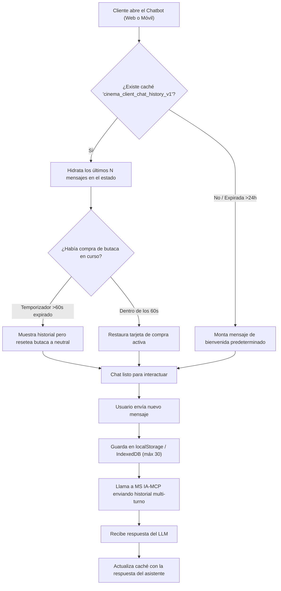

# Specification: Módulo de Evolución y Actualizaciones — CRUD Asistido por Deep Learning, Notificaciones Push y Caché de Chat IA
Status: APPROVED
Version: 3
Risk: estándar

---

## 1. Objetivo, Contexto y Alcance

### 1.1 Objetivo Medible
Consolidar el paquete de actualizaciones, mejoras funcionales y correcciones de continuidad en el ecosistema **CineV2**, abarcando:
1. La consola administrativa completa para el catálogo de películas en FrontWeb (Angular `:4200`), asistida por inferencia de **Deep Learning / Visión Artificial** en `MS MULTIMEDIA` (NestJS `:3001`) para extraer automáticamente atributos canónicos de la entidad `Movie` (género, clasificación etaria y título) y persistir el póster en **MinIO S3** (`:9000`).
2. La difusión masiva de **Notificaciones Web Push Enriquecidas (*Rich Push*)** hacia los clientes móviles (`ms/movil-client` `:5173`), desplegándose con imagen del póster en la barra de estado del sistema operativo incluso con la aplicación móvil **completamente cerrada o en segundo plano**.
3. La **persistencia en caché local y memoria multi-turno del Chat IA del Cliente** (tanto en el portal web `:5174` como en la PWA móvil `:5173`), evitando la pérdida del historial conversacional al cerrar la burbuja, navegar entre rutas o recargar la pantalla (<kbd>F5</kbd>), preservando el contexto ante el LLM (GrokCloud).

### 1.2 Contexto de Integración
- **FrontWeb Administrativo:** `ms/ms-cinema-core/frontend` (Angular 17 en `:4200`).
- **Backend Núcleo Cinematográfico:** `ms/ms-cinema-core/backend` (NestJS 10 en `:3000`).
- **Servicio de Multimedia & Deep Learning:** `ms/ms-multimedia/backend` (NestJS 10 + TensorFlow en `:3001`).
- **Almacenamiento de Objetos S3:** MinIO S3 contenedorizado en `:9000` (bucket `cinev2-media/posters/`).
- **Canal Cliente Web:** `ms/ms-ticket-auth/frontend` (React 18 + Vite en `:5174`).
- **Canal Cliente Móvil:** `ms/movil-client` (React 18 PWA + Capacitor + IndexedDB en `:5173`).
- **Backend IA & MCP:** `ms/ms-ia-mcp/backend` (FastAPI + GrokCloud en `:8001`).

### 1.3 Alcance Detallado (In Scope / Out of Scope)
* **In Scope:**
  * **Módulo A: Procesamiento de Póster por Deep Learning (MS MULTIMEDIA):**
    - Endpoint `POST /api/v1/multimedia/movies/analyze-poster` (multipart/form-data).
    - Decodificación y normalización con `sharp`.
    - Inferencia con modelo de Deep Learning (TensorFlow) para extraer atributos compatibles con `Movie`:
      * Detección y sugerencia de Género (`genre`).
      * Sugerencia de Clasificación Etaria (`rating`: `ATP`, `PG-13`, `R-16`, `R-18`).
      * Extracción de texto/título tentativo presente en el arte visual.
    - Persistencia en MinIO S3 y generación de URL pública (`posterUrl`).
    - Destrucción inmediata del tensor (`tf.dispose`) para evitar fugas de memoria en V8.
  * **Módulo B: CRUD Administrativo Completo de Películas (FRONTWEB Angular):**
    - Vista dedicada con tabla/cuadrícula interactiva de películas.
    - Modal asistente de *"Nueva Película"* con área de arrastrar y soltar (*drag & drop*) de póster.
    - Prellenado automático de campos (`genre`, `rating`, `title`) tras el análisis IA, permitiendo al Administrador revisar, ajustar o complementar la sinopsis y duración antes de confirmar.
    - Edición de películas existentes y cambio de estado (`EN_CARTELERA`, `PROXIMO_ESTRENO`, `ARCHIVADA`).
    - Archivado lógico de películas (sin eliminación destructiva física).
  * **Módulo C: Notificaciones Web Push Enriquecidas (*Rich Push*) en Segundo Plano:**
    - Generación y custodia de claves VAPID en `ms-cinema-core/backend`.
    - Registro de suscripciones de clientes móviles (`POST /api/v1/push/subscribe`).
    - Servicio de difusión masiva (*broadcast*) disparado automáticamente ante guardado de película con estado notificable (`EN_CARTELERA` o `PROXIMO_ESTRENO`).
    - Payload Web Push enriquecido que incluye la URL del póster en MinIO (`image`), título, género y clasificación.
    - Service Worker en `ms/movil-client` que despierta con la app cerrada, despliega la alerta nativa con imagen y gestiona el clic para navegación profunda hacia la cartelera.
    - Purga automática de suscripciones inválidas (HTTP 410 Gone / 404 Not Found).
  * **Módulo D: Persistencia en Caché y Memoria Multi-Turno del Chat IA del Cliente:**
    - Persistencia híbrida en `localStorage` (`ms-ticket-auth/frontend`) e `IndexedDB` (`movil-client`) bajo la clave `cinema_client_chat_history_v1`.
    - Hidratación automática de mensajes al recargar (<kbd>F5</kbd>), navegar entre pantallas o reabrir el widget/drawer.
    - Botón *"Nueva Conversación / Limpiar Chat"* en el encabezado del chat.
    - Límite de retención de los últimos 30 mensajes con expiración automática de 24 horas de inactividad.
    - Restauración segura de estado: recuperación del texto y tarjetas informativas, pero reinicio del temporizador/bloqueo de butaca si transcurrieron más de 60 segundos para evitar bloqueos fantasma.
    - Memoria multi-turno en backend: envío de los últimos turnos conversacionales hacia `ms-ia-mcp` para que GrokCloud recuerde el contexto previo.
* **Out of Scope:**
  - Envío de correos masivos (SMTP) o SMS de pago.
  - Generación sintética generativa de imágenes completas de pósteres; el modelo analiza y clasifica imágenes reales suministradas.

---

## 2. Actores y Permisos

| Actor | Canal / Interfaz | Acciones Permitidas | Restricciones y Protección Efectiva |
| :--- | :--- | :--- | :--- |
| **Administrador (`admin`)** | FrontWeb Angular (`:4200`) / REST | Subir pósteres para análisis de IA, revisar prellenado, crear, editar y archivar películas. | Requiere autenticación con JWT y rol `admin`. |
| **Cliente (`cliente`)** | Web Oficial (`:5174`) y PWA Móvil (`:5173`) | Conceder permiso de notificaciones push, recibir alertas con póster expandido en barra de estado con la app cerrada, y conversar con el chatbot conservando su historial en caché entre sesiones. | No requiere login para suscribir el navegador ni para la caché local del chat; si está autenticado, se asocia su `user_id`. |
| **Push Service del Sistema Operativo** | Dispositivo móvil / Push Service nativo | Despertar el Service Worker en segundo plano y presentar la alerta flotante nativa del sistema. | Cumple especificación RFC 8292 VAPID. |

---

## 3. Datos Funcionales e Invariantes

### 3.1 Modelo de Datos en Caché del Chat (`ClientChatCacheRecord`)
```typescript
interface ClientChatCacheRecord {
  version: 1;
  sessionId: string;
  updatedAt: string; // ISO 8601
  messages: Array<{
    id: string;
    sender: 'user' | 'assistant';
    text: string;
    timestamp: string;
    suggestedShowtimes?: any[];
    suggestedSeats?: any[];
    purchaseSummary?: any;
    confirmedTicketId?: string;
  }>;
}
```

### 3.2 Contrato del Payload de Notificación Web Push Enriquecida
```json
{
  "title": "🎬 ¡Nuevo Estreno: Dune: Parte Dos!",
  "body": "Ciencia Ficción / Aventura • Clasificación PG-13. ¡Entradas ya disponibles en cartelera!",
  "icon": "/assets/icon-192.png",
  "badge": "/assets/badge-72.png",
  "image": "http://localhost:9000/cinev2-media/posters/dune2-poster.jpg",
  "vibrate": [200, 100, 200],
  "tag": "premiere-uuid-movie-1234",
  "data": {
    "movieId": "uuid-movie-1234",
    "movieTitle": "Dune: Parte Dos",
    "genre": "Ciencia Ficción / Aventura",
    "rating": "PG-13",
    "url": "/?movie=uuid-movie-1234&tab=billboard",
    "timestamp": "2026-11-05T20:30:00Z"
  }
}
```

### 3.3 Reglas de Negocio Universales (`RB-01` a `RB-13`)

#### `RB-01` (Entrega en Segundo Plano y App Cerrada)
La notificación debe desplegarse en la barra de notificaciones del sistema operativo aun cuando la aplicación móvil esté cerrada o el dispositivo se encuentre con la pantalla bloqueada, delegando el ciclo de vida al **Service Worker** registrado por la PWA.

#### `RB-02` (Independencia de Proveedores y Estándar VAPID)
El backend debe firmar las peticiones Web Push utilizando un par de claves públicas y privadas VAPID generadas en el servidor, sin requerir SDKs cerrados ni costos de licenciamiento, preservando la portabilidad local del proyecto en contenedores Docker.

#### `RB-03` (Filtro Estricto por Estado de Publicación)
El disparo masivo de notificaciones se ejecuta única y exclusivamente cuando una película sea creada o actualizada con los estados de catálogo `EN_CARTELERA` o `PROXIMO_ESTRENO`. Las películas registradas en estado de borrador o `ARCHIVADA` quedan terminantemente excluidas del envío.

#### `RB-04` (Consentimiento Explícito y No Invasivo)
La solicitud de suscripción debe iniciarse tras una interacción deliberada del usuario o mediante un banner flotante no bloqueante que explique el beneficio (*"¿Deseas enterarte de nuevos estrenos antes que nadie?"*). Si el usuario rechaza (`Permission: denied`), el banner se oculta y no vuelve a interrumpir la navegación.

#### `RB-05` (Purga Automática de Suscripciones Inactivas)
Si un servicio Push remoto responde con código de estado HTTP `410 Gone` o `404 Not Found`, el backend debe eliminar físicamente la suscripción de su base de datos para no degradar el rendimiento en futuros envíos.

#### `RB-06` (Navegación Profunda / Deep Linking)
Al hacer clic sobre la notificación flotante en el móvil, el Service Worker debe interceptar el evento `notificationclick`, cerrar la notificación, buscar una pestaña abierta de la PWA o abrir una nueva ventana (`clients.openWindow`), redirigiendo al cliente directamente a la ficha de la película estrenada.

#### `RB-07` (Análisis de Imagen por Deep Learning previo a Persistencia)
Al cargar un póster en el modal administrativo, este debe procesarse a través de `MS MULTIMEDIA` para predecir género y rating y optimizar la imagen antes de fijar su ubicación en MinIO S3.

#### `RB-08` (Prellenado Asistido con Control y Edición Humana)
Los atributos extraídos por la IA constituyen sugerencias asistidas. El Administrador conserva siempre la potestad de corregir el título, modificar la duración, cambiar el género o alterar el rating antes de guardar definitivamente.

#### `RB-09` (Inmutabilidad de Relaciones y Archivado Lógico)
Una película asociada a funciones históricas o boletos vendidos no puede ser eliminada mediante `DELETE SQL`. Cualquier baja se efectúa mediante archivado lógico (`status = MovieStatus.ARCHIVADA`).

#### `RB-10` (Persistencia Automática e Hidratación de Chat)
Todo mensaje enviado o recibido en el chatbot del cliente debe sincronizarse de inmediato en el almacenamiento local (`localStorage` en portal web y `IndexedDB` en cliente móvil). Al montar el componente tras una recarga (<kbd>F5</kbd>) o reapertura, el chat debe restaurar los mensajes previos sin presentar pantalla en blanco ni bienvenida redundante.

#### `RB-11` (Retención, Expiración y Limpieza Manual)
La caché del chat conservará un límite máximo de los últimos 30 mensajes con un tiempo de vida (TTL) de 24 horas a partir de la última interacción. El encabezado del chat debe incluir obligatoriamente el botón *"Nueva Conversación / Limpiar Chat"*, que vacía la caché local y reanuda el estado inicial limpio.

#### `RB-12` (Restauración Segura de Bloqueo de Butacas)
Al restaurar una conversación desde la caché que contenía una selección de butaca en curso, si el temporizador de 60 segundos ya expiró, el sistema debe restaurar el texto y las recomendaciones pero restablecer el estado de compra a neutral (`NONE`), obligando a revalidar la disponibilidad para prevenir reservas fantasma.

#### `RB-13` (Memoria Multi-Turno en Backend de IA)
Al enviar un nuevo mensaje a `MS IA-MCP`, el frontend debe adjuntar los últimos turnos conversacionales relevantes (`history: [{ role, content }]`), de modo que el agente GrokCloud formule respuestas manteniendo la memoria y continuidad del diálogo.

---

## 4. Flujos, Estados y Comportamiento Observable

### 4.1 Flujo de Hidratación y Caché del Chat



---

## 5. Requisitos EARS (Easy Approach to Requirements Syntax)

* **RF-08.1 (Análisis de Póster con Deep Learning):**
  * *Requisito:* Cuando el Administrador cargue una imagen de póster en el FrontWeb Admin, el sistema debe ejecutar la inferencia de Visión/Deep Learning en `MS MULTIMEDIA`, retornar el género y rating inferidos y almacenar la imagen en MinIO S3.
  * *Reglas asociadas:* `RB-07`.

* **RF-08.2 (Prellenado Asistido en Formulario Angular):**
  * *Requisito:* Tras recibir la respuesta del análisis de póster, el FrontWeb Admin debe poblar automáticamente los campos correspondientes permitiendo su edición manual antes del envío.
  * *Reglas asociadas:* `RB-08`.

* **RF-08.3 (CRUD y Archivado de Películas):**
  * *Requisito:* El Administrador debe poder listar, filtrar, editar y archivar lógicamente películas desde el panel de Angular.
  * *Reglas asociadas:* `RB-09`.

* **RF-08.4 (Claves VAPID y Suscripción):**
  * *Requisito:* El sistema debe exponer el endpoint `GET /api/v1/push/vapid-public-key` y registrar suscripciones de dispositivos móviles mediante `POST /api/v1/push/subscribe`.
  * *Reglas asociadas:* `RB-02`, `RB-04`.

* **RF-08.5 (Disparo Automático de Estrenos):**
  * *Requisito:* Cuando una película se guarde con estado `EN_CARTELERA` o `PROXIMO_ESTRENO`, el backend debe difundir asíncronamente la notificación Web Push a los suscriptores.
  * *Reglas asociadas:* `RB-03`.

* **RF-08.6 (Notificación Enriquecida en Segundo Plano):**
  * *Requisito:* Mientras la aplicación móvil se encuentre cerrada, cuando llegue el mensaje push, el Service Worker debe desplegar la alerta nativa con la imagen del póster de MinIO, título, género y clasificación.
  * *Reglas asociadas:* `RB-01`.

* **RF-08.7 (Navegación Profunda):**
  * *Requisito:* Al hacer clic en la notificación móvil, el sistema debe abrir la PWA y posicionar la vista en la cartelera con la película estrenada.
  * *Reglas asociadas:* `RB-06`.

* **RF-08.8 (Purga de Suscripciones Obsoletas):**
  * *Requisito:* Si un Push Service devuelve error HTTP 410 o 404, el backend debe eliminar la suscripción correspondiente de la base de datos.
  * *Reglas asociadas:* `RB-05`.

* **RF-08.9 (Persistencia en Caché del Chat de Cliente):**
  * *Requisito:* Cuando el usuario envíe o reciba un mensaje en el Chatbot, el frontend debe guardar el historial en el almacenamiento local del cliente (`localStorage` / `IndexedDB`).
  * *Reglas asociadas:* `RB-10`.

* **RF-08.10 (Hidratación al Recargar o Reabrir):**
  * *Requisito:* Cuando el usuario recargue la página (<kbd>F5</kbd>) o reabra la ventana del chat, el componente debe recuperar e hidratar los mensajes previos si no han superado las 24 horas de inactividad.
  * *Reglas asociadas:* `RB-10`, `RB-11`.

* **RF-08.11 (Botón de Nueva Conversación):**
  * *Requisito:* El encabezado del chat debe proporcionar un botón de *"Nueva Conversación"* que limpie la caché local e inicialice el diálogo en blanco.
  * *Reglas asociadas:* `RB-11`.

* **RF-08.12 (Memoria Multi-Turno en IA):**
  * *Requisito:* Cuando el frontend despache una solicitud de chat a `MS IA-MCP`, debe incluir los turnos previos de la conversación para mantener la coherencia semántica del LLM.
  * *Reglas asociadas:* `RB-13`.

---

## 6. Criterios de Aceptación y Escenarios BDD

### Escenario 1: Análisis de póster con Deep Learning y prellenado asistido
```gherkin
SC-08.1.1 -> RF-08.1, RF-08.2
Dado que el Administrador accede a la consola de "Películas" en el panel de Angular (:4200)
Y abre el modal "Registrar Nueva Película"
Cuando sube el archivo de imagen de póster de "Dune 2"
Entonces el servicio MS MULTIMEDIA procesa la imagen con Deep Learning
Y almacena el archivo en MinIO S3 en el bucket "cinev2-media/posters/"
Y el formulario en Angular prellena automáticamente el campo Género con "Ciencia Ficción"
Y sugiere el Rating "PG-13" manteniendo habilitada la edición manual.
```

### Escenario 2: Notificación Push Enriquecida en segundo plano (App Cerrada)
```gherkin
SC-08.2.1 -> RF-08.5, RF-08.6
Dado que un cliente móvil autorizó notificaciones en "http://localhost:5173"
Y la PWA móvil se encuentra cerrada en el teléfono
Cuando el Administrador guarda la película "Dune 2" en estado "EN_CARTELERA"
Entonces el backend de Cinema-Core emite el mensaje Web Push VAPID
Y el Service Worker del cliente despierta en segundo plano
Y se muestra en la barra de estado la notificación del sistema con el póster de MinIO expandido
Y el texto "🎬 ¡Nuevo Estreno: Dune 2! Ciencia Ficción • PG-13".
```

### Escenario 3: Filtro de películas archivadas sin envío de push
```gherkin
SC-08.3.1 -> RF-08.5
Dado que existen clientes móviles suscritos
Cuando el Administrador registra o edita una película en estado "ARCHIVADA"
Entonces el sistema NO ejecuta ningún envío de notificación Web Push
Y el contador de alertas despachadas permanece en 0.
```

### Escenario 4: Navegación profunda al pulsar la notificación enriquecida
```gherkin
SC-08.4.1 -> RF-08.7
Dado que el cliente tiene visible la notificación de "Dune 2" en su barra de estado
Cuando el usuario toca la notificación
Entonces la notificación se descarta automáticamente
Y el navegador abre la PWA móvil en la ruta "/?movie=uuid-dune-2&tab=billboard"
Desplegando la cartelera con el detalle de "Dune 2" y sus horarios de función.
```

### Escenario 5: Archivado lógico de película con funciones previas
```gherkin
SC-08.5.1 -> RF-08.3
Dado que una película cuenta con funciones registradas o boletos asociados
Cuando el Administrador selecciona la opción "Archivar Película"
Entonces el sistema actualiza su estado a "ARCHIVADA" en la base de datos
Y la película desaparece de la cartelera pública
Sin ejecutar eliminación destructiva (DELETE) en la tabla de películas.
```

### Escenario 6: Hidratación del chat tras recargar la página (F5)
```gherkin
SC-08.6.1 -> RF-08.9, RF-08.10
Dado que el cliente mantuvo una conversación de 4 mensajes con el Asistente en el portal web
Cuando el usuario presiona F5 o cierra y reabre la burbuja del chat
Entonces el componente recupera el historial de "cinema_client_chat_history_v1" desde localStorage
Y renderiza los 4 mensajes previos con sus respectivas tarjetas
Sin disparar un nuevo mensaje de bienvenida repetido.
```

### Escenario 7: Limpieza manual y nueva conversación
```gherkin
SC-08.7.1 -> RF-08.11
Dado que el cliente tiene un historial activo en el chat
Cuando pulsa el botón "Nueva Conversación" en el encabezado
Entonces el almacenamiento en caché local es purgado
Y la vista del chat se reinicia mostrando únicamente el saludo inicial.
```

---

## 7. Integraciones, Efectos y Requisitos de Calidad

1. **Rendimiento y Memoria:**
   - Inferencia en `MS MULTIMEDIA` con liberación obligatoria de tensores `tf.dispose(imageTensor)`.
   - Límite estricto de 30 mensajes en la caché del chat para no degradar el almacenamiento de `localStorage` ni desbordar la ventana de tokens de GrokCloud.
2. **Seguridad y Privacidad:**
   - Clave privada VAPID custodiada en variables de entorno del backend.
   - El historial de chat almacenado en el cliente no contiene datos sensibles de tarjetas de crédito (Stripe procesa pagos mediante tokens aislados).
3. **Resiliencia ante Expiración de Compra:**
   - El restablecimiento de selecciones de butacas expiradas previene estados inconsistentes o bloqueos fantasma en `MS CINEMA-CORE`.

---

## 8. Registro de Inferencias y Decisiones

| ID | Hallazgo / Dimensión | Clasificación | Origen / Razonamiento | Decisión Tomada |
| :--- | :--- | :--- | :--- | :--- |
| **INF-01** | Notificaciones con la aplicación cerrada | **HECHO** | Requerimiento explícito del usuario. | Uso obligatorio de **Web Push API estándar + Service Worker**. |
| **INF-02** | Dependencia de infraestructura y costos | **DERIVADO** | `docs/constitution.md` prohíbe dependencias de pago en la nube pública. | Uso de **RFC 8292 VAPID** con la librería `web-push`, sin cuentas comerciales. |
| **INF-03** | Atributos a procesar con Deep Learning | **HECHO** | Instrucción explícita del usuario: *"extraer atributos que ya existen en el proyecto respecto a la clase pelicula y sus relaciones"*. | Extracción de **Género (`genre`)**, **Rating etario (`rating`)**, texto tentativo, y subida de **`posterUrl` a MinIO S3**. |
| **INF-04** | Experiencia en el FrontWeb Admin | **ACORDADO (/grill-me)** | Confirmado por el usuario en la entrevista. | **Asistente interactivo en Angular**: la IA prellena los campos en el modal y el Admin valida/ajusta antes de guardar. |
| **INF-05** | Responsabilidad de Deep Learning y MinIO | **ACORDADO (/grill-me)** | Confirmado por el usuario en la entrevista. | **MS MULTIMEDIA (NestJS :3001)** procesa la imagen con TensorFlow y persiste en MinIO S3 (:9000). |
| **INF-06** | Tipo de notificación Push | **ACORDADO (/grill-me)** | Confirmado por el usuario en la entrevista. | **Notificación Push Enriquecida (*Rich Push*)** con la imagen del póster de MinIO y atributos en la alerta nativa del móvil. |
| **INF-07** | Alcance del CRUD en Angular | **ACORDADO (/grill-me)** | Confirmado por el usuario en la entrevista. | **CRUD Administrativo Completo** con tabla/cuadrícula, modal asistente de IA, edición y archivado lógico. |
| **INF-08** | Persistencia del Chat en Caché | **HECHO** | Requerimiento de usuario + conversación `b70c0b42-2db8-4318-8f81-4de9dc459ad3`. | Caché híbrida en **localStorage / IndexedDB** + memoria multi-turno en **MS IA-MCP**. |
| **INF-09** | Ubicación documental de la spec | **HECHO** | Instrucción del usuario: *"solo en el 08, ya que este spec se basa en arreglos, actualizaciones y bugs"*. | Formalizado de manera unificada en **`docs/specs/08-movie-premiere-notifications/spec.md`**. |
| **INF-10** | Retención y limpieza de chat | **ACORDADO (/grill-me)** | Confirmado por el usuario en la entrevista. | Límite de **30 mensajes**, **TTL de 24 horas** y botón de **"Nueva Conversación"**. |
| **INF-11** | Manejo de compra pendiente en caché | **ACORDADO (/grill-me)** | Confirmado por el usuario en la entrevista. | Restaurar texto, pero **reiniciar bloqueo de butaca si expiró el temporizador de 60s**. |

---

## 9. Trazabilidad y Pendientes

- **Objetivo Macro:** Módulo integral de evolución: CRUD asistido por Deep Learning, Rich Push en segundo plano y Caché del Chat IA.
- **Trazabilidad:** `OBJ-EVOL-01` $\rightarrow$ `RB-NOTIF-01..06`, `RB-MOVIE-01..03`, `RB-CHAT-CACHE-01..04` $\rightarrow$ `RF-08.1..08.12` $\rightarrow$ `SC-08.1.1..SC-08.7.1`.
- **Pendientes:**
  - Ninguno. La especificación cubre todos los requerimientos funcionales, acuerdos del grill-me y casos de borde. Lista para revisión formal.