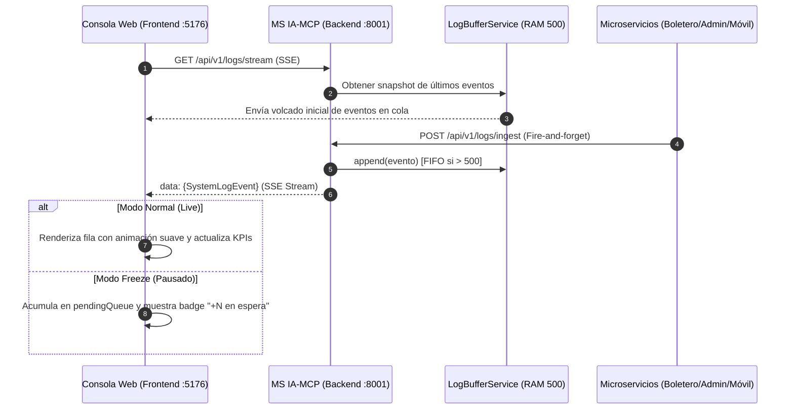

# Plan: Bitácora Unificada y Monitoreo en Tiempo Real (Consola IA-MCP)
Status: APPROVED
Version: 1
Spec-SHA256: 8babcad9870acb9d005097fb9b427231cebbcb1f012fa2271e6f28856ce0923f
Constitution-SHA256: bf9282dc4cc5ac79d835e768865b29b9544a02c8cd2af2489d72cfc304cb8e84

## 1. Arquitectura y decisiones

### 1.1 Decisiones Arquitectónicas (PLAN)
- **PLAN-01 (Buffer Circular en Memoria y Streaming SSE en FastAPI):**  
  Implementar un servicio en memoria `LogBufferService` utilizando `collections.deque(maxlen=500)` de Python para garantizar tiempo constante $O(1)$ de inserción y desalojo FIFO. La transmisión en vivo hacia la consola web se implementará mediante Server-Sent Events (SSE) con `StreamingResponse(media_type="text/event-stream")` en `GET /api/v1/logs/stream`, aprovechando el soporte nativo asíncrono de `asyncio.Queue` por cada cliente conectado sin requerir librerías externas pesadas de WebSockets.
- **PLAN-02 (Endpoint Unificado de Ingesta Asíncrona):**  
  Exponer `POST /api/v1/logs/ingest` en `ms-ia-mcp/backend` tipado estrictamente con Pydantic (`SystemLogEvent`). Los eventos recibidos se sanitizan, se agregan al buffer circular y se despachan de forma concurrente a las colas de todos los auditores conectados en vivo.
- **PLAN-03 (Consola Reactiva Multidimensional en Frontend):**  
  Extender `ms/ms-ia-mcp/frontend/src/components/AuditMonitorConsole.tsx` para incorporar la pestaña `'logs'` junto con un nuevo componente modular `SystemLogStreamView.tsx`. Este componente orquesta:
  1. Conexión nativa con la API de navegador `EventSource` hacia `/api/v1/logs/stream` con reconexión automática.
  2. Acumulador de estado para *Freeze Mode* (Pausa/Reanudar) para evitar desplazamientos forzados cuando el auditor analiza un registro.
  3. Filtrado instantáneo en memoria por Actor (`BOLETERO`, `CLIENTE_WEB`, `CLIENTE_MOVIL`, `ADMIN`, `SISTEMA_IA`), Severidad (`INFO`, `SUCCESS`, `WARN`, `ERROR`) y término de búsqueda libre.
  4. Tarjetas de métricas en tiempo real (KPIs de cabecera).
  5. Acordeón para inspeccionar el payload JSON formateado y botón de copiado.
  6. Exportador cliente a archivos `.json` y `.csv`.
- **PLAN-04 (Telemetría Distribuida no Bloqueante en Microservicios):**  
  Diseñar clientes ligeros de telemetría HTTP asíncronos (*fire-and-forget* con timeout de 500 ms y captura silenciosa de excepciones) en:
  - `ms-boleteo-validator`: emisión en validaciones de boleto y alertas de intento de doble ingreso (409).
  - `ms-cinema-core`: emisión en creación y archivado lógico (PATCH) de películas.
  - `ms-ticket-auth`: emisión en compras y reservas confirmadas.
  - `movil-client`: emisión en eventos PWA, activación de VAPID y descargas offline en IndexedDB.

---

## 2. Alcance físico de cambios

```
ms/ms-ia-mcp/backend/
├── app/
│   ├── domain/
│   │   └── models.py                        # MODIFY: DTO SystemLogEvent y SeverityLevel
│   ├── infrastructure/
│   │   └── log_buffer_service.py             # CREATE: Buffer circular deque(500) y colas SSE
│   └── presentation/
│       └── log_routes.py                    # CREATE: Endpoints /api/v1/logs/ingest y stream
├── tests/
│   └── test_system_logs_stream.py           # CREATE: Tests de ingesta, buffer circular y SSE
└── main.py                                  # MODIFY: Registro de log_routes router

ms/ms-ia-mcp/frontend/
├── src/
│   ├── components/
│   │   ├── AuditMonitorConsole.tsx          # MODIFY: Integración de tab 'logs'
│   │   └── SystemLogStreamView.tsx          # CREATE: Componente de bitácora en tiempo real
│   ├── types/
│   │   └── system-logs.types.ts             # CREATE: Tipos TypeScript para logs y KPIs
│   └── tests/
│       └── SystemLogStreamView.spec.tsx     # CREATE: Pruebas unitarias de filtros, freeze y KPIs
```

---

## 3. Persistencia e integraciones

- **Esquema de Datos:** No se requieren tablas físicas de base de datos ni migraciones ORM (conforme a la decisión de alcance acordada).
- **Buffer en RAM:** `collections.deque(maxlen=500)` administra automáticamente el límite superior de memoria (< 5 MB).
- **Concurrencia:** Inserción protegida mediante bucle de eventos de `asyncio`. Distribución tipo pub/sub con `Set[asyncio.Queue]`.
- **Rollback y Resiliencia:** Si la consola web se desconecta, el backend purga automáticamente la `asyncio.Queue` del cliente para evitar fugas de memoria. Si el backend de logs se detiene, los microservicios continúan operando con normalidad.

---

## 4. Contratos frontend/backend

### 4.1 Ingesta de Eventos
- **Método / Ruta:** `POST /api/v1/logs/ingest`
- **Headers:** `Content-Type: application/json`
- **Request Body (JSON):**
  ```json
  {
    "sourceService": "ms-boleteo-validator",
    "actorRole": "BOLETERO",
    "actionType": "TICKET_SCAN_SUCCESS",
    "severity": "SUCCESS",
    "summary": "Boleto #b1110001 escaneado exitosamente en Sala 1",
    "metadata": {
      "ticketId": "b1110001-2026-4000-8000-000000000001",
      "seatCode": "C-8",
      "hallName": "Sala 1 - IMAX Laser"
    }
  }
  ```
- **Response (201 Created):**
  ```json
  {
    "status": "INGESTED",
    "eventId": "log-7f3b8a1c-...",
    "timestamp": "2026-11-07T16:45:00.000Z"
  }
  ```

### 4.2 Stream de Bitácora (SSE)
- **Método / Ruta:** `GET /api/v1/logs/stream`
- **Headers de Respuesta:** `Content-Type: text/event-stream; charset=utf-8`, `Cache-Control: no-cache`
- **Payload Evento SSE (`event: log_event`):**
  ```
  data: {"id":"log-01","timestamp":"2026-11-07T16:45:00Z","sourceService":"ms-cinema-core","actorRole":"ADMIN","actionType":"MOVIE_CREATED","severity":"SUCCESS","summary":"Película 'Gladiador II' creada en cartelera","metadata":{"title":"Gladiador II","durationMinutes":148}}
  ```

### 4.3 Consulta Histórica de Respaldo
- **Método / Ruta:** `GET /api/v1/logs/history?limit=100`
- **Response (200 OK):** `List[SystemLogEvent]` con los registros almacenados en el buffer circular.

---

## 5. Flujos y estados



---

## 6. Diseño visual e interacción

- **Estilo Base:** Tema oscuro Slate 950 con tarjetas translúcidas `bg-slate-900/80` y bordes sutiles `border-slate-800`.
- **Paleta Cromática de Severidad (Tokens):**
  - `SUCCESS`: Fondo `bg-emerald-950/60`, texto `text-emerald-300`, borde `border-emerald-500/40`.
  - `INFO`: Fondo `bg-sky-950/60`, texto `text-sky-300`, borde `border-sky-500/40`.
  - `WARN`: Fondo `bg-amber-950/60`, texto `text-amber-300`, borde `border-amber-500/40`.
  - `ERROR`: Fondo `bg-rose-950/60`, texto `text-rose-300`, borde `border-rose-500/40`.
- **Badges de Actores:**
  - `BOLETERO`: `text-purple-400 bg-purple-950/40 border-purple-500/30`
  - `CLIENTE_WEB`: `text-cyan-400 bg-cyan-950/40 border-cyan-500/30`
  - `CLIENTE_MOVIL`: `text-teal-400 bg-teal-950/40 border-teal-500/30`
  - `ADMIN`: `text-amber-400 bg-amber-950/40 border-amber-500/30`
  - `SISTEMA_IA`: `text-indigo-400 bg-indigo-950/40 border-indigo-500/30`
- **Acordeón JSON:** Bloque tipográfico `font-mono text-xs bg-slate-950 p-3 rounded-lg border border-slate-800 text-slate-300` con resaltado de sintaxis y botón `Copiar JSON`.
- **Responsive:** En pantallas móviles (< 640px) los filtros se organizan en scroll horizontal deslizable y la tabla se adapta a tarjetas verticales tipo feed.

---

## 7. Vertical slices

- **Slice 1: Infraestructura de Ingesta y Streaming en Backend (PLAN-01, PLAN-02)**  
  Implementar `LogBufferService` con buffer circular `deque(500)` y endpoints `/api/v1/logs/ingest`, `/api/v1/logs/stream` y `/api/v1/logs/history`.
- **Slice 2: Componente Frontend de Bitácora y Conexión en Tiempo Real (PLAN-03)**  
  Crear pestaña `LOG` en `AuditMonitorConsole.tsx` y componente `SystemLogStreamView.tsx` conectado vía SSE con visualización fluida de eventos.
- **Slice 3: Barra de Herramientas, Filtros, Freeze Mode y Métricas KPIs (PLAN-03, PLAN-04)**  
  Implementar filtrado combinado por Actor/Severidad, control de congelamiento de pantalla, buscador de texto libre y cálculo de métricas de cabecera.
- **Slice 4: Inspección de Detalle JSON y Exportación CSV/JSON (PLAN-03, PLAN-05)**  
  Desarrollar visor acordeón de metadatos expandible y utilidades de descarga en archivos `.csv` y `.json`.
- **Slice 5: Integración de Telemetría desde Microservicios Emisores (PLAN-04)**  
  Conectar la emisión no bloqueante de eventos clave desde `ms-boleteo-validator`, `ms-cinema-core`, `ms-ticket-auth` y `movil-client`.

---

## 8. Verificación

```bash
# Backend (FastAPI / pytest)
python -m pytest ms/ms-ia-mcp/backend/tests/test_system_logs_stream.py

# Frontend (React 18 / Vitest)
npm test --prefix ms/ms-ia-mcp/frontend -- src/tests/SystemLogStreamView.spec.tsx
```

---

## 9. Trazabilidad y riesgos

### Matriz de Cobertura
- `RF-09.1`, `RF-09.2`, `SC-09.1.1` $\rightarrow$ PLAN-01, PLAN-03 (Slice 1, Slice 2)
- `RF-09.3`, `RF-09.4`, `SC-09.2.1`, `SC-09.2.2`, `SC-09.3.1`, `SC-09.6.1` $\rightarrow$ PLAN-02, PLAN-04 (Slice 1, Slice 5)
- `RF-09.5`, `RF-09.6`, `RF-09.7`, `SC-09.4.1`, `SC-09.5.1` $\rightarrow$ PLAN-03, PLAN-04 (Slice 3)
- `RF-09.8`, `RF-09.9`, `SC-09.7.1` $\rightarrow$ PLAN-03, PLAN-05 (Slice 4)

### Análisis de Riesgos
- **Riesgo 1:** Sobrecarga de memoria en navegadores de clientes abiertos durante horas con miles de eventos.  
  *Mitigación:* El frontend mantiene un límite estricto de 250 elementos renderizados simultáneamente en el DOM, descartando los más viejos de la vista activa.
- **Riesgo 2:** Caída de red o desconexión SSE.  
  *Mitigación:* Reintento con backoff exponencial y opción de recarga manual con fallback a `/api/v1/logs/history`.
